# Implementation plan

This plan orders the work that turns the [research](../research/README.md),
the [decision records](../research/decisions/README.md) and the
[architecture options](../research/architecture-options/README.md) into a
working infraweave. The decision records say *what* infraweave does and *why*;
report [26](../research/reference/26-scope-and-tiers.md) says *which* capabilities are in scope. This file says in
which *order* they are built, the *tasks* each phase holds and the *exit
criteria* that must hold before a phase counts as done.

Every phase is also subject to the [definition of done](definition-of-done.md).
The target package tree is in [repo-layout.md](repo-layout.md), every
feature's kind, seeded tier and owning phase is in the
[feature catalogue](../data/features.json), which the
[capability roadmap](capability-roadmap.md) explains, and every deliberate difference
from Spacelift is in the [deviations register](../data/deviations.json),
which [deviations.md](deviations.md) explains. Research
baseline: **2026-10-28**. Implementation status is reviewed against `main`
and the GitHub issues on the same date.

Decisions 0001 to 0024 are Accepted, and this plan builds them. Where a
decision marks a behaviour as infraweave's choice until a capture of report
[30](../research/reference/30-open-questions.md) settles it, the phase builds
the choice and its scenarios assert it; P28 replays the captures, and the
[deviations a capture may change](deviations.md#deviations-a-capture-may-change)
are the records that can move.

## Scope direction

- **Everything Spacelift offers is in scope**: Deploy at every tier,
  Intelligence (AI integrations, Infra Assistant, Intent and MCP), Flows and
  the console. The scope rule and the supersession test are decision
  [0021](../research/decisions/0021-capability-scope-and-supersession.md)'s. An interface is left out only when it passes that test,
  with its replacement, evidence, coverage of the original use and the path
  for stored data recorded in report 26 section 7; the
  [supersession register](capability-roadmap.md#supersession-register) lists
  every such interface.
- **Seeded tiers, billing off by default.** Every feature is an entry of one
  catalogue, [docs/data/features.json](../data/features.json), from which
  `make generate` writes `internal/features/catalogue.gen.go`: a capability,
  an option or a limit. Five tiers (Free, Starter, Starter+, Business and Enterprise) are
  seeded from report 26, and the operator can add its own. Billing is off
  by default, so every organization behaves as Enterprise: `tier` answers the
  Enterprise tier object, `tierFeatures` lists every feature not in
  `features.disabled`, and no limit applies. With billing on, a feature
  outside the organization's entitlement answers `403 feature-not-in-tier`,
  and a limit, pooled across the organization's accounts, answers
  `403 limit-reached`
  ([0021](../research/decisions/0021-capability-scope-and-supersession.md),
  [0022](../research/decisions/0022-api-errors-and-update-semantics.md), P3b).
- **Root, organization, account, spaces.** `root` is the installation's
  top node: only operators act on it, and it holds nothing but
  organizations. An organization is a customer's agreement: its tier and
  grants, limits pooled across its accounts, its members and its identity
  providers. An account is a separate business entity and the data
  boundary: its spaces, stacks, runs, state and secrets are invisible to
  every other account, and its top space is addressed by its immutable
  slug. Nothing inherits from root or from the organization. Members
  authenticate at the organization and are authorized per account by the
  account's `LOGIN` policies. Organization admins manage accounts, members
  and limits through the served `Organization` tag, outside the parity
  surface; the operator API keeps the installation-level actions
  ([0006](../research/decisions/0006-authentication-and-tokens.md),
  [0007](../research/decisions/0007-authorization-spaces-and-roles.md),
  [0021](../research/decisions/0021-capability-scope-and-supersession.md),
  P3, P3b, P4, P13b, P23).
- **infraweave's own names.** No served operationId, schema, property, enum
  value, header, environment variable, policy input key or description
  contains "spacelift". Decision 0001's rename table maps each reference name that
  does to its infraweave name, such as `spaceliftAwsAccountId` to
  `installationAwsAccountId`, and "root admin" becomes "account admin";
  `TestUnitServedNames` checks every served bundle against both from P1c.
- **REST, not GraphQL.** The served API is REST over JSON described by
  OpenAPI 3 ([0001](../research/decisions/0001-rest-first-spacelift-surface.md), [0003](../research/decisions/0003-api-conventions.md), [0022](../research/decisions/0022-api-errors-and-update-semantics.md)). The Spacelift reference
  `api/reference/spacelift/spacelift.openapi.yaml` is the parity oracle; the
  served documents are `api/deploy.openapi.yaml`, `api/flows.openapi.yaml`
  and the operator API's `api/operator.openapi.yaml`. Each difference is
  recorded in `x-infraweave-divergence` and in the
  [deviations register](../data/deviations.json).
- **infraweave's own clients.** `pkg/sdk` wraps the generated
  `pkg/client/<spec>` packages and is the only way infraweave's Go clients
  call the API ([0001](../research/decisions/0001-rest-first-spacelift-surface.md)). It lands in P1c, where every acceptance step
  drives the API through it, and gains the token exchange in P3.
  `infraweavectl` starts in P3b with its `operator` group and covers
  report 06 section 8 and Flows in P24b; infraweave's provider is P24 and the
  console ([0023](../research/decisions/0023-console.md)) is P24c. Each is held to a parity oracle
  ([0016](../research/decisions/0016-testing-and-acceptance.md)).
- **One event model.** Deploy and Flows share decision
  [0015](../research/decisions/0015-events-notifications-webhooks-audit.md)'s event envelope and emit path from the queue phase on: P2c's
  outbox writes the `events` rows that P18 fans out and that the Flows
  engine consumes ([0018](../research/decisions/0018-flows-runtime.md)). Flows therefore follows the events phase
  directly, as P18c and P18d.
- **One expression language.** Every expression a user writes is CEL
  ([0024](../research/decisions/0024-expression-language.md)). `internal/platform/expr` and the expression endpoints land in
  P6 with environment interpolation, the first surface that uses them; each
  later surface adds its context in its own phase.
- **FIPS from the start.** The `fips-only` CI job runs `make test` and
  every acceptance partition under `GOFIPS140=certified` and
  `GODEBUG=fips140=only` from P2b, where the keyring and the object store drivers land
  ([0013](../research/decisions/0013-secrets-at-rest.md), [0016](../research/decisions/0016-testing-and-acceptance.md)).
- **Self-hosted, with SaaS behaviour.** infraweave is installed by its
  operator but mirrors SaaS: it keeps the Azure integration, an optional
  public worker pool and an optional installation AI default, and no
  capability depends on the public worker pool ([0021](../research/decisions/0021-capability-scope-and-supersession.md)).
- **Evidence over claims.** A capability is `implemented` only when decision
  [0016](../research/decisions/0016-testing-and-acceptance.md)'s evidence rule holds: every operation is served, answers
  something other than 501, and is named by passing `@op:` scenarios for a
  success, a denial and a failure. The state of each record of
  [capabilities.json](../data/capabilities.json) follows the tests through
  `specref parity --states --check`, never the other way round.

## Open items

These have no decision. The plan builds what does not depend on the answer
and invents no answer.

| Item | State | What the plan does meanwhile |
|---|---|---|
| Where the provider's checks run | Decision [0001](../research/decisions/0001-rest-first-spacelift-surface.md) places the provider's source in `weaveplatform/terraform-provider-infraweave`; decision [0016](../research/decisions/0016-testing-and-acceptance.md) defines `provider-parity` and `TestAccProvider` against a live `infraweave all` and lists the job in this repository's CI | P24 builds the provider in its own repository over `pkg/sdk`, and keeps `api/reference/provider-parity.yaml` and the `test/terraform/` configurations in this repository, which builds the provider at a pinned commit |
[feature catalogue](../data/features.json), which the
[capability roadmap](capability-roadmap.md) explains, and every deliberate difference
from Spacelift is in the [deviations register](../data/deviations.json),
which [deviations.md](deviations.md) explains. Research

## Build status

Updated as phases land. "Done" means the exit criteria hold, `make gate`
passes with merged coverage of at least 95% in total and 90% per package,
and lint is clean.

| Phase | Status | Notes |
|---|---|---|
| P0 Specification reference | Done | [#5](https://github.com/weaveplatform/infraweave/issues/5): the Spacelift reference spec, its coverage report, the Bruno and Terraform provider enrichment and `make verify-reference` |
| P1 Served API skeleton | Done | Epic [#8](https://github.com/weaveplatform/infraweave/issues/8). Done: [#9](https://github.com/weaveplatform/infraweave/issues/9) bundling, [#10](https://github.com/weaveplatform/infraweave/issues/10) decision 0003 and the convention components, [#12](https://github.com/weaveplatform/infraweave/issues/12) scaffolding with Stacks seeded, [#13](https://github.com/weaveplatform/infraweave/issues/13) the strict chi server, client and 501 stubs, [#14](https://github.com/weaveplatform/infraweave/issues/14) `infraweave serve`, [#11](https://github.com/weaveplatform/infraweave/issues/11) the parity report, [#15](https://github.com/weaveplatform/infraweave/issues/15) rate limits and idempotency |
| P1b Domain layout and depguard | Not started | |
| P1c Test harness, SDK and parity tooling | Not started | **M1** |
| P2 PostgreSQL, migrations and operability | Not started | |
| P2b Object storage and secrets at rest | Not started | |
| P2c Work queue, cron, outbox and the event model | Not started | |
| P3 Identity and tokens | Not started | |
| P3b Organizations, members, account settings and the feature catalogue | Not started | |
| P4 Spaces and authorization | Not started | |
| P4b Roles and role bindings | Not started | |
| P5 Stacks | Not started | **M2** |
| P6 Contexts, configuration and expressions | Not started | |
| P7 Run state machine and scheduling | Not started | |
| P8 Worker protocol, private pools and the Docker launcher | Not started | |
| P8b Managed state backend | Not started | |
| P9 First tracked run end to end | Not started | **M3** |
| P10 Run lifecycle completeness | Not started | |
| P11 State management | Not started | |
| P12 VCS integrations: GitHub | Not started | |
| P13 Policy engine and workflow policies | Not started | **M4** |
| P13b Login, task and initialization policies, sampling and simulation | Not started | |
| P14 Public worker pool, Kubernetes workers and signed runs | Not started | |
| P15 Cloud integrations and OIDC federation | Not started | |
| P16 Scheduling, drift detection and stack dependencies | Not started | |
| P17 Module registry | Not started | |
| P17b Provider registry and GPG keys | Not started | |
| P18 Notifications, webhooks, Slack and event streams | Not started | |
| P18b Audit trail and observability | Not started | **M5** |
| P18c Flows engine and API | Not started | |
| P18d Flows apps, agents and Deploy blocks | Not started | **M6** |
| P19 VCS providers: GitLab, Bitbucket and Azure DevOps | Not started | |
| P19b VCS agent pools and other source providers | Not started | |
| P20 Other vendors | Not started | |
| P20b Ansible, OpenTofu migration and plugins | Not started | |
| P21 Blueprints, templates and external integrations | Not started | |
| P22 Resources, search and console support | Not started | |
| P22b Scans | Not started | **M7** |
| P23 Organization identity providers, SCIM and MFA | Not started | |
| P24 infraweave Terraform provider | Not started | |
| P24b infraweavectl | Not started | **M8** |
| P24c Console | Not started | **M9** |
| P25 AI integrations, Infra Assistant and MCP | Not started | |
| P25b Intent | Not started | **M10** |
| P27 Reference deployments and packaging | Not started | **M11** |
| P28 Capture replay and qualification | Not started | **M12** |

## Milestones

| Milestone | Reached after | Demonstrable outcome |
|---|---|---|
| M1 Walking skeleton | P1c | `infraweave serve`, built with `-cover`, runs as a subprocess under godog and every step drives it through `pkg/sdk`; every reference operation is classified served, served with divergence, superseded or missing by `make verify-parity`; depguard enforces the domain layout |
| M2 Authorized API on PostgreSQL | P5 | An operator creates an organization with its first account, and an organization admin adds a second account whose data the first cannot see; an API key exchanges for a token that works in its own account only; spaces and roles decide every route; a feature in `features.disabled` answers `403 feature-disabled`; a stack is created, read, replaced with `PUT`, merged with `PATCH`, locked, searched and deleted, and survives a restart and a second `serve` replica |
| M3 First run | P9 | `runs_terraform.feature` and `runs_tofu.feature`: a tracked run on a private Docker worker fetches its source, plans, waits for `runConfirm`, applies through the managed state backend into the object store, masks a secret in its log and reaches `FINISHED` |
| M4 GitOps loop | P13 | Option 5's walkthrough holds end to end against Gitea: a push opens a proposed run, a plan policy warns, the check and the pull request comment appear, and an approval policy holds a tracked run until a review |
| M5 Deploy core | P14, P15, P16, P17b and P18b | Public worker pool and Kubernetes workers, cloud credentials through OIDC, schedules, drift detection, stack dependencies, the module and provider registries, notifications, webhooks, Slack, the event streams, the audit trail and the per-account metrics all pass their features |
| M6 Flows | P18d | A flow's Deploy trigger block reacts to a real run and a Trigger Run block starts another; a Go app built on `pkg/flows/appsdk` runs on a Flows agent; every expression in the flow is CEL |
| M7 Ecosystem | P19b, P21 and P22b | Every VCS provider, VCS agent pools, every vendor of report 20, blueprints and templates, the resources view, generic search, the console-support operations and scans pass their features |
| M8 Identity and clients | P24b | SAML and OIDC identity providers at the organization, SCIM, MFA and identity linking work, and each account's login policies decide who enters it; infraweave's provider passes schema parity and apply, empty plan, import, empty plan and destroy for every resource that is not superseded, Flows resources included; `infraweavectl` covers report 06 section 8 and its `flows` group covers `flowctl` |
| M9 Console | P24c | The console, embedded in `infraweave`, passes every Playwright journey against a real `infraweave all` with no CSP, other-origin or accessibility violation |
| M10 Intelligence | P25b | AI integrations, Infra Assistant, the hosted `/mcp` server and Intent work against recorded providers |
| M11 Release | P27 | Signed binaries, images, the Helm charts, the Compose file and the Terraform modules install infraweave; an upgrade from the previous release runs both versions against one database |
| M12 Qualified | P28 | Every capture of report 30 is replayed or recorded as unobtainable; report 26 has no row in `missing` or `partial` |

## Sequence

```mermaid
flowchart LR
  P0[P0 Reference] --> P1[P1 Served skeleton]
  P1 --> P1b[P1b Domain layout]
  P1b --> P1c[P1c Harness and SDK]
  P1c --> P2[P2 PostgreSQL]
  P2 --> P2c[P2c Queue, outbox and events]
  P2c --> P2b[P2b Objects and secrets]
  P2b --> P3[P3 Identity]
  P3 --> P3b[P3b Organizations and features]
  P3 --> P4[P4 Spaces and authz]
  P4 --> P5[P5 Stacks]
  P5 --> P4b[P4b Roles and bindings]
  P3b --> P4b
  P5 --> P6[P6 Configuration and expressions]
  P5 --> P7[P7 Run machine]
  P7 --> P8[P8 Workers]
  P6 --> P8
  P8 --> P8b[P8b State backend]
  P6 --> P9[P9 First run]
  P8b --> P9
  P9 --> P10[P10 Run lifecycle]
  P10 --> P11[P11 State management]
  P10 --> P12[P12 GitHub]
  P12 --> P13[P13 Policies]
  P13 --> P13b[P13b Login and other policies]
  P4b --> P13b
  P13 --> P14[P14 Public worker pool and Kubernetes]
  P9 --> P15[P15 Cloud and OIDC]
  P10 --> P16[P16 Schedules and dependencies]
  P13 --> P17[P17 Module registry]
  P15 --> P17
  P17 --> P17b[P17b Provider registry]
  P13 --> P18[P18 Events, webhooks and streams]
  P18 --> P18b[P18b Audit and observability]
  P18 --> P18c[P18c Flows engine]
  P4b --> P18c
  P18c --> P18d[P18d Flows apps and agents]
  P21 --> P18d
  P12 --> P19[P19 Other VCS providers]
  P19 --> P19b[P19b VCS agents and sources]
  P11 --> P20[P20 Vendors]
  P20 --> P20b[P20b Ansible and plugins]
  P16 --> P21[P21 Templates]
  P20b --> P22[P22 Resources and search]
  P22 --> P22b[P22b Scans]
  P14 --> P22b
  P13b --> P23[P23 Identity providers and SCIM]
  P23 --> P24[P24 Provider]
  P21 --> P24
  P22b --> P24
  P19b --> P24
  P18b --> P24
  P18d --> P24
  P17b --> P24
  P15 --> P24
  P25 --> P24
  P24 --> P24b[P24b infraweavectl]
  P24b --> P24c[P24c Console]
  P18d --> P24c
  P25b --> P24c
  P15 --> P25[P25 AI and MCP]
  P3b --> P25
  P25 --> P25b[P25b Intent]
  P14 --> P25b
  P24c --> P27[P27 Packaging]
  P25b --> P27
  P27 --> P28[P28 Qualification]
```

The chart shows the main edges; each phase's **Depends on** line is the full
list. Numbering does not serialize independent work: a phase starts as soon as
the phases it depends on are done.

**Critical path:** P0 → P1 → P1b → P1c → P2 → P2c → P2b → P3 → P4 → P5 → P7 →
P8 → P8b → P9 → P10 → P11 → P20 → P20b → P22 → P22b → P24 → P24b → P24c →
P27 → P28, the longest chain of **Depends on** edges (24 edges). P6 ties with
P7 between P5 and P8. From P10 to P24, the Flows chain
(P12 → P13 → P18 → P18c → P18d) ties with the vendor chain, so a slip in
either moves the release. The policy and identity chain
(P12 → P13 → P13b → P23), the registry chain (P12 → P13 → P17 → P17b) and
the audit chain (P12 → P13 → P18 → P18b) are each one phase shorter.

**Parallel lanes:**
- P2c comes before P2b, because object storage registers `blob.delete` and
  `blob.expire` on the queue and `secrets rotate` enqueues `secrets.reseal`.
  P2c also fixes the event envelope that P18 and the Flows engine share.
- P3b runs beside P4. P4b follows P5, because stack role bindings bind a
  stack. P3b's authorization server is ready long before `/flows/mcp`
  (P18c, through P4b) and `/mcp` (P25) use it.
- P6 and P7 run side by side once P5 lands; P8 needs both, because the run
  handover carries the resolved environment.
- P15 (cloud and OIDC) starts once P9 lands, and Intelligence (P25 → P25b)
  follows it.
- Once P10 lands, four lanes run independently:
  - state and vendors: P11 → P20 → P20b → P22 → P22b;
  - VCS and policy: P12 → P13, then P19 → P19b, P13b → P23, P14,
    P17 → P17b (with P15) and P18 → P18b, each from P13 or P12 as its
    **Depends on** line says;
  - events and Flows: P18 → P18c → P18d, once P4b has landed for Flows
    roles and P21 for the Deploy Template and Deploy Blueprint blocks;
  - scheduling and templates: P16 → P21, where P21 also needs P12.
- Events (P18 → P18b) start once P13 lands, because notification policies
  route every event.
- P24 waits for every phase whose operations a provider resource calls; P24b
  follows it so the CLI and provider share fixtures, and the console (P24c)
  follows P24b because its journeys cover every surface, Flows and Intent
  included.

**Adjustments to report 26's provisional spine.** Report
[26 section 1.4](../research/reference/26-scope-and-tiers.md#14-provisional-phase-spine)
gives a provisional phase spine. Each change below follows a dependency the
research shows. Where option 5's
[domain status table](../research/architecture-options/5-modular-monolith.md#domain-status-by-phase)
assigns a domain to another phase, this plan's assignment holds.

| Change | Why |
|---|---|
| P1b and P1c inserted after P1 | Decision [0004](../research/decisions/0004-repository-architecture.md) moves today's packages into the domain layout and enables depguard; decision [0016](../research/decisions/0016-testing-and-acceptance.md) defines the harness, the test-name split and the parity outcomes. Doing both before persistence lands every later phase in its final package and inside a working test loop, as `CLAUDE.md`'s correctness-loop rule requires |
| `pkg/sdk` lands in P1c | Decision [0001](../research/decisions/0001-rest-first-spacelift-surface.md) makes the SDK the base of every Go client, and decision [0016](../research/decisions/0016-testing-and-acceptance.md)'s steps drive the API through it, so every scenario from the first one also tests the SDK |
| P2 split into P2, P2c and P2b | P3 seals signing keys and idempotency bodies ([0006](../research/decisions/0006-authentication-and-tokens.md), [0005](../research/decisions/0005-persistence-postgresql.md)), so object storage and the keyring ([0013](../research/decisions/0013-secrets-at-rest.md)) come first, and they run their jobs on the queue |
| The work queue, cron, outbox and event envelope move from P7 to P2c | `blob.expire` and `blob.delete` ([0005](../research/decisions/0005-persistence-postgresql.md)), `authn.keys.rotate` and `authn.sessions.expire` ([0006](../research/decisions/0006-authentication-and-tokens.md)) and `idempotency.purge` are queue jobs and periodic tasks ([0011](../research/decisions/0011-persistent-work-queue.md)), needed long before runs. The one event model of [0015](../research/decisions/0015-events-notifications-webhooks-audit.md) and [0018](../research/decisions/0018-flows-runtime.md) is fixed with the outbox, so Deploy and Flows emit the same envelope. P7 keeps the run state machine and `run.schedule` |
| The object store emulators, the `fips-only` job and the scheduled cloud job land in P2b | Decision [0016](../research/decisions/0016-testing-and-acceptance.md) runs `objectstoretest` on RustFS, fake-gcs-server, Azurite and `fs` in every pull request and against the real services nightly, and runs the tests under `fips140=only`; each lands with the drivers and the crypto it checks ([0013](../research/decisions/0013-secrets-at-rest.md)) |
| Process logging, request IDs and the admin listener's health endpoints move from P18 to P2 | Every process mode reports `/readyz` against PostgreSQL from its first connection ([0017](../research/decisions/0017-observability-and-health.md), [0004](../research/decisions/0004-repository-architecture.md)); P18b keeps metrics, the per-account series and run tracing |
| P3 and P4 split into P3, P3b, P4 and P4b | Size: about 110 identity operations and 47 spaces and roles operations |
| The organization level, the feature catalogue, tiers, billing, the operator API and the OAuth authorization server land in P3b | Every operation of every served document carries `x-infraweave-feature` ([0021](../research/decisions/0021-capability-scope-and-supersession.md)), so the gate exists before the first domain beyond identity; entitlement and pooled limits belong to the organization, and `seats` counts the members and keys P3b creates across its accounts. The authorization server ([0006](../research/decisions/0006-authentication-and-tokens.md)) needs only P3's sessions and P3b's redirect allowlist, and it stays off the critical path there |
| Expressions land in P6 | Environment interpolation is the first surface of decision [0024](../research/decisions/0024-expression-language.md); `internal/platform/expr` and its endpoints exist before workflow files (P10), notification text (P18), templates (P21) and Flows (P18c) need them |
| Private pools move from P14 to P8; the public worker pool moves from P8 to P14 | Every acceptance run uses a private pool ([0016](../research/decisions/0016-testing-and-acceptance.md), [0021](../research/decisions/0021-capability-scope-and-supersession.md)); the pool token CSR of [0008](../research/decisions/0008-run-execution-and-worker-protocol.md) is the private pool's path, and the public worker pool is an optional operator-run pool on the same protocol |
| P8b inserted before P9 | The first real run writes state through infraweave's `http` backend ([0016](../research/decisions/0016-testing-and-acceptance.md), [0010](../research/decisions/0010-state-backend.md)). P11 keeps import, rollback, external access, the signed URLs and Tofu workspaces |
| The raw Git `Source` moves from P19 to P9 | The first tracked run needs a source with no webhook; decision [0016](../research/decisions/0016-testing-and-acceptance.md) serves it from Gitea |
| Login policies and the `LOGIN_POLICIES` scheme move from P4 to P13b | They evaluate through decision [0009](../research/decisions/0009-policy-engine-opa.md)'s engine ([0007](../research/decisions/0007-authorization-spaces-and-roles.md)) |
| Flows moves from the end of the spine to P18c and P18d | Flows is built on Deploy's events from the start ([0018](../research/decisions/0018-flows-runtime.md)): the engine needs the fan-out of P18 and the queue of P2c, nothing later, and its clients join `infraweavectl` and the provider in P24 and P24b |
| P24c added for the console | Decision [0023](../research/decisions/0023-console.md) builds a console over the public API only, so it follows the last client phase and covers every surface |
| P13, P17, P19, P20, P22, P24 and P25 each split in two; P18 splits in four | Size: each part is a few pull requests. P18's parts are events, audit and observability, the Flows engine, and Flows apps and agents |
| P28 added | Decision [0016](../research/decisions/0016-testing-and-acceptance.md) replays captures as fixtures, and report [30](../research/reference/30-open-questions.md) lists 269 of them; qualification closes the loop once an authorized account is available |
| Report 26's provisional Terraform phases remapped | The reference rows `spacelift_worker_pool`, `spacelift_worker_pools` and `spacelift_worker_pool_recycle` to P8; `spacelift_ips` to P14; `spacelift_current_stack` and `spacelift_current_space` to P9, where the in-run token first exists; `spacelift_idp_group_mapping` to P3b; the Billing tag to P3b, with `usage` in P18b; the OAuth tag to P18, with the Slack redirect; the Worker Pools tag to P8. [capabilities.json](../data/capabilities.json) is the assignment |

## P0: Specification reference

Decisions: [0001](../research/decisions/0001-rest-first-spacelift-surface.md), [0002](../research/decisions/0002-reference-sources-and-licensing.md).

**Depends on:** nothing.

The Spacelift reference is the parity oracle every later phase is measured
against: a REST projection of every GraphQL root field, enriched with the Bruno
collection and the Terraform provider, with a coverage report that accounts for
every field ([#5](https://github.com/weaveplatform/infraweave/issues/5)).

**Tasks**
1. `internal/specref` and `tools/specref`: `fetch`, `generate` and `check`
   over the snapshots in `api/reference/spacelift/` (`introspection.json`,
   `bruno.json`, `terraform-schema.json`, `terraform-operations.json`,
   `sources.lock.yaml`), producing `spacelift.openapi.yaml`,
   `rest-mapping.yaml` and `coverage.md`. Tests: the golden spec in
   `internal/specref/testdata/golden/`.
2. `make reference-fetch`, `make reference` and `make verify-reference`, and
   the weekly `openapi-spec-update.yml` refresh.
3. `specref inventory`, which generates the register
   [`graphql-inventory.json`](../data/graphql-inventory.json) and report
   [29](../research/reference/29-data-model-inventory.md) that summarises it,
   and their drift check in `make verify-reference`.

**Exit criteria**
- 725 reference operations in 53 tags plus 8 untagged, 622 routed root fields
  and 43 excluded, every exclusion with its reason in `coverage.md`.
- `make verify-reference` fails on any drift of the reference, of report 29
  or of the GraphQL inventory register.
- `make gate` passes at 95% in total and 90% per package.

**Outcome: done.** The research and decision layer built on it is reports 01
to 31 and decisions 0001 to 0024.

## P1: Served API skeleton

Decisions: [0001](../research/decisions/0001-rest-first-spacelift-surface.md), [0003](../research/decisions/0003-api-conventions.md).

**Depends on:** P0.

infraweave serves its own REST API: fragments scaffolded from the reference,
bundled into `api/deploy.openapi.yaml` and generated into a strict chi server
in which every operation answers `501` until a family implements it (epic
[#8](https://github.com/weaveplatform/infraweave/issues/8)). Its packages
sit under `internal/server/...`; P1b moves them.

**Tasks**
1. Done: [#9](https://github.com/weaveplatform/infraweave/issues/9) `internal/openapibundle` and `tools/openapi-bundle` bundle
   `api/src/deploy/*.yaml`; [#12](https://github.com/weaveplatform/infraweave/issues/12) `specref scaffold` and `make scaffold`
   seed `api/src/deploy/paths-stacks.yaml` (69 Stacks and 3 Runs
   operations); [#13](https://github.com/weaveplatform/infraweave/issues/13) `make generate` writes the strict server and
   `UnimplementedStrict` into `internal/server/gen/deploy` and the client
   into `pkg/client/deploy`, with `make verify-generate`; [#10](https://github.com/weaveplatform/infraweave/issues/10) decision
   0003 and `api/src/deploy/components-common.yaml`.
2. Done: [#14](https://github.com/weaveplatform/infraweave/issues/14) `cmd/infraweave` with `serve` and `version`;
   `internal/server` builds the chi router with request ID and recovery,
   mounts the strict handler under `/api/v1`, turns `404` and `405` into
   problem details and serves `GET /livez` on the admin listener
   (`server.admin_listen`, `:9090`), never on the API listener
   ([0017](../research/decisions/0017-observability-and-health.md#health)).
   Strict YAML config with flag over environment over file. Tests:
   `internal/server` unit tests for `/livez`, a `501` stub, `404`, `405`
   and recovery; config precedence and unknown-key
   rejection; `served_api.feature`.
3. Done: [#15](https://github.com/weaveplatform/infraweave/issues/15) `internal/server/ratelimit`, `internal/server/idempotency` and
   `internal/server/pagination`: token buckets per caller and cost class
   from `x-infraweave-cost`, `X-RateLimit-*` headers and `429` with
   `Retry-After`; `Idempotency-Key` replay, `409` in flight and `422` reuse;
   the `api-disabled` switch; opaque versioned cursors with
   `invalid-cursor`. In-memory stores behind interfaces until P2; settings
   under `server.rate_limit` and `server.idempotency`. Tests: a
   `-race` test of concurrent reservations, limiter refill with an injected
   clock, cursor tamper cases, `served_api.feature` scenarios for `429`,
   replay and the disabled caller. Records DV-003 to DV-007.
4. Done: [#11](https://github.com/weaveplatform/infraweave/issues/11) `specref parity` in `internal/specref` with `make parity` and
   `make parity-baseline`: present, missing, moved and infraweave-only
   operations by tag, against `api/parity-baseline.json`; the `api/` test
   fails on a regression and on an entry that is now present.

**Exit criteria**
- The epic's acceptance holds on `main`: `make generate` reproduces the
  committed bundle, server, client and stubs byte for byte; a Stacks route
  answers a `501` problem, `/livez` answers `200` on the admin listener and an unknown path answers a
  `404` problem; a retried `POST` acts once; an exhausted budget answers
  `429` with `Retry-After`.
- The parity report shows the 72 scaffolded operations present and every
  other reference operation in the baseline.
- `make gate` passes at 95% in total and 90% per package.

## P1b: Domain layout and depguard

Decisions: [0004](../research/decisions/0004-repository-architecture.md), [0016](../research/decisions/0016-testing-and-acceptance.md).

**Depends on:** P1.

Today's packages move into option 5's tree before any domain exists, so no
later phase pays for a move, and depguard starts enforcing the boundaries
with a clean run over the whole tree.

**Tasks**
1. Move per option 5's [package mapping](../research/architecture-options/5-modular-monolith.md#package-mapping):
   `internal/buildinfo` to `internal/platform/buildinfo`,
   `internal/server/problem` to `internal/platform/httpkit/problem`,
   `internal/server/{ratelimit,idempotency,pagination}` to
   `internal/platform/httpkit/{middleware,page}`, `internal/server` routing to
   `internal/app/router.go`, `internal/specref`, `internal/openapibundle`,
   `internal/stubgen` and `internal/docscheck` to `internal/devtools/...`.
   Update the `Makefile` (`LDFLAGS`, `generate`, `verify-generate`,
   `docs-check`), `.testcoverage.yml` and the `tools/` imports.
2. Regenerate the strict server into `internal/platform/gen/deploy` by
   changing `api/oapi-server-deploy.yaml`'s output; stubgen reads the new
   path. `internal/app/router.go` composes a `deployServer` struct that
   embeds each domain's partial and `UnimplementedStrict` one level deeper,
   with `var _ deploy.StrictServerInterface = deployServer{}`.
3. Create `internal/kernel` with `ids.go` (ULID and slug), `page.go`
   (decision 0003's cursor and page) and `principal.go`; create the empty
   `internal/app/{config,modes.go,platform.go,domains.go}` and one cobra file
   per process mode in `cmd/infraweave` (`serve`, `version`; the others land with
   their phases).
4. `.golangci.yml`: enable depguard with option 5's rules
   ([tests and enforcement](../research/architecture-options/5-modular-monolith.md#tests-and-enforcement)): `api-packages`,
   `constructors`, `core-not-adapters`, `shared-below-domains`,
   `agent-isolation`, `devtools`, one rule per domain listing the other
   domains' `api/` packages it may import, and the `pkg/` rule of decision 0004 that
   nothing under `pkg/` imports `internal/`. Add forbidigo for `time.Sleep` in
   `_test.go` files ([0016](../research/decisions/0016-testing-and-acceptance.md)).
5. `internal/app/depguard_test.go` (`TestUnitDepguardFixtures`): a fixture
   domain that imports another domain's `internal/` and `assembly/` packages,
   a fixture domain that imports a sibling of an allowed `api/` package
   (`internal/stacks/apiutil`), and a platform package that imports a
   domain, each fail `make lint`; and every allow entry in `.golangci.yml`
   ends in `$` or `/` ([repo layout](repo-layout.md#depguard-rules)).

**Exit criteria**
- `GOWORK=off go list ./...` shows no package under `internal/server`, and
  every package it lists sits where the [repo layout](repo-layout.md) places
  it.
- `make verify-generate` checks `internal/platform/gen/deploy`; the parity
  report is unchanged.
- depguard runs clean over the whole tree, and each fixture violation fails
  `make lint`.
- `make gate` passes at 95% in total and 90% per package.

## P1c: Test harness, SDK and parity tooling

Decisions: [0016](../research/decisions/0016-testing-and-acceptance.md), [0001](../research/decisions/0001-rest-first-spacelift-surface.md), [0021](../research/decisions/0021-capability-scope-and-supersession.md), [0022](../research/decisions/0022-api-errors-and-update-semantics.md).

**Depends on:** P1b.

The acceptance harness, the SDK it drives the API through and the parity
outcomes of decision 0016 exist before the first domain, so every later
operation is proved by the same rule: served, not `501`, and named by
passing success, denial and failure scenarios.

**Tasks**
1. Test names: rename every top-level test to `TestUnit...` or `TestAcc...`;
   `api/testnames_test.go` (`TestUnitTestNames`) fails on any other name.
   `make test` selects `-run '^TestUnit'` across all packages and
   `make accept` selects `-run '^TestAcc'`, so store and domain suites beside
   the code run in the acceptance job.
2. `test/acceptance`: `TestAccFeatures` runs godog with `Strict: true` over
   `features/<area>_<topic>.feature`; the harness builds `cmd/infraweave`
   once with `-cover -covermode=atomic`, runs `infraweave all` (serve plus
   scheduler) as a subprocess per scenario on a free port with `GOCOVERDIR`
   set to `cover/accept`, starts `@postgres` (PostgreSQL 18),
   `@objectstore` (RustFS) and `@oidc` dependencies lazily through
   testcontainers-go, and writes logs to
   `test/acceptance/out/<scenario>/` on failure. `test/acceptance/images.go`
   pins every image by digest. `acceptance.eventually` is the only wait.
   Feature: `acceptance_harness.feature` (skip without Docker, failure with
   `INFRAWEAVE_ACCEPT_REQUIRE_DOCKER=1`, evidence on failure).
3. `internal/devtools/specref`: `specref parity` decides served, served with
   divergence (`x-infraweave-divergence`), superseded (report 26 section 7)
   and missing for each of the 725 reference operations, failing on an
   unrecorded divergence or a served superseded operation; `--states`
   computes report 26's state per tag and per Terraform row from
   `cover/accept/cucumber.json` and the `@op:<operationId>` tags; `--check`
   fails when report 26 claims more. `make verify-parity`. The P1 baseline
   file becomes the computed `missing` list. A reference name that decision
   0001's rename table renames is matched to its served name, so a renamed
   operation counts as served with divergence, never as missing. The
   operations of the `Organization` tag are infraweave-only, outside the
   parity surface.
4. `api/deploy_test.go`: `TestUnitFeaturePartitions` (every scenario tag
   maps to one CI partition), `TestUnitServedDeprecations`,
   `TestUnitSupersededEnums` and `TestUnitDeployProblemTypes`; the problem
   slug registry in `internal/platform/httpkit/problem` gains every slug of
   decision 0022 (`TestUnitProblemRegistry`). `TestUnitServedNames`, the
   rename-table test, fails when an operationId, schema, property, enum
   value, header, environment variable, policy input key or description of
   any served bundle contains "spacelift" in any case, and when a row of decision
   0001's rename table is served under its reference name rather than its
   infraweave name. Each later bundle (worker, flows, registry, operator)
   joins the test in the phase that adds it. Records DV-114.
5. CI: split the acceptance job into `accept-core`, `accept-runs` and
   `accept-integrations`, add `parity` and a scheduled `nightly`, and list
   every required job, `generated` included, in the `Quality gate` job's
   `needs`.
6. `test/fixtures/captures/` layout with `TestUnitCaptureRedaction` and an
   empty `TestAccCaptures` replayer, ready for P28.
7. `pkg/sdk` over `pkg/client/deploy` ([0001](../research/decisions/0001-rest-first-spacelift-surface.md)): one client for every
   served document, `Idempotency-Key` on every `POST` and `PATCH` reused
   across its retries, retries on `429` and on `503` with `Retry-After`,
   iterators that follow `nextCursor`, and a typed error per problem slug of
   decision 0022. A ready token is used as is; the API key exchange lands in
   P3. Every acceptance step calls the API through it. Tests: unit tests
   against a chi test server, and a test that fails when the SDK's slugs
   differ from the problem registry.

**Exit criteria**
- `served_api.feature`, `spec_reference.feature` and `deploy_spec.feature`
  run against the subprocess binary, and its coverage reaches the merged
  profile.
- `make verify-parity` reports the 72 scaffolded operations served and every
  other reference operation superseded or missing, and a deliberately
  removed operation fails it.
- No acceptance step calls `pkg/client` directly; `pkg/sdk` meets the
  per-package coverage bar.
- `TestUnitServedNames` passes on `api/deploy.openapi.yaml`, and a fixture
  bundle with a property named `spaceliftAwsAccountId` and a description
  that names Spacelift fails it.
- `make gate` passes at 95% in total and 90% per package; CI fails a run in
  which any scenario was skipped.

## P2: PostgreSQL, migrations and operability

Decisions: [0005](../research/decisions/0005-persistence-postgresql.md), [0017](../research/decisions/0017-observability-and-health.md), [0020](../research/decisions/0020-reference-deployments-and-packaging.md), [0003](../research/decisions/0003-api-conventions.md).

**Depends on:** P1c.

PostgreSQL becomes the only store, with the migration runner every domain
uses, and the binary gains the process modes, logs and health endpoints an operator
needs from its first database connection.

**Tasks**
1. `internal/platform/sql`: `pgxpool` from `database.url`, the optional
   `database.read_url`, statement and idle timeouts; `internal/platform/tx`
   with `InTx`, retries on `40001` and `40P01`, and the lock order.
   `internal/platform/sql/notify`: one `LISTEN` connection per replica with
   reconnect. Tests: `internal/platform/sql/sqltest` gives each case a
   database from the `iw_template` template; `TestAccTxRetry`,
   `TestAccNotifyReconnect`.
2. `database.iam_auth`
   ([0005](../research/decisions/0005-persistence-postgresql.md)): `aws`
   signs an RDS IAM token, `azure` takes an azidentity token for scope
   `https://ossrdbms-aad.database.windows.net/.default`, and `gcp` takes an
   Application Default Credentials token with the `sqlservice.login`
   scope. Each fetches a token for every new connection in pgx's
   `BeforeConnect` and uses it as the password; there is no Cloud SQL
   connector, and a URL without TLS fails startup. Tests:
   `TestUnitIAMAuth` with a fake credential source per provider, a token
   refreshed between two connections, and the TLS refusal.
3. `internal/platform/sql/migrate`: embedded streams of
   `NNNNN_snake_case.sql`, `schema_migrations` and `schema_state`, the
   advisory lock, `-- infraweave:no-transaction` and
   `-- infraweave:compatible-from`, refusal on checksum mismatch, a too-old
   binary or a skipped major. `infraweave migrate up` and
   `infraweave migrate status`; `database.migrate: auto | check`. Tests:
   `TestUnitMigrationNames`, `TestAccMigrateConcurrent` (two replicas apply
   once), `TestAccMigrateRefusals`.
4. Move decision 0003's stores to PostgreSQL in
   `internal/platform/httpkit/middleware`: `idempotency_keys` (body sealed
   from P2b; plaintext behind the store interface until then),
   `rate_limit_buckets` (`UNLOGGED`, one upsert per request) and
   `api_disabled_callers` with cache invalidation on `infraweave_invalidate`.
   Tests: `api_conventions.feature` against two `serve` replicas sharing a
   key and a bucket.
5. `internal/platform/observe`: `log/slog` JSON with the standard fields,
   `X-Request-Id` validation and echo, the redacting handler, the access log;
   `/readyz` and `/startupz` beside P1's `/livez` on the admin listener,
   with decision 0017's checks per process mode; graceful shutdown order. `infraweave scheduler`
   and `infraweave all` process modes start with no consumers yet. Tests:
   `TestUnitRedactHandler`, `TestUnitRequestID`,
   `TestUnitServerListeners`, `observability_health.feature` (readiness
   fails while PostgreSQL is stopped and recovers). Records DV-009 and
   DV-062.
6. CI: `postgres-next` runs `storetest`, `queuetest` once P2c lands and
   `accept-core` on the next PostgreSQL major, its beta or release
   candidate, without blocking ([0016](../research/decisions/0016-testing-and-acceptance.md)).
7. Problem bodies carry `instance` as `urn:infraweave:request:<id>`
   ([0022](../research/decisions/0022-api-errors-and-update-semantics.md)); `service-unavailable` answers when the database is
   unreachable.

**Exit criteria**
- Store suites run on PostgreSQL 18, the floor, in `accept-core`, and
  `postgres-next` reports them on the next major.
- A second `serve` replica shares idempotency and rate-limit state; a
  replay through either replica returns the stored response.
- `infraweave all` refuses to start on a database migrated by a newer
  incompatible binary and says why.
- `make gate` passes at 95% in total and 90% per package.

## P2b: Object storage and secrets at rest

Decisions: [0005](../research/decisions/0005-persistence-postgresql.md), [0013](../research/decisions/0013-secrets-at-rest.md), [0011](../research/decisions/0011-persistent-work-queue.md), [0016](../research/decisions/0016-testing-and-acceptance.md).

**Depends on:** P2, P2c.

Object storage and envelope encryption are platform services every later
domain writes through: state, logs, artifacts, archives and every sealed
column. The FIPS 140-3 job and the object store emulators join CI with
them, so no later phase can add an algorithm or a driver call that the
checks have not seen.

**Tasks**
1. `internal/platform/objectstore`: the `Store` port (`Put`, `Get`, `Head`,
   `Delete`, `SignURL`) with the `s3`, `gcs`, `azureblob` and `fs` drivers,
   the logical stores and prefixes of decision 0005, `GET` and `PUT
   /blobs/{token}` for `fs`. `blob_objects` with `pending`, `live` and
   `deleting`, the `blob.delete` job and the `blob.expire` periodic task on
   P2c's queue and ticker. Tests:
   `internal/platform/objectstore/objectstoretest`, run as `TestAcc` suites
   for `s3` on RustFS, `gcs` on fake-gcs-server and `azureblob` on Azurite,
   and as a `TestUnit` suite for `fs`. Records DV-010 and DV-011.
2. `internal/platform/crypt`: the keyring in `encryption_keys` with
   `active`, `retiring` and `retired` keys; `Seal`, `Open` and
   `DeriveKey`; `secrets.Value` that renders `[redacted]`; the sealed
   object stream format (`IWSB`, 64 KiB segments); `crypt.Registry` of
   sealed columns. Tests: round trips, wrong key and AAD, truncated and
   reordered segments, `TestAccSealedColumnRegistry`.
3. `internal/platform/crypt/kek`: `local`, `awskms`, `gcpkms`, `azurekv`
   and `vault` providers. Tests: `local` as unit tests, `vault` and `awskms`
   (LocalStack) as `TestAcc` suites, recorded fixtures for the other two.
4. `cmd/infraweave` `secrets generate-kek`, `secrets rewrap` and
   `secrets rotate`, which enqueues `secrets.reseal` on the `maintenance`
   queue; the idempotency store seals `body_sealed`. Feature:
   `secrets_key_rotation.feature` (rotate with two replicas, rewrap from
   `local` to Vault). Records DV-048 to DV-050.
5. CI ([0016](../research/decisions/0016-testing-and-acceptance.md)): the required `fips-only` job runs `make test` and every
   acceptance partition with the binary built with `GOFIPS140=certified`
   and every process run with `GODEBUG=fips140=only`, outside the merged
   coverage; the scheduled `objectstore-cloud` job runs `objectstoretest`
   against Amazon S3, Google Cloud Storage and Azure Blob Storage through
   OIDC federation, in buckets with a one-day lifecycle rule, and opens or
   updates an issue when it fails.

**Exit criteria**
- `objectstoretest` passes on RustFS, fake-gcs-server, Azurite and `fs`; a
  pending object older than 24 hours disappears with its row.
- `fips-only` passes and is in the `needs` of the `Quality gate` job; a test
  that calls MD5 or SHA-1 outside an allowed path fails it.
- A sealed value copied to another row fails to open; a rotation leaves every
  value readable and deletes the old key.
- `make gate` passes at 95% in total and 90% per package.

## P2c: Work queue, cron, outbox and the event model

Decisions: [0011](../research/decisions/0011-persistent-work-queue.md), [0015](../research/decisions/0015-events-notifications-webhooks-audit.md), [0005](../research/decisions/0005-persistence-postgresql.md).

**Depends on:** P2.

Background work, periodic tasks and the transactional outbox run on
PostgreSQL in the `scheduler` process mode, so that storage, identity and every later
domain can enqueue work in the transaction that asks for it. The event
envelope that Deploy and Flows share is fixed here, with the outbox that
writes it.

**Tasks**
1. `internal/platform/queue`: the `jobs` table and indexes, `EnqueueTx` and
   `Enqueue` with `pg_notify('infraweave_jobs', ...)`, `Coalesce` and `Ignore`
   duplicates, ordering keys, leases with `generation` fencing,
   `CompleteTx`, `Snooze`, `Permanent`, backoff with full jitter, the
   `dead` state, pruning; the six logical queues with per-replica worker
   counts. Tests: `internal/platform/queue/queuetest` (`TestAccQueue...`
   for every case decision 0011 lists).
2. `internal/platform/cron`: the five-field grammar, time zones, next-fire
   computation and the ticker that claims due rows of `periodic_tasks` with
   `FOR UPDATE SKIP LOCKED`. Tests: table tests across daylight-saving
   changes in `Europe/London`, `America/New_York` and
   `Australia/Lord_Howe`; `FuzzParse`.
3. `internal/platform/outbox`: decision 0015's envelope (`id`, `kind`, `account`, subject, `occurred_at`,
   `document`) and the kind registry, each kind with a JSON Schema
   (`TestUnitEventSchemas`), which Flows events use unchanged from P18c;
   `outbox.Append` writes an `events` row and an `events.fanout` job in the
   caller's transaction and notifies `infraweave_events`;
   `Subscribe(kind, consumer, handler)`;
   `internal/platform/audit` records `audit_trail_entries` in the caller's
   transaction (the audit API lands in P18b).
4. Periodic tasks: `queue.prune` and `idempotency.purge`. The
   `scheduler` process mode starts queue workers and the ticker. The
   queue's list, retry and discard of dead jobs, which the operator API
   serves from P3b. Records DV-037 to DV-040.
5. `messageQueueStats` (Infrastructure tag) reads the queue's depth by
   logical queue.

**Exit criteria**
- `queue_periodic_tasks.feature`: two `infraweave all` instances never run
  one task twice; a job that exhausts its attempts is `dead` with its last
  error.
- An enqueue rolled back with its transaction leaves no job, and a killed
  handler's job is retried by the other instance within one lease.
- `make gate` passes at 95% in total and 90% per package.

## P3: Identity and tokens

Decisions: [0006](../research/decisions/0006-authentication-and-tokens.md), [0007](../research/decisions/0007-authorization-spaces-and-roles.md), [0022](../research/decisions/0022-api-errors-and-update-semantics.md), [0013](../research/decisions/0013-secrets-at-rest.md).

**Depends on:** P2b, P2c.

Every API request carries a principal: API keys exchange for tokens, sessions
can be listed and revoked, and each organization's break-glass admin, whose
credential only the operator sets, can log in before any identity provider
exists. The `access` domain is created with the tenancy model: root, the
organizations it holds, their accounts and their members.

**Tasks**
1. `internal/access` skeleton (`api/`, `assembly/`, `internal/core`,
   `internal/adapters/{http,pg}`) with its migration stream:
   `organizations` (an immutable slug and a display name), `accounts` (its
   organization, an immutable slug and a display name), `members` and
   `member_identities` (one row per identity provider identity of a
   member), `api_keys` (each belonging to one account), `sessions` and
   `signing_keys`. `root` has no row: it is the installation's top node,
   which only operator principals reach. `internal/kernel`
   `organization.go`, `account.go` and `principal.go`, whose principal names
   its organization, its account and, for a person, its member.
2. `internal/access/internal/core/token`: JWTs with go-jose, the
   `api-token` ES256 key, `next`, `active`, `retiring` and `retired`
   states and the daily `authn.keys.rotate` task.
   `internal/platform/crypt/signer` signs with a local key or a KMS
   signing key from the providers of `crypt/kek`
   ([0006](../research/decisions/0006-authentication-and-tokens.md)).
   Tests: `TestUnitTokenClaims`, `TestUnitKeyRotation` in virtual time.
3. `internal/access/internal/core/apikey`: `iwk_` secrets hashed with
   SHA-256, `POST /auth/token` exchange (`apiKeyUser`), reset, disable,
   delete, `last_used_at`; OIDC API keys verified against the issuer's JWKS
   with the allowlist. `pkg/sdk` gains the exchange and exchanges again
   before `validUntil`. Operations: `apiKeys`, `apiKeyCreate`, `apiKey`,
   `apiKeyUpdate`, `apiKeyDelete`, `apiKeyReset`,
   `apiKeyEnableNonAdminManagers` (the reference's
   `apiKeyEnableNonRootManagers`, at `/account/api-key-non-admin-managers`),
   `apiKeyUser`. An API key belongs to one account, and its token works
   there only. `ApiKeyInput` has no
   `admin` field: a body that sets it answers `400 invalid-request`
   ([0006](../research/decisions/0006-authentication-and-tokens.md), [0021](../research/decisions/0021-capability-scope-and-supersession.md)); the key's `admin` reads whether it holds a
   `space-admin` binding on the account's top space, which reads `false`
   until P4b serves API key bindings. Feature: `auth_api_keys.feature` (`@postgres`,
   `@oidc`). Records DV-013 and DV-014.
4. `internal/access/internal/core/session` and the chi
   `authn.Middleware`: session rows, the `__Host-infraweave_session` cookie
   with the `Origin` rule, the 60-second cache cleared by
   `infraweave_invalidate`, forced revocation, `authn.sessions.expire`;
   break-glass login at `/admin-login`, an organization-admin session with no account and no seat that reaches only the `Organization` and `SSO` tags, its credential in `organization_break_glass` set through the operator API; CLI loopback tokens. A session or
   token works in one account at a time: entering another account of the
   member's organization issues a session bound to that account, which
   P13b's login policies admit or refuse. Operations:
   `sessions`, `sessionDelete`, `sessionDeleteAll`, `logout`,
   `cliConfirmationToken`, `viewer`. Feature: `auth_sessions.feature`.
5. Account reads: `id`, `name`, `type` and the vendor-bound
   `defaultPrivateWorkerPoolRunnerImage` placeholder. The rate-limit and
   idempotency caller becomes `<kind>:<actor ID>`; `401` with
   `WWW-Authenticate: Bearer` on every authenticated route.
6. Remove the "auth not enforced" note from `README.md`; `bearerAuth` is now
   enforced by the middleware on every route except health, discovery and
   login callbacks.
7. The [domain wiring](#p1b-domain-layout-and-depguard) of `access`, a
   hexagon, so it also takes a `core-not-adapters` entry; it is the first
   domain in `domains.go` and the migration order. Its `features` edge lands with
   P3b and its `policiesapi.Evaluator` back edge with P13b
   ([declared graph](repo-layout.md#declared-graph)).

**Exit criteria**
- Every operation listed above is served and passes its success and failure
  scenarios; the parity report shows them served. Their `403` denial
  scenarios need P4's authorizer, so P4's exit holds them to decision 0016's
  evidence rule.
- A revoked session stops working on a second replica within a second.
- A key or session of one account reads nothing of another account, in the
  same organization or in another.
- Captures C22 and C119 replay through `TestAccCaptures` once recorded;
  until then the scenarios assert decision 0006's choices.
- `make gate` passes at 95% in total and 90% per package.

## P3b: Organizations, members, account settings and the feature catalogue

Decisions: [0006](../research/decisions/0006-authentication-and-tokens.md), [0021](../research/decisions/0021-capability-scope-and-supersession.md), [0022](../research/decisions/0022-api-errors-and-update-semantics.md), [0007](../research/decisions/0007-authorization-spaces-and-roles.md), [0001](../research/decisions/0001-rest-first-spacelift-surface.md), [0019](../research/decisions/0019-ai-provider-boundary.md).

**Depends on:** P3.

The organization level and its served `Organization` tag; members,
managed users, groups, personal keys and the account-wide settings that
have no other owner; decision 0021's feature catalogue, with entitlement
and pooled limits per organization, the seeded tiers, the billing switch,
the operator API and the answers for the commercial operations; and
decision 0006's OAuth authorization server, which `/flows/mcp` and `/mcp`
use.

**Tasks**
1. Members, managed users and groups in
   `internal/access/internal/core/{member,user,group}`. A managed user is a
   member of the organization as one account sees it: inviting adds the
   person to the organization if it is not yet a member and admits it to
   the account, and a role in one account grants nothing in another.
   Operations: `managedUsers`, `managedUser`, `managedUserInviteV2`,
   `managedUserUpdate`, `managedUserDelete`, `managedUserResendInvite`,
   `managedUserRequestInvite`, `managedUserRequestRoleChange`,
   `managedUserPersonalApiKeys`, `managedUserGroups`,
   `managedUserGroupCreateV2`, `managedUserGroup`,
   `managedUserGroupUpdateV2`, `managedUserGroupDelete`,
   `managedUserGroupManagedUsers`, `availableUserGroups`. Invitations are
   recorded without e-mail delivery (capture C251). Feature:
   `access_managed_users.feature`.
2. Personal API keys: `personalApiKeys`, `personalApiKeyCreate`,
   `personalApiKeysCount`, `personalApiKeyDisable`, with
   `DEPROVISIONED` on owner removal. Feature: `auth_personal_keys.feature`.
3. Account settings without another owner: `personalApiKeysEnabled`,
   `accountSetPersonalApiKeysEnabled`,
   `accountRequestPersonalApiKeysEnabling`, `apiKeysManageableByNonHumans`,
   `accountToggleAPIKeyManagementFromNonHumans`,
   `apiKeysManagedByNonAdmins` (the reference's
   `apiKeysManagedByNonRootAdmins`), `securityEmail`,
   `accountUpdateSecurityEmail`, `oauthRedirectAllowedHosts`,
   `accountSetOAuthRedirectAllowlist`, `awarenessSourceSurvey`,
   `accountUpdateAwarenessSourceSurvey`, `markedForDeletion`,
   `accountToggleDeletionMark`, `accountCanBeDeleted`,
   `accountCanBeDeletedAt`, `accountConfirmDelete`. Feature:
   `account_settings.feature`.
4. `internal/features` ([0021](../research/decisions/0021-capability-scope-and-supersession.md)): `catalogue.gen.go`, which `make generate`
   writes from [docs/data/features.json](../data/features.json), the
   catalogue's one source, with the `BillingTierFeature` values each feature
   covers from the `tier-feature:` records of
   [capabilities.json](../data/capabilities.json): every capability, option
   and limit, its requirements, those values and its seeded tiers, and
   `make verify-generate` fails when the file is stale; the five seeded
   tiers and their limits, installed once; `x-infraweave-feature` on every operation of every
   served document and on each gated schema property. The chi middleware
   after authentication answers `403 feature-disabled` and, with billing
   on, `403 feature-not-in-tier`; input validation checks options.
   Entitlement belongs to the organization: its tier plus its grants,
   which every account inherits, with snapshots rebuilt on
   `organization_entitlements.entitlement_version` through `infraweave_invalidate`; the
   dequeue check completes a job of a feature outside the entitlement as
   skipped, counted in `infraweave.features.skipped`. Limits are pooled: a
   limit counts its thing across every account of the organization, an
   organization admin may set an account limit below the pool for any
   account, and creating the thing beyond either answers
   `403 limit-reached`, whose `scope` member names the organization or the
   account. `seats` counts a member once however many accounts
   admit it, and API keys as Spacelift counts them. Strict
   `features.disabled`. Tests: `TestUnitFeatureCatalogue`,
   `TestUnitEntitlement`, `TestUnitPooledLimits`,
   `TestUnitFeaturesConfig`. Records DV-018 and DV-101.
5. The `Organization` tag in `api/src/deploy/paths-organization.yaml`:
   infraweave-only operations, outside the parity surface, gated by the
   `organization` capability and reached by organization admins (members
   that hold an organization role) and organization keys. They cover the
   organization's display name (its slug is immutable), its accounts
   (create with an immutable slug, list, remove), its members and their
   organization roles, account limits, and usage of every pooled limit
   across its accounts. No operation of the tag reads an account's stacks,
   runs, state or secrets. Organization keys exchange at `POST /auth/token`
   for a token that only the `Organization` tag accepts, and an account
   credential answers `401` there. Features:
   `organization_accounts.feature`, `organization_limits.feature`. Records
   DV-109.
6. The operator API: `api/src/operator/` bundled to
   `api/operator.openapi.yaml`, generated into
   `internal/platform/gen/operator` and `pkg/client/operator`, outside the
   parity surface, for the installation-level actions only: organizations,
   tiers, the billing switch, organization tiers, grants and the queue's
   dead jobs. As for `deploy`, each domain serves its own operations:
   `access` organizations, their first account and break-glass
   credentials, whose tables `features` cannot reference, and `features`
   the rest. Creating
   an organization creates its first account, whose slug may be the
   organization's; the account starts unclaimed until an organization admin
   claims it (`accounts.claimed_at`, a second claim answers `409`, decision
   [0007](../research/decisions/0007-authorization-spaces-and-roles.md)). Operator principals from `auth.operator.keys` exchange
   at `POST /auth/token` for a token no other route accepts ([0006](../research/decisions/0006-authentication-and-tokens.md)).
   `cmd/infraweavectl` starts over `pkg/sdk` with `profile`, `whoami`,
   `version`, `api` and the `operator` group (`tier`, `organization`,
   `grant`, `billing`). Features: `platform_tiers.feature`,
   `queue_dead_letters.feature`.
7. Billing reads per decision 0021's vendor-bound table: `tier` as a tier
   object, `tierFeatures` as the entitlement in infraweave feature names,
   `seats`, `billedExternally`, `billingSubscription`, `onTrialUntil`,
   `availableBillingAddons`, `availableSelfServicePlans`, and the five
   subscription mutations answering `installation-unsupported`;
   `evaluateFeatureFlags` answers an empty set. Features
   `platform_features.feature`, `platform_billing.feature`. Records DV-079
   and DV-080.
8. The OAuth authorization server of decision 0006 in
   `internal/access/internal/core/oauth`, for MCP clients of `/mcp` and
   `/flows/mcp`: RFC 8414 metadata, RFC 7591 dynamic client registration,
   and the authorization and token endpoints; PKCE with `S256` only; the
   consent step as an API operation that the console's consent page calls
   on the console session (the page lands in P24c); access tokens of about
   an hour with rotating refresh tokens; the `mcp:read` and `mcp:write`
   scopes, which never reach beyond the member's own permissions; redirect
   URIs limited to loopback and the hosts of `oauthRedirectAllowedHosts`,
   which account admins maintain. Tests: `TestUnitPKCE`,
   `TestUnitRefreshRotation`, `TestUnitRedirectURIs`. Feature:
   `auth_oauth_server.feature`. Records DV-113.
9. The [domain wiring](#p1b-domain-layout-and-depguard) of `features`,
   which imports no domain and goes first in `domains.go` and the
   migration order, ahead of `access`; its tables carry organization and
   account IDs without foreign keys. `access`' edge to `features` lands
   here: `access` checks its features and limits through `featuresapi`
   ([declared graph](repo-layout.md#declared-graph)).

**Exit criteria**
- The operations of tasks 1 to 8 are served and pass their success and
  failure scenarios. P4b's exit holds them to decision 0016's evidence rule
  once the authorizer and bindings exist: Managed Users less its role-binding
  reads (P4b) and group integrations (P18), Personal API Keys, Billing less
  `usage` (P18b), Feature Flags and the `Organization` tag.
- An operator creates an organization with its first account; an
  organization admin creates a second account, sees the usage of both and
  reads no stack, run, state or secret of either; a member of one account
  sees nothing of the other.
- With billing off, `tier` answers the Enterprise tier object and
  `tierFeatures` every feature; `ai-integrations` in `features.disabled`
  answers `403 feature-disabled` on a gated route only; an unknown name,
  `billing` or a Spacelift spelling such as `SCANS` fails startup.
- With billing on, a member admitted to two accounts takes one seat of the
  organization's `seats`; a seat beyond the pool, or beyond an account
  limit while the pool has room, answers `403 limit-reached`; a tier change
  applies without a restart; and an account credential on the operator API
  or the `Organization` tag answers `401`. Each later phase adds the
  `feature-not-in-tier` scenario of the capabilities it serves to
  `platform_tiers.feature`.
- An MCP client registers, completes the authorization code flow with PKCE
  `S256` and refreshes once; `plain` PKCE, a reused refresh token and a
  redirect URI outside loopback and the allowlist are refused.
- Captures C118, C123, C124 and C125 replay once recorded.
- `make gate` passes at 95% in total and 90% per package.

## P4: Spaces and authorization

Decisions: [0007](../research/decisions/0007-authorization-spaces-and-roles.md), [0022](../research/decisions/0022-api-errors-and-update-semantics.md), [0005](../research/decisions/0005-persistence-postgresql.md).

**Depends on:** P3.

Spaces and the evaluator decide every route from here on: deny by default,
`404` for what the caller cannot read, `403` for what it can read but not do.

**Tasks**
1. `internal/access/internal/core/space`: `spaces`, the closure table,
   each account's top space, seeded with the account and addressed by its
   immutable slug, and the `legacy` space beneath it; slug rules; moves
   refused when a stack would lose a reachable entity. Nothing sits above an
   account's top space, so no grant reaches from one account into another,
   and no served space is named `root`. The account admin is `space-admin`
   on the account's top space. Operations: `spaces`, `space`,
   `spaceCreate`, `spaceUpdate`, `spaceDelete`, `searchSpaces`,
   `searchSpacesSuggestions`, `allowNonAdminSpaceCreation` and
   `accountToggleAllowNonAdminSpaceCreation` (the reference's
   `allowNonRootAdminSpaceCreation` and
   `accountToggleAllowNonRootAdminSpaceCreation`). Feature:
   `authz_spaces.feature`. Records DV-111.
2. The action catalogue: `specref` generates
   `internal/access/api/actions.gen.go` from the 150-value `Action` enum and
   `internal/access/api/actions.yaml` gives each its subject, fallback and
   flags; `make verify-reference` fails on a mismatch. The five system roles
   are seeded per account.
3. `internal/access/internal/core/authz`: `Authorize` and `Reachable` over
   resident, propagated and inherited grants, the stack self-read, the
   in-run restriction; per-account snapshots rebuilt on `authz:<account>`.
   Tests: table tests from report 14's worked cases;
   `TestUnitClosureProperty`.
4. Enforcement point: `x-infraweave-action` and `x-infraweave-subject` on
   every operation of `api/deploy.openapi.yaml`, the scaffolder writing them
   from the catalogue, the generated route table and `authz.Require`
   middleware. `api/deploy_test.go` fails on an operation without both.
   Every resource the API returns carries `allowedActions`, computed by the
   evaluator that enforces them ([0023](../research/decisions/0023-console.md)). Records DV-108.
5. Every list and search filters with `Reachable` as
   `space_id = ANY($n)`; `role_actions` data source support through
   `GET` of the catalogue.

**Exit criteria**
- The Spaces operations listed above, and P3's operations with their `403`
  denial scenarios, meet decision 0016's evidence rule; report 26 shows
  Viewer `implemented` and API Keys, Auth and Sessions and Security Keys
  `partial`.
- A route without a route-table entry answers `403`; a hidden space and a
  missing one both answer `404 not found` (`api_errors.feature`).
- A `space-admin` binding on one account's top space grants nothing in
  another account of the same organization.
- Captures C115, C126 and C127 replay once recorded.
- `make gate` passes at 95% in total and 90% per package.

## P4b: Roles and role bindings

Decisions: [0007](../research/decisions/0007-authorization-spaces-and-roles.md), [0006](../research/decisions/0006-authentication-and-tokens.md).

**Depends on:** P4, P3b, P5.

Custom roles and every binding kind, with the grant views that explain why a
caller can do something.

**Tasks**
1. `internal/access/internal/core/role`: `roles`, `role`, `roleCreate`,
   `roleUpdate`, `roleDelete`; disabled and deprecated actions refused with
   `422`. Feature: `authz_roles.feature`.
2. `internal/access/internal/core/binding`: user, group, API key and stack
   bindings, single and batch: `userRoleBinding*` (5),
   `userGroupRoleBinding*` (5), `apiKeyRoleBinding*` (5),
   `stackRoleBinding*` (5), `apiKeyApiKeyRoleBindings`,
   `managedUserUserRoleBindings`, `managedUserGroupUserRoleBindings`,
   `stackRoleBindings`. Legacy `SpaceAccessRule` inputs stored as bindings
   with `origin = access_rule`. An API key's `admin` reads whether it holds
   `space-admin` on the account's top space (DV-013). `access` sits below
   `stacks` in the [declared graph](repo-layout.md#declared-graph), so a
   stack binding holds the stack's ID without a foreign key, `stacks`
   removes a deleted stack's bindings through `accessapi`, and the stack
   binding operations and `stacksWithAccessToSpace`, which name stacks,
   are `stacks`' over `accessapi`. Feature: `authz_bindings.feature`.
3. Grant views with the explaining evaluator: `usersWithAccessToSpace`,
   `userGroupsWithAccessToSpace`, `apiKeysWithAccessToSpace`,
   `apiKeySessionsWithAccessToSpace`, `userSessionsWithAccessToSpace`,
   `stacksWithAccessToSpace` and their suggestion operations.
4. Binding and role changes apply to live sessions at once (decision 0007's
   snapshot invalidation). Records DV-019 to DV-023.

**Exit criteria**
- Roles, the binding and grant-view operations of Spaces, API Keys and
  `stackRoleBindings`, and P3b's operations with their `403` denial
  scenarios, meet decision 0016's evidence rule.
- Captures C116, C117 and C128 replay once recorded.
- `make gate` passes at 95% in total and 90% per package.

## P5: Stacks

Decisions: [0022](../research/decisions/0022-api-errors-and-update-semantics.md), [0007](../research/decisions/0007-authorization-spaces-and-roles.md), [0005](../research/decisions/0005-persistence-postgresql.md), [0004](../research/decisions/0004-repository-architecture.md).

**Depends on:** P4.

Stacks are created, configured, locked and searched on PostgreSQL, with the
update semantics, input strictness and search every later family reuses.

**Tasks**
1. `internal/stacks` (flat domain) with its migration stream (`stacks`,
   `stack_hooks`, labels); `api/` with `Stacks.Get`, `ByRepository`,
   `LockForRun`, `Settings` and `StackChanged`. Operations: `stacks`,
   `stack`, `stackCreate`, `stackUpdate`, `stackDelete`, `stackReslug`,
   `stackDisable`, `stackEnable`, `stackLock`, `stackUnlock`, `starSet`.
   Feature: `stacks_crud.feature`.
2. `internal/iac` with `terraform` and `opentofu` settings validation
   (`iac.ValidateSettings`), so vendor configuration is checked at write
   time; `iactest` contract suite. Each vendor is an option on
   `StackVendor` (`vendor-terraform`, `vendor-opentofu`).
3. Update semantics in `internal/platform/httpkit/strict`: `PATCH` with
   `application/merge-patch+json` through the `PUT` path, `ETag` from the
   `version` column, `If-Match` with `412`; every input schema
   `additionalProperties: false`; label rules. Tests:
   `api_updates.feature`, `api_strictness.feature`. Records DV-085 to
   DV-089.
4. Generic search: `internal/kernel/search` predicate types and
   `internal/platform/sql/search`, which compiles `SearchInput` predicates,
   ordering and cursors to SQL under `Reachable`. Operations: `searchStacks`,
   `searchStacksSuggestions`.
5. Version Catalog in `internal/vendors`: `terraformVersions`,
   `terraformEffectiveVersion`, `openTofuVersions`,
   `openTofuEffectiveVersion`, from a release index refreshed by a periodic
   task.
6. Stack reads that later phases fill answer from empty data until then:
   `stackRuns`, `stackRunsInRange`, `stackProposedRuns`, `stackTasks` and
   `stackRun` return empty pages or `404`.
7. The [domain wiring](#p1b-domain-layout-and-depguard) of `vendors` and
   `stacks`, in that order after `access` in `domains.go` and the migration
   order. `vendors` imports `features` and `access`; `stacks` imports
   `features`, `access` and `vendors`, and its tables reference `access`'
   spaces. The `stacks` edge to `workers` lands with P8, and `stacks`'
   `runsapi.StackStatus` back edge with P7
   ([declared graph](repo-layout.md#declared-graph)).

**Exit criteria**
- The Stacks operations of task 1 and the Version Catalog operations of
  task 5 meet decision 0016's evidence rule; the parity baseline drops them.
- `PUT` without an optional field resets it, `PATCH` keeps it, and a stale
  `If-Match` answers `412`.
- Captures C24, C25 and C26 replay once recorded.
- `make gate` passes at 95% in total and 90% per package.

## P6: Contexts, configuration and expressions

Decisions: [0013](../research/decisions/0013-secrets-at-rest.md), [0022](../research/decisions/0022-api-errors-and-update-semantics.md), [0007](../research/decisions/0007-authorization-spaces-and-roles.md), [0024](../research/decisions/0024-expression-language.md).

**Depends on:** P5, P2b.

Environment variables, mounted files and hooks on stacks and contexts, with
auto-attachment by label and one resolver that hands a run its ordered
environment, and the expression engine every later surface uses.

**Tasks**
1. `internal/configuration` (flat domain): `config_elements` with
   `value_sealed` for every element and `checksum`, `write_only`;
   `contexts`, `context_attachments` with priorities and
   `is_autoattached`. Operations: `contexts`, `context`, `contextCreateV2`,
   `contextUpdateV2`, `contextDelete`, `contextAttach`, `contextDetach`,
   `contextAttachedStack`, `contextConfigElement`, `contextConfigAdd`,
   `contextConfigDelete`, `searchContexts`, `searchContextsSuggestions`,
   `attachableContextsInSpace`, `searchSpaceContexts`,
   `searchSpaceContextsSuggestions`. Feature: `config_contexts.feature`.
2. Stack configuration: `stackConfigElement`, `stackConfigAdd`,
   `stackConfigDelete`, `stackAttachableContexts`, and the item
   `PUT /stacks/{stackId}/config/{configId}` answering `201` then `200`
   (decision 0022). Write-only values are never readable. Feature:
   `config_stack_elements.feature`.
3. Auto-attachment: `autoattach:<label>` matching with `text[]` and GIN
   indexes, reaching child spaces by decision 0007's inheritance.
4. `configuration/api.Environment.Resolve(target)`: the ordered elements and
   hooks report 13 defines, with `${{ env.NAME }}` text templates rendered
   in `serve` at the run handover in P8 and `${NAME}` left to the shell.
   Tests: `TestUnitEnvironmentPrecedence` from report 13's tables. Records
   DV-105.
5. `internal/platform/expr` ([0024](../research/decisions/0024-expression-language.md)): CEL through cel-go and text templates, one
   environment per surface, type-checking against the surface's context,
   the cost limit and timeout, `now` and the random seed fixed per
   evaluation, results masked by decision 0013's masker. The
   `expressions` domain, `internal/expressions`, serves `POST
   /expressions/check`, `/complete` and `/evaluate` over the
   surfaces each domain's assembly lists through `Surfaces()`. Tests:
   `TestUnitExprLibrary`, `TestUnitExprTemplates`,
   `TestUnitExprDeterminism`, `TestUnitExprCostLimit`,
   `TestUnitExprTimeout`, `TestUnitExprSchemaTypes`. Features:
   `expressions_editor.feature` against a stack, which later phases extend,
   and the interpolation scenario of `expressions_deploy.feature`. Records
   DV-103.
6. The [domain wiring](#p1b-domain-layout-and-depguard) of
   `configuration` and `expressions`. `configuration` follows `stacks` in
   `domains.go` and the migration order and imports `features`, `access`
   and `stacks`; its attachments and stack elements reference `stacks`.
   `expressions` has no `api/` and no migration stream, imports no domain
   and is constructed last, from every domain's `Surfaces()`
   ([declared graph](repo-layout.md#declared-graph)).

**Exit criteria**
- Contexts and the stack configuration operations meet decision 0016's
  evidence rule; the parity baseline drops them.
- A secret element's value never appears in any response, log line or
  audit entry; its checksum does.
- Captures C97, C98, C99, C101, C102 and C103 replay once recorded.
- `make gate` passes at 95% in total and 90% per package.

## P7: Run state machine and scheduling

Decisions: [0008](../research/decisions/0008-run-execution-and-worker-protocol.md), [0011](../research/decisions/0011-persistent-work-queue.md), [0004](../research/decisions/0004-repository-architecture.md), [0015](../research/decisions/0015-events-notifications-webhooks-audit.md).

**Depends on:** P5, P2c.

The `runs` domain owns every table a run transition writes, and one function
moves a run between states in one transaction. Runs can be created and
queued; nothing executes them until P8.

**Tasks**
1. `internal/runs` (hexagon) with its migration stream: `runs`,
   `run_state_transitions`, `stack_run_locks`, `stack_run_state`,
   `stack_outputs`, and the stack-by-run-state read view over `stacks` and
   `stack_run_state`, the one sanctioned read across two schemas, which
   `runsapi.StackStatus` serves to stack reads and to stack lists filtered
   or sorted by state
   ([0004](../research/decisions/0004-repository-architecture.md#constraints)).
   `internal/kernel/run.go` holds the 22 `RunState`
   values (`PENDING` absent, `UNKNOWN` never assigned), `RunType`,
   `StackState` and `RunPriority`.
2. `internal/runs/internal/core/machine`: the edges of the
   [run-transitions register](../data/run-transitions.json), report 08's
   T1 to T43 and decision 0008's T44, as data, with guards. Tests:
   `TestUnitTransitionTable` over every edge and every illegal pair;
   `TestUnitTransitionRegister` reads the register and fails on an edge the
   machine is missing or has beyond it.
3. `internal/runs/internal/core/lifecycle`: `Transition` with
   `state_version` fencing, the stack state update, `outbox.Append` of
   `run_updated`, terminal lock release and the `run.schedule` follow-up;
   `Create` with deduplication on stack, commit and run type.
4. `internal/runs/internal/core/queuegate` and `schedule`: `run.schedule`
   with unique key `stack:<id>`, the stack lock for blocking runs, the
   disabled-stack and dependency gates (approval and dependencies are
   no-ops until P13 and P16), the seven priority levels.
5. Read and queue operations: `run`, `runStack`, `searchRuns`,
   `searchRunsSuggestions`, `runCancel`, `runPrioritySet`, and the stack
   run lists left empty by P5, which `runs`' partial serves, since `stacks`
   imports no `runs` package. Feature: `runs_queue.feature` (a blocking
   run takes the lock, a second waits, cancel releases it). A run's
   `allowedActions` include only the transitions its state allows.
6. The [domain wiring](#p1b-domain-layout-and-depguard) of `runs`, a
   hexagon, after `configuration` in `domains.go` and the migration order:
   its edges to `features`, `access`, `stacks`, `configuration` and
   `vendors`, with `runs` and `stack_run_locks` referencing `stacks`. Its
   `workers` edge lands with P8 and its `policies` edge with P13. `stacks`
   reads run state through `runsapi.StackStatus`, a back edge that
   `internal/app` sets after construction (`SetStackStatus`), adding no
   import and no foreign key
   ([declared graph](repo-layout.md#declared-graph)).

**Exit criteria**
- `runs_queue.feature` passes on two `infraweave all` instances; one
  `run.schedule` evaluation per stack burst.
- `run`, `runStack`, `searchRuns`, `runCancel` and `runPrioritySet` meet
  decision 0016's evidence rule.
- Captures C25 and C33 replay once recorded.
- `make gate` passes at 95% in total and 90% per package.

## P8: Worker protocol, private pools and the Docker launcher

Decisions: [0008](../research/decisions/0008-run-execution-and-worker-protocol.md), [0006](../research/decisions/0006-authentication-and-tokens.md), [0013](../research/decisions/0013-secrets-at-rest.md), [0004](../research/decisions/0004-repository-architecture.md), [0020](../research/decisions/0020-reference-deployments-and-packaging.md).

**Depends on:** P7, P6, P4, P2b.

Private worker pools, the `/worker/v1` protocol and `infraweave launcher`, which
claims a run, prepares it and starts a container from the same binary. The
container runs a stub runner until P9.

**Tasks**
1. `internal/workers` (hexagon) with `worker_pools`, `workers`,
   `worker_nonces`, `worker_pool_ca`: pool creation from a CSR for a P-256
   key signed by the installation pool CA, the pool token, reset by
   certificate serial; the `private-worker-pools` capability and the
   `private-workers` limit, pooled across the organization's accounts,
   which a worker reconnecting under its registration does not count
   against. Records DV-093.
   Operations: `workerPools`, `workerPool`, `workerPoolCreate`,
   `workerPoolUpdate`, `workerPoolDelete`, `workerPoolReset`,
   `workerPoolCycle`, `workerDrainSet`, `searchWorkerPools`,
   `searchWorkerPoolsSuggestions`, `workerPoolSearchWorkers`,
   `workerPoolSearchWorkersSuggestions`, `attachableWorkerPoolsInSpace`,
   `stackAttachableWorkerPools`, `accountUpdateDefaultWorkerPoolRunnerImages`,
   `defaultPrivateWorkerPoolRunnerImage`. Feature: `workers_pools.feature`.
2. `api/src/worker/` bundled to `api/worker.openapi.yaml`, generated into
   `internal/platform/gen/worker` and `internal/agent/wire`;
   `internal/workers/internal/adapters/protocol` serves `register`, `poll`,
   `deregister`, `runs/{run}/spec`, `reports`, `upload-urls`, `log-chunks`,
   `artifacts` and `workspace`. Held polls woken by `infraweave_runs`; the
   claim with `FOR UPDATE SKIP LOCKED` in
   `internal/runs/internal/core/schedule`.
   Tests: `TestUnitWorkerRegistration` (foreign chain, reset serial,
   replayed `jti`, skewed `iat`), `TestAccRunClaim` (50 concurrent pollers,
   one claim per run). Records DV-008, DV-024, DV-027.
3. `internal/runs/internal/core/handover`: the run specification with the
   environment resolved by P6's `configuration/api.Environment`, the run
   token, the in-run API token, and the secret part sealed to the pool key
   with decision 0013's pool envelope (ECDH P-256, HKDF-SHA256,
   AES-256-GCM); the per-run artifact key.
4. `internal/agent`: `config`, `launcher` (register, poll, signals, drain,
   cycle), `executor/docker` (the launcher's own binary bind-mounted
   read-only as the container's root process, UID 1983) and `agenttest`.
   `internal/agent/cli` holds `infraweave launcher` and the hidden
   `infraweave runner` stub, which `cmd/infraweave/agent.go` registers.
5. Liveness: a worker unseen for `worker.offline_after` (3 minutes) is
   `OFFLINE` and receives no new work; `worker.reap` fails a run whose
   worker stays offline past `run.lost_after` (60 minutes) as a lost run
   with the note `worker lost`; drain, cycle and reset as decision 0008's
   table. Records DV-025 and DV-092.
6. `worker.sample`, a periodic task in the `scheduler` process mode that
   runs every minute and writes each pool's busy workers, registered
   workers and queued runs to `worker_pool_samples`, kept for
   `worker.samples.retention` (35 days). `workers/api` serves the samples,
   which P18's `worker_usage` events and P18b's usage read
   ([0008](../research/decisions/0008-run-execution-and-worker-protocol.md),
   [0015](../research/decisions/0015-events-notifications-webhooks-audit.md)). Tests: `TestUnitWorkerPoolSample` in virtual time,
   and a retention case.
7. The [domain wiring](#p1b-domain-layout-and-depguard) of `workers`, a
   hexagon, after `access` in `domains.go` and the migration order: its
   edges to `features` and `access`, and the edges waiting on it, `stacks`
   to `workers` (a stack's worker pool references `worker_pools`) and
   `runs` to `workers` (`runs`' `run_assignments` references `workers`).
   The protocol claims and reports through `runsapi.Scheduler` and
   `runsapi.Reports`, back edges that `internal/app` sets after
   construction (`SetScheduler`, `SetReports`), adding no import and no
   foreign key ([declared graph](repo-layout.md#declared-graph)).

**Exit criteria**
- `worker_protocol.feature` (`@postgres`, `@objectstore`): a launcher
  registers, claims a run, receives a sealed specification, starts a
  container that reports and exits; a killed launcher's worker turns
  `OFFLINE` and, in virtual time past `run.lost_after`, its run is lost
  with the note `worker lost`.
- The Worker Pools operations of task 1 meet decision 0016's evidence rule.
- Two instances write one `worker_pool_samples` row per pool per minute.
- Captures C58, C59, C60, C61, C62, C63 and C64 replay once recorded.
- `make gate` passes at 95% in total and 90% per package.

## P8b: Managed state backend

Decisions: [0010](../research/decisions/0010-state-backend.md), [0006](../research/decisions/0006-authentication-and-tokens.md), [0013](../research/decisions/0013-secrets-at-rest.md), [0005](../research/decisions/0005-persistence-postgresql.md).

**Depends on:** P8.

Terraform and OpenTofu reach infraweave's `http` state backend with the run
token, so the first run stores its state in infraweave rather than in its
workspace.

**Tasks**
1. `internal/state` (flat domain) with `state_workspaces`, `state_locks` and
   `managed_state_versions`; `api/` with `Versions.Latest` and `Outputs`.
2. `internal/state/internal/backend`: `GET`, `POST`, `LOCK` and `UNLOCK` on
   `/state/v1/stacks/{stack}` and the workspace form, registered with
   `chi.RegisterMethod`; the authorization table per run state through
   `runs/api.StateAccess`; shared and exclusive locks with `423` and the
   holder's `LockInfo`; plain-text errors. Tests:
   `TestUnitStateAccessTable`, `TestUnitLockConflicts`.
3. Writing a version: `pending` blob row, SHA-256 of the body and the
   `Content-MD5` check, which `fips140=only` accepts without checking
   (DV-094), the size limit,
   sealing into `states`, client-encrypted bodies, no new version for an
   identical body, `state.indexed` enqueued. Reading streams and unseals.
4. The runner's `infraweave_backend.tf` with `TF_HTTP_USERNAME` and
   `TF_HTTP_PASSWORD`, and lock release in the terminal transition.
   Records DV-032 to DV-035.
5. The [domain wiring](#p1b-domain-layout-and-depguard) of `state`, after
   `runs` in `domains.go` and the migration order: its edges to
   `features`, `access`, `stacks` and `runs`, with `state_workspaces`
   referencing `stacks`. `runs` reads `stateapi.Versions` through a back
   edge bound by its first use at handover, P16's output references
   ([declared graph](repo-layout.md#declared-graph)).

**Exit criteria**
- `state_backend.feature` (`@terraform`, `@tofu`): init, plan and apply
  through the backend, and a second apply blocked by `423` until the first
  ends.
- A state with a known secret output is unreadable in the object store.
- Captures C105 and C111 replay once recorded.
- `make gate` passes at 95% in total and 90% per package.

## P9: First tracked run end to end

Decisions: [0008](../research/decisions/0008-run-execution-and-worker-protocol.md), [0010](../research/decisions/0010-state-backend.md), [0013](../research/decisions/0013-secrets-at-rest.md), [0016](../research/decisions/0016-testing-and-acceptance.md), [0012](../research/decisions/0012-vcs-integration-model.md),
[0020](../research/decisions/0020-reference-deployments-and-packaging.md).

**Depends on:** P6, P8b.

A tracked Terraform and OpenTofu run goes from trigger to `FINISHED` on a
private Docker worker: source fetched, phases executed with hooks, logs
masked and stored, plan recorded, confirmation honoured and state written
through the backend.

**Tasks**
1. `internal/agent/exec`: the phases of `runner`, with
   `before_*` and `after_*` hooks in one shell session, reports per phase,
   `pause` and `exit` answers. `internal/agent/vendors/{terraform,opentofu}`
   and `internal/iac/{terraform,opentofu}` with plan JSON parsing into
   changes.
2. `internal/agent/tools`: download and verification of Terraform (HashiCorp
   PGP key) and OpenTofu (OpenTofu signing key) per version, the cache and
   `launcher.tool_mirror`. Tests: `TestUnitToolVerification` with a
   tampered sum.
3. `internal/agent/mask`: masking of secret values, `::add-mask` words and
   patterns; log chunks of 1 MiB or two seconds uploaded by pre-signed `PUT`
   and indexed in `run_log_chunks`; sealed artifacts with the run's artifact
   key; the encrypted workspace saved for confirmation. Tests:
   `TestUnitMaskOverlaps`, `TestUnitMaskMinimum` (the 4-byte rule, DV-051).
   Feature: `secrets_run_delivery.feature`.
4. Sources: `internal/vcs` skeleton with the `Source` interface and the
   `rawgit` provider (public HTTPS clone) in
   `internal/vcs/internal/adapters/rawgit`, served in acceptance by Gitea as
   a plain Git host; `uploadLocalWorkspace` and `runProposeLocalWorkspace`
   for local preview.
5. Run operations: `runTrigger`, `runConfirm`, `runDiscard`, `runLogs`,
   `runLogsDownloadURL`, `runChangesV2`, `runChangesV3`, plus
   `stackRun`, `stackRuns`, `stackRunsInRange`, `stackProposedRuns` with
   data. The plan decision after `PLANNING` takes T20 or T21 with no policy
   attached.
6. Runner images: `deploy/images/runner-terraform` and
   `deploy/images/runner-opentofu` definitions meeting decision 0008's
   contract; the harness builds `infraweave-runner:acceptance`. In-run
   `INFRAWEAVE_API_TOKEN` with `sub` `<stack>/<run>`, so the provider's
   `infraweave_current_stack` and `infraweave_current_space` have their
   data.
7. The [domain wiring](#p1b-domain-layout-and-depguard) of `vcs`, a
   hexagon, after `state` in `domains.go` and the migration order: its
   edges to `features`, `access`, `stacks` and `runs`. Its `policies` edge
   lands with P13 and its `registry` edge with P17. The handover asks
   `vcsapi.Sources` for the source archive URL, a back edge that
   `internal/app` sets after construction (`SetSources`), adding no import
   and no foreign key ([declared graph](repo-layout.md#declared-graph)).

**Exit criteria**
- `runs_terraform.feature` and `runs_tofu.feature` (`@postgres`,
  `@objectstore`, `@terraform` or `@tofu`, `@vcs`): a tracked run passes
  through report 08's states to `FINISHED`, the stored state version
  matches, the log shows five asterisks for each secret, and `run_updated`
  events are in the outbox.
- `runs_runner_image.feature`: a Spacelift public runner image runs
  unchanged.
- The operations of task 5 meet decision 0016's evidence rule.
- Captures C17, C39, C42 and C104 replay once recorded.
- `make gate` passes at 95% in total and 90% per package.

## P10: Run lifecycle completeness

Decisions: [0008](../research/decisions/0008-run-execution-and-worker-protocol.md), [0010](../research/decisions/0010-state-backend.md), [0022](../research/decisions/0022-api-errors-and-update-semantics.md).

**Depends on:** P9.

Every run type and run action of report 08, the timers, and the run reads
that depend on them.

**Tasks**
1. Run types: proposed, tracked, task, destroy and testing paths in
   `internal/runs/internal/core/lifecycle`; `taskCreate` with
   `skipInitialization`;
   `proposeWithOverrides`; `runTriggerBatch`; `stackTasks`.
2. Actions: `runRetry`, `runStop`, `runKill` (signals through the poll),
   `runTargetedReplan` with `PREPARING_REPLAN` and T44, `runPromote`,
   `runDiscardAll`, `runComment`, `runLogsDelete`.
3. `internal/runs/internal/core/timers`: `run.timers` every minute for the
   2, 7 and 30 day rules; the run timeout and no-log timeout enforced by the
   launcher; `runLogRetentionDays`.
4. Outputs and diagnostics: `stack_outputs` sealed per output with
   `sensitive`; `runWorkerMetrics`, `runCpuProfileDownloadURL` from
   `run-observability`.
5. Workflow files: `.infraweave/workflow.yml` command templates rendered
   by the runner in `internal/agent/exec` at initialization through
   `internal/platform/expr`, with every interpolated value shell-quoted.
   `vendors` contributes the templates' editor surface through
   `Surfaces()`, from each `internal/iac` vendor's workflow keys
   ([option 5](../research/architecture-options/5-modular-monolith.md#expressions)).
   Tests: `TestUnitWorkflowQuoting`, and
   the hostile workspace scenario of `expressions_deploy.feature`. Records
   DV-104.
6. Feature: `runs_lifecycle.feature` (proposed, tracked with confirm,
   autodeploy, task, targeted replan, stop, kill, lost run, timers in
   virtual time).

**Exit criteria**
- The Runs operations of tasks 1 to 4 meet decision 0016's evidence rule,
  and report 26 shows `spacelift_run`, `spacelift_task` and
  `spacelift_stack_outputs` with their API `implemented` (the provider
  follows in P24).
- Captures C10, C34, C36, C37, C38 and C44 replay once recorded; until then
  the scenarios assert decision 0008's gap table.
- `make gate` passes at 95% in total and 90% per package.

## P11: State management

Decisions: [0010](../research/decisions/0010-state-backend.md), [0013](../research/decisions/0013-secrets-at-rest.md), [0007](../research/decisions/0007-authorization-spaces-and-roles.md).

**Depends on:** P10, P8b.

Everything around the backend: import, history and rollback, external
read-only access, signed URLs, Terragrunt workspaces and retention.

**Tasks**
1. `stateUploadUrl` and `stateDownloadUrl` with tokens under
   `DeriveKey("state-upload-url")`; `PUT /state/v1/uploads/{token}` and
   `GET /state/v1/download/{token}`.
2. Import at creation and later (`stackCreate` with `stackObjectID`,
   `stackManagedStateImport`) with decision 0010's checks; rollback
   (`stackManagedStateRollback`) as a new version; `isStateRollback`;
   `stackSearchManagedStateVersions`.
3. External access with `STACK_STATE_READ` and `STACK_STATE_DOWNLOAD`;
   `terraform_remote_state` through the `http` backend with a token. No
   Terraform Cloud service is served or listed in discovery ([0010](../research/decisions/0010-state-backend.md)).
4. Tofu Workspaces: `searchTofuWorkspaces`,
   `searchTofuWorkspacesSuggestions`, `tofuWorkspaceUnlock`,
   `tofuWorkspaceUnlockAll`; retention with `state.noncurrent_retention`
   (90 days by default) applied by the daily `state.retention` task, and
   `state.purge` on stack deletion. Records DV-036.

**Exit criteria**
- `state_external_access.feature`, `state_import.feature`,
  `state_rollback.feature` and `state_terragrunt_units.feature` pass.
- Tofu Workspaces and the state operations of the Stacks tag meet decision
  0016's evidence rule.
- Captures C106, C107, C108, C109, C110, C112, C113 and C114 replay once
  recorded.
- `make gate` passes at 95% in total and 90% per package.

## P12: VCS integrations: GitHub

Decisions: [0012](../research/decisions/0012-vcs-integration-model.md), [0011](../research/decisions/0011-persistent-work-queue.md), [0013](../research/decisions/0013-secrets-at-rest.md), [0015](../research/decisions/0015-events-notifications-webhooks-audit.md).

**Depends on:** P10.

GitHub and GitHub Enterprise integrations: webhooks stored before they are
acknowledged, default push behaviour creating tracked and proposed runs,
checks, pull request comments and deployments.

**Tasks**
1. `internal/vcs`, wired in P9: `vcs_integrations` with sealed credentials and
   webhook secrets, one default per provider, space reach, detaching on
   delete. Operations: `githubIntegration`, `githubIntegrationUpdate`,
   `githubEnterpriseIntegrationCreate`, `githubEnterpriseIntegration`,
   `githubEnterpriseIntegrationUpdate`, `githubEnterpriseIntegrationDelete`,
   `githubEnterpriseIntegrationRegenerateWebhookSecret`,
   `githubEnterpriseIntegrationTest`, `githubEnterpriseWebhooksEndpoint`,
   `githubAppGenerateManifest`, `githubAppCreateFromManifest`,
   `vcsIntegrations`, `vcsIntegration`, `vcsIntegrationTest`,
   `searchVCSIntegrations`, `searchVCSIntegrationsSuggestions`,
   `vcsIntegrationSearchUsers`, `vcsIntegrationSearchUsersSuggestions`,
   `repositories`, `branches`, `attachableVCSIntegrationsForProviderInSpace`.
2. Intake at `POST /webhooks/vcs/github` and
   `/webhooks/vcs/{provider}/{integrationId}`: body bound, verification
   against the current and previous secret, filtering, `vcs_deliveries`
   stored with `vcs.process_delivery` in one transaction. Tests:
   `internal/vcs/internal/adapters/github/verify_test.go`
   (`TestUnitGitHubSignature`), `parse_test.go`, and the GitHub chi fake in
   `githubfake`. Records DV-041 to DV-044.
3. Processing: `vcs.process_delivery` and `vcs.evaluate_event` with the
   default push behaviour (push policies in P13), run deduplication,
   `vcsEventTriggeredRunsLimit`, `accountUpdateVCSEventTriggeredRunsLimit`,
   ignored triggers (`stackSearchRunIgnoredTriggers`), superseded proposed
   runs, `stackSetCurrentCommit`, `stackSyncCommit`.
4. Feedback: `vcs.report_check` with individual and aggregated checks,
   check actions (Preview and Deploy), `Comments.Upsert` with the hidden
   marker, GitHub Deployments. Installation tokens per run for source
   access. Records DV-047.
5. Features: `vcs_webhooks.feature` and `vcs_feedback.feature` (`@vcs`,
   Gitea for real webhooks and statuses, the GitHub fake for GitHub-only
   shapes).

**Exit criteria**
- A signed push creates one tracked run; a bad signature answers `401` and
  stores nothing; a duplicate delivery creates nothing; a replica stopped
  after acknowledging leaves the run to another.
- The GitHub operations of the VCS Integrations tag meet decision 0016's
  evidence rule.
- Captures C72, C73, C79 and C80 replay once recorded.
- `make gate` passes at 95% in total and 90% per package.

## P13: Policy engine and workflow policies

Decisions: [0009](../research/decisions/0009-policy-engine-opa.md), [0008](../research/decisions/0008-run-execution-and-worker-protocol.md), [0012](../research/decisions/0012-vcs-integration-model.md), [0021](../research/decisions/0021-capability-scope-and-supersession.md).

**Depends on:** P12.

Embedded OPA evaluates plan, approval, push and trigger policies at the run's
state points, with receipts committed in the transition they justify.

**Tasks**
1. `internal/platform/rego`: OPA v1 as a library, `REGO_V0` and `REGO_V1`,
   the capability set with removed built-ins, the compilation cache,
   timeouts and print capture. `policyRuntime` (Infrastructure tag).
   Tests: `TestUnitRegoEngines`, `TestUnitRemovedBuiltins`,
   `TestUnitPolicyTimeout`.
2. `internal/policies` (flat domain): `policies`, attachments and
   auto-attachment by label; `run_policy_receipts` and `run_flags` are in
   `runs`' stream, since a run transition commits them. Operations:
   `policies`, `policy`, `policyCreatev2`, `policyUpdatev2`,
   `policyDelete`, `policyAttach`, `policyDetach`, `policyAttachedStack`,
   `attachablePoliciesInSpace`, `autoattachmentForLabels`, `searchPolicies`,
   `searchPoliciesSuggestions`, `searchSpacePolicies`,
   `searchSpacePoliciesSuggestions`, `stackAttachablePolicies`,
   `stackPolicyAttachment`. `ACCESS` and the superseded aliases are absent
   from `PolicyType`. Records DV-028 to DV-031.
3. `internal/policies/internal/{inputs,combine}`: per-type input structs
   matching report 09 section 4, with the reference's `spacelift.*` input
   keys named `infraweave.*`, `GET /.well-known/policy-contract.json`,
   combination rules. Tests: `TestUnitPolicyContract`,
   `TestUnitCombination`. `POST /policies/check`, served by `expressions`
   over the surface `policies` lists in `Surfaces()`, compiles a body
   with the preamble and returns diagnostics with ranges ([0024](../research/decisions/0024-expression-language.md)).
4. Evaluation points in `internal/runs/internal/core/gates`: approval on
   `QUEUED`, `UNCONFIRMED`, `PENDING_REVIEW` and each `runReview`; plan after
   `PLANNING` and each targeted replan; push in `vcs.evaluate_event`;
   trigger through the durable `policy.trigger` job. `runReview`,
   `runPolicyReceiptSample`.
5. Features: `policy_plan.feature`, `policy_approval.feature`,
   `policy_push.feature`, `policy_trigger.feature`, against a real Terraform
   run.
6. The [domain wiring](#p1b-domain-layout-and-depguard) of `policies`,
   after `configuration` and before `runs` in `domains.go` and the
   migration order: its edges to `features`, `access` and `stacks`, with
   stack attachments referencing `stacks`, and the edges waiting on it,
   `runs` to `policies` (`run_policy_receipts` references `policies`) and
   `vcs` to `policies` (push policies through `policiesapi.Evaluator`).
   `policies` imports none of its callers
   ([declared graph](repo-layout.md#declared-graph)).

**Exit criteria**
- Option 5's walkthrough holds against Gitea: a push opens a proposed run, a
  plan policy warns, and the check and pull request comment appear.
- The operations of task 2 and task 4 meet decision 0016's evidence rule.
- Captures C40, C41, C49, C50, C51, C55 and C57 replay once recorded.
- `make gate` passes at 95% in total and 90% per package.

## P13b: Login, task and initialization policies, sampling and simulation

Decisions: [0009](../research/decisions/0009-policy-engine-opa.md), [0007](../research/decisions/0007-authorization-spaces-and-roles.md), [0006](../research/decisions/0006-authentication-and-tokens.md), [0021](../research/decisions/0021-capability-scope-and-supersession.md).

**Depends on:** P13, P4b.

The policy types outside the run workflow, the `LOGIN_POLICIES` scheme, and
the tooling around evaluation: samples, captures, simulation and templates.

**Tasks**
1. Login policies through `internal/access/internal/core/login`:
   authorization per account, after the organization has authenticated the
   member. The account's `LOGIN` policies, evaluated on its top space, admit or refuse
   the member and compute its roles when it enters the account, at session
   creation and API key exchange; `session_grants`, `deny_message`
   aggregation, revocation on change; `authorizationScheme` and
   `accountUpdateAuthorizationScheme`. The accounts that admit a member are
   the entries of its account switcher, which is empty when none does.
   `access` evaluates them through `policiesapi.Evaluator`, a back edge
   that `internal/app` sets after construction (`SetEvaluator`), adding no
   import and no foreign key
   ([declared graph](repo-layout.md#declared-graph)). Feature:
   `policy_login.feature`, `authz_login_policy.feature`.
2. `TASK` and server-side `INITIALIZATION` types, live but deprecated with
   `Deprecation` headers. Feature: `platform_deprecation.feature`.
3. Sampling and captures: `policy_evaluations`, hourly sample budgets in
   `policy_sample_budgets`, sealed samples in `policy-inputs`;
   `policyEvaluationSample`, `policySearchEvaluationRecords`,
   `policySearchEvaluationRecordSuggestions`, `policyInputCaptures`,
   `policyInputCapture`. Test: a sealing test that finds no input value in
   the object store.
4. `policySimulatev2` with no receipt and no sample; `policyTemplate` and
   `searchPolicyTemplates`, `searchPolicyTemplatesSuggestions` from the MIT
   example library. Test: `TestUnitPolicyLibrary` runs its 67 templates and
   61 tests.

**Exit criteria**
- The Policies tag (less its Intent attachments) meets decision 0016's
  evidence rule.
- A member whom one account's login policy admits and another's refuses
  enters only the first; a member no account admits gets a session that
  lists no account.
- Captures C47, C48, C52, C53 and C54 replay once recorded.
- `make gate` passes at 95% in total and 90% per package.

## P14: Public worker pool, Kubernetes workers and signed runs

Decisions: [0008](../research/decisions/0008-run-execution-and-worker-protocol.md), [0009](../research/decisions/0009-policy-engine-opa.md), [0021](../research/decisions/0021-capability-scope-and-supersession.md), [0016](../research/decisions/0016-testing-and-acceptance.md).

**Depends on:** P13.

The optional operator-run public worker pool, Kubernetes workers on the same
protocol, and the worker-side initialization policy that signed runs rest on.

**Tasks**
1. Public worker pool in `internal/workers`, on when
   `publicWorkerPool.enabled` is set: an installation-level pool token from
   the operator API, the `public-worker-slots` limit, pooled across the
   organization's accounts and applied in the claim so a run beyond it
   waits, the image registry allowlist, no
   priorities and no scheduled or drift runs. Records DV-078. Operations:
   `publicWorkerPool`, `workerUsage`, `defaultPublicWorkerPoolRunnerImage`,
   `outgoingIPAddresses`, `workerPoolSearchSchedulableRuns`,
   `workerPoolSearchSchedulableRunsSuggestions`, `workerPoolSearchUsers`,
   `workerPoolSearchUsersSuggestions`. Feature: `workers_public_pool.feature`.
2. `internal/agent/executor/kubernetes`: a controller that creates a pod per
   run and acts as a launcher, with `WorkerPool` and `Worker` resources.
   Feature: `workers_kubernetes.feature` (`@kubernetes`, k3s).
3. `internal/agent/initpolicy`: the worker-side initialization policy
   compiled at start over `internal/platform/rego`, with the `exec`
   built-in in a short-lived container of the run's image; a `deny` fails
   the run from `PREPARING`. Feature: `runs_signed.feature` with a
   signed-run JWT, and `policy_worker_initialization.feature`.
4. `availableAt` for autoscalers.

**Exit criteria**
- The Worker Pools operations of task 1 meet decision 0016's evidence rule.
- With billing on, a run of an organization at its `public-worker-slots`
  waits on the public worker pool, in whichever of its accounts it starts,
  while another organization's run proceeds.
- Captures C21, C66, C67, C68 and C69 replay once recorded.
- `make gate` passes at 95% in total and 90% per package.

## P15: Cloud integrations and OIDC federation

Decisions: [0006](../research/decisions/0006-authentication-and-tokens.md), [0013](../research/decisions/0013-secrets-at-rest.md), [0021](../research/decisions/0021-capability-scope-and-supersession.md).

**Depends on:** P9.

AWS, Azure and GCP credentials for runs, the OIDC federation token in every
run and the discovery document cloud providers verify it against.

**Tasks**
1. Federation: the `federation` signing key, `GET
   /.well-known/openid-configuration` and `GET /.well-known/jwks`; the token
   with report 12's claims and scope table, injected as
   `INFRAWEAVE_OIDC_TOKEN` and `/mnt/workspace/infraweave.oidc` and refreshed
   in long runs; the subject template with `accountSetOIDCSubjectTemplate`
   and its validation. Tests: golden claims and placeholders. Feature:
   `oidc_federation.feature` (a Vault container's `jwt` auth accepts the
   token with `bound_claims` on `spacePath`). Records DV-016.
2. `internal/cloud` (flat domain): AWS integrations and attachments with the
   fixed external ID and `RoleSessionName` formats, the role trust check
   with decision 0022's matched text, credentials assumed by the server or
   on the worker. Operations: `awsIntegrations`, `awsIntegration`,
   `awsIntegrationByName`, `awsIntegrationCreate`, `awsIntegrationUpdate`,
   `awsIntegrationDelete`, `awsIntegrationAttach`, `awsIntegrationDetach`,
   `awsIntegrationAttachmentUpdate`, `awsIntegrationAttachedStack`,
   `awsIntegrationExternalIdForStack`, `awsIntegrationsEnabled`,
   `attachableAwsIntegrationsInSpace`, `stackAttachableAwsIntegrations`,
   `installationAwsAccountId` (the reference's `spaceliftAwsAccountId`);
   the legacy
   `stackIntegrationAwsCreate` and `stackIntegrationAwsDelete` served and
   deprecated. STS fake in `awsfake`.
3. Azure and GCP: `azureIntegrations`, `azureIntegration`,
   `azureIntegrationByName`, `azureIntegrationCreate`,
   `azureIntegrationUpdate`, `azureIntegrationDelete`,
   `azureIntegrationAttach`, `azureIntegrationDetach`,
   `azureIntegrationAttachmentUpdate`, `azureIntegrationAttachedStack`,
   `azureIntegrationsEnabled`, `attachableAzureIntegrationsInSpace`,
   `stackAttachableAzureIntegrations` (the module reads land in P17), with
   the Entra applications created through the operator-registered
   application in `cloud.azure`, or `installation-unsupported` without one;
   GCP through the OIDC token only. `integrationsCount`.
4. Feature: `cloud_integrations.feature` (`@postgres`, `@tofu`, `@oidc`) with
   read and write attachments and the external ID suffix per run type.

**Exit criteria**
- Cloud Integrations (less its Intent attachments) meets decision 0016's
  evidence rule.
- Captures C81 to C96 replay once recorded; until then the scenarios assert
  decision 0006's formats.
- `make gate` passes at 95% in total and 90% per package.

## P16: Scheduling, drift detection and stack dependencies

Decisions: [0011](../research/decisions/0011-persistent-work-queue.md), [0008](../research/decisions/0008-run-execution-and-worker-protocol.md), [0022](../research/decisions/0022-api-errors-and-update-semantics.md).

**Depends on:** P10, P2c.

Scheduled runs, tasks and deletes, drift detection, and stack dependencies
with output references and external dependencies.

**Tasks**
1. `internal/schedules` (flat domain): `scheduled_jobs` with `next_fire_at`
   claimed by the cron ticker; missed firings coalesced. Operations:
   `stackScheduledRun`, `stackScheduledRunCreate`,
   `stackScheduledRunUpdate`, `stackScheduledRunDelete`,
   `stackScheduledTask`, `stackScheduledTaskCreate`,
   `stackScheduledTaskUpdate`, `stackScheduledTaskDelete`,
   `stackScheduledDelete`, `stackScheduledDeleteCreate`,
   `stackScheduledDeleteUpdate`, `stackScheduledDeleteDelete`. Records
   DV-090.
2. Drift detection: `drift_detection` rows, drift runs at priority levels 6 and 7 on
   private pools, each pool's drift run limits enforced in the claim,
   reconcile. Operations:
   `stackIntegrationDriftDetectionCreate`,
   `stackIntegrationDriftDetectionUpdate`,
   `stackIntegrationDriftDetectionDelete`.
3. `internal/stacks/internal/dependency`: the dependency DAG with cycle
   rejection and references to outputs. Operations: `stackDependency`,
   `stackDependencyCreate`, `stackDependencyUpdate`,
   `stackDependencyDelete`, `stackDependenciesCreateInBatch`,
   `stackDependenciesAddReference`, `stackDependenciesAddReferences`,
   `stackDependenciesUpdateReference`, `stackDependenciesUpdateReferences`,
   `stackDependenciesDeleteReference`,
   `stackDependenciesDeleteReferences`. An output reference may carry an
   expression over `value` and `outputs`, evaluated in `serve` at the
   downstream run's handover; its scenario joins
   `expressions_deploy.feature`. Records DV-107.
4. `internal/runs/internal/core/dependencies`: dependent runs, skipping on
   unchanged outputs, `SKIPPED` on upstream failure; external dependencies
   with `runExternalDependencyMarkAsCompleted`.
5. Features: `scheduler_scheduled_runs.feature`,
   `scheduler_missed_firings.feature`, `drift_detection.feature`,
   `stacks_dependencies.feature`.

**Exit criteria**
- Drift Detection and the schedule and dependency operations of the Stacks
  tag meet decision 0016's evidence rule.
- Two instances fire each scheduled time once.
- Captures C151 and C153 to C168 replay once recorded.
- `make gate` passes at 95% in total and 90% per package.

## P17: Module registry

Decisions: [0014](../research/decisions/0014-module-and-provider-registry.md), [0012](../research/decisions/0012-vcs-integration-model.md), [0006](../research/decisions/0006-authentication-and-tokens.md), [0007](../research/decisions/0007-authorization-spaces-and-roles.md), [0009](../research/decisions/0009-policy-engine-opa.md).

**Depends on:** P13, P15.

Private modules from VCS, versioned and tested by runs, served through the
Terraform module registry protocol and `terraform login`.

**Tasks**
1. `internal/registry` (hexagon) with modules, versions and test cases;
   archives built once per version into `modules`. Operations: `modules`,
   `module`, `moduleCreate`, `moduleUpdateV2`, `moduleDelete`,
   `moduleDisable`, `moduleEnable`, `modulePublish`, `moduleRun`,
   `moduleRunsInRange`, `moduleVersion`, `moduleVersionFind`,
   `moduleVersions`, `moduleVersionsCount`, `moduleSearchModuleVersions`,
   `moduleSearchModuleVersionsSuggestions`, `versionCreate`,
   `versionDelete`, `versionAnnotate`, `versionTrigger`, `versionYank`,
   `versionProposeLocalWorkspace`, `versionPush`, `searchModules`,
   `searchModulesSuggestions`, `moduleConfigElement`,
   `moduleAttachableContexts`, `moduleAttachablePolicies`,
   `moduleAttachableVcsIntegrations`, `moduleAttachableWorkerPools`,
   `modulePolicyAttachment`, `moduleAttachableAwsIntegrations`,
   `moduleAttachableAzureIntegrations`.
2. Sharing: `moduleShare`, `sharedModulesV2`, reads through shared spaces.
   A share is the one exception to account isolation, and only between
   accounts of the same organization: a share naming an account of another
   organization answers `422 validation-failed`. It exposes the module's
   fields and version downloads only, needs `module-sharing` in both
   accounts' entitlement, and its revocation hides the module while runs in
   flight finish. Records DV-112.
3. Protocol in `internal/registry/internal/adapters/protocol`:
   `/.well-known/terraform.json`, `/registry/modules/v1/...` versions and
   download with signed `X-Terraform-Get`, lenient version segments, the
   documented answers for unauthenticated callers; `api/src/registry/`
   bundled to `api/registry.openapi.yaml`. `login.v1` (`/terraform-login`,
   `POST /terraform/token`) in `access`. Tests:
   `TestUnitVersionNumberRules`, `TestUnitVersionSegmentParse`. Records
   DV-052, DV-054, DV-055.
4. Test cases as `TESTING` runs, including negative cases.
5. Features: `registry_protocol.feature`, `registry_modules.feature`
   (`@vcs`, `@terraform`, `@tofu`).

**Exit criteria**
- Modules meets decision 0016's evidence rule; `terraform init` and
  `tofu init` resolve a module through an API key token.
- A module shared with another account of the organization resolves there,
  a share to an account of another organization answers
  `422 validation-failed`, and a revoked share stops new downloads.
- Captures C129 to C134 replay once recorded.
- `make gate` passes at 95% in total and 90% per package.

## P17b: Provider registry and GPG keys

Decisions: [0014](../research/decisions/0014-module-and-provider-registry.md).

**Depends on:** P17.

Private Terraform providers published from GoReleaser-shaped archives and
verified with registered GPG keys.

**Tasks**
1. Providers and versions in `internal/registry/internal/core/provider`:
   `terraformProviders`, `terraformProvider`, `terraformProviderCreate`,
   `terraformProviderUpdate`, `terraformProviderDelete`,
   `terraformProviderSetVisibility`, `terraformProviderVersion`,
   `terraformProviderVersionCreate`, `terraformProviderVersionUpdate`,
   `terraformProviderVersionDelete`,
   `terraformProviderVersionRegisterPlatformV2`,
   `terraformProviderVersionPublish`, `terraformProviderVersionRevoke`,
   `terraformProviderVersionUploadDocs`, `terraformProviderVersionVerify`,
   `providers`, `providersInSpace`. Records DV-053.
2. GPG keys: `gpgKeys`, `gpgKeyCreate`, `gpgKeyUpdate`, `gpgKeyRevoke`.
   Tests: `TestUnitVerifyProviderVersion`,
   `TestUnitGPGKeyRejectsPrivateKey`.
3. Provider protocol: `/registry/providers/v1/...` versions and download
   metadata, public providers without credentials, and
   `/registry/files/{token}` in `proxy` mode.
4. Feature: `registry_providers.feature` (`terraform init` installs a
   provider signed by a test key; revoking removes it).

**Exit criteria**
- Terraform Providers and GPG Keys meet decision 0016's evidence rule.
- Captures C135 to C138 replay once recorded.
- `make gate` passes at 95% in total and 90% per package.

## P18: Notifications, webhooks, Slack and event streams

Decisions: [0015](../research/decisions/0015-events-notifications-webhooks-audit.md), [0009](../research/decisions/0009-policy-engine-opa.md), [0013](../research/decisions/0013-secrets-at-rest.md), [0011](../research/decisions/0011-persistent-work-queue.md).

**Depends on:** P13.

The fan-out of every event to the inbox, notification policy routes,
webhooks, Slack and pull request comments, and the server-sent-event
streams that observers read. `internal/events` holds only these sinks;
the Flows engine (P18c) adds its own consumer of the same fan-out.

**Tasks**
1. `internal/events` (hexagon): `events.fanout` and `events.deliver` with
   `event_deliveries` keyed by event, sink, target and rule; notification
   policy selection by space; the `run_updated`, `module_version`,
   `internal_error` and `worker_usage` kinds, the last computed from P8's
   `worker_pool_samples` through `workers/api`. Tests:
   `TestUnitPolicySelection`, `TestUnitGroupingKey`,
   `TestUnitNotificationInputConformsToContract`.
2. HTTP delivery: signatures, secret headers, rule headers, timeouts, no
   redirects, retries with `retryOnFailure`, auto-disable after ten
   failures, the egress guard, delivery bodies in `deliveries`. Operations:
   `namedWebhooksIntegrationCreate`, `namedWebhooksIntegration`,
   `namedWebhooksIntegrationUpdate`, `namedWebhooksIntegrationDelete`,
   `namedWebhooksIntegrationSetHeaders`,
   `namedWebhooksIntegrationDeleteHeaders`,
   `namedWebhooksIntegrationDeliveries`,
   `namedWebhooksIntegrationDeliveryDetails`,
   `searchNamedWebhooksIntegrations`,
   `searchNamedWebhooksIntegrationsSuggestions`, and per-stack
   `webhooksIntegrationCreate`, `webhooksIntegrationUpdate`,
   `webhooksIntegrationDelete`. Tests: `TestUnitSignature`,
   `TestUnitHeaderPrecedence`, `TestUnitRetrySchedule`,
   `TestUnitAutoDisable`. The SHA-1 header is left out with
   `events.webhooks.fips: true` and under `fips140=only`. Records DV-056
   to DV-058.
3. Inbox: `searchNotifications`, `searchNotificationsSuggestions`,
   `notificationCount`, `dismissNotifications`,
   `dismissNotificationGroup`, `dismissAllNotifications`.
4. Slack and Teams: `slackAppConfig`, `slackAppConfigSet`,
   `slackAppConfigDelete`, `slackAppManifest`, `slackIntegration`,
   `slackOauthRedirect`, message editing per run with
   `last_state_version`; Slack chi fake. Slack channel access rules on
   managed user groups: `managedUserGroupIntegrations`,
   `managedUserGroupIntegration`, `managedUserGroupIntegrationCreate`,
   `managedUserGroupIntegrationUpdate`,
   `managedUserGroupIntegrationDelete`. Pull request comments from
   notification policy `pull_request` rules through P12's `Comments`.
5. Notification text: every string a notification policy returns, and
   every default message, is a text template over `event` and
   `logs(phase)` ([0024](../research/decisions/0024-expression-language.md)), rendered in the delivery job. Tests:
   `TestUnitMessageTemplates`. The option `notification-policies` gates
   policy `type: NOTIFICATION`. Records DV-097.
6. Streams ([0015](../research/decisions/0015-events-notifications-webhooks-audit.md)): run logs, run state and worker pool queue
   streams with `Last-Event-ID` resume, `reset` past retention, the
   per-identity limit and `end` on shutdown, woken by `infraweave_events`
   and `infraweave_logs`; polling stays. Records DV-095.
7. Features: `events_webhooks.feature`, `events_notifications.feature`,
   `events_slack.feature`, `events_streams.feature`, and the notification
   scenario of `expressions_deploy.feature`.

**Exit criteria**
- Notifications, Webhooks, Slack, OAuth and the group integrations of
  Managed Users meet decision 0016's evidence rule.
- A delivery survives a node stopped mid-delivery and arrives at least once
  with a stable `X-Infraweave-Delivery`.
- Captures C170 to C179 replay once recorded.
- `make gate` passes at 95% in total and 90% per package.

## P18b: Audit trail and observability

Decisions: [0015](../research/decisions/0015-events-notifications-webhooks-audit.md), [0017](../research/decisions/0017-observability-and-health.md), [0021](../research/decisions/0021-capability-scope-and-supersession.md).

**Depends on:** P18.

The audit trail with its ordered webhook, usage reporting from infraweave's
own records, and the metrics and traces operators run infraweave with.

**Tasks**
1. Audit: `x-infraweave-audit-action` on every mutating operation and a
   `platform/audit.Record` call in each, write-only fields as `SecretSHA`
   under `DeriveKey("audit-secret-sha")`, retention. Operations:
   `searchAuditTrailEntries`, `searchAuditTrailEntriesSuggestions`,
   `auditTrailSetWebhook` (with `webhook-verification-failed`),
   `auditTrailWebhook`, `auditTrailDeleteWebhook`,
   `auditTrailWebhookSetHeaders`, `auditTrailWebhookDeleteHeaders`,
   `auditTrailRetentionDays`. Test: `TestUnitAuditActionsCoverMutations`.
   Feature: `events_audit.feature` (ordered shipping across a receiver that
   fails three times).
2. Usage: `usage` and the usage CSV from a trailing 30-day window of run
   records and P8's `worker_pool_samples`; `runMinutesUsage`; the
   `worker_usage` event at 60% of the configured limit. The `Organization`
   tag's usage gains the same figures per account, so organization admins
   see run and worker usage across accounts without any account's data.
   Records DV-059.
3. Metrics in `internal/platform/observe`: the OpenTelemetry metric API,
   `/metrics` on the admin listener, infraweave's own instruments, and
   `/metrics/accounts` with the exporter's series under the `infraweave_`
   prefix and with `account` and `organization` labels.
   Tests: `TestUnitAccountCollectors`, `TestUnitAccountMetricNames`.
   Feature: `observability_metrics.feature`. Records DV-060, DV-061.
4. Traces: OTLP export, sampling, spans for HTTP, pgx, object storage,
   jobs and policy evaluations; trace context carried into runs and the
   launcher's phase spans. Feature: `observability_tracing.feature`.
   Records DV-063, DV-064.

**Exit criteria**
- Audit Trail meets decision 0016's evidence rule, and every mutating
  operation in `api/deploy.openapi.yaml` carries an audit action.
- One trace ID spans a run's API request, its job, the launcher's phases and
  the runner's environment.
- Captures C180 to C184 replay once recorded.
- `make gate` passes at 95% in total and 90% per package.

## P18c: Flows engine and API

Decisions: [0018](../research/decisions/0018-flows-runtime.md), [0015](../research/decisions/0015-events-notifications-webhooks-audit.md), [0024](../research/decisions/0024-expression-language.md), [0011](../research/decisions/0011-persistent-work-queue.md), [0005](../research/decisions/0005-persistence-postgresql.md), [0013](../research/decisions/0013-secrets-at-rest.md), [0007](../research/decisions/0007-authorization-spaces-and-roles.md), [0021](../research/decisions/0021-capability-scope-and-supersession.md).

**Depends on:** P18, P4b, P10.

Flows, built on Deploy's events and belonging to the account: projects,
flows, blocks, events, invocations and timers on the work queue, with
Deploy events reaching trigger blocks through the fan-out of P18 and every
expression in CEL.

**Tasks**
1. `internal/flows` (hexagon) with the `flows` PostgreSQL schema and its
   own migration stream, UUIDv7 identifiers; Flows belongs to the account,
   which takes the place of Spacelift Flows' organization, so projects,
   apps and agent pools are the account's; `flows_memberships`, a personal
   sandbox per member on
   first request, sealed `flows_secrets`, named expressions, data tables
   and KV with locks; event bodies above 256 KiB in object storage under
   `flows/events/`. Records DV-065.
2. `api/src/flows/` bundled to `api/flows.openapi.yaml` under `/flows/v1/`,
   generated into `internal/platform/gen/flows` and `pkg/client/flows`,
   which `pkg/sdk` wraps; the Flows API operations from report 23 and
   `api/reference/flows-clients.yaml`, each carrying the feature
   (`flows-engine`, `flows-data-tables`, `flows-forms` or
   `flows-mcp-tools`) that gates it; the four project roles, and the
   account admin in place of Spacelift Flows' organization admin, enforced
   in the handlers. Test:
   `TestUnitFlowsClientParity`. Records DV-069.
3. The engine on the `flows` logical queue: `flows.deliver`, `flows.timer`,
   `flows.lifecycle` and `flows.invocation.status` jobs, effects committed
   with the delivery, schedules through the cron ticker, limits and
   retention. Tests: `TestUnitFlowsDelivery`,
   `TestUnitFlowsInvocationStatus`, `TestUnitFlowsLimits`,
   `TestUnitFlowsDefinitionParse`.
4. One event model: a fan-out consumer inside `internal/flows` treats
   every enabled Deploy trigger block whose filter matches as a target and
   inserts the root `flow_events` row in the fan-out's transaction, so
   `events` never imports `flows`; `flows.event` feeds the
   `GET /flows/v1/flows/{flowId}/events/stream` stream and the audit trail
   under the `flows.` prefix. Input and static configuration, output
   customization and Transform are CEL, checked at save with the
   expression endpoints of P6. Feature: `expressions_flows.feature`.
   Records DV-096 and DV-103.
5. Core blocks in Go in the `scheduler` process mode, with Transform's
   steps form and no Script block; HTTP Endpoint blocks, forms at
   `/flows/forms/<block>`, and the flow and platform Flows MCP servers at
   `/flows/mcp/<flow>` and `/flows/mcp` (DV-066), authorized by P3b's
   OAuth authorization server. Deploy-side reads:
   `flowsIntegration`, `flowsProjects`, `flowsInstances`,
   `flowsProjectRoleBinding`, `flowsProjectRoleBindingBatchCreate`,
   `flowsProjectRoleBindingDelete`.
6. Feature: `flows_engine.feature` (`@postgres`, `@flows-agent`: fan-out
   and merge, echo, pending events, Sleep across a restart, manual retry
   and re-emit, limits, retention).

**Exit criteria**
- The Flows tag meets decision 0016's evidence rule, and every operation of
  `api/flows.openapi.yaml` the engine serves passes its scenarios.
- A Deploy `run_updated` event and the Flows event it starts share one
  envelope, and the flow's event stream shows it.
- `flows-engine` in `features.disabled` answers `403 feature-disabled` on
  every Flows route and pauses the flows' schedules and timers without
  deleting them.
- Captures C228, C230, C240 and C241 replay once recorded.
- `make gate` passes at 95% in total and 90% per package.

## P18d: Flows apps, agents and Deploy blocks

Decisions: [0018](../research/decisions/0018-flows-runtime.md), [0020](../research/decisions/0020-reference-deployments-and-packaging.md), [0016](../research/decisions/0016-testing-and-acceptance.md), [0008](../research/decisions/0008-run-execution-and-worker-protocol.md), [0013](../research/decisions/0013-secrets-at-rest.md).

**Depends on:** P18c, P21.

App blocks run in containers on Flows agents, apps are OCI images built on
the Go app SDK, and Deploy blocks act on runs, templates and blueprints.

**Tasks**
1. The `App` and `Host` gRPC services in `api/proto/flows/app/v1/`, with
   `buf breaking` against the last release in CI
   (`TestUnitAppContractCompatible`); `pkg/flows/appsdk` with
   `appsdk.Serve`, schemas from Go types, KV, locks, timers, messages and
   widgets, and `appsdk/apptest`.
2. The agent gateway in `internal/flows/internal/adapters/gateway`:
   WebSocket at `wss://<host>/flows/agent/v1/connect` on every `serve`
   replica, `flows.agent_task` jobs partitioned by pool and claimed up to
   each agent's capacity; agent pools with SHA-256 hashed tokens, rotation
   and the default pool. `internal/agent/flowsagent` and
   `infraweave flows-agent` with the `docker` (gVisor when configured),
   `kubernetes` and `process` executors and their isolation rules. Feature:
   `flows_agents.feature` (two `serve` replicas, an agent killed mid-task,
   token rotation, a container never reused for another installation).
3. Apps: an app version is an OCI image plus a manifest captured at
   publish; registries fetched hourly, with the digest checked by the agent;
   custom apps from image references, and a JavaScript bundle refused with
   `422 validation-failed`; declarative widgets validated against their
   type's schema. The `flows-apps` and `flows-agents` features gate them.
   Feature: `flows_apps.feature`, with a fixture app built from the SDK and
   a registry served by a chi test server. Records DV-098 and DV-099.
4. Deploy blocks: trigger blocks on decision 0015's kinds, Trigger Run,
   Trigger Task, Confirm Run, Review Run, Deploy Template, Deploy Blueprint
   and the API Request kind that calls a REST operation by `operationId`,
   each acting with the Deploy role bindings of its Flows project. Feature:
   `flows_deploy.feature` (`@tofu`). Records DV-067 and DV-068.

**Exit criteria**
- A Run Events block reacts to a real run's state change and to a drift
  result, and a Trigger Run block starts another run.
- A fixture app built on `pkg/flows/appsdk` passes `apptest` and runs on a
  Flows agent under the `docker` and `kubernetes` executors.
- Captures C229, C231 to C237, C239 and C242 replay once recorded.
- `make gate` passes at 95% in total and 90% per package.

## P19: VCS providers: GitLab, Bitbucket and Azure DevOps

Decisions: [0012](../research/decisions/0012-vcs-integration-model.md), [0021](../research/decisions/0021-capability-scope-and-supersession.md).

**Depends on:** P12.

The remaining VCS providers, each a package of its own behind the normalised
event, and more than one integration per provider.

**Tasks**
1. `internal/vcs/internal/adapters/gitlab` with GitLab environments:
   `gitlabIntegrationCreate`, `gitlabIntegration`, `gitlabIntegrationUpdate`,
   `gitlabIntegrationDelete`, `gitlabIntegrationRegenerateWebhookSecret`,
   `gitlabIntegrationTest`, `gitlabWebhooksEndpoint`.
2. `bitbucketcloud` and `bitbucketdc`: `bitbucketCloudIntegrationCreateV2`,
   `bitbucketCloudIntegration`, `bitbucketCloudIntegrationUpdateV2`,
   `bitbucketCloudIntegrationDelete`,
   `bitbucketCloudIntegrationRegenerateWebhookSecret`,
   `bitbucketCloudIntegrationTest`, `bitbucketCloudWebhooksEndpoint`,
   `bitbucketDatacenterIntegrationCreate`,
   `bitbucketDatacenterIntegration`,
   `bitbucketDatacenterIntegrationUpdate`,
   `bitbucketDatacenterIntegrationDelete`,
   `bitbucketDatacenterIntegrationRegenerateWebhookSecret`,
   `bitbucketDatacenterIntegrationTest`,
   `bitbucketDatacenterWebhooksEndpoint`.
3. `azuredevops`: `azureDevOpsRepoIntegrationCreate`,
   `azureDevOpsRepoIntegration`, `azureDevOpsRepoIntegrationUpdate`,
   `azureDevOpsRepoIntegrationDelete`, `azureDevOpsRepoIntegrationTest`,
   `azureDevOpsWebhooksEndpoint`.
4. Each provider's `routes.go` allowlist, `verify_test.go`, `parse_test.go`
   and chi fake with fault modes; space-level and multiple integrations per
   provider. Feature: `vcs_providers.feature` (each provider's recorded
   payloads drive a run and a check).

**Exit criteria**
- VCS Integrations meets decision 0016's evidence rule.
- Captures C74, C75 and C76 replay once recorded.
- `make gate` passes at 95% in total and 90% per package.

## P19b: VCS agent pools and other source providers

Decisions: [0012](../research/decisions/0012-vcs-integration-model.md), [0021](../research/decisions/0021-capability-scope-and-supersession.md), [0013](../research/decisions/0013-secrets-at-rest.md).

**Depends on:** P19.

VCS systems the internet cannot reach, through `infraweave vcs-agent`, and the
`BLOB`, `ORIGIN` and `INFRAWEAVE` source providers.

**Tasks**
1. `internal/vcs/internal/adapters/agentgateway`: `vcs_agent_pools`,
   connections and the `UNLOGGED` `vcs_agent_requests`, the long-poll
   `POST /vcs-agent/v1/poll` and `/responses/{id}`, routing across replicas
   on `infraweave_vcs_agent`, `private://` addressing. Operations:
   `vcsAgentPools`, `vcsAgentPool`, `vcsAgentPoolCreate`,
   `vcsAgentPoolUpdate`, `vcsAgentPoolDelete`, `vcsAgentPoolReset`.
2. `internal/agent/vcsagent` and `infraweave vcs-agent` with the allowlist
   compiled from `internal/kernel/vcsroutes`, `--validation` and
   `--allowed-projects`. Test: `allowlist_test.go`. Feature:
   `vcs_agent.feature`. Records DV-045, DV-046.
3. `BLOB` provider: `blobStorageIntegrationCreate`,
   `blobStorageIntegration`, `blobStorageIntegrationUpdate`,
   `blobStorageIntegrationDelete`, with `x-infraweave-basis: schema-only`.
   `ORIGIN` provider from `vcs.origin`: `originIntegration`,
   `originIntegrationUpdate`, `originIntegrationDelete`,
   `originIntegrationInstallURL`.
4. The Repos tag, the `INFRAWEAVE` source provider (the reference's
   `SPACELIFT`), stored in object storage:
   `repos`, `repo`, `repoCreate`, `repoUpdate`, `repoDelete`, `repoCommit`,
   `repoCommitCreate`, `repoCommits`, `searchRepoCommits`,
   `searchRepoCommitsSuggestions`, `repoFileHistory`, `searchRepoFiles`,
   `searchRepoFilesSuggestions`, `searchRepos`, `searchReposSuggestions`.

**Exit criteria**
- VCS Agent Pools, Blob Storage, Origin Integration and Repos meet decision
  0016's evidence rule.
- A request outside the allowlist is refused on every provider, Azure DevOps
  included.
- Captures C11, C12, C77 and C78 replay once recorded.
- `make gate` passes at 95% in total and 90% per package.

## P20: Other vendors

Decisions: [0008](../research/decisions/0008-run-execution-and-worker-protocol.md), [0004](../research/decisions/0004-repository-architecture.md), [0010](../research/decisions/0010-state-backend.md).

**Depends on:** P11.

Terragrunt, Pulumi, CloudFormation and Kubernetes, each an `iac` package and an
agent command set behind the same contract.

**Tasks**
1. `internal/iac/terragrunt` and `internal/agent/vendors/terragrunt`:
   run-all, units with workspaces in the state backend, `terragruntVersions`,
   `terragruntEffectiveVersion`. Feature: `vendors_terragrunt.feature`.
2. `internal/iac/pulumi` and the agent command set, following option 5's
   walkthrough. Feature: `vendors_pulumi.feature`.
3. `internal/iac/cloudformation` (CDK, SAM, Serverless) and
   `internal/iac/kubernetes` (Helm, Kustomize, `kubectlVersions`). Features:
   `vendors_cloudformation.feature`, `vendors_kubernetes.feature`
   (`@kubernetes`).
4. Every vendor passes `iactest`; runner images for each in
   `deploy/images/`; plan sanitization per vendor. Each vendor is an option
   on `StackVendor`: `vendor-terragrunt`, `vendor-pulumi`,
   `vendor-cloudformation` and `vendor-kubernetes`.

**Exit criteria**
- Terragrunt, Pulumi, CloudFormation and Kubernetes each run a tracked run
  to `FINISHED` in acceptance.
- Captures C185, C188, C189, C190, C192 and C193 replay once recorded.
- `make gate` passes at 95% in total and 90% per package.

## P20b: Ansible, OpenTofu migration and plugins

Decisions: [0008](../research/decisions/0008-run-execution-and-worker-protocol.md), [0021](../research/decisions/0021-capability-scope-and-supersession.md).

**Depends on:** P20.

Ansible with its inventory views, the OpenTofu migration tooling, and plugins
that run inside runs.

**Tasks**
1. `internal/iac/ansible` and its agent command set, the option
   `vendor-ansible`; inventory records.
   Operations: `ansibleHosts`, `ansibleHost`,
   `ansibleHostSearchAnsibleTaskExecutions`,
   `ansibleHostSearchAnsibleTaskExecutionsSuggestions`,
   `searchAnsibleHosts`, `searchAnsibleHostsSuggestions`, `ansibleTasks`,
   `searchAnsibleTasks`, `searchAnsibleTasksSuggestions`,
   `hasAnsibleStacks`.
2. OpenTofu migration: `openTofuFeatures`, `openTofuMigrateSearch`,
   `openTofuMigrateSuggestions`, `openTofuMigrationCounts`,
   `openTofuMigrationQueueSearch`, `openTofuMigrationQueueSearchSuggestions`,
   `openTofuMigrate`, `openTofuMigrationQueueClean`, `stackMigrateVendor`,
   `stackMigrateVendorAll`.
3. Plugins with templates from `spacelift-io/plugins` at a pinned commit
   plus `plugins.catalog_paths`: `pluginTemplates`, `pluginTemplate`,
   `pluginTemplateCreate`, `pluginTemplateDelete`, `plugins`, `plugin`,
   `pluginInstall`, `pluginUpdate`, `pluginDelete`,
   `runPluginLogsDownloadURL`. Records DV-081.
4. Features: `vendors_ansible.feature`, `vendors_opentofu_migration.feature`,
   `vendors_plugins.feature`.

**Exit criteria**
- Ansible, OpenTofu Migration and Plugins meet decision 0016's evidence rule.
- Captures C186, C187, C191, C199 and C252 to C256 replay once recorded.
- `make gate` passes at 95% in total and 90% per package.

## P21: Blueprints, templates and external integrations

Decisions: [0021](../research/decisions/0021-capability-scope-and-supersession.md), [0007](../research/decisions/0007-authorization-spaces-and-roles.md), [0016](../research/decisions/0016-testing-and-acceptance.md), [0024](../research/decisions/0024-expression-language.md).

**Depends on:** P16, P12.

Single-body blueprints, templates with versions and deployments, and the
ServiceNow and Backstage integrations that attach to them.

**Tasks**
1. `internal/templates` (flat domain), whose bodies are text templates of
   `internal/platform/expr` ([0024](../research/decisions/0024-expression-language.md)), with time and randomness fixed per rendered
   change and stored with it (DV-106). Blueprints: `blueprint`,
   `blueprintCreate`, `blueprintUpdate`, `blueprintDelete`, `blueprintClone`,
   `blueprintCreateStack`, `blueprintParseTemplate`, `blueprintSchema`,
   `templateSchema`, `blueprintWithGroupCreate`,
   `blueprintWithGroupUpdate`, `blueprintWithGroupDelete`,
   `searchBlueprints`, `searchBlueprintsSuggestions`,
   `blueprintAttachToIntegration`, `blueprintDetachIntegration`.
2. Templates: `templateCreate`, `template`, `templateUpdate`,
   `templateDelete`, `templateVersionCreate`, `templateVersionUpdate`,
   `templateVersionDelete`, `templateVersionDeprecate`,
   `templateVersionParseTemplate`, `templateCompatibleVersions`,
   `templateTemplateVersion`, `templateTemplateVersionByNumber`,
   `templateSearchTemplateVersions`,
   `templateSearchTemplateVersionsSuggestions`, `searchTemplates`,
   `searchTemplatesSuggestions`.
3. Deployments that create stacks with dependencies:
   `templateDeploymentCreate`, `templateDeployment`,
   `templateDeploymentUpdate`, `templateDeploymentDelete`,
   `templateDeploymentRollback`, `templateDeploymentSearchChangeHistory`,
   `searchTemplateDeployments`.
4. External integrations: `externalIntegrations`, `externalIntegration`,
   `externalIntegrationCreate`, `externalIntegrationDelete`,
   `attachableExternalIntegrationInSpace`; the Backstage key with its seat
   exemption.
5. Features: `templates_blueprints.feature`, `templates_versions.feature`,
   `templates_deployments.feature`, `external_integrations.feature`.

**Exit criteria**
- Blueprints, Templates and External Integrations meet decision 0016's
  evidence rule.
- Captures C139 to C150, C152, C257 and C258 replay once recorded.
- `make gate` passes at 95% in total and 90% per package.

## P22: Resources, search and console support

Decisions: [0021](../research/decisions/0021-capability-scope-and-supersession.md), [0007](../research/decisions/0007-authorization-spaces-and-roles.md), [0010](../research/decisions/0010-state-backend.md).

**Depends on:** P20b, P11.

The resources view built from state and plans, the remaining searches and
suggestions, and the operations the console uses, which the `console`
capability gates.

**Tasks**
1. `internal/resources` (flat domain): managed entities indexed from
   `state.indexed` and plan changes. Operations: `searchManagedEntities`,
   `searchManagedEntitiesSuggestions`,
   `searchManagedEntitiesGroupByProviders`,
   `searchManagedEntitiesGroupByStacks`,
   `searchManagedEntitiesGroupByTypes`, `stackEntity`,
   `stackRunResourceState`, `stackSearchManagedEntities`,
   `stackSearchManagedEntitiesSuggestions`,
   `stackSearchManagedEntitiesGroupByProviders`,
   `stackSearchManagedEntitiesGroupByStacks`,
   `stackSearchManagedEntitiesGroupByTypes`, `runSearchEntityChanges`,
   `runSearchEntityChangesSuggestions`, `runResourceCreate`.
2. `metrics` and `metricsRange` (Spaces tag) for the console's overview,
   answering `AccountMetrics` (the reference's `SpaceliftMetrics`). Every
   Search Suggestions operation lands with the search it completes, in
   that search's phase.
3. Saved filters and UI state: `savedFilters`, `savedFilter`,
   `savedFilterCreate`, `savedFilterUpdate`, `savedFilterDelete`,
   `uiConfigGet`, `uiConfigStore`.
4. Forms and user guides: `genericFormsList`, `completeGenericForm`,
   `isGenericFormCompleted`, and the 20 User Guide operations from a guide
   catalogue the operator can extend.
5. Features: `resources_view.feature`, `search_generic.feature`,
   `console_support.feature`.

**Exit criteria**
- Resources, Saved Filters, UI State, Forms and User Guide meet decision
  0016's evidence rule.
- Captures C196 to C211 replay once recorded.
- `make gate` passes at 95% in total and 90% per package.

## P22b: Scans

Decisions: [0021](../research/decisions/0021-capability-scope-and-supersession.md), [0008](../research/decisions/0008-run-execution-and-worker-protocol.md).

**Depends on:** P22, P14.

Scans built to the schema's shape: scan configurations and scan runs on
discovery-type workers, recording discovered resources against managed
entities.

**Tasks**
1. `internal/resources/internal/scans`: scan configurations and runs with
   `x-infraweave-basis: schema-only`. Operations: `scanCreate`, `scan`,
   `scanUpdate`, `scanDelete`, `searchScans`, `searchScansSuggestions`,
   `scanRunTrigger`, `scanRun`, `scanRunCancel`, `scanRunStop`,
   `scanSearchRuns`, `scanSearchRunsSuggestions`, `scanRunSearchFailures`,
   `scanRunSearchFailuresSuggestions`, `scanRunSearchResources`,
   `scanRunSearchResourcesSuggestions`, `scanProviderSchemas`.
2. Discovery-type pools and scan execution through the launcher.
3. Feature: `resources_scans.feature`.

**Exit criteria**
- Scans meets decision 0016's evidence rule.
- Captures C194 and C195 replay once recorded.
- `make gate` passes at 95% in total and 90% per package.

## P23: Organization identity providers, SCIM and MFA

Decisions: [0006](../research/decisions/0006-authentication-and-tokens.md), [0007](../research/decisions/0007-authorization-spaces-and-roles.md), [0013](../research/decisions/0013-secrets-at-rest.md).

**Depends on:** P13b, P3b.

Authentication at the organization: its identity providers, provisioning
through SCIM, enforced multi-factor authentication with security keys and
the session lifetime, with explicit linking of one person's identities.
Each account still authorizes for itself (P13b).

**Tasks**
1. `internal/access/internal/adapters/{oidc,saml}` and
   `internal/access/internal/core/sso`: OIDC SSO with PKCE, SP-initiated
   SAML, the GitHub OAuth front end. Identity providers belong to the
   organization, which may hold more than one, in `identity_providers`
   with sealed secrets; the `Organization` tag manages every provider, and
   the SSO tag's operations configure the organization's providers, so
   they need an organization role. Operations: `oidcSettings`,
   `oidcCreate`, `oidcUpdate`, `oidcDelete`, `oidcSubjectTemplate`,
   `samlSettings`, `samlCreate`, `samlUpdate`, `samlDelete`, `hasSSO`,
   `identityFederationUnlink`, `oauthRedirect`, `oauthToken`, `oauthUser`.
   Feature: `auth_sso.feature` (`@oidc`, and a SAML IdP served by the
   test). Records DV-110.
2. IdP groups at login map onto each account's managed user groups (P3b),
   which `infraweave_idp_group_mapping` manages, when the member enters
   that account.
3. Identity linking in the `Organization` tag: two identities from two
   identity providers are two members, and two seats, until an
   organization admin links them. Linking is explicit, needs one sign-in
   through each provider, and merges them into one member ID; nothing is
   linked by e-mail address. Feature:
   `organization_identity_linking.feature`. Records DV-110.
4. `internal/access/internal/core/scim`: SCIM v2 users and groups, which
   provision the organization's members, with filters, `PATCH` and
   reconciliation; `scimSettings`,
   `createOauthClientForSCIM`, `resetOauthClientForSCIM`,
   `deleteOauthClientForSCIM`; deactivation revokes sessions and personal
   keys. Feature: `auth_scim.feature`.
5. `internal/access/internal/core/mfa`: WebAuthn registration and login,
   `enforceMFA`, `accountToggleEnforcingMFA`, `securityKeys`,
   `securityKeyDelete`, `userSecurityKeyDeleteAll`. MFA enforcement and the
   session lifetime are the organization's and apply in every one of its
   accounts. Feature: `auth_mfa.feature`.

**Exit criteria**
- SSO, and the Auth and Sessions and Security Keys operations above, meet
  decision 0016's evidence rule.
- Provision, group assignment, login and deactivation change effective
  access, and deactivation ends every session of the member in every
  account.
- One sign-in through an organization identity provider reaches every
  account whose login policies admit the member, and none other; two
  unlinked identities hold two seats, and linked ones hold one.
- Captures C14, C118, C119, C120 and C121 replay once recorded.
- `make gate` passes at 95% in total and 90% per package.

## P24: infraweave Terraform provider

Decisions: [0016](../research/decisions/0016-testing-and-acceptance.md), [0001](../research/decisions/0001-rest-first-spacelift-surface.md), [0021](../research/decisions/0021-capability-scope-and-supersession.md), [0018](../research/decisions/0018-flows-runtime.md).

**Depends on:** P3 to P23, Flows (P18c and P18d) included, and P25, for the
operations each resource calls.

infraweave's own Terraform and OpenTofu provider, covering Deploy and
Flows, held to `terraform-schema.json` by schema parity and to Spacelift's
own acceptance configurations by behaviour. Its source lives in
`weaveplatform/terraform-provider-infraweave` ([0001](../research/decisions/0001-rest-first-spacelift-surface.md)); where its
checks run is an [open item](#open-items).

**Tasks**
1. The provider over `pkg/sdk`, imported at a pinned version of this
   module, with the Terraform plugin framework and protocol 6: every
   resource and data source record of
   [capabilities.json](../data/capabilities.json) that is not superseded,
   named with the `infraweave_` prefix, with import IDs from report 05, and the Flows resources as
   `infraweave_flows_<name>`. Records DV-002.
2. `specref provider-parity`: compare `terraform providers schema -json`
   with `api/reference/spacelift/terraform-schema.json`;
   `api/reference/provider-parity.yaml` records each rename, type change and
   omission with its reason. CI job `provider-parity`.
3. `test/terraform/<resource>/`: configurations translated from the
   Spacelift provider's acceptance configurations, attributed in `NOTICE`.
   `TestAccProvider` builds the provider into a filesystem mirror and runs
   `apply`, `plan -detailed-exitcode`, `import`, `plan` and `destroy`
   against `infraweave all`, with `@op:` tags naming the operations each
   resource calls.
4. A scenario for each behaviour of report 05 section 6 worth copying
   (eventual consistency, trust relationship retries, write-only values).
5. The provider's half of `flows_clients.feature`: apply, an empty plan
   and import of a flow, held to the `terraform-provider-flows` operations
   that `api/reference/flows-clients.yaml` maps.

**Exit criteria**
- Schema parity passes with every difference recorded.
- Every resource and data source not superseded is `implemented` in report
  26's terms: its operations are, and its provider scenario passes.
- Capture C18 replays once recorded.
- `make gate` passes at 95% in total and 90% per package.

## P24b: infraweavectl

Decisions: [0001](../research/decisions/0001-rest-first-spacelift-surface.md), [0016](../research/decisions/0016-testing-and-acceptance.md), [0021](../research/decisions/0021-capability-scope-and-supersession.md), [0004](../research/decisions/0004-repository-architecture.md), [0006](../research/decisions/0006-authentication-and-tokens.md), [0018](../research/decisions/0018-flows-runtime.md).

**Depends on:** P24, P25.

`infraweavectl`, infraweave's own CLI, completes over `pkg/sdk`: the
commands of report 06 section 8, the `flows` group, strict profiles and
browser login.

**Tasks**
1. `cmd/infraweavectl`, started in P3b, with cobra and viper over
   `pkg/sdk`; profiles in `$XDG_CONFIG_HOME/infraweave/config.yaml`,
   refusing two credential methods without
   `INFRAWEAVE_API_PREFERRED_METHOD`. Records DV-083.
2. Login: API key, token and the loopback browser flow with
   `cliConfirmationToken`; the `INFRAWEAVECTL` session channel.
3. The command tree of decision 0001: `stack`, `module`, `policy`,
   `provider`, `workerpool`, `blueprint`, `template`, `audit-trail`,
   `run-external-dependency`, `ai`, `profile`, `registry`, `whoami`,
   `version` and `api`, with the subcommands report 06 section 8 lists;
   run log tailing over the run log stream. The `flows` group mirrors
   `flowctl`, publishing an app version from an image reference and
   exporting a flow; its half of `flows_clients.feature`.
4. `infraweavectl mcp`: stdio proxied to `/mcp` with the CLI's credentials
   and no tools of its own ([0019](../research/decisions/0019-ai-provider-boundary.md)); its scenario joins
   `mcp_server.feature`.
5. `test/acceptance/features/cli_<area>.feature`, one per row, driving the
   built binary with `@op:` tags.

**Exit criteria**
- Every row of report 06 section 8 has a passing `cli_<area>.feature`.
- `make build` cross-compiles `cmd/infraweavectl` for every platform.
- Captures C22 and C23 replay once recorded.
- `make gate` passes at 95% in total and 90% per package.

## P24c: Console

Decisions: [0023](../research/decisions/0023-console.md), [0006](../research/decisions/0006-authentication-and-tokens.md), [0001](../research/decisions/0001-rest-first-spacelift-surface.md), [0015](../research/decisions/0015-events-notifications-webhooks-audit.md), [0019](../research/decisions/0019-ai-provider-boundary.md), [0024](../research/decisions/0024-expression-language.md), [0016](../research/decisions/0016-testing-and-acceptance.md).

**Depends on:** P24b, P18d, P25b.

infraweave's console: a React client of the public REST API, embedded in
the `infraweave` binary, that covers every surface and calls no operation
of its own.

**Tasks**
1. `web/console/`: React 19 and TypeScript in strict mode built with Vite,
   TanStack Router and TanStack Query, Radix primitives styled with
   Tailwind 4 and owned in the repository, React Flow and CodeMirror 6.
   Node.js pinned to an exact LTS release, npm with a committed lockfile
   and `npm ci`, Dependabot for `npm`, and the pin in `deps-refresh.yml`.
   orval generates the TypeScript client and hooks from the served bundles;
   they are committed, regenerated by `make generate` and checked by
   `make verify-generate`.
2. Serving in `internal/app`: the build embedded through `embed.FS` with a
   committed marker file, answered at `/`; `index.html` for console routes
   only, never under a prefix another handler owns; immutable caching for
   hashed assets and `no-cache` for `index.html`; the Content Security
   Policy with a per-response style nonce; the placeholder page when the
   console was not built. Tests: Go unit tests for each.
3. Surfaces: every operation family the inventory lists, with controls
   shown, hidden or disabled from `allowedActions` alone and refusals shown
   from their problem response; the account switcher, which lists the
   accounts that admit the member and shows the organization level only
   once a second account exists or in organization settings; the OAuth
   consent page of P3b's authorization server; live run logs and run state
   over the streams of P18, with polling when a stream closes; the Flows canvas and
   app widgets; Rego, CEL and text template editors backed by the
   expression and policy check endpoints; the Infra Assistant panel with
   page context, navigation and confirmation of destructive calls; English
   messages from a catalogue; WCAG 2.2 level AA. Records DV-108.
4. Quality gate: the blocking `console` job (`tsc --strict`, ESLint with
   typescript-eslint's `strict` configuration, Vitest at 95% in total and
   90% per directory, the production build) and the blocking
   `console-e2e` job, whose Playwright journeys start their dependencies
   with testcontainers and run `infraweave all` with the console embedded
   and built with `-cover`; both in the `needs` of the `Quality gate` job.

**Exit criteria**
- Every area has a success, a `403` denial and a failure journey, including
  login through the `@oidc` issuer, a switch between two accounts, an MCP
  client's consent, live run logs, a policy edited with
  server diagnostics, a flow edited on the canvas and an assistant
  confirmation.
- No journey records a CSP violation, a request to another origin or an
  axe-core level AA violation.
- `make verify-generate` fails when the committed console client differs
  from what orval generates.
- `make gate` passes at 95% in total and 90% per package, and the console's
  own thresholds hold.

## P25: AI integrations, Infra Assistant and MCP

Decisions: [0019](../research/decisions/0019-ai-provider-boundary.md), [0013](../research/decisions/0013-secrets-at-rest.md), [0006](../research/decisions/0006-authentication-and-tokens.md), [0021](../research/decisions/0021-capability-scope-and-supersession.md).

**Depends on:** P15, P3b.

Bring-your-own-model AI integrations, an optional installation default with a
budget, Infra Assistant and run summaries, and the hosted `/mcp` server.

**Tasks**
1. `internal/intelligence` (hexagon) with the `Provider` interface and the
   Anthropic, OpenAI, Google and Bedrock adapters, each with a chi fake.
   Operations: `aiIntegrations`, `aiIntegration`, `aiIntegrationCreate`,
   `aiIntegrationUpdate`, `aiIntegrationDelete`, `aiIntegrationToggle`,
   `availableAIProviders`, `availableAIModels`. Tests:
   `TestUnitAIProviderConformance`, `TestUnitAIRedaction`,
   `TestUnitAIBudget`. The installation default reports
   `isInstallationProvided`, and its spend counts against the `ai-budget`
   limit (USD per 30 days), pooled across the organization's accounts,
   answering `403 limit-reached` beyond it.
   Feature: `ai_integrations.feature` (`@ai`). Records DV-071.
2. Account controls: `aiEnabled`, `accountSetAiEnabled`,
   `aiTermsAccepted` and `aiTermsLatestVersion` (the reference's
   `spaceliftIntelligence*` names), `infraAssistantEnabled`,
   `accountSetInfraAssistantEnabled`, `infraAssistantBuildModeEnabled`,
   `accountSetInfraAssistantBuildModeEnabled`,
   `accountRequestInfraAssistantEnabling`.
3. Infra Assistant over one tool layer, streamed over SSE, with
   confirmation of destructive calls; run summaries with masked logs.
   Feature: `ai_assistant.feature`. Records DV-072, DV-073.
4. The hosted `/mcp` server with its protected-resource metadata naming
   P3b's OAuth authorization server, `mcp:read` and `mcp:write` narrowed by
   the member's permissions, and `tools` narrowing. Feature:
   `mcp_server.feature` (`@oidc`, an MCP client that registers and
   authorizes through the code flow). `infraweavectl mcp`, which proxies stdio to it, lands in P24b.

**Exit criteria**
- AI Integrations and the AI settings of Account Settings meet decision
  0016's evidence rule.
- Captures C212, C213, C215, C216, C217 and C225 replay once recorded.
- `make gate` passes at 95% in total and 90% per package.

## P25b: Intent

Decisions: [0019](../research/decisions/0019-ai-provider-boundary.md), [0009](../research/decisions/0009-policy-engine-opa.md), [0008](../research/decisions/0008-run-execution-and-worker-protocol.md), [0010](../research/decisions/0010-state-backend.md).

**Depends on:** P25, P14.

Intent projects: AI-driven resource operations through worker runs, with
policies, locks, review and export to a stack.

**Tasks**
1. Intent projects and configuration: `intentProjects`, `intentProject`,
   `intentProjectCreate`, `intentProjectUpdate`, `intentProjectDelete`,
   `intentProjectActive`, `intentProjectActivate`, `intentProjectEnable`,
   `intentProjectDisable`, `intentProjectUnlock`,
   `intentProjectConfigAdd`, `intentProjectConfigUpdate`,
   `intentProjectConfigDelete`, `intentProjectHcl`,
   `intentProjectAttachWorkerPool`, `intentProjectDetachWorkerPool`,
   `intentProjectAttachablePolicies`, `searchIntentProjects`,
   `searchIntentProjectsSuggestions`, `workerPoolSearchIntentProjects`,
   `workerPoolSearchIntentProjectsSuggestions`,
   `awsIntegrationIntentProjectAttach`,
   `awsIntegrationIntentProjectDetach`, `policyIntentProjectAttach`,
   `policyIntentProjectDetach`.
2. Resources and operations with `INTENT` policies and review:
   `intentModuleResources`, `intentPolicyInputSchema`,
   `intentResourceDependencyAdd`, `intentResourceDependencyRemove`,
   `intentResourceOperationReview`, `intentResourceStateEject`,
   `intentProjectSearchIntentResources`,
   `intentProjectSearchIntentResourcesSuggestions`,
   `intentProjectSearchIntentResourcesOperations`,
   `intentProjectSearchIntentResourcesOperationsSuggestions`,
   `searchIntentResources`, `searchIntentResourcesSuggestions`,
   `searchIntentResourcesOperations`,
   `searchIntentResourcesOperationsSuggestions`, `stackCreateFromIntent`.
   Provider signatures verified on the worker (DV-074).
3. Conversations: `intentChatConversations`, `intentChatConversation`,
   `intentChatConversationCreate`, `intentChatConversationUpdate`,
   `intentChatConversationDelete`, `intentChatConversationTranscript`;
   the hosted `intent` tool. Records DV-070.
4. Feature: `intent_projects.feature` (`@tofu`, lock contention, allow,
   deny and review, import and create through a worker, export to a stack).

**Exit criteria**
- Intent meets decision 0016's evidence rule, and `/intent/mcp` answers
  `404`.
- Captures C214 and C218 to C224 replay once recorded.
- `make gate` passes at 95% in total and 90% per package.

## P27: Reference deployments and packaging

Decisions: [0020](../research/decisions/0020-reference-deployments-and-packaging.md), [0005](../research/decisions/0005-persistence-postgresql.md), [0017](../research/decisions/0017-observability-and-health.md), [0004](../research/decisions/0004-repository-architecture.md).

**Depends on:** P24c, P25b, P18b.

The release artefacts, the reference deployments and the upgrade and recovery
rules that make infraweave installable and upgradable.

**Tasks**
1. Release: archives for every platform with `SHA256SUMS`, the distroless
   server image with the console embedded (the build fails when the
   embedded directory has no `index.html`), which runs in FIPS 140-3 mode
   by default so no separate FIPS image ships, runner images,
   and one image per first-party Flows app version listed in infraweave's
   first-party app registry, all signed with Sigstore and carrying SLSA
   provenance and an SPDX SBOM; the release workflow verifies each before
   it publishes. Records DV-076 and DV-100.
2. Launcher distribution: `GET /downloads/launcher/<version>/linux-<arch>`
   and its sums and bundles, from the server image. Records DV-077.
3. `deploy/helm/infraweave` and `deploy/helm/infraweave-workers`,
   `deploy/compose/compose.yaml`, `deploy/terraform/modules/<cloud>` for AWS,
   GCP and Azure with examples, each setting `database.iam_auth` to its
   cloud's value (`aws`, `gcp`, `azure`) over TLS, and `deploy/check.sh` in
   the gate.
   Features: `deploy_compose.feature`, `deploy_helm.feature`
   (`@kubernetes`). Records DV-075.
4. Upgrades and recovery: the `upgrade_floor` per stream, mixed-version
   operation, backup and restore guidance. Feature:
   `deploy_upgrade.feature`. `debugInfo`, `installationId` (Debug and
   Infrastructure tags).

**Exit criteria**
- `deploy/check.sh` passes, a tracked run finishes on the Compose file and on
  the Helm chart, and the previous release and the candidate serve one
  database together.
- Debug and Infrastructure meet decision 0016's evidence rule.
- Captures C243 to C250 replay once recorded.
- `make gate` passes at 95% in total and 90% per package.

## P28: Capture replay and qualification

Decisions: [0016](../research/decisions/0016-testing-and-acceptance.md), [0021](../research/decisions/0021-capability-scope-and-supersession.md), [0002](../research/decisions/0002-reference-sources-and-licensing.md).

**Depends on:** P27, and an account Spacelift has authorized for captures.

Every behaviour that infraweave tested against its own recorded choice is
checked against Spacelift where a capture can settle it, and report 26 is
qualified against the tests.

**Tasks**
1. Take the captures of report 30 with an authorized account, redact them
   and check them in under `test/fixtures/captures/C<n>/`; mark each entry
   resolved in report 30 and change the report's marker.
2. `TestAccCaptures` replays every `expect.yaml`; a failing expectation is a
   parity bug, fixed in the owning domain with its deviation row if
   infraweave keeps its choice.
3. Amend in place each decision whose behaviour a capture changes, with
   its deviation row; amend the report 26 cells decision 0021's
   constraints name (section 7.8's MQTT transport, section 7.7's legacy AWS
   mutations).
4. Run the `nightly` suite on the newest PostgreSQL, Terraform and OpenTofu
   releases and close what it finds.

**Exit criteria**
- Every capture of report 30 is replayed or recorded as unobtainable with
  its reason.
- `specref parity --states --check` shows no tag or Terraform record of
  [capabilities.json](../data/capabilities.json) in `missing` or `partial`.
- `make gate` passes at 95% in total and 90% per package.
