# Implementation plan

This plan orders the work that turns the [research](../research/README.md),
the [decision records](../research/decisions/README.md) and the
[architecture options](../research/architecture-options/README.md) into a
working infraweave. The decision records say *what* infraweave does and *why*;
report [26](../research/reference/26-scope-and-tiers.md) says *which* capabilities are in scope. This file says in
which *order* they are built, the *tasks* each phase holds and the *exit
criteria* that must hold before a phase counts as done.

Every phase is also subject to the [definition of done](definition-of-done.md).
The target package tree is in [repo-layout.md](repo-layout.md), every
capability's owning phase is in the [capability roadmap](capability-roadmap.md),
and every deliberate difference from Spacelift is in the
[deviations register](deviations.md). Research baseline: **2026-10-28**.
Implementation status is reviewed against `main` and the GitHub issues on the
same date.

Decisions 0001 to 0003 are Accepted. Decisions 0004 to 0022 are Proposed, and
this plan treats them as the design. A phase that rests on a choice the
maintainer has not yet confirmed says so in an **Open choice** line; accepting
a different answer changes that phase's tasks, not the order.

## Scope direction

- **Everything Spacelift offers is in scope**: Deploy at every tier,
  Intelligence (AI integrations, Infra Assistant, Intent and MCP) and Flows.
  The scope rule and the supersession test are decision
  [0021](../research/decisions/0021-capability-scope-and-supersession.md)'s. An interface is left out only when it passes that test,
  with its replacement, evidence, coverage of the original use and the path
  for stored data recorded in report 26 section 7; the
  [supersession register](capability-roadmap.md#supersession-register) lists
  every such interface.
- **No editions.** infraweave has no commercial tiers. `tier` answers
  `V5_ENTERPRISE_PLUS`, `tierFeatures` lists every value that is neither
  superseded nor in `features.disabled`, and an operator turns a feature off
  with `features.disabled` ([0021](../research/decisions/0021-capability-scope-and-supersession.md), P3b).
- **REST, not GraphQL.** The served API is REST over JSON described by
  OpenAPI 3 ([0001](../research/decisions/0001-rest-first-spacelift-surface.md), [0003](../research/decisions/0003-api-conventions.md), [0022](../research/decisions/0022-api-errors-and-update-semantics.md)). The Spacelift reference
  `api/reference/spacelift/spacelift.openapi.yaml` is the parity oracle; the
  served document is `api/deploy.openapi.yaml`. Each difference is recorded in
  `x-infraweave-divergence` and in the [deviations register](deviations.md).
- **infraweave's own clients.** infraweave replaces Spacelift's Terraform
  provider and spacectl with its own provider (P24) and `infraweavectl`
  (P24b), each held to a parity oracle ([0016](../research/decisions/0016-testing-and-acceptance.md)).
- **Self-hosted, with SaaS behaviour.** infraweave is installed by its
  operator but mirrors SaaS: it keeps the Azure integration, an optional
  public pool and an optional installation AI default, and no capability
  depends on a shared pool ([0021](../research/decisions/0021-capability-scope-and-supersession.md)).
- **Evidence over claims.** A capability is `implemented` only when decision
  [0016](../research/decisions/0016-testing-and-acceptance.md)'s evidence rule holds: every operation is served, answers
  something other than 501, and is named by passing `@op:` scenarios for a
  success, a denial and a failure. Report 26's state column follows the
  tests through `specref parity --states --check`, never the other way round.
- **The web console is open.** No decision covers a browser console.
  Operations that serve Spacelift's web UI (saved filters, search
  suggestions, forms, UI state, user guides) are built as API operations in
  P22, whatever the answer; see [Open items](#open-items).

## Open items

These have no decision. The plan builds what does not depend on the answer
and invents no answer.

| Item | State | What the plan does meanwhile |
|---|---|---|
| A web console | No decision record covers a browser console, its stack or its repository | P22 serves the UI-support operations as API operations; no phase builds a console |
| Where the Terraform provider lives | No decision places the provider's source: this repository, or a repository of its own | P24's tasks import `pkg/client/deploy` and hold the parity oracle, the mapping file and the acceptance configurations in this repository either way |
| Report 26 cells that decisions supersede | Report 26 section 7.8 keeps the MQTT worker transport in scope for self-hosted; decisions [0008](../research/decisions/0008-run-execution-and-worker-protocol.md) (P6) and [0021](../research/decisions/0021-capability-scope-and-supersession.md) (S3) supersede it. Section 7.7's open question on the legacy AWS mutations and the provisional phase column of section 1.4 are in the same position | The plan follows the decisions: P8 serves HTTP long-poll only, the [supersession register](capability-roadmap.md#supersession-register) lists MQTT, and the [capability roadmap](capability-roadmap.md) is the phase assignment. Report 26 is amended when decision 0021 is accepted (P28 task 3) |

## Build status

Updated as phases land. "Done" means the exit criteria hold, `make gate`
passes with merged coverage of at least 95% in total and 90% per package,
and lint is clean.

| Phase | Status | Notes |
|---|---|---|
| P0 Specification reference | Done | [#5](https://github.com/weaveplatform/infraweave/issues/5): the Spacelift reference spec, its coverage report, the Bruno and Terraform provider enrichment and `make verify-reference` |
| P1 Served API skeleton | In progress | Epic [#8](https://github.com/weaveplatform/infraweave/issues/8). Done: [#9](https://github.com/weaveplatform/infraweave/issues/9) bundling, [#10](https://github.com/weaveplatform/infraweave/issues/10) decision 0003 and the convention components, [#12](https://github.com/weaveplatform/infraweave/issues/12) scaffolding with Stacks seeded, [#13](https://github.com/weaveplatform/infraweave/issues/13) the strict chi server, client and 501 stubs. Open: [#11](https://github.com/weaveplatform/infraweave/issues/11) parity report, [#14](https://github.com/weaveplatform/infraweave/issues/14) `infraweave serve`, [#15](https://github.com/weaveplatform/infraweave/issues/15) rate limits and idempotency |
| P1b Module layout and depguard | Not started | |
| P1c Test harness and parity tooling | Not started | **M1** |
| P2 PostgreSQL, migrations and operability | Not started | |
| P2b Object storage and secrets at rest | Not started | |
| P2c Work queue, cron and outbox | Not started | |
| P3 Identity and tokens | Not started | |
| P3b Users, groups and account settings | Not started | |
| P4 Spaces and authorization | Not started | |
| P4b Roles and role bindings | Not started | |
| P5 Stacks | Not started | **M2** |
| P6 Contexts and configuration | Not started | |
| P7 Run state machine and scheduling | Not started | |
| P8 Worker protocol, private pools and the Docker launcher | Not started | |
| P8b Managed state backend | Not started | |
| P9 First tracked run end to end | Not started | **M3** |
| P10 Run lifecycle completeness | Not started | |
| P11 State management | Not started | |
| P12 VCS integrations: GitHub | Not started | |
| P13 Policy engine and workflow policies | Not started | **M4** |
| P13b Login, task and initialization policies, sampling and simulation | Not started | |
| P14 Public pool, Kubernetes workers and signed runs | Not started | |
| P15 Cloud integrations and OIDC federation | Not started | |
| P16 Scheduling, drift detection and stack dependencies | Not started | |
| P17 Module registry | Not started | |
| P17b Provider registry and GPG keys | Not started | |
| P18 Notifications, webhooks and Slack | Not started | |
| P18b Audit trail and observability | Not started | **M5** |
| P19 VCS providers: GitLab, Bitbucket and Azure DevOps | Not started | |
| P19b VCS agent pools and other source providers | Not started | |
| P20 Other vendors | Not started | |
| P20b Ansible, OpenTofu migration and plugins | Not started | |
| P21 Blueprints, templates and external integrations | Not started | |
| P22 Resources, search and UI support | Not started | |
| P22b Scans | Not started | **M6** |
| P23 SSO, SCIM and MFA | Not started | |
| P24 infraweave Terraform provider | Not started | |
| P24b infraweavectl | Not started | **M7** |
| P25 AI integrations, Infra Assistant and MCP | Not started | |
| P25b Intent | Not started | |
| P26 Flows engine and API | Not started | |
| P26b Flows apps, agents and clients | Not started | **M8** |
| P27 Reference deployments and packaging | Not started | **M9** |
| P28 Capture replay and qualification | Not started | **M10** |

## Milestones

| Milestone | Reached after | Demonstrable outcome |
|---|---|---|
| M1 Walking skeleton | P1c | `infraweave serve`, built with `-cover`, runs as a subprocess under godog; every reference operation is classified served, served with divergence, superseded or missing by `make verify-parity`; depguard enforces the module layout |
| M2 Authorized API on PostgreSQL | P5 | An API key exchanges for a token; spaces and roles decide every route; a stack is created, read, replaced with `PUT`, merged with `PATCH`, locked, searched and deleted, and survives a restart and a second `serve` replica |
| M3 First run | P9 | `runs_terraform.feature` and `runs_tofu.feature`: a tracked run on a private Docker worker fetches its source, plans, waits for `runConfirm`, applies through the managed state backend into MinIO, masks a secret in its log and reaches `FINISHED` |
| M4 GitOps loop | P13 | Option 5's walkthrough holds end to end against Gitea: a push opens a proposed run, a plan policy warns, the check and the pull request comment appear, and an approval policy holds a tracked run until a review |
| M5 Deploy core | P14, P15, P16, P17b and P18b | Public pool and Kubernetes workers, cloud credentials through OIDC, schedules, drift detection, stack dependencies, the module and provider registries, notifications, webhooks, Slack, the audit trail and the Spacelift exporter metrics all pass their features |
| M6 Ecosystem | P19b, P21 and P22b | Every VCS provider, VCS agent pools, every vendor of report 20, blueprints and templates, the resources view, generic search, the UI-support operations and scans pass their features |
| M7 Identity and clients | P24b | SAML and OIDC SSO, SCIM and MFA work; infraweave's provider passes schema parity and apply, empty plan, import, empty plan and destroy for every resource that is not superseded; `infraweavectl` covers report 06 section 8 |
| M8 Intelligence and Flows | P25b and P26b | AI integrations, Infra Assistant, the hosted `/mcp` server and Intent work against recorded providers; a flow reacts to a real run and starts another |
| M9 Release | P27 | Signed binaries, images, the Helm charts, the Compose file and the Terraform modules install infraweave; an upgrade from the previous release runs both versions against one database |
| M10 Qualified | P28 | Every capture of report 30 is replayed or recorded as unobtainable; report 26 has no row in `missing` or `partial` |

## Sequence

```mermaid
flowchart LR
  P0[P0 Reference] --> P1[P1 Served skeleton]
  P1 --> P1b[P1b Module layout]
  P1b --> P1c[P1c Test harness]
  P1c --> P2[P2 PostgreSQL]
  P2 --> P2c[P2c Queue and outbox]
  P2c --> P2b[P2b Objects and secrets]
  P2b --> P3[P3 Identity]
  P3 --> P3b[P3b Users and settings]
  P3 --> P4[P4 Spaces and authz]
  P4 --> P5[P5 Stacks]
  P5 --> P4b[P4b Roles and bindings]
  P3b --> P4b
  P5 --> P6[P6 Configuration]
  P5 --> P7[P7 Run machine]
  P7 --> P8[P8 Workers]
  P6 --> P8
  P8 --> P8b[P8b State backend]
  P6 --> P9[P9 First run]
  P8b --> P9
  P9 --> P10[P10 Run lifecycle]
  P10 --> P11[P11 State management]
  P10 --> P12[P12 GitHub]
  P12 --> P13[P13 Policies]
  P13 --> P13b[P13b Login and other policies]
  P4b --> P13b
  P13 --> P14[P14 Public pool and Kubernetes]
  P9 --> P15[P15 Cloud and OIDC]
  P10 --> P16[P16 Schedules and dependencies]
  P13 --> P17[P17 Module registry]
  P15 --> P17
  P17 --> P17b[P17b Provider registry]
  P13 --> P18[P18 Notifications, webhooks and Slack]
  P18 --> P18b[P18b Audit and observability]
  P12 --> P19[P19 Other VCS providers]
  P19 --> P19b[P19b VCS agents and sources]
  P11 --> P20[P20 Vendors]
  P20 --> P20b[P20b Ansible and plugins]
  P16 --> P21[P21 Templates]
  P20b --> P22[P22 Resources and search]
  P22 --> P22b[P22b Scans]
  P14 --> P22b
  P13b --> P23[P23 SSO and SCIM]
  P23 --> P24[P24 Provider]
  P21 --> P24
  P22b --> P24
  P19b --> P24
  P18b --> P24
  P17b --> P24
  P15 --> P24
  P25 --> P24
  P24 --> P24b[P24b infraweavectl]
  P15 --> P25[P25 AI and MCP]
  P25 --> P25b[P25b Intent]
  P14 --> P25b
  P10 --> P26[P26 Flows engine]
  P4b --> P26
  P26 --> P26b[P26b Flows apps and clients]
  P24b --> P26b
  P26b --> P27[P27 Packaging]
  P25b --> P27
  P27 --> P28[P28 Qualification]
```

The chart shows the main edges; each phase's **Depends on** line is the full
list. Numbering does not serialize independent work: a phase starts as soon as
the phases it depends on are done.

**Critical path:** P0 → P1 → P1b → P1c → P2 → P2c → P2b → P3 → P4 → P5 → P7 →
P8 → P8b → P9 → P10 → P11 → P20 → P20b → P22 → P22b → P24 → P24b → P26b →
P27 → P28, the longest chain of **Depends on** edges (24 edges). P6 ties with
P7 between P5 and P8. From P10 to P24, the policy and identity chain
(P12 → P13 → P13b → P23), the registry chain (P12 → P13 → P17 → P17b) and
the events chain (P12 → P13 → P18 → P18b) are each one phase shorter.

**Parallel lanes:**
- P2c comes before P2b, because object storage registers `blob.delete` and
  `blob.expire` on the queue and `secrets rotate` enqueues `secrets.reseal`.
- P3b runs beside P4. P4b follows P5, because stack role bindings bind a
  stack.
- P6 and P7 run side by side once P5 lands; P8 needs both, because the run
  handover carries the resolved environment.
- P15 (cloud and OIDC) starts once P9 lands, and Intelligence (P25 → P25b)
  follows it.
- Once P10 lands, four lanes run independently:
  - state and vendors: P11 → P20 → P20b → P22 → P22b;
  - VCS and policy: P12 → P13, then P19 → P19b, P13b → P23, P14,
    P17 → P17b (with P15) and P18 → P18b, each from P13 or P12 as its
    **Depends on** line says;
  - scheduling and templates: P16 → P21, where P21 also needs P12;
  - Flows: P26, once P4b has landed too.
- Events (P18 → P18b) start once P13 lands, because notification policies
  route every event.
- P24 waits for every phase whose operations a provider resource calls; P24b
  follows it so the CLI and provider share fixtures.

**Adjustments to report 26's provisional spine.** Report
[26 section 1.4](../research/reference/26-scope-and-tiers.md#14-provisional-phase-spine)
gives a provisional phase spine. Each change below follows a dependency the
research shows. Where option 5's
[module status table](../research/architecture-options/5-modular-monolith.md#module-status-by-phase)
assigns a module to another phase, this plan's assignment holds.

| Change | Why |
|---|---|
| P1b and P1c inserted after P1 | Decision [0004](../research/decisions/0004-repository-architecture.md) moves today's packages into the module layout and enables depguard; decision [0016](../research/decisions/0016-testing-and-acceptance.md) defines the harness, the test-name split and the parity outcomes. Doing both before persistence lands every later phase in its final package and inside a working test loop, as `CLAUDE.md`'s correctness-loop rule requires |
| P2 split into P2, P2c and P2b | P3 seals signing keys and idempotency bodies ([0006](../research/decisions/0006-authentication-and-tokens.md), [0005](../research/decisions/0005-persistence-postgresql.md)), so object storage and the keyring ([0013](../research/decisions/0013-secrets-at-rest.md)) come first, and they run their jobs on the queue |
| The work queue, cron and outbox move from P7 to P2c | `blob.expire` and `blob.delete` ([0005](../research/decisions/0005-persistence-postgresql.md)), `authn.keys.rotate` and `authn.sessions.expire` ([0006](../research/decisions/0006-authentication-and-tokens.md)) and `idempotency.purge` are queue jobs and periodic tasks ([0011](../research/decisions/0011-persistent-work-queue.md)), needed long before runs. P7 keeps the run state machine and `run.schedule` |
| Process logging, request IDs and the admin listener's health endpoints move from P18 to P2 | Every role reports `/readyz` against PostgreSQL from its first connection ([0017](../research/decisions/0017-observability-and-health.md), [0020](../research/decisions/0020-reference-deployments-and-packaging.md)); P18b keeps metrics, the Spacelift exporter series and run tracing |
| P3 and P4 split into P3, P3b, P4 and P4b | Size: about 110 identity operations and 47 spaces and roles operations |
| Private pools move from P14 to P8; the public pool moves from P8 to P14 | Every acceptance run uses a private pool ([0016](../research/decisions/0016-testing-and-acceptance.md), [0021](../research/decisions/0021-capability-scope-and-supersession.md)); the pool token CSR of [0008](../research/decisions/0008-run-execution-and-worker-protocol.md) is the private pool's path, and the public pool is an optional operator-run pool on the same protocol |
| P8b inserted before P9 | The first real run writes state through infraweave's `http` backend ([0016](../research/decisions/0016-testing-and-acceptance.md), [0010](../research/decisions/0010-state-backend.md)). P11 keeps import, rollback, external access, the signed URLs and Tofu workspaces |
| The raw Git `Source` moves from P19 to P9 | The first tracked run needs a source with no webhook; decision [0016](../research/decisions/0016-testing-and-acceptance.md) serves it from Gitea |
| Login policies and the `LOGIN_POLICIES` scheme move from P4 to P13b | They evaluate through decision [0009](../research/decisions/0009-policy-engine-opa.md)'s engine ([0007](../research/decisions/0007-authorization-spaces-and-roles.md)) |
| P13, P17, P18, P19, P20, P22, P24, P25 and P26 each split in two | Size: each half is a few pull requests |
| P28 added | Decision [0016](../research/decisions/0016-testing-and-acceptance.md) replays captures as fixtures, and report [30](../research/reference/30-open-questions.md) lists 269 of them; qualification closes the loop once an authorized account is available |
| Report 26's provisional Terraform phases remapped | `spacelift_worker_pool`, `spacelift_worker_pools` and `spacelift_worker_pool_recycle` to P8; `spacelift_ips` to P14; `spacelift_current_stack` and `spacelift_current_space` to P9, where the in-run token first exists; `spacelift_idp_group_mapping` to P3b; the Billing tag to P3b, with `usage` in P18b; the OAuth tag to P18, with the Slack redirect; the Worker Pools tag to P8. The [capability roadmap](capability-roadmap.md) is the assignment |

## P0: Specification reference

Decisions: [0001](../research/decisions/0001-rest-first-spacelift-surface.md), [0002](../research/decisions/0002-reference-sources-and-licensing.md).

**Depends on:** nothing.

The Spacelift reference is the parity oracle every later phase is measured
against: a REST projection of every GraphQL root field, enriched with the Bruno
collection and the Terraform provider, with a coverage report that accounts for
every field ([#5](https://github.com/weaveplatform/infraweave/issues/5)).

**Tasks**
1. `internal/specref` and `tools/specref`: `fetch`, `generate` and `check`
   over the snapshots in `api/reference/spacelift/` (`introspection.json`,
   `bruno.json`, `terraform-schema.json`, `terraform-operations.json`,
   `sources.lock.yaml`), producing `spacelift.openapi.yaml`,
   `rest-mapping.yaml` and `coverage.md`. Tests: the golden spec in
   `internal/specref/testdata/golden/`.
2. `make reference-fetch`, `make reference` and `make verify-reference`, and
   the weekly `openapi-spec-update.yml` refresh.
3. `specref inventory`, which generates report [29](../research/reference/29-data-model-inventory.md), and its drift check
   in `make verify-reference`.

**Exit criteria**
- 725 reference operations in 53 tags plus 8 untagged, 622 routed root fields
  and 43 excluded, every exclusion with its reason in `coverage.md`.
- `make verify-reference` fails on any drift of the reference or of report 29.
- `make gate` passes at 95% in total and 90% per package.

**Outcome: done.** The research and decision layer built on it is reports 01
to 31 and decisions 0001 to 0022.

## P1: Served API skeleton

Decisions: [0001](../research/decisions/0001-rest-first-spacelift-surface.md), [0003](../research/decisions/0003-api-conventions.md).

**Depends on:** P0.

infraweave serves its own REST API: fragments scaffolded from the reference,
bundled into `api/deploy.openapi.yaml` and generated into a strict chi server
in which every operation answers `501` until a family implements it (epic
[#8](https://github.com/weaveplatform/infraweave/issues/8)). The remaining issues finish the server and the parity report. Their
package paths are today's (`internal/server/...`); P1b moves them.

**Tasks**
1. Done: [#9](https://github.com/weaveplatform/infraweave/issues/9) `internal/openapibundle` and `tools/openapi-bundle` bundle
   `api/src/deploy/*.yaml`; [#12](https://github.com/weaveplatform/infraweave/issues/12) `specref scaffold` and `make scaffold`
   seed `api/src/deploy/paths-stacks.yaml` (69 Stacks and 3 Runs
   operations); [#13](https://github.com/weaveplatform/infraweave/issues/13) `make generate` writes the strict server and
   `UnimplementedStrict` into `internal/server/gen/deploy` and the client
   into `pkg/client/deploy`, with `make verify-generate`; [#10](https://github.com/weaveplatform/infraweave/issues/10) decision
   0003 and `api/src/deploy/components-common.yaml`.
2. [#14](https://github.com/weaveplatform/infraweave/issues/14) `cmd/infraweave` with `serve` and `version`;
   `internal/server` builds the chi router with request ID and recovery,
   mounts the strict handler under `/api/v1`, turns `404` and `405` into
   problem details and serves `GET /api/v1/health` from
   `api/src/deploy/paths-system.yaml`. Strict YAML config with flag over
   environment over file. Tests: `internal/server` unit tests for health, a
   `501` stub, `404`, `405` and recovery; config precedence and unknown-key
   rejection; `served_api.feature`.
3. [#15](https://github.com/weaveplatform/infraweave/issues/15) `internal/server/ratelimit`, `internal/server/idempotency` and
   `internal/server/pagination`: token buckets per caller and cost class
   from `x-infraweave-cost`, `X-RateLimit-*` headers and `429` with
   `Retry-After`; `Idempotency-Key` replay, `409` in flight and `422` reuse;
   the `api-disabled` switch; opaque versioned cursors with
   `invalid-cursor`. In-memory stores behind interfaces until P2. Tests: a
   `-race` test of concurrent reservations, limiter refill with an injected
   clock, cursor tamper cases, `served_api.feature` scenarios for `429`,
   replay and the disabled caller. Records DV-003 to DV-007.
4. [#11](https://github.com/weaveplatform/infraweave/issues/11) `specref parity` in `internal/specref` with `make parity` and
   `make parity-baseline`: present, missing, moved and infraweave-only
   operations by tag, against `api/parity-baseline.json`; the `api/` test
   fails on a regression and on an entry that is now present.

**Exit criteria**
- The epic's acceptance holds on `main`: `make generate` reproduces the
  committed bundle, server, client and stubs byte for byte; a Stacks route
  answers a `501` problem, health answers `200` and an unknown path answers a
  `404` problem; a retried `POST` acts once; an exhausted budget answers
  `429` with `Retry-After`.
- The parity report shows the 72 scaffolded operations present and every
  other reference operation in the baseline.
- `make gate` passes at 95% in total and 90% per package.

## P1b: Module layout and depguard

Decisions: [0004](../research/decisions/0004-repository-architecture.md), [0016](../research/decisions/0016-testing-and-acceptance.md).

**Depends on:** P1.

Today's packages move into option 5's tree before any module exists, so no
later phase pays for a move, and depguard starts enforcing the boundaries
with a clean run over the whole tree.

Open choice: decision [0004](../research/decisions/0004-repository-architecture.md) (option 5, the modular monolith, with one
binary in roles) is Proposed; every later package path assumes it.

**Tasks**
1. Move per option 5's [package mapping](../research/architecture-options/5-modular-monolith.md#package-mapping):
   `internal/buildinfo` to `internal/platform/buildinfo`,
   `internal/server/problem` to `internal/platform/httpkit/problem`,
   `internal/server/{ratelimit,idempotency,pagination}` to
   `internal/platform/httpkit/{middleware,page}`, `internal/server` routing to
   `internal/app/router.go`, `internal/specref`, `internal/openapibundle`,
   `internal/stubgen` and `internal/docscheck` to `internal/devtools/...`.
   Update the `Makefile` (`LDFLAGS`, `generate`, `verify-generate`,
   `docs-check`), `.testcoverage.yml` and the `tools/` imports.
2. Regenerate the strict server into `internal/platform/gen/deploy` by
   changing `api/oapi-server-deploy.yaml`'s output; stubgen reads the new
   path. `internal/app/router.go` composes a `deployServer` struct that
   embeds each module's partial and `UnimplementedStrict` one level deeper,
   with `var _ deploy.StrictServerInterface = deployServer{}`.
3. Create `internal/kernel` with `ids.go` (ULID and slug), `page.go`
   (decision 0003's cursor and page) and `principal.go`; create the empty
   `internal/app/{config,roles.go,platform.go,modules.go}` and one cobra file
   per role in `cmd/infraweave` (`serve`, `version`; the others land with
   their phases).
4. `.golangci.yml`: enable depguard with option 5's six rules
   ([tests and enforcement](../research/architecture-options/5-modular-monolith.md#tests-and-enforcement)): `api-packages`,
   `constructors`, `core-not-adapters`, `shared-below-modules`,
   `agent-isolation`, `devtools`. Add forbidigo for `time.Sleep` in
   `_test.go` files ([0016](../research/decisions/0016-testing-and-acceptance.md)).
5. `internal/app/depguard_test.go` (`TestUnitDepguardFixtures`): a fixture
   module that imports another module's `internal/` and `module/` packages,
   and a platform package that imports a module, each fail `make lint`.

**Exit criteria**
- `GOWORK=off go list ./...` shows no package under `internal/server`, and
  every package it lists sits where the [repo layout](repo-layout.md) places
  it.
- `make verify-generate` checks `internal/platform/gen/deploy`; the parity
  report is unchanged.
- depguard runs clean over the whole tree, and each fixture violation fails
  `make lint`.
- `make gate` passes at 95% in total and 90% per package.

## P1c: Test harness and parity tooling

Decisions: [0016](../research/decisions/0016-testing-and-acceptance.md), [0021](../research/decisions/0021-capability-scope-and-supersession.md), [0022](../research/decisions/0022-api-errors-and-update-semantics.md).

**Depends on:** P1b.

The acceptance harness and the parity outcomes of decision 0016 exist before
the first module, so every later operation is proved by the same rule: served,
not `501`, and named by passing success, denial and failure scenarios.

Open choice: decision [0016](../research/decisions/0016-testing-and-acceptance.md) is Proposed, including the CI partitions
and the three-scenario rule.

**Tasks**
1. Test names: rename every top-level test to `TestUnit...` or `TestAcc...`;
   `api/testnames_test.go` (`TestUnitTestNames`) fails on any other name.
   `make test` selects `-run '^TestUnit'` across all packages and
   `make accept` selects `-run '^TestAcc'`, so store and module suites beside
   the code run in the acceptance job.
2. `test/acceptance`: `TestAccFeatures` runs godog with `Strict: true` over
   `features/<area>_<topic>.feature`; the harness builds `cmd/infraweave`
   once with `-cover -covermode=atomic`, runs `infraweave all` (serve plus
   scheduler) as a subprocess per scenario on a free port with `GOCOVERDIR`
   set to `cover/accept`, starts `@postgres`, `@objectstore` and `@oidc`
   dependencies lazily through testcontainers-go, and writes logs to
   `test/acceptance/out/<scenario>/` on failure. `test/acceptance/images.go`
   pins every image by digest. `acceptance.eventually` is the only wait.
   Feature: `acceptance_harness.feature` (skip without Docker, failure with
   `INFRAWEAVE_ACCEPT_REQUIRE_DOCKER=1`, evidence on failure).
3. `internal/devtools/specref`: `specref parity` decides served, served with
   divergence (`x-infraweave-divergence`), superseded (report 26 section 7)
   and missing for each of the 725 reference operations, failing on an
   unrecorded divergence or a served superseded operation; `--states`
   computes report 26's state per tag and per Terraform row from
   `cover/accept/cucumber.json` and the `@op:<operationId>` tags; `--check`
   fails when report 26 claims more. `make verify-parity`. The P1 baseline
   file becomes the computed `missing` list.
4. `api/deploy_test.go`: `TestUnitFeaturePartitions` (every scenario tag
   maps to one CI partition), `TestUnitServedDeprecations`,
   `TestUnitSupersededEnums` and `TestUnitDeployProblemTypes`; the problem
   slug registry in `internal/platform/httpkit/problem` gains every slug of
   decision 0022 (`TestUnitProblemRegistry`).
5. CI: split the acceptance job into `accept-core`, `accept-runs` and
   `accept-integrations`, add `parity` and a scheduled `nightly`, and list
   every required job, `generated` included, in the `Quality gate` job's
   `needs`.
6. `test/fixtures/captures/` layout with `TestUnitCaptureRedaction` and an
   empty `TestAccCaptures` replayer, ready for P28.

**Exit criteria**
- `served_api.feature`, `spec_reference.feature` and `deploy_spec.feature`
  run against the subprocess binary, and its coverage reaches the merged
  profile.
- `make verify-parity` reports the 72 scaffolded operations served and every
  other reference operation superseded or missing, and a deliberately
  removed operation fails it.
- `make gate` passes at 95% in total and 90% per package; CI fails a run in
  which any scenario was skipped.

## P2: PostgreSQL, migrations and operability

Decisions: [0005](../research/decisions/0005-persistence-postgresql.md), [0017](../research/decisions/0017-observability-and-health.md), [0020](../research/decisions/0020-reference-deployments-and-packaging.md), [0003](../research/decisions/0003-api-conventions.md).

**Depends on:** P1c.

PostgreSQL becomes the only store, with the migration runner every module
uses, and the binary gains the roles, logs and health endpoints an operator
needs from its first database connection.

Open choice: decision [0005](../research/decisions/0005-persistence-postgresql.md)'s floor of PostgreSQL 15 and its forward-only
migrations are Proposed.

**Tasks**
1. `internal/platform/sql`: `pgxpool` from `database.url`, the optional
   `database.read_url`, statement and idle timeouts, RDS IAM auth through
   `BeforeConnect`; `internal/platform/tx` with `InTx`, retries on `40001`
   and `40P01`, and the lock order. `internal/platform/sql/notify`: one
   `LISTEN` connection per replica with reconnect. Tests:
   `internal/platform/sql/sqltest` gives each case a database from the
   `iw_template` template; `TestAccTxRetry`, `TestAccNotifyReconnect`.
2. `internal/platform/sql/migrate`: embedded streams of
   `NNNNN_snake_case.sql`, `schema_migrations` and `schema_state`, the
   advisory lock, `-- infraweave:no-transaction` and
   `-- infraweave:compatible-from`, refusal on checksum mismatch, a too-old
   binary or a skipped major. `infraweave migrate up` and
   `infraweave migrate status`; `database.migrate: auto | check`. Tests:
   `TestUnitMigrationNames`, `TestAccMigrateConcurrent` (two replicas apply
   once), `TestAccMigrateRefusals`.
3. Move decision 0003's stores to PostgreSQL in
   `internal/platform/httpkit/middleware`: `idempotency_keys` (body sealed
   from P2b; plaintext behind the store interface until then),
   `rate_limit_buckets` (`UNLOGGED`, one upsert per request) and
   `api_disabled_callers` with cache invalidation on `infraweave_invalidate`.
   Tests: `api_conventions.feature` against two `serve` replicas sharing a
   key and a bucket.
4. `internal/platform/observe`: `log/slog` JSON with the standard fields,
   `X-Request-Id` validation and echo, the redacting handler, the access log;
   the admin listener `server.admin_listen` (`:9090`) with `/livez`,
   `/readyz` and `/startupz`; graceful shutdown order. `infraweave scheduler`
   and `infraweave all` roles start with no consumers yet. Tests:
   `TestUnitRedactHandler`, `TestUnitRequestID`,
   `TestUnitServerListeners`, `observability_health.feature` (readiness
   fails while PostgreSQL is stopped and recovers). Records DV-009 and
   DV-062.
5. Problem bodies carry `instance` as `urn:infraweave:request:<id>`
   ([0022](../research/decisions/0022-api-errors-and-update-semantics.md)); `service-unavailable` answers when the database is
   unreachable.

**Exit criteria**
- Store suites run on PostgreSQL 15 and the newest major in `accept-core`.
- A second `serve` replica shares idempotency and rate-limit state; a
  replay through either replica returns the stored response.
- `infraweave all` refuses to start on a database migrated by a newer
  incompatible binary and says why.
- `make gate` passes at 95% in total and 90% per package.

## P2b: Object storage and secrets at rest

Decisions: [0005](../research/decisions/0005-persistence-postgresql.md), [0013](../research/decisions/0013-secrets-at-rest.md), [0011](../research/decisions/0011-persistent-work-queue.md).

**Depends on:** P2, P2c.

Object storage and envelope encryption are platform services every later
module writes through: state, logs, artifacts, archives and every sealed
column.

Open choice: decision [0013](../research/decisions/0013-secrets-at-rest.md)'s KEK providers and its reversible
`rewrap` are Proposed.

**Tasks**
1. `internal/platform/objectstore`: the `Store` port (`Put`, `Get`, `Head`,
   `Delete`, `SignURL`) with the `s3`, `gcs`, `azureblob` and `fs` drivers,
   the logical stores and prefixes of decision 0005, `GET` and `PUT
   /blobs/{token}` for `fs`. `blob_objects` with `pending`, `live` and
   `deleting`, the `blob.delete` job and the `blob.expire` periodic task on
   P2c's queue and ticker. Tests: `internal/platform/objectstore/objectstoretest`,
   `TestAccObjectStoreMinIO` and `TestUnitObjectStoreFS`. Records DV-010
   and DV-011.
2. `internal/platform/crypt`: the keyring in `encryption_keys` with
   `active`, `retiring` and `retired` keys; `Seal`, `Open` and
   `DeriveKey`; `secrets.Value` that renders `[redacted]`; the sealed
   object stream format (`IWSB`, 64 KiB segments); `crypt.Registry` of
   sealed columns. Tests: round trips, wrong key and AAD, truncated and
   reordered segments, `TestAccSealedColumnRegistry`.
3. `internal/platform/crypt/kek`: `local`, `awskms`, `gcpkms`, `azurekv`
   and `vault` providers. Tests: `local` as unit tests, `vault` and `awskms`
   (LocalStack) as `TestAcc` suites, recorded fixtures for the other two.
4. `cmd/infraweave` `secrets generate-kek`, `secrets rewrap` and
   `secrets rotate`, which enqueues `secrets.reseal` on the `maintenance`
   queue; the idempotency store seals `body_sealed`. Feature:
   `secrets_key_rotation.feature` (rotate with two replicas, rewrap from
   `local` to Vault). Records DV-048 to DV-050.

**Exit criteria**
- `objectstoretest` passes on MinIO and `fs`; a pending object older than 24
  hours disappears with its row.
- A sealed value copied to another row fails to open; a rotation leaves every
  value readable and deletes the old key.
- `make gate` passes at 95% in total and 90% per package.

## P2c: Work queue, cron and outbox

Decisions: [0011](../research/decisions/0011-persistent-work-queue.md), [0015](../research/decisions/0015-events-notifications-webhooks-audit.md), [0005](../research/decisions/0005-persistence-postgresql.md).

**Depends on:** P2.

Background work, periodic tasks and the transactional outbox run on
PostgreSQL in the `scheduler` role, so that storage, identity and every later
module can enqueue work in the transaction that asks for it.

Open choice: decision [0011](../research/decisions/0011-persistent-work-queue.md) rules out a separate workflow engine; a
different answer would move run orchestration and reopen decision 0004.

**Tasks**
1. `internal/platform/queue`: the `jobs` table and indexes, `EnqueueTx` and
   `Enqueue` with `pg_notify('infraweave_jobs', ...)`, `Coalesce` and `Ignore`
   duplicates, ordering keys, leases with `generation` fencing,
   `CompleteTx`, `Snooze`, `Permanent`, backoff with full jitter, the
   `dead` state, pruning; the six logical queues with per-replica worker
   counts. Tests: `internal/platform/queue/queuetest` (`TestAccQueue...`
   for every case decision 0011 lists).
2. `internal/platform/cron`: the five-field grammar, time zones, next-fire
   computation and the ticker that claims due rows of `periodic_tasks` with
   `FOR UPDATE SKIP LOCKED`. Tests: table tests across daylight-saving
   changes in `Europe/London`, `America/New_York` and
   `Australia/Lord_Howe`; `FuzzParse`.
3. `internal/platform/outbox` and `internal/platform/events`:
   `outbox.Append` writes an `events` row and an `events.fanout` job in the
   caller's transaction; `Subscribe(kind, consumer, handler)`;
   `internal/platform/audit` records `audit_trail_entries` in the caller's
   transaction (the audit API lands in P18b).
4. Periodic tasks: `queue.prune` and `idempotency.purge`. The
   `scheduler` role starts queue workers and the ticker. Admin routes
   `GET /admin/queue/jobs`, `POST /admin/queue/jobs/{id}/retry`,
   `DELETE /admin/queue/jobs/{id}` (root admins from P4). Records DV-037 to
   DV-040.
5. `messageQueueStats` (Infrastructure tag) reads the queue's depth by
   logical queue.

**Exit criteria**
- `queue_periodic_tasks.feature`: two `infraweave all` instances never run
  one task twice; `queue_dead_letters.feature` lists, retries and discards
  a dead job.
- An enqueue rolled back with its transaction leaves no job, and a killed
  handler's job is retried by the other instance within one lease.
- `make gate` passes at 95% in total and 90% per package.

## P3: Identity and tokens

Decisions: [0006](../research/decisions/0006-authentication-and-tokens.md), [0007](../research/decisions/0007-authorization-spaces-and-roles.md), [0022](../research/decisions/0022-api-errors-and-update-semantics.md), [0013](../research/decisions/0013-secrets-at-rest.md).

**Depends on:** P2b, P2c.

Every API request carries a principal: API keys exchange for tokens, sessions
can be listed and revoked, and the break-glass admin can log in before any SSO
exists. The `access` module is created.

Open choice: decision [0006](../research/decisions/0006-authentication-and-tokens.md) reproduces Spacelift's token formats
(report 30 P7) and the session lifetimes it states are infraweave's.

**Tasks**
1. `internal/access` skeleton (`api/`, `module/`, `internal/core`,
   `internal/adapters/{http,pg}`) with its migration stream: `accounts`,
   `users`, `api_keys`, `sessions`, `signing_keys`. `internal/kernel`
   `account.go` and `principal.go`.
2. `internal/access/internal/core/token`: JWT signing with go-jose, the
   `api-token` ES256 key, `next`, `active`, `retiring` and `retired`
   states and the daily `authn.keys.rotate` task; `local` and `kms`
   backends. Tests: `TestUnitTokenClaims`, `TestUnitKeyRotation` in
   virtual time.
3. `internal/access/internal/core/apikey`: `iwk_` secrets hashed with
   SHA-256, `POST /auth/token` exchange (`apiKeyUser`), reset, disable,
   delete, `last_used_at`; OIDC API keys verified against the issuer's JWKS
   with the allowlist. Operations: `apiKeys`, `apiKeyCreate`, `apiKey`,
   `apiKeyUpdate`, `apiKeyDelete`, `apiKeyReset`,
   `apiKeyEnableNonRootManagers`, `apiKeyUser`. `ApiKeyInput` has no
   `admin` field: a body that sets it answers `400 invalid-request`
   ([0006](../research/decisions/0006-authentication-and-tokens.md), [0021](../research/decisions/0021-capability-scope-and-supersession.md)); the key's `admin` reads whether it holds a
   `space-admin` binding on `root`, which reads `false` until P4b serves
   API key bindings. Feature: `auth_api_keys.feature` (`@postgres`,
   `@oidc`). Records DV-013 and DV-014.
4. `internal/access/internal/core/session` and the chi
   `authn.Middleware`: session rows, the `__Host-infraweave_session` cookie
   with the `Origin` rule, the 60-second cache cleared by
   `infraweave_invalidate`, forced revocation, `authn.sessions.expire`;
   break-glass login at `/admin-login`; CLI loopback tokens. Operations:
   `sessions`, `sessionDelete`, `sessionDeleteAll`, `logout`,
   `cliConfirmationToken`, `viewer`. Feature: `auth_sessions.feature`.
5. Account reads: `id`, `name`, `type` and the vendor-bound
   `defaultPrivateWorkerPoolRunnerImage` placeholder. The rate-limit and
   idempotency caller becomes `<kind>:<actor ID>`; `401` with
   `WWW-Authenticate: Bearer` on every authenticated route.
6. Remove the "auth not enforced" note from `README.md`; `bearerAuth` is now
   enforced by the middleware on every route except health, discovery and
   login callbacks.

**Exit criteria**
- Every operation listed above is served and passes its success and failure
  scenarios; the parity report shows them served. Their `403` denial
  scenarios need P4's authorizer, so P4's exit holds them to decision 0016's
  evidence rule.
- A revoked session stops working on a second replica within a second.
- Captures C22 and C119 replay through `TestAccCaptures` once recorded;
  until then the scenarios assert decision 0006's choices.
- `make gate` passes at 95% in total and 90% per package.

## P3b: Users, groups and account settings

Decisions: [0006](../research/decisions/0006-authentication-and-tokens.md), [0021](../research/decisions/0021-capability-scope-and-supersession.md), [0022](../research/decisions/0022-api-errors-and-update-semantics.md).

**Depends on:** P3.

Managed users, groups, personal keys and the account-wide settings that have
no other owner, plus decision 0021's answers for the commercial operations and
the feature switch.

Open choice: decision [0021](../research/decisions/0021-capability-scope-and-supersession.md)'s answers to report 30 P5 (no editions,
`features.disabled`) are Proposed.

**Tasks**
1. Managed users and groups in `internal/access/internal/core/{user,group}`:
   `managedUsers`, `managedUser`, `managedUserInviteV2`,
   `managedUserUpdate`, `managedUserDelete`, `managedUserResendInvite`,
   `managedUserRequestInvite`, `managedUserRequestRoleChange`,
   `managedUserPersonalApiKeys`, `managedUserGroups`,
   `managedUserGroupCreateV2`, `managedUserGroup`,
   `managedUserGroupUpdateV2`, `managedUserGroupDelete`,
   `managedUserGroupManagedUsers`, `availableUserGroups`. Invitations are
   recorded without e-mail delivery (capture C251). Feature:
   `access_managed_users.feature`.
2. Personal API keys: `personalApiKeys`, `personalApiKeyCreate`,
   `personalApiKeysCount`, `personalApiKeyDisable`, with
   `DEPROVISIONED` on owner removal. Feature: `auth_personal_keys.feature`.
3. Account settings without another owner: `personalApiKeysEnabled`,
   `accountSetPersonalApiKeysEnabled`,
   `accountRequestPersonalApiKeysEnabling`, `apiKeysManageableByNonHumans`,
   `accountToggleAPIKeyManagementFromNonHumans`,
   `apiKeysManagedByNonRootAdmins`, `securityEmail`,
   `accountUpdateSecurityEmail`, `oauthRedirectAllowedHosts`,
   `accountSetOAuthRedirectAllowlist`, `awarenessSourceSurvey`,
   `accountUpdateAwarenessSourceSurvey`, `markedForDeletion`,
   `accountToggleDeletionMark`, `accountCanBeDeleted`,
   `accountCanBeDeletedAt`, `accountConfirmDelete`. Feature:
   `account_settings.feature`.
4. `internal/platform/features`: strict `features.disabled`, the
   `x-infraweave-feature` annotation on every gated operation, the chi
   middleware answering `feature-disabled`, and the dequeue filter. Billing
   and feature reads per decision 0021's vendor-bound table: `tier`,
   `tierFeatures`, `seats`, `billedExternally`, `billingSubscription`,
   `onTrialUntil`, `availableBillingAddons`, `availableSelfServicePlans`,
   and the five subscription mutations answering
   `installation-unsupported`; `evaluateFeatureFlags` answers an empty set.
   Tests: `TestUnitFeaturesConfig`, `TestUnitFeatureAnnotations`; features
   `platform_features.feature`, `platform_billing.feature`. Records DV-079
   and DV-080.

**Exit criteria**
- The operations of tasks 1 to 4 are served and pass their success and
  failure scenarios. P4b's exit holds them to decision 0016's evidence rule
  once the authorizer and bindings exist: Managed Users less its role-binding
  reads (P4b) and group integrations (P18), Personal API Keys, Billing less
  `usage` (P18b), and Feature Flags.
- Disabling `SPACELIFT_INTELLIGENCE` answers `403 feature-disabled` on a
  gated route only; `ACCESS_POLICIES` in `features.disabled` fails startup.
- Captures C118, C123, C124 and C125 replay once recorded.
- `make gate` passes at 95% in total and 90% per package.

## P4: Spaces and authorization

Decisions: [0007](../research/decisions/0007-authorization-spaces-and-roles.md), [0022](../research/decisions/0022-api-errors-and-update-semantics.md), [0005](../research/decisions/0005-persistence-postgresql.md).

**Depends on:** P3.

Spaces and the evaluator decide every route from here on: deny by default,
`404` for what the caller cannot read, `403` for what it can read but not do.

Open choice: decision [0007](../research/decisions/0007-authorization-spaces-and-roles.md) is Proposed, including the system role
definitions taken from the fallback column (capture C116).

**Tasks**
1. `internal/access/internal/core/space`: `spaces`, the closure table, the
   seeded `root` and `legacy` spaces, slug rules, moves refused when a stack
   would lose a reachable entity. Operations: `spaces`, `space`,
   `spaceCreate`, `spaceUpdate`, `spaceDelete`, `searchSpaces`,
   `searchSpacesSuggestions`, `allowNonRootAdminSpaceCreation`,
   `accountToggleAllowNonRootAdminSpaceCreation`. Feature:
   `authz_spaces.feature`.
2. The action catalogue: `specref` generates
   `internal/access/api/actions_gen.go` from the 150-value `Action` enum and
   `internal/access/api/actions.yaml` gives each its subject, fallback and
   flags; `make verify-reference` fails on a mismatch. The five system roles
   are seeded per account.
3. `internal/access/internal/core/authz`: `Authorize` and `Reachable` over
   resident, propagated and inherited grants, the stack self-read, the
   in-run restriction; per-account snapshots rebuilt on `authz:<account>`.
   Tests: table tests from report 14's worked cases;
   `TestUnitClosureProperty`.
4. Enforcement point: `x-infraweave-action` and `x-infraweave-subject` on
   every operation of `api/deploy.openapi.yaml`, the scaffolder writing them
   from the catalogue, the generated route table and `authz.Require`
   middleware. `api/deploy_test.go` fails on an operation without both.
5. Every list and search filters with `Reachable` as
   `space_id = ANY($n)`; `role_actions` data source support through
   `GET` of the catalogue.

**Exit criteria**
- The Spaces operations listed above, and P3's operations with their `403`
  denial scenarios, meet decision 0016's evidence rule; report 26 shows
  Viewer `implemented` and API Keys, Auth and Sessions and Security Keys
  `partial`.
- A route without a route-table entry answers `403`; a hidden space and a
  missing one both answer `404 not found` (`api_errors.feature`).
- Captures C115, C126 and C127 replay once recorded.
- `make gate` passes at 95% in total and 90% per package.

## P4b: Roles and role bindings

Decisions: [0007](../research/decisions/0007-authorization-spaces-and-roles.md), [0006](../research/decisions/0006-authentication-and-tokens.md).

**Depends on:** P4, P3b, P5.

Custom roles and every binding kind, with the grant views that explain why a
caller can do something.

**Tasks**
1. `internal/access/internal/core/role`: `roles`, `role`, `roleCreate`,
   `roleUpdate`, `roleDelete`; disabled and deprecated actions refused with
   `422`. Feature: `authz_roles.feature`.
2. `internal/access/internal/core/binding`: user, group, API key and stack
   bindings, single and batch: `userRoleBinding*` (5),
   `userGroupRoleBinding*` (5), `apiKeyRoleBinding*` (5),
   `stackRoleBinding*` (5), `apiKeyApiKeyRoleBindings`,
   `managedUserUserRoleBindings`, `managedUserGroupUserRoleBindings`,
   `stackRoleBindings`. Legacy `SpaceAccessRule` inputs stored as bindings
   with `origin = access_rule`. An API key's `admin` reads whether it holds
   `space-admin` on `root` (DV-013). Feature: `authz_bindings.feature`.
3. Grant views with the explaining evaluator: `usersWithAccessToSpace`,
   `userGroupsWithAccessToSpace`, `apiKeysWithAccessToSpace`,
   `apiKeySessionsWithAccessToSpace`, `userSessionsWithAccessToSpace`,
   `stacksWithAccessToSpace` and their suggestion operations.
4. Binding and role changes apply to live sessions at once (decision 0007's
   snapshot invalidation). Records DV-019 to DV-023.

**Exit criteria**
- Roles, the binding and grant-view operations of Spaces, API Keys and
  `stackRoleBindings`, and P3b's operations with their `403` denial
  scenarios, meet decision 0016's evidence rule.
- Captures C116, C117 and C128 replay once recorded.
- `make gate` passes at 95% in total and 90% per package.

## P5: Stacks

Decisions: [0022](../research/decisions/0022-api-errors-and-update-semantics.md), [0007](../research/decisions/0007-authorization-spaces-and-roles.md), [0005](../research/decisions/0005-persistence-postgresql.md), [0004](../research/decisions/0004-repository-architecture.md).

**Depends on:** P4.

Stacks are created, configured, locked and searched on PostgreSQL, with the
update semantics, input strictness and search every later family reuses.

Open choice: decision [0022](../research/decisions/0022-api-errors-and-update-semantics.md)'s `PUT` plus `PATCH` and its strictness rules
(report 30 P8 and P9) are Proposed.

**Tasks**
1. `internal/stacks` (flat module) with its migration stream (`stacks`,
   `stack_hooks`, labels); `api/` with `Stacks.Get`, `ByRepository`,
   `LockForRun`, `Settings` and `StackChanged`. Operations: `stacks`,
   `stack`, `stackCreate`, `stackUpdate`, `stackDelete`, `stackReslug`,
   `stackDisable`, `stackEnable`, `stackLock`, `stackUnlock`, `starSet`.
   Feature: `stacks_crud.feature`.
2. `internal/iac` with `terraform` and `opentofu` settings validation
   (`iac.ValidateSettings`), so vendor configuration is checked at write
   time; `iactest` contract suite.
3. Update semantics in `internal/platform/httpkit/strict`: `PATCH` with
   `application/merge-patch+json` through the `PUT` path, `ETag` from the
   `version` column, `If-Match` with `412`; every input schema
   `additionalProperties: false`; label rules. Tests:
   `api_updates.feature`, `api_strictness.feature`. Records DV-085 to
   DV-089.
4. Generic search: `internal/kernel/search` predicate types and
   `internal/platform/sql/search`, which compiles `SearchInput` predicates,
   ordering and cursors to SQL under `Reachable`. Operations: `searchStacks`,
   `searchStacksSuggestions`.
5. Version Catalog in `internal/vendors`: `terraformVersions`,
   `terraformEffectiveVersion`, `openTofuVersions`,
   `openTofuEffectiveVersion`, from a release index refreshed by a periodic
   task.
6. Stack reads that later phases fill answer from empty data until then:
   `stackRuns`, `stackRunsInRange`, `stackProposedRuns`, `stackTasks` and
   `stackRun` return empty pages or `404`.

**Exit criteria**
- The Stacks operations of task 1 and the Version Catalog operations of
  task 5 meet decision 0016's evidence rule; the parity baseline drops them.
- `PUT` without an optional field resets it, `PATCH` keeps it, and a stale
  `If-Match` answers `412`.
- Captures C24, C25 and C26 replay once recorded.
- `make gate` passes at 95% in total and 90% per package.

## P6: Contexts and configuration

Decisions: [0013](../research/decisions/0013-secrets-at-rest.md), [0022](../research/decisions/0022-api-errors-and-update-semantics.md), [0007](../research/decisions/0007-authorization-spaces-and-roles.md).

**Depends on:** P5, P2b.

Environment variables, mounted files and hooks on stacks and contexts, with
auto-attachment by label and one resolver that hands a run its ordered
environment.

**Tasks**
1. `internal/configuration` (flat module): `config_elements` with
   `value_sealed` for every element and `checksum`, `write_only`;
   `contexts`, `context_attachments` with priorities and
   `is_autoattached`. Operations: `contexts`, `context`, `contextCreateV2`,
   `contextUpdateV2`, `contextDelete`, `contextAttach`, `contextDetach`,
   `contextAttachedStack`, `contextConfigElement`, `contextConfigAdd`,
   `contextConfigDelete`, `searchContexts`, `searchContextsSuggestions`,
   `attachableContextsInSpace`, `searchSpaceContexts`,
   `searchSpaceContextsSuggestions`. Feature: `config_contexts.feature`.
2. Stack configuration: `stackConfigElement`, `stackConfigAdd`,
   `stackConfigDelete`, `stackAttachableContexts`, and the item
   `PUT /stacks/{stackId}/config/{configId}` answering `201` then `200`
   (decision 0022). Write-only values are never readable. Feature:
   `config_stack_elements.feature`.
3. Auto-attachment: `autoattach:<label>` matching with `text[]` and GIN
   indexes, reaching child spaces by decision 0007's inheritance.
4. `configuration/api.Environment.Resolve(target)`: the ordered elements and
   hooks report 13 defines, with `${NAME}` interpolation, for the run
   handover in P8. Tests: `TestUnitEnvironmentPrecedence` from report 13's
   tables.

**Exit criteria**
- Contexts and the stack configuration operations meet decision 0016's
  evidence rule; the parity baseline drops them.
- A secret element's value never appears in any response, log line or
  audit entry; its checksum does.
- Captures C97, C98, C99, C101, C102 and C103 replay once recorded.
- `make gate` passes at 95% in total and 90% per package.

## P7: Run state machine and scheduling

Decisions: [0008](../research/decisions/0008-run-execution-and-worker-protocol.md), [0011](../research/decisions/0011-persistent-work-queue.md), [0004](../research/decisions/0004-repository-architecture.md), [0015](../research/decisions/0015-events-notifications-webhooks-audit.md).

**Depends on:** P5, P2c.

The `runs` module owns every table a run transition writes, and one function
moves a run between states in one transaction. Runs can be created and
queued; nothing executes them until P8.

**Tasks**
1. `internal/runs` (hexagon) with its migration stream: `runs`,
   `run_state_transitions`, `stack_run_locks`, `stack_run_state`,
   `stack_outputs`. `internal/kernel/run.go` holds the 22 `RunState`
   values (`PENDING` absent, `UNKNOWN` never assigned), `RunType`,
   `StackState` and `RunPriority`.
2. `internal/runs/internal/core/machine`: report 08's transitions T1 to T43
   plus T44 as data, with guards. Tests: `TestUnitTransitionTable` over
   every edge and every illegal pair; `TestUnitReport08Edges` parses report
   08's table and fails on a missing edge.
3. `internal/runs/internal/core/lifecycle`: `Transition` with
   `state_version` fencing, the stack state update, `outbox.Append` of
   `run_updated`, terminal lock release and the `run.schedule` follow-up;
   `Create` with deduplication on stack, commit and run type.
4. `internal/runs/internal/core/queuegate` and `schedule`: `run.schedule`
   with unique key `stack:<id>`, the stack lock for blocking runs, the
   disabled-stack and dependency gates (approval and dependencies are
   no-ops until P13 and P16), the seven priority tiers.
5. Read and queue operations: `run`, `runStack`, `searchRuns`,
   `searchRunsSuggestions`, `runCancel`, `runPrioritySet`, and the stack
   run lists left empty by P5. Feature: `runs_queue.feature` (a blocking
   run takes the lock, a second waits, cancel releases it).

**Exit criteria**
- `runs_queue.feature` passes on two `infraweave all` instances; one
  `run.schedule` evaluation per stack burst.
- `run`, `runStack`, `searchRuns`, `runCancel` and `runPrioritySet` meet
  decision 0016's evidence rule.
- Captures C25 and C33 replay once recorded.
- `make gate` passes at 95% in total and 90% per package.

## P8: Worker protocol, private pools and the Docker launcher

Decisions: [0008](../research/decisions/0008-run-execution-and-worker-protocol.md), [0006](../research/decisions/0006-authentication-and-tokens.md), [0013](../research/decisions/0013-secrets-at-rest.md), [0004](../research/decisions/0004-repository-architecture.md), [0020](../research/decisions/0020-reference-deployments-and-packaging.md).

**Depends on:** P7, P6, P4, P2b.

Private worker pools, the `/worker/v1` protocol and `infraweave worker`, which
claims a run, prepares it and starts a container from the same binary. The
container runs a stub executor until P9.

Open choice: decision [0008](../research/decisions/0008-run-execution-and-worker-protocol.md) serves HTTP long-poll only, with no MQTT
transport (report 30 P6).

**Tasks**
1. `internal/workers` (hexagon) with `worker_pools`, `workers`,
   `worker_nonces`, `worker_pool_ca`: pool creation from a CSR signed by the
   installation pool CA, the pool token, reset by certificate serial.
   Operations: `workerPools`, `workerPool`, `workerPoolCreate`,
   `workerPoolUpdate`, `workerPoolDelete`, `workerPoolReset`,
   `workerPoolCycle`, `workerDrainSet`, `searchWorkerPools`,
   `searchWorkerPoolsSuggestions`, `workerPoolSearchWorkers`,
   `workerPoolSearchWorkersSuggestions`, `attachableWorkerPoolsInSpace`,
   `stackAttachableWorkerPools`, `accountUpdateDefaultWorkerPoolRunnerImages`,
   `defaultPrivateWorkerPoolRunnerImage`. Feature: `workers_pools.feature`.
2. `api/src/worker/` bundled to `api/worker.openapi.yaml`, generated into
   `internal/platform/gen/worker` and `internal/agent/wire`;
   `internal/workers/internal/adapters/protocol` serves `register`, `poll`,
   `deregister`, `runs/{run}/spec`, `reports`, `upload-urls`, `log-chunks`,
   `artifacts` and `workspace`. Held polls woken by `infraweave_runs`; the
   claim with `FOR UPDATE SKIP LOCKED` in `runs/internal/core/schedule`.
   Tests: `TestUnitWorkerRegistration` (foreign chain, reset serial,
   replayed `jti`, skewed `iat`), `TestAccRunClaim` (50 concurrent pollers,
   one claim per run). Records DV-008, DV-024, DV-027.
3. `internal/runs/internal/core/handover`: the run specification with the
   environment resolved by P6's `configuration/api.Environment`, the run token, the in-run API token, and the
   secret part sealed to the pool key as a JWE; the per-run artifact key.
4. `internal/agent`: `config`, `launcher` (register, poll, signals, drain,
   cycle), `executor/docker` (the launcher's own binary bind-mounted
   read-only as the container's root process, UID 1983) and `agenttest`.
   `infraweave worker` and the hidden `infraweave worker exec` in
   `cmd/infraweave`.
5. Liveness: `worker.reap` fails runs held by a worker unseen for three
   minutes; drain, cycle and reset as decision 0008's table.

**Exit criteria**
- `worker_protocol.feature` (`@postgres`, `@objectstore`): a launcher
  registers, claims a run, receives a sealed specification, starts a
  container that reports and exits, and a killed launcher's run fails as
  `worker lost`.
- The Worker Pools operations of task 1 meet decision 0016's evidence rule.
- Captures C58, C59, C60, C61, C62, C63 and C64 replay once recorded.
- `make gate` passes at 95% in total and 90% per package.

## P8b: Managed state backend

Decisions: [0010](../research/decisions/0010-state-backend.md), [0006](../research/decisions/0006-authentication-and-tokens.md), [0013](../research/decisions/0013-secrets-at-rest.md), [0005](../research/decisions/0005-persistence-postgresql.md).

**Depends on:** P8.

Terraform and OpenTofu reach infraweave's `http` state backend with the run
token, so the first run stores its state in infraweave rather than in its
workspace.

**Tasks**
1. `internal/state` (flat module) with `state_workspaces`, `state_locks` and
   `managed_state_versions`; `api/` with `Versions.Latest` and `Outputs`.
2. `internal/state/internal/backend`: `GET`, `POST`, `LOCK` and `UNLOCK` on
   `/state/v1/stacks/{stack}` and the workspace form, registered with
   `chi.RegisterMethod`; the authorization table per run state through
   `runs/api.StateAccess`; shared and exclusive locks with `423` and the
   holder's `LockInfo`; plain-text errors. Tests:
   `TestUnitStateAccessTable`, `TestUnitLockConflicts`.
3. Writing a version: `pending` blob row, MD5 and SHA-256, the size limit,
   sealing into `states`, client-encrypted bodies, no new version for an
   identical body, `state.indexed` enqueued. Reading streams and unseals.
4. The runner's `infraweave_backend.tf` with `TF_HTTP_USERNAME` and
   `TF_HTTP_PASSWORD`, and lock release in the terminal transition.
   Records DV-032 to DV-035.

**Exit criteria**
- `state_backend.feature` (`@terraform`, `@tofu`): init, plan and apply
  through the backend, and a second apply blocked by `423` until the first
  ends.
- A state with a known secret output is unreadable in the object store.
- Captures C105 and C111 replay once recorded.
- `make gate` passes at 95% in total and 90% per package.

## P9: First tracked run end to end

Decisions: [0008](../research/decisions/0008-run-execution-and-worker-protocol.md), [0010](../research/decisions/0010-state-backend.md), [0013](../research/decisions/0013-secrets-at-rest.md), [0016](../research/decisions/0016-testing-and-acceptance.md), [0012](../research/decisions/0012-vcs-integration-model.md),
[0020](../research/decisions/0020-reference-deployments-and-packaging.md).

**Depends on:** P6, P8b.

A tracked Terraform and OpenTofu run goes from trigger to `FINISHED` on a
private Docker worker: source fetched, phases executed with hooks, logs
masked and stored, plan recorded, confirmation honoured and state written
through the backend.

**Tasks**
1. `internal/agent/exec`: the phase executor of `worker exec`, with
   `before_*` and `after_*` hooks in one shell session, reports per phase,
   `pause` and `exit` answers. `internal/agent/vendors/{terraform,opentofu}`
   and `internal/iac/{terraform,opentofu}` with plan JSON parsing into
   changes.
2. `internal/agent/tools`: download and verification of Terraform (HashiCorp
   PGP key) and OpenTofu (OpenTofu signing key) per version, the cache and
   `launcher.tool_mirror`. Tests: `TestUnitToolVerification` with a
   tampered sum.
3. `internal/agent/mask`: masking of secret values, `::add-mask` words and
   patterns; log chunks of 1 MiB or two seconds uploaded by pre-signed `PUT`
   and indexed in `run_log_chunks`; sealed artifacts with the run's artifact
   key; the encrypted workspace saved for confirmation. Tests:
   `TestUnitMaskOverlaps`, `TestUnitMaskMinimum` (the 4-byte rule, DV-051).
   Feature: `secrets_run_delivery.feature`.
4. Sources: `internal/vcs` skeleton with the `Source` interface and the
   `rawgit` provider (public HTTPS clone), served in acceptance by Gitea as a
   plain Git host; `uploadLocalWorkspace` and `runProposeLocalWorkspace` for
   local preview.
5. Run operations: `runTrigger`, `runConfirm`, `runDiscard`, `runLogs`,
   `runLogsDownloadURL`, `runChangesV2`, `runChangesV3`, plus
   `stackRun`, `stackRuns`, `stackRunsInRange`, `stackProposedRuns` with
   data. The plan decision after `PLANNING` takes T20 or T21 with no policy
   attached.
6. Runner images: `deploy/images/runner-terraform` and
   `deploy/images/runner-opentofu` definitions meeting decision 0008's
   contract; the harness builds `infraweave-runner:acceptance`. In-run
   `SPACELIFT_API_TOKEN` with `sub` `<stack>/<run>`, so
   `spacelift_current_stack` and `spacelift_current_space` have their data.

**Exit criteria**
- `runs_terraform.feature` and `runs_tofu.feature` (`@postgres`,
  `@objectstore`, `@terraform` or `@tofu`, `@vcs`): a tracked run passes
  through report 08's states to `FINISHED`, the stored state version
  matches, the log shows five asterisks for each secret, and `run_updated`
  events are in the outbox.
- `runs_runner_image.feature`: a Spacelift public runner image runs
  unchanged.
- The operations of task 5 meet decision 0016's evidence rule.
- Captures C17, C39, C42 and C104 replay once recorded.
- `make gate` passes at 95% in total and 90% per package.

## P10: Run lifecycle completeness

Decisions: [0008](../research/decisions/0008-run-execution-and-worker-protocol.md), [0010](../research/decisions/0010-state-backend.md), [0022](../research/decisions/0022-api-errors-and-update-semantics.md).

**Depends on:** P9.

Every run type and run action of report 08, the timers, and the run reads
that depend on them.

**Tasks**
1. Run types: proposed, tracked, task, destroy and testing paths in
   `runs/internal/core/lifecycle`; `taskCreate` with `skipInitialization`;
   `proposeWithOverrides`; `runTriggerBatch`; `stackTasks`.
2. Actions: `runRetry`, `runStop`, `runKill` (signals through the poll),
   `runTargetedReplan` with `PREPARING_REPLAN` and T44, `runPromote`,
   `runDiscardAll`, `runComment`, `runLogsDelete`.
3. `internal/runs/internal/core/timers`: `run.timers` every minute for the
   2, 7 and 30 day rules; the run timeout and no-log timeout enforced by the
   launcher; `runLogRetentionDays`.
4. Outputs and diagnostics: `stack_outputs` sealed per output with
   `sensitive`; `runWorkerMetrics`, `runCpuProfileDownloadURL` from
   `run-observability`.
5. Feature: `runs_lifecycle.feature` (proposed, tracked with confirm,
   autodeploy, task, targeted replan, stop, kill, lost worker, timers in
   virtual time).

**Exit criteria**
- The Runs operations of tasks 1 to 4 meet decision 0016's evidence rule,
  and report 26 shows `spacelift_run`, `spacelift_task` and
  `spacelift_stack_outputs` with their API `implemented` (the provider
  follows in P24).
- Captures C10, C34, C36, C37, C38 and C44 replay once recorded; until then
  the scenarios assert decision 0008's gap table.
- `make gate` passes at 95% in total and 90% per package.

## P11: State management

Decisions: [0010](../research/decisions/0010-state-backend.md), [0013](../research/decisions/0013-secrets-at-rest.md), [0007](../research/decisions/0007-authorization-spaces-and-roles.md).

**Depends on:** P10, P8b.

Everything around the backend: import, history and rollback, external
read-only access, signed URLs, Terragrunt workspaces and retention.

**Tasks**
1. `stateUploadUrl` and `stateDownloadUrl` with tokens under
   `DeriveKey("state-upload-url")`; `PUT /state/v1/uploads/{token}` and
   `GET /state/v1/download/{token}`.
2. Import at creation and later (`stackCreate` with `stackObjectID`,
   `stackManagedStateImport`) with decision 0010's checks; rollback
   (`stackManagedStateRollback`) as a new version; `isStateRollback`;
   `stackSearchManagedStateVersions`.
3. External access with `STACK_STATE_READ` and `STACK_STATE_DOWNLOAD`;
   `terraform_remote_state` through the `http` backend; the read-only
   `tfe` subset and `state.v2` in service discovery
   (`internal/app/discovery.go`).
4. Tofu Workspaces: `searchTofuWorkspaces`,
   `searchTofuWorkspacesSuggestions`, `tofuWorkspaceUnlock`,
   `tofuWorkspaceUnlockAll`; retention with `state.noncurrent_retention`
   and `state.purge` on stack deletion. Records DV-036.

**Exit criteria**
- `state_external_access.feature`, `state_import.feature`,
  `state_rollback.feature` and `state_terragrunt_units.feature` pass.
- Tofu Workspaces and the state operations of the Stacks tag meet decision
  0016's evidence rule.
- Captures C106, C107, C108, C109, C110, C112, C113 and C114 replay once
  recorded.
- `make gate` passes at 95% in total and 90% per package.

## P12: VCS integrations: GitHub

Decisions: [0012](../research/decisions/0012-vcs-integration-model.md), [0011](../research/decisions/0011-persistent-work-queue.md), [0013](../research/decisions/0013-secrets-at-rest.md), [0015](../research/decisions/0015-events-notifications-webhooks-audit.md).

**Depends on:** P10.

GitHub and GitHub Enterprise integrations: webhooks stored before they are
acknowledged, default push behaviour creating tracked and proposed runs,
checks, pull request comments and deployments.

Open choice: decision [0012](../research/decisions/0012-vcs-integration-model.md)'s operator-registered GitHub App, which
replaces Spacelift's Marketplace app, is Proposed.

**Tasks**
1. `internal/vcs` (hexagon): `vcs_integrations` with sealed credentials and
   webhook secrets, one default per provider, space reach, detaching on
   delete. Operations: `githubIntegration`, `githubIntegrationUpdate`,
   `githubEnterpriseIntegrationCreate`, `githubEnterpriseIntegration`,
   `githubEnterpriseIntegrationUpdate`, `githubEnterpriseIntegrationDelete`,
   `githubEnterpriseIntegrationRegenerateWebhookSecret`,
   `githubEnterpriseIntegrationTest`, `githubEnterpriseWebhooksEndpoint`,
   `githubAppGenerateManifest`, `githubAppCreateFromManifest`,
   `vcsIntegrations`, `vcsIntegration`, `vcsIntegrationTest`,
   `searchVCSIntegrations`, `searchVCSIntegrationsSuggestions`,
   `vcsIntegrationSearchUsers`, `vcsIntegrationSearchUsersSuggestions`,
   `repositories`, `branches`, `attachableVCSIntegrationsForProviderInSpace`.
2. Intake at `POST /webhooks/vcs/github` and
   `/webhooks/vcs/{provider}/{integrationId}`: body bound, verification
   against the current and previous secret, filtering, `vcs_deliveries`
   stored with `vcs.process_delivery` in one transaction. Tests:
   `internal/vcs/internal/adapters/github/verify_test.go`
   (`TestUnitGitHubSignature`), `parse_test.go`, and the GitHub chi fake in
   `githubfake`. Records DV-041 to DV-044.
3. Processing: `vcs.process_delivery` and `vcs.evaluate_event` with the
   default push behaviour (push policies in P13), run deduplication,
   `vcsEventTriggeredRunsLimit`, `accountUpdateVCSEventTriggeredRunsLimit`,
   ignored triggers (`stackSearchRunIgnoredTriggers`), superseded proposed
   runs, `stackSetCurrentCommit`, `stackSyncCommit`.
4. Feedback: `vcs.report_check` with individual and aggregated checks,
   check actions (Preview and Deploy), `Comments.Upsert` with the hidden
   marker, GitHub Deployments. Installation tokens per run for source
   access. Records DV-047.
5. Features: `vcs_webhooks.feature` and `vcs_feedback.feature` (`@vcs`,
   Gitea for real webhooks and statuses, the GitHub fake for GitHub-only
   shapes).

**Exit criteria**
- A signed push creates one tracked run; a bad signature answers `401` and
  stores nothing; a duplicate delivery creates nothing; a replica stopped
  after acknowledging leaves the run to another.
- The GitHub operations of the VCS Integrations tag meet decision 0016's
  evidence rule.
- Captures C72, C73, C79 and C80 replay once recorded.
- `make gate` passes at 95% in total and 90% per package.

## P13: Policy engine and workflow policies

Decisions: [0009](../research/decisions/0009-policy-engine-opa.md), [0008](../research/decisions/0008-run-execution-and-worker-protocol.md), [0012](../research/decisions/0012-vcs-integration-model.md), [0021](../research/decisions/0021-capability-scope-and-supersession.md).

**Depends on:** P12.

Embedded OPA evaluates plan, approval, push and trigger policies at the run's
state points, with receipts committed in the transition they justify.

Open choice: decision [0009](../research/decisions/0009-policy-engine-opa.md) pins Spacelift's policy contract as a fixture
or fetches it (report 30 P14).

**Tasks**
1. `internal/platform/rego`: OPA v1 as a library, `REGO_V0` and `REGO_V1`,
   the capability set with removed built-ins, the compilation cache,
   timeouts and print capture. `policyRuntime` (Infrastructure tag).
   Tests: `TestUnitRegoEngines`, `TestUnitRemovedBuiltins`,
   `TestUnitPolicyTimeout`.
2. `internal/policies` (flat module): `policies`, attachments and
   auto-attachment by label, `run_policy_receipts`, `run_flags`.
   Operations: `policies`, `policy`, `policyCreatev2`, `policyUpdatev2`,
   `policyDelete`, `policyAttach`, `policyDetach`, `policyAttachedStack`,
   `attachablePoliciesInSpace`, `autoattachmentForLabels`, `searchPolicies`,
   `searchPoliciesSuggestions`, `searchSpacePolicies`,
   `searchSpacePoliciesSuggestions`, `stackAttachablePolicies`,
   `stackPolicyAttachment`. `ACCESS` and the superseded aliases are absent
   from `PolicyType`. Records DV-028 to DV-031.
3. `internal/policies/internal/{inputs,combine}`: per-type input structs
   matching report 09 section 4, `GET /.well-known/policy-contract.json`,
   combination rules. Tests: `TestUnitPolicyContract`,
   `TestUnitCombination`.
4. Evaluation points in `runs/internal/core/gates`: approval on `QUEUED`,
   `UNCONFIRMED`, `PENDING_REVIEW` and each `runReview`; plan after
   `PLANNING` and each targeted replan; push in `vcs.evaluate_event`;
   trigger through the durable `policy.trigger` job. `runReview`,
   `runPolicyReceiptSample`.
5. Features: `policy_plan.feature`, `policy_approval.feature`,
   `policy_push.feature`, `policy_trigger.feature`, against a real Terraform
   run.

**Exit criteria**
- Option 5's walkthrough holds against Gitea: a push opens a proposed run, a
  plan policy warns, and the check and pull request comment appear.
- The operations of task 2 and task 4 meet decision 0016's evidence rule.
- Captures C40, C41, C49, C50, C51, C55 and C57 replay once recorded.
- `make gate` passes at 95% in total and 90% per package.

## P13b: Login, task and initialization policies, sampling and simulation

Decisions: [0009](../research/decisions/0009-policy-engine-opa.md), [0007](../research/decisions/0007-authorization-spaces-and-roles.md), [0006](../research/decisions/0006-authentication-and-tokens.md), [0021](../research/decisions/0021-capability-scope-and-supersession.md).

**Depends on:** P13, P4b.

The policy types outside the run workflow, the `LOGIN_POLICIES` scheme, and
the tooling around evaluation: samples, captures, simulation and templates.

**Tasks**
1. Login policies through `access/internal/core/login`: evaluation at
   session creation and API key exchange, `session_grants`, `deny_message`
   aggregation, revocation on change; `authorizationScheme` and
   `accountUpdateAuthorizationScheme`. Feature: `policy_login.feature`,
   `authz_login_policy.feature`.
2. `TASK` and server-side `INITIALIZATION` types, live but deprecated with
   `Deprecation` headers. Feature: `platform_deprecation.feature`.
3. Sampling and captures: `policy_evaluations`, hourly quotas in
   `policy_sample_quota`, sealed samples in `policy-inputs`;
   `policyEvaluationSample`, `policySearchEvaluationRecords`,
   `policySearchEvaluationRecordSuggestions`, `policyInputCaptures`,
   `policyInputCapture`. Test: a sealing test that finds no input value in
   the object store.
4. `policySimulatev2` with no receipt and no sample; `policyTemplate` and
   `searchPolicyTemplates`, `searchPolicyTemplatesSuggestions` from the MIT
   example library. Test: `TestUnitPolicyLibrary` runs its 67 templates and
   61 tests.

**Exit criteria**
- The Policies tag (less its Intent attachments) meets decision 0016's
  evidence rule.
- Captures C47, C48, C52, C53 and C54 replay once recorded.
- `make gate` passes at 95% in total and 90% per package.

## P14: Public pool, Kubernetes workers and signed runs

Decisions: [0008](../research/decisions/0008-run-execution-and-worker-protocol.md), [0009](../research/decisions/0009-policy-engine-opa.md), [0021](../research/decisions/0021-capability-scope-and-supersession.md), [0016](../research/decisions/0016-testing-and-acceptance.md).

**Depends on:** P13.

The optional operator-run public pool, Kubernetes workers on the same
protocol, and the worker-side initialization policy that signed runs rest on.

**Tasks**
1. Public pool in `internal/workers`: an installation-level pool token from
   the administration API, per-account `parallelism`, the image registry
   allowlist, no priorities and no scheduled or drift runs. Operations:
   `publicWorkerPool`, `workerUsage`, `defaultPublicWorkerPoolRunnerImage`,
   `outgoingIPAddresses`, `workerPoolSearchSchedulableRuns`,
   `workerPoolSearchSchedulableRunsSuggestions`, `workerPoolSearchUsers`,
   `workerPoolSearchUsersSuggestions`. Feature: `workers_public_pool.feature`.
2. `internal/agent/executor/kubernetes`: a controller that creates a pod per
   run and acts as a launcher, with `WorkerPool` and `Worker` resources.
   Feature: `workers_kubernetes.feature` (`@kubernetes`, k3s).
3. `internal/agent/initpolicy`: the worker-side initialization policy
   compiled at start over `internal/platform/rego`, with the `exec`
   built-in in a short-lived container of the run's image; a `deny` fails
   the run from `PREPARING`. Feature: `runs_signed.feature` with a
   signed-run JWT, and `policy_worker_initialization.feature`.
4. `availableAt` for autoscalers.

**Exit criteria**
- The Worker Pools operations of task 1 meet decision 0016's evidence rule.
- A public-pool account over its `parallelism` waits while another
  account's run proceeds.
- Captures C21, C66, C67, C68 and C69 replay once recorded.
- `make gate` passes at 95% in total and 90% per package.

## P15: Cloud integrations and OIDC federation

Decisions: [0006](../research/decisions/0006-authentication-and-tokens.md), [0013](../research/decisions/0013-secrets-at-rest.md), [0021](../research/decisions/0021-capability-scope-and-supersession.md).

**Depends on:** P9.

AWS, Azure and GCP credentials for runs, the OIDC federation token in every
run and the discovery document cloud providers verify it against.

Open choice: decision [0021](../research/decisions/0021-capability-scope-and-supersession.md) creates the Azure integration's Entra
applications through an operator-registered application, or answers
`installation-unsupported` without one.

**Tasks**
1. Federation: the `federation` signing key, `GET
   /.well-known/openid-configuration` and `GET /.well-known/jwks`; the token
   with report 12's claims and scope table, injected as
   `SPACELIFT_OIDC_TOKEN` and `/mnt/workspace/spacelift.oidc` and refreshed
   in long runs; the subject template with `accountSetOIDCSubjectTemplate`
   and its validation. Tests: golden claims and placeholders. Feature:
   `oidc_federation.feature` (a Vault container's `jwt` auth accepts the
   token with `bound_claims` on `spacePath`). Records DV-016.
2. `internal/cloud` (flat module): AWS integrations and attachments with the
   fixed external ID and `RoleSessionName` formats, the role trust check
   with decision 0022's matched text, credentials assumed by the server or
   on the worker. Operations: `awsIntegrations`, `awsIntegration`,
   `awsIntegrationByName`, `awsIntegrationCreate`, `awsIntegrationUpdate`,
   `awsIntegrationDelete`, `awsIntegrationAttach`, `awsIntegrationDetach`,
   `awsIntegrationAttachmentUpdate`, `awsIntegrationAttachedStack`,
   `awsIntegrationExternalIdForStack`, `awsIntegrationsEnabled`,
   `attachableAwsIntegrationsInSpace`, `stackAttachableAwsIntegrations`,
   `spaceliftAwsAccountId`; the legacy
   `stackIntegrationAwsCreate` and `stackIntegrationAwsDelete` served and
   deprecated. STS fake in `awsfake`.
3. Azure and GCP: `azureIntegrations`, `azureIntegration`,
   `azureIntegrationByName`, `azureIntegrationCreate`,
   `azureIntegrationUpdate`, `azureIntegrationDelete`,
   `azureIntegrationAttach`, `azureIntegrationDetach`,
   `azureIntegrationAttachmentUpdate`, `azureIntegrationAttachedStack`,
   `azureIntegrationsEnabled`, `attachableAzureIntegrationsInSpace`,
   `stackAttachableAzureIntegrations` (the module reads land in P17);
   GCP through the OIDC token only. `integrationsCount`.
4. Feature: `cloud_integrations.feature` (`@postgres`, `@tofu`, `@oidc`) with
   read and write attachments and the external ID suffix per run type.

**Exit criteria**
- Cloud Integrations (less its Intent attachments) meets decision 0016's
  evidence rule.
- Captures C81 to C96 replay once recorded; until then the scenarios assert
  decision 0006's formats.
- `make gate` passes at 95% in total and 90% per package.

## P16: Scheduling, drift detection and stack dependencies

Decisions: [0011](../research/decisions/0011-persistent-work-queue.md), [0008](../research/decisions/0008-run-execution-and-worker-protocol.md), [0022](../research/decisions/0022-api-errors-and-update-semantics.md).

**Depends on:** P10, P2c.

Scheduled runs, tasks and deletes, drift detection, and stack dependencies
with output references and external dependencies.

**Tasks**
1. `internal/schedules` (flat module): `scheduled_jobs` with `next_fire_at`
   claimed by the cron ticker; missed firings coalesced. Operations:
   `stackScheduledRun`, `stackScheduledRunCreate`,
   `stackScheduledRunUpdate`, `stackScheduledRunDelete`,
   `stackScheduledTask`, `stackScheduledTaskCreate`,
   `stackScheduledTaskUpdate`, `stackScheduledTaskDelete`,
   `stackScheduledDelete`, `stackScheduledDeleteCreate`,
   `stackScheduledDeleteUpdate`, `stackScheduledDeleteDelete`. Records
   DV-090.
2. Drift detection: `drift_detection` rows, drift runs at tiers 6 and 7 on
   private pools, each pool's drift run limits enforced in the claim,
   reconcile. Operations:
   `stackIntegrationDriftDetectionCreate`,
   `stackIntegrationDriftDetectionUpdate`,
   `stackIntegrationDriftDetectionDelete`.
3. `internal/stacks/internal/dependency`: the dependency DAG with cycle
   rejection and references to outputs. Operations: `stackDependency`,
   `stackDependencyCreate`, `stackDependencyUpdate`,
   `stackDependencyDelete`, `stackDependenciesCreateInBatch`,
   `stackDependenciesAddReference`, `stackDependenciesAddReferences`,
   `stackDependenciesUpdateReference`, `stackDependenciesUpdateReferences`,
   `stackDependenciesDeleteReference`,
   `stackDependenciesDeleteReferences`.
4. `internal/runs/internal/core/dependencies`: dependent runs, skipping on
   unchanged outputs, `SKIPPED` on upstream failure; external dependencies
   with `runExternalDependencyMarkAsCompleted`.
5. Features: `scheduler_scheduled_runs.feature`,
   `scheduler_missed_firings.feature`, `drift_detection.feature`,
   `stacks_dependencies.feature`.

**Exit criteria**
- Drift Detection and the schedule and dependency operations of the Stacks
  tag meet decision 0016's evidence rule.
- Two instances fire each scheduled time once.
- Captures C151 and C153 to C168 replay once recorded.
- `make gate` passes at 95% in total and 90% per package.

## P17: Module registry

Decisions: [0014](../research/decisions/0014-module-and-provider-registry.md), [0012](../research/decisions/0012-vcs-integration-model.md), [0006](../research/decisions/0006-authentication-and-tokens.md), [0007](../research/decisions/0007-authorization-spaces-and-roles.md), [0009](../research/decisions/0009-policy-engine-opa.md).

**Depends on:** P13, P15.

Private modules from VCS, versioned and tested by runs, served through the
Terraform module registry protocol and `terraform login`.

**Tasks**
1. `internal/registry` (hexagon) with modules, versions and test cases;
   archives built once per version into `modules`. Operations: `modules`,
   `module`, `moduleCreate`, `moduleUpdateV2`, `moduleDelete`,
   `moduleDisable`, `moduleEnable`, `modulePublish`, `moduleRun`,
   `moduleRunsInRange`, `moduleVersion`, `moduleVersionFind`,
   `moduleVersions`, `moduleVersionsCount`, `moduleSearchModuleVersions`,
   `moduleSearchModuleVersionsSuggestions`, `versionCreate`,
   `versionDelete`, `versionAnnotate`, `versionTrigger`, `versionYank`,
   `versionProposeLocalWorkspace`, `versionPush`, `searchModules`,
   `searchModulesSuggestions`, `moduleConfigElement`,
   `moduleAttachableContexts`, `moduleAttachablePolicies`,
   `moduleAttachableVcsIntegrations`, `moduleAttachableWorkerPools`,
   `modulePolicyAttachment`, `moduleAttachableAwsIntegrations`,
   `moduleAttachableAzureIntegrations`.
2. Sharing: `moduleShare`, `sharedModulesV2`, reads through shared spaces.
3. Protocol in `internal/registry/internal/adapters/protocol`:
   `/.well-known/terraform.json`, `/registry/modules/v1/...` versions and
   download with signed `X-Terraform-Get`, lenient version segments, the
   documented answers for unauthenticated callers; `api/src/registry/`
   bundled to `api/registry.openapi.yaml`. `login.v1` (`/terraform-login`,
   `POST /terraform/token`) in `access`. Tests:
   `TestUnitVersionNumberRules`, `TestUnitVersionSegmentParse`. Records
   DV-052, DV-054, DV-055.
4. Test cases as `TESTING` runs, including negative cases.
5. Features: `registry_protocol.feature`, `registry_modules.feature`
   (`@vcs`, `@terraform`, `@tofu`).

**Exit criteria**
- Modules meets decision 0016's evidence rule; `terraform init` and
  `tofu init` resolve a module through an API key token.
- Captures C129 to C134 replay once recorded.
- `make gate` passes at 95% in total and 90% per package.

## P17b: Provider registry and GPG keys

Decisions: [0014](../research/decisions/0014-module-and-provider-registry.md).

**Depends on:** P17.

Private Terraform providers published from GoReleaser-shaped archives and
verified with registered GPG keys.

**Tasks**
1. Providers and versions in `internal/registry/internal/core/provider`:
   `terraformProviders`, `terraformProvider`, `terraformProviderCreate`,
   `terraformProviderUpdate`, `terraformProviderDelete`,
   `terraformProviderSetVisibility`, `terraformProviderVersion`,
   `terraformProviderVersionCreate`, `terraformProviderVersionUpdate`,
   `terraformProviderVersionDelete`,
   `terraformProviderVersionRegisterPlatformV2`,
   `terraformProviderVersionPublish`, `terraformProviderVersionRevoke`,
   `terraformProviderVersionUploadDocs`, `terraformProviderVersionVerify`,
   `providers`, `providersInSpace`. Records DV-053.
2. GPG keys: `gpgKeys`, `gpgKeyCreate`, `gpgKeyUpdate`, `gpgKeyRevoke`.
   Tests: `TestUnitVerifyProviderVersion`,
   `TestUnitGPGKeyRejectsPrivateKey`.
3. Provider protocol: `/registry/providers/v1/...` versions and download
   metadata, public providers without credentials, and
   `/registry/files/{token}` in `proxy` mode.
4. Feature: `registry_providers.feature` (`terraform init` installs a
   provider signed by a test key; revoking removes it).

**Exit criteria**
- Terraform Providers and GPG Keys meet decision 0016's evidence rule.
- Captures C135 to C138 replay once recorded.
- `make gate` passes at 95% in total and 90% per package.

## P18: Notifications, webhooks and Slack

Decisions: [0015](../research/decisions/0015-events-notifications-webhooks-audit.md), [0009](../research/decisions/0009-policy-engine-opa.md), [0013](../research/decisions/0013-secrets-at-rest.md), [0011](../research/decisions/0011-persistent-work-queue.md).

**Depends on:** P13.

The fan-out of every event to the inbox, notification policy routes,
webhooks, Slack and pull request comments.

**Tasks**
1. `internal/events` (hexagon): `events.fanout` and `events.deliver` with
   `event_deliveries` keyed by event, sink, target and rule; notification
   policy selection by space; the `run_updated`, `module_version`,
   `internal_error` and `worker_usage` kinds. Tests:
   `TestUnitPolicySelection`, `TestUnitGroupingKey`,
   `TestUnitNotificationInputConformsToContract`.
2. HTTP delivery: signatures, secret headers, rule headers, timeouts, no
   redirects, retries with `retryOnFailure`, auto-disable after ten
   failures, the egress guard, delivery bodies in `deliveries`. Operations:
   `namedWebhooksIntegrationCreate`, `namedWebhooksIntegration`,
   `namedWebhooksIntegrationUpdate`, `namedWebhooksIntegrationDelete`,
   `namedWebhooksIntegrationSetHeaders`,
   `namedWebhooksIntegrationDeleteHeaders`,
   `namedWebhooksIntegrationDeliveries`,
   `namedWebhooksIntegrationDeliveryDetails`,
   `searchNamedWebhooksIntegrations`,
   `searchNamedWebhooksIntegrationsSuggestions`, and per-stack
   `webhooksIntegrationCreate`, `webhooksIntegrationUpdate`,
   `webhooksIntegrationDelete`. Tests: `TestUnitSignature`,
   `TestUnitHeaderPrecedence`, `TestUnitRetrySchedule`,
   `TestUnitAutoDisable`. Records DV-056 to DV-058.
3. Inbox: `searchNotifications`, `searchNotificationsSuggestions`,
   `notificationCount`, `dismissNotifications`,
   `dismissNotificationGroup`, `dismissAllNotifications`.
4. Slack and Teams: `slackAppConfig`, `slackAppConfigSet`,
   `slackAppConfigDelete`, `slackAppManifest`, `slackIntegration`,
   `slackOauthRedirect`, message editing per run with
   `last_state_version`; Slack chi fake. Slack channel access rules on
   managed user groups: `managedUserGroupIntegrations`,
   `managedUserGroupIntegration`, `managedUserGroupIntegrationCreate`,
   `managedUserGroupIntegrationUpdate`,
   `managedUserGroupIntegrationDelete`. Pull request comments from
   notification policy `pull_request` rules through P12's `Comments`.
5. Features: `events_webhooks.feature`, `events_notifications.feature`,
   `events_slack.feature`.

**Exit criteria**
- Notifications, Webhooks, Slack, OAuth and the group integrations of
  Managed Users meet decision 0016's evidence rule.
- A delivery survives a node stopped mid-delivery and arrives at least once
  with a stable `X-Infraweave-Delivery`.
- Captures C170 to C179 replay once recorded.
- `make gate` passes at 95% in total and 90% per package.

## P18b: Audit trail and observability

Decisions: [0015](../research/decisions/0015-events-notifications-webhooks-audit.md), [0017](../research/decisions/0017-observability-and-health.md), [0021](../research/decisions/0021-capability-scope-and-supersession.md).

**Depends on:** P18.

The audit trail with its ordered webhook, usage reporting from infraweave's
own records, and the metrics and traces operators run infraweave with.

**Tasks**
1. Audit: `x-infraweave-audit-action` on every mutating operation and a
   `platform/audit.Record` call in each, write-only fields as `SecretSHA`
   under `DeriveKey("audit-secret-sha")`, retention. Operations:
   `searchAuditTrailEntries`, `searchAuditTrailEntriesSuggestions`,
   `auditTrailSetWebhook` (with `webhook-verification-failed`),
   `auditTrailWebhook`, `auditTrailDeleteWebhook`,
   `auditTrailWebhookSetHeaders`, `auditTrailWebhookDeleteHeaders`,
   `auditTrailRetentionDays`. Test: `TestUnitAuditActionsCoverMutations`.
   Feature: `events_audit.feature` (ordered shipping across a receiver that
   fails three times).
2. Usage: `usage` and the usage CSV from a trailing 30-day window of run and
   worker records; `runMinutesUsage`; the `worker_usage` event at 60% of
   the configured limit. Records DV-059.
3. Metrics in `internal/platform/observe`: the OpenTelemetry metric API,
   `/metrics` on the admin listener, infraweave's own instruments, and
   `/metrics/spacelift` with the Spacelift exporter's names and labels.
   Tests: `TestUnitSpaceliftCollectors`, `TestUnitSpaceliftMetricNames`.
   Feature: `observability_metrics.feature`. Records DV-060, DV-061.
4. Traces: OTLP export, sampling, spans for HTTP, pgx, object storage,
   jobs and policy evaluations; trace context carried into runs and the
   launcher's phase spans. Feature: `observability_tracing.feature`.
   Records DV-063, DV-064.

**Exit criteria**
- Audit Trail meets decision 0016's evidence rule, and every mutating
  operation in `api/deploy.openapi.yaml` carries an audit action.
- One trace ID spans a run's API request, its job, the launcher's phases and
  the runner's environment.
- Captures C180 to C184 replay once recorded.
- `make gate` passes at 95% in total and 90% per package.

## P19: VCS providers: GitLab, Bitbucket and Azure DevOps

Decisions: [0012](../research/decisions/0012-vcs-integration-model.md), [0021](../research/decisions/0021-capability-scope-and-supersession.md).

**Depends on:** P12.

The remaining VCS providers, each a package of its own behind the normalised
event, and more than one integration per provider.

**Tasks**
1. `internal/vcs/internal/adapters/gitlab` with GitLab environments:
   `gitlabIntegrationCreate`, `gitlabIntegration`, `gitlabIntegrationUpdate`,
   `gitlabIntegrationDelete`, `gitlabIntegrationRegenerateWebhookSecret`,
   `gitlabIntegrationTest`, `gitlabWebhooksEndpoint`.
2. `bitbucketcloud` and `bitbucketdc`: `bitbucketCloudIntegrationCreateV2`,
   `bitbucketCloudIntegration`, `bitbucketCloudIntegrationUpdateV2`,
   `bitbucketCloudIntegrationDelete`,
   `bitbucketCloudIntegrationRegenerateWebhookSecret`,
   `bitbucketCloudIntegrationTest`, `bitbucketCloudWebhooksEndpoint`,
   `bitbucketDatacenterIntegrationCreate`,
   `bitbucketDatacenterIntegration`,
   `bitbucketDatacenterIntegrationUpdate`,
   `bitbucketDatacenterIntegrationDelete`,
   `bitbucketDatacenterIntegrationRegenerateWebhookSecret`,
   `bitbucketDatacenterIntegrationTest`,
   `bitbucketDatacenterWebhooksEndpoint`.
3. `azuredevops`: `azureDevOpsRepoIntegrationCreate`,
   `azureDevOpsRepoIntegration`, `azureDevOpsRepoIntegrationUpdate`,
   `azureDevOpsRepoIntegrationDelete`, `azureDevOpsRepoIntegrationTest`,
   `azureDevOpsWebhooksEndpoint`.
4. Each provider's `routes.go` allowlist, `verify_test.go`, `parse_test.go`
   and chi fake with fault modes; space-level and multiple integrations per
   provider. Feature: `vcs_providers.feature` (each provider's recorded
   payloads drive a run and a check).

**Exit criteria**
- VCS Integrations meets decision 0016's evidence rule.
- Captures C74, C75 and C76 replay once recorded.
- `make gate` passes at 95% in total and 90% per package.

## P19b: VCS agent pools and other source providers

Decisions: [0012](../research/decisions/0012-vcs-integration-model.md), [0021](../research/decisions/0021-capability-scope-and-supersession.md), [0013](../research/decisions/0013-secrets-at-rest.md).

**Depends on:** P19.

VCS systems the internet cannot reach, through `infraweave vcs-agent`, and the
`BLOB`, `ORIGIN` and `SPACELIFT` source providers.

Open choice: decision [0021](../research/decisions/0021-capability-scope-and-supersession.md) builds the schema-only `BLOB` and `ORIGIN`
providers to the schema's shape (report 30 P3).

**Tasks**
1. `internal/vcs/internal/adapters/agentgateway`: `vcs_agent_pools`,
   connections and the `UNLOGGED` `vcs_agent_requests`, the long-poll
   `POST /vcs-agent/v1/poll` and `/responses/{id}`, routing across replicas
   on `infraweave_vcs_agent`, `private://` addressing. Operations:
   `vcsAgentPools`, `vcsAgentPool`, `vcsAgentPoolCreate`,
   `vcsAgentPoolUpdate`, `vcsAgentPoolDelete`, `vcsAgentPoolReset`.
2. `internal/agent/vcsagent` and `infraweave vcs-agent` with the allowlist
   compiled from `internal/kernel/vcsroutes`, `--validation` and
   `--allowed-projects`. Test: `allowlist_test.go`. Feature:
   `vcs_agent.feature`. Records DV-045, DV-046.
3. `BLOB` provider: `blobStorageIntegrationCreate`,
   `blobStorageIntegration`, `blobStorageIntegrationUpdate`,
   `blobStorageIntegrationDelete`, with `x-infraweave-basis: schema-only`.
   `ORIGIN` provider from `vcs.origin`: `originIntegration`,
   `originIntegrationUpdate`, `originIntegrationDelete`,
   `originIntegrationInstallURL`.
4. Spacelift Repos (`SPACELIFT` provider) stored in object storage:
   `repos`, `repo`, `repoCreate`, `repoUpdate`, `repoDelete`, `repoCommit`,
   `repoCommitCreate`, `repoCommits`, `searchRepoCommits`,
   `searchRepoCommitsSuggestions`, `repoFileHistory`, `searchRepoFiles`,
   `searchRepoFilesSuggestions`, `searchRepos`, `searchReposSuggestions`.

**Exit criteria**
- VCS Agent Pools, Blob Storage, Origin Integration and Repos meet decision
  0016's evidence rule.
- A request outside the allowlist is refused on every provider, Azure DevOps
  included.
- Captures C11, C12, C77 and C78 replay once recorded.
- `make gate` passes at 95% in total and 90% per package.

## P20: Other vendors

Decisions: [0008](../research/decisions/0008-run-execution-and-worker-protocol.md), [0004](../research/decisions/0004-repository-architecture.md), [0010](../research/decisions/0010-state-backend.md).

**Depends on:** P11.

Terragrunt, Pulumi, CloudFormation and Kubernetes, each an `iac` package and an
agent command set behind the same contract.

**Tasks**
1. `internal/iac/terragrunt` and `internal/agent/vendors/terragrunt`:
   run-all, units with workspaces in the state backend, `terragruntVersions`,
   `terragruntEffectiveVersion`. Feature: `vendors_terragrunt.feature`.
2. `internal/iac/pulumi` and the agent command set, following option 5's
   walkthrough. Feature: `vendors_pulumi.feature`.
3. `internal/iac/cloudformation` (CDK, SAM, Serverless) and
   `internal/iac/kubernetes` (Helm, Kustomize, `kubectlVersions`). Features:
   `vendors_cloudformation.feature`, `vendors_kubernetes.feature`
   (`@kubernetes`).
4. Every vendor passes `iactest`; runner images for each in
   `deploy/images/`; plan sanitization per vendor.

**Exit criteria**
- Terragrunt, Pulumi, CloudFormation and Kubernetes each run a tracked run
  to `FINISHED` in acceptance.
- Captures C185, C188, C189, C190, C192 and C193 replay once recorded.
- `make gate` passes at 95% in total and 90% per package.

## P20b: Ansible, OpenTofu migration and plugins

Decisions: [0008](../research/decisions/0008-run-execution-and-worker-protocol.md), [0021](../research/decisions/0021-capability-scope-and-supersession.md).

**Depends on:** P20.

Ansible with its inventory views, the OpenTofu migration tooling, and plugins
that run inside runs.

**Tasks**
1. `internal/iac/ansible` and its agent command set; inventory records.
   Operations: `ansibleHosts`, `ansibleHost`,
   `ansibleHostSearchAnsibleTaskExecutions`,
   `ansibleHostSearchAnsibleTaskExecutionsSuggestions`,
   `searchAnsibleHosts`, `searchAnsibleHostsSuggestions`, `ansibleTasks`,
   `searchAnsibleTasks`, `searchAnsibleTasksSuggestions`,
   `hasAnsibleStacks`.
2. OpenTofu migration: `openTofuFeatures`, `openTofuMigrateSearch`,
   `openTofuMigrateSuggestions`, `openTofuMigrationCounts`,
   `openTofuMigrationQueueSearch`, `openTofuMigrationQueueSearchSuggestions`,
   `openTofuMigrate`, `openTofuMigrationQueueClean`, `stackMigrateVendor`,
   `stackMigrateVendorAll`.
3. Plugins with templates from `spacelift-io/plugins` at a pinned commit
   plus `plugins.catalog_paths`: `pluginTemplates`, `pluginTemplate`,
   `pluginTemplateCreate`, `pluginTemplateDelete`, `plugins`, `plugin`,
   `pluginInstall`, `pluginUpdate`, `pluginDelete`,
   `runPluginLogsDownloadURL`. Records DV-081.
4. Features: `vendors_ansible.feature`, `vendors_opentofu_migration.feature`,
   `vendors_plugins.feature`.

**Exit criteria**
- Ansible, OpenTofu Migration and Plugins meet decision 0016's evidence rule.
- Captures C186, C187, C191, C199 and C252 to C256 replay once recorded.
- `make gate` passes at 95% in total and 90% per package.

## P21: Blueprints, templates and external integrations

Decisions: [0021](../research/decisions/0021-capability-scope-and-supersession.md), [0007](../research/decisions/0007-authorization-spaces-and-roles.md), [0016](../research/decisions/0016-testing-and-acceptance.md).

**Depends on:** P16, P12.

Single-body blueprints, templates with versions and deployments, and the
ServiceNow and Backstage integrations that attach to them.

**Tasks**
1. `internal/templates` (flat module) with a CEL renderer in
   `internal/templates/internal/render`. Blueprints: `blueprint`,
   `blueprintCreate`, `blueprintUpdate`, `blueprintDelete`, `blueprintClone`,
   `blueprintCreateStack`, `blueprintParseTemplate`, `blueprintSchema`,
   `templateSchema`, `blueprintWithGroupCreate`,
   `blueprintWithGroupUpdate`, `blueprintWithGroupDelete`,
   `searchBlueprints`, `searchBlueprintsSuggestions`,
   `blueprintAttachToIntegration`, `blueprintDetachIntegration`.
2. Templates: `templateCreate`, `template`, `templateUpdate`,
   `templateDelete`, `templateVersionCreate`, `templateVersionUpdate`,
   `templateVersionDelete`, `templateVersionDeprecate`,
   `templateVersionParseTemplate`, `templateCompatibleVersions`,
   `templateTemplateVersion`, `templateTemplateVersionByNumber`,
   `templateSearchTemplateVersions`,
   `templateSearchTemplateVersionsSuggestions`, `searchTemplates`,
   `searchTemplatesSuggestions`.
3. Deployments that create stacks with dependencies:
   `templateDeploymentCreate`, `templateDeployment`,
   `templateDeploymentUpdate`, `templateDeploymentDelete`,
   `templateDeploymentRollback`, `templateDeploymentSearchChangeHistory`,
   `searchTemplateDeployments`.
4. External integrations: `externalIntegrations`, `externalIntegration`,
   `externalIntegrationCreate`, `externalIntegrationDelete`,
   `attachableExternalIntegrationInSpace`; the Backstage key with its seat
   exemption.
5. Features: `templates_blueprints.feature`, `templates_versions.feature`,
   `templates_deployments.feature`, `external_integrations.feature`.

**Exit criteria**
- Blueprints, Templates and External Integrations meet decision 0016's
  evidence rule.
- Captures C139 to C150, C152, C257 and C258 replay once recorded.
- `make gate` passes at 95% in total and 90% per package.

## P22: Resources, search and UI support

Decisions: [0021](../research/decisions/0021-capability-scope-and-supersession.md), [0007](../research/decisions/0007-authorization-spaces-and-roles.md), [0010](../research/decisions/0010-state-backend.md).

**Depends on:** P20b, P11.

The resources view built from state and plans, the remaining searches and
suggestions, and the operations Spacelift's web UI uses.

**Tasks**
1. `internal/resources` (flat module): managed entities indexed from
   `state.indexed` and plan changes. Operations: `searchManagedEntities`,
   `searchManagedEntitiesSuggestions`,
   `searchManagedEntitiesGroupByProviders`,
   `searchManagedEntitiesGroupByStacks`,
   `searchManagedEntitiesGroupByTypes`, `stackEntity`,
   `stackRunResourceState`, `stackSearchManagedEntities`,
   `stackSearchManagedEntitiesSuggestions`,
   `stackSearchManagedEntitiesGroupByProviders`,
   `stackSearchManagedEntitiesGroupByStacks`,
   `stackSearchManagedEntitiesGroupByTypes`, `runSearchEntityChanges`,
   `runSearchEntityChangesSuggestions`, `runResourceCreate`.
2. `metrics` and `metricsRange` (Spaces tag) for dashboards. Every Search
   Suggestions operation lands with the search it completes, in that
   search's phase.
3. Saved filters and UI state: `savedFilters`, `savedFilter`,
   `savedFilterCreate`, `savedFilterUpdate`, `savedFilterDelete`,
   `uiConfigGet`, `uiConfigStore`.
4. Forms and user guides: `genericFormsList`, `completeGenericForm`,
   `isGenericFormCompleted`, and the 20 User Guide operations from a guide
   catalogue the operator can extend.
5. Features: `resources_view.feature`, `search_generic.feature`,
   `ui_support.feature`.

**Exit criteria**
- Resources, Saved Filters, UI State, Forms and User Guide meet decision
  0016's evidence rule.
- Captures C196 to C211 replay once recorded.
- `make gate` passes at 95% in total and 90% per package.

## P22b: Scans

Decisions: [0021](../research/decisions/0021-capability-scope-and-supersession.md), [0008](../research/decisions/0008-run-execution-and-worker-protocol.md).

**Depends on:** P22, P14.

Scans built to the schema's shape: scan configurations and scan runs on
discovery-type workers, recording discovered resources against managed
entities.

Open choice: decision [0021](../research/decisions/0021-capability-scope-and-supersession.md) builds scans from the schema alone (report 30
P3, capture C11).

**Tasks**
1. `internal/resources/internal/scans`: scan configurations and runs with
   `x-infraweave-basis: schema-only`. Operations: `scanCreate`, `scan`,
   `scanUpdate`, `scanDelete`, `searchScans`, `searchScansSuggestions`,
   `scanRunTrigger`, `scanRun`, `scanRunCancel`, `scanRunStop`,
   `scanSearchRuns`, `scanSearchRunsSuggestions`, `scanRunSearchFailures`,
   `scanRunSearchFailuresSuggestions`, `scanRunSearchResources`,
   `scanRunSearchResourcesSuggestions`, `scanProviderSchemas`.
2. Discovery-type pools and scan execution through the launcher.
3. Feature: `resources_scans.feature`.

**Exit criteria**
- Scans meets decision 0016's evidence rule.
- Captures C194 and C195 replay once recorded.
- `make gate` passes at 95% in total and 90% per package.

## P23: SSO, SCIM and MFA

Decisions: [0006](../research/decisions/0006-authentication-and-tokens.md), [0007](../research/decisions/0007-authorization-spaces-and-roles.md), [0013](../research/decisions/0013-secrets-at-rest.md).

**Depends on:** P13b, P3b.

Human login through an identity provider, provisioning through SCIM, and
enforced multi-factor authentication with security keys.

**Tasks**
1. `internal/access/internal/adapters/{oidc,saml}` and
   `internal/access/internal/core/sso`: OIDC SSO with PKCE, SP-initiated
   SAML, the GitHub OAuth front end, `sso_settings` with sealed secrets.
   Operations: `oidcSettings`, `oidcCreate`, `oidcUpdate`, `oidcDelete`,
   `oidcSubjectTemplate`, `samlSettings`, `samlCreate`, `samlUpdate`,
   `samlDelete`, `hasSSO`, `identityFederationUnlink`, `oauthRedirect`,
   `oauthToken`, `oauthUser`. Feature: `auth_sso.feature` (`@oidc`, and a
   SAML IdP served by the test).
2. IdP groups at login map onto P3b's managed user groups, which
   `spacelift_idp_group_mapping` manages.
3. `internal/access/internal/core/scim`: SCIM v2 users and groups with
   filters, `PATCH` and reconciliation; `scimSettings`,
   `createOauthClientForSCIM`, `resetOauthClientForSCIM`,
   `deleteOauthClientForSCIM`; deactivation revokes sessions and personal
   keys. Feature: `auth_scim.feature`.
4. `internal/access/internal/core/mfa`: WebAuthn registration and login,
   `enforceMFA`, `accountToggleEnforcingMFA`, `securityKeys`,
   `securityKeyDelete`, `userSecurityKeyDeleteAll`. Feature:
   `auth_mfa.feature`.

**Exit criteria**
- SSO, and the Auth and Sessions and Security Keys operations above, meet
  decision 0016's evidence rule.
- Provision, group assignment, login and deactivation change effective
  access, and deactivation ends every session of the user.
- Captures C14, C118, C119, C120 and C121 replay once recorded.
- `make gate` passes at 95% in total and 90% per package.

## P24: infraweave Terraform provider

Decisions: [0016](../research/decisions/0016-testing-and-acceptance.md), [0001](../research/decisions/0001-rest-first-spacelift-surface.md), [0021](../research/decisions/0021-capability-scope-and-supersession.md).

**Depends on:** P3 to P23 and P25, for the operations each resource calls.

infraweave's own Terraform provider replaces Spacelift's, held to
`terraform-schema.json` by schema parity and to Spacelift's own acceptance
configurations by behaviour.

Open item: no decision places the provider's source
([Open items](#open-items)); `pkg/client/deploy` is the client it imports
wherever it lives.

**Tasks**
1. The provider over `pkg/client/deploy` with the Terraform plugin
   framework: every resource and data source the
   [capability roadmap](capability-roadmap.md) lists as not superseded,
   with import IDs from report 05. Records DV-002.
2. `specref provider-parity`: compare `terraform providers schema -json`
   with `api/reference/spacelift/terraform-schema.json`;
   `api/reference/provider-parity.yaml` records each rename, type change and
   omission with its reason. CI job `provider-parity`.
3. `test/terraform/<resource>/`: configurations translated from the
   Spacelift provider's acceptance configurations, attributed in `NOTICE`.
   `TestAccProvider` builds the provider into a filesystem mirror and runs
   `apply`, `plan -detailed-exitcode`, `import`, `plan` and `destroy`
   against `infraweave all`, with `@op:` tags naming the operations each
   resource calls.
4. A scenario for each behaviour of report 05 section 6 worth copying
   (eventual consistency, trust relationship retries, write-only values).

**Exit criteria**
- Schema parity passes with every difference recorded.
- Every resource and data source not superseded is `implemented` in report
  26's terms: its operations are, and its provider scenario passes.
- Capture C18 replays once recorded.
- `make gate` passes at 95% in total and 90% per package.

## P24b: infraweavectl

Decisions: [0016](../research/decisions/0016-testing-and-acceptance.md), [0021](../research/decisions/0021-capability-scope-and-supersession.md), [0004](../research/decisions/0004-repository-architecture.md), [0006](../research/decisions/0006-authentication-and-tokens.md).

**Depends on:** P24, P25.

`infraweavectl` replaces spacectl: the commands of report 06 section 8 over
`pkg/client/deploy`, with strict profiles and browser login.

**Tasks**
1. `cmd/infraweavectl` with cobra and viper over `pkg/client/deploy`;
   profiles in `$XDG_CONFIG_HOME/infraweave/config.yaml`, refusing two
   credential methods without `INFRAWEAVE_API_PREFERRED_METHOD`. Records
   DV-083.
2. Login: API key, token and the loopback browser flow with
   `cliConfirmationToken`; the `SPACECTL` session channel.
3. Commands per report 06 section 8 row: stacks, runs (with log tailing
   and local preview), modules, providers, worker pools, blueprints and
   templates, policies, profiles, version.
4. `infraweavectl mcp`: stdio proxied to `/mcp` with the CLI's credentials
   and no tools of its own ([0019](../research/decisions/0019-ai-provider-boundary.md)); its scenario joins
   `mcp_server.feature`.
5. `test/acceptance/features/cli_<area>.feature`, one per row, driving the
   built binary with `@op:` tags.

**Exit criteria**
- Every row of report 06 section 8 has a passing `cli_<area>.feature`.
- `make build` cross-compiles `cmd/infraweavectl` for every platform.
- Captures C22 and C23 replay once recorded.
- `make gate` passes at 95% in total and 90% per package.

## P25: AI integrations, Infra Assistant and MCP

Decisions: [0019](../research/decisions/0019-ai-provider-boundary.md), [0013](../research/decisions/0013-secrets-at-rest.md), [0006](../research/decisions/0006-authentication-and-tokens.md), [0021](../research/decisions/0021-capability-scope-and-supersession.md).

**Depends on:** P15.

Bring-your-own-model AI integrations, an optional installation default with a
budget, Infra Assistant and run summaries, and the hosted `/mcp` server.

Open choice: decision [0019](../research/decisions/0019-ai-provider-boundary.md)'s answers to report 30 P10 (hosted `/mcp`
only) and P11 (BYOM plus an optional default) are Proposed.

**Tasks**
1. `internal/intelligence` (hexagon) with the `Provider` interface and the
   Anthropic, OpenAI, Google and Bedrock adapters, each with a chi fake.
   Operations: `aiIntegrations`, `aiIntegration`, `aiIntegrationCreate`,
   `aiIntegrationUpdate`, `aiIntegrationDelete`, `aiIntegrationToggle`,
   `availableAIProviders`, `availableAIModels`. Tests:
   `TestUnitAIProviderConformance`, `TestUnitAIRedaction`,
   `TestUnitAIBudget`. Feature: `ai_integrations.feature` (`@ai`). Records
   DV-071.
2. Account controls: `spaceliftIntelligenceEnabled`,
   `accountSetSpaceliftIntelligenceEnabled`,
   `spaceliftIntelligenceTermsAccepted`,
   `spaceliftIntelligenceTermsLatestVersion`, `infraAssistantEnabled`,
   `accountSetInfraAssistantEnabled`, `infraAssistantBuildModeEnabled`,
   `accountSetInfraAssistantBuildModeEnabled`,
   `accountRequestInfraAssistantEnabling`.
3. Infra Assistant over one tool layer, streamed over SSE, with
   confirmation of destructive calls; run summaries with masked logs.
   Feature: `ai_assistant.feature`. Records DV-072, DV-073.
4. The hosted `/mcp` server with dynamic client registration, `mcp:read`
   and `mcp:write`, and `tools` narrowing. Feature: `mcp_server.feature`
   (`@oidc`). `infraweavectl mcp`, which proxies stdio to it, lands in P24b.

**Exit criteria**
- AI Integrations and the AI settings of Account Settings meet decision
  0016's evidence rule.
- Captures C212, C213, C215, C216, C217, C225 and C226 replay once recorded.
- `make gate` passes at 95% in total and 90% per package.

## P25b: Intent

Decisions: [0019](../research/decisions/0019-ai-provider-boundary.md), [0009](../research/decisions/0009-policy-engine-opa.md), [0008](../research/decisions/0008-run-execution-and-worker-protocol.md), [0010](../research/decisions/0010-state-backend.md).

**Depends on:** P25, P14.

Intent projects: AI-driven resource operations through worker runs, with
policies, locks, review and export to a stack.

**Tasks**
1. Intent projects and configuration: `intentProjects`, `intentProject`,
   `intentProjectCreate`, `intentProjectUpdate`, `intentProjectDelete`,
   `intentProjectActive`, `intentProjectActivate`, `intentProjectEnable`,
   `intentProjectDisable`, `intentProjectUnlock`,
   `intentProjectConfigAdd`, `intentProjectConfigUpdate`,
   `intentProjectConfigDelete`, `intentProjectHcl`,
   `intentProjectAttachWorkerPool`, `intentProjectDetachWorkerPool`,
   `intentProjectAttachablePolicies`, `searchIntentProjects`,
   `searchIntentProjectsSuggestions`, `workerPoolSearchIntentProjects`,
   `workerPoolSearchIntentProjectsSuggestions`,
   `awsIntegrationIntentProjectAttach`,
   `awsIntegrationIntentProjectDetach`, `policyIntentProjectAttach`,
   `policyIntentProjectDetach`.
2. Resources and operations with `INTENT` policies and review:
   `intentModuleResources`, `intentPolicyInputSchema`,
   `intentResourceDependencyAdd`, `intentResourceDependencyRemove`,
   `intentResourceOperationReview`, `intentResourceStateEject`,
   `intentProjectSearchIntentResources`,
   `intentProjectSearchIntentResourcesSuggestions`,
   `intentProjectSearchIntentResourcesOperations`,
   `intentProjectSearchIntentResourcesOperationsSuggestions`,
   `searchIntentResources`, `searchIntentResourcesSuggestions`,
   `searchIntentResourcesOperations`,
   `searchIntentResourcesOperationsSuggestions`, `stackCreateFromIntent`.
   Provider signatures verified on the worker (DV-074).
3. Conversations: `intentChatConversations`, `intentChatConversation`,
   `intentChatConversationCreate`, `intentChatConversationUpdate`,
   `intentChatConversationDelete`, `intentChatConversationTranscript`;
   the hosted `intent` tool. Records DV-070.
4. Feature: `intent_projects.feature` (`@tofu`, lock contention, allow,
   deny and review, import and create through a worker, export to a stack).

**Exit criteria**
- Intent meets decision 0016's evidence rule, and `/intent/mcp` answers
  `404`.
- Captures C214 and C218 to C224 replay once recorded.
- `make gate` passes at 95% in total and 90% per package.

## P26: Flows engine and API

Decisions: [0018](../research/decisions/0018-flows-runtime.md), [0011](../research/decisions/0011-persistent-work-queue.md), [0005](../research/decisions/0005-persistence-postgresql.md), [0013](../research/decisions/0013-secrets-at-rest.md), [0007](../research/decisions/0007-authorization-spaces-and-roles.md).

**Depends on:** P10, P4b.

Flows with its own tenancy in the `flows` schema, executed on the work queue:
organizations, projects, flows, blocks, events, invocations and timers.

Open choice: decision [0018](../research/decisions/0018-flows-runtime.md) runs Flows on decision 0011's queue with no
Temporal cluster, and serves REST under `/flows/v1/` (DV-069).

**Tasks**
1. `internal/flows` (hexagon) with the `flows` PostgreSQL schema and its
   own migration stream, UUIDv7 identifiers, one organization per account,
   personal sandboxes, sealed `flows_secrets`, data tables and KV with
   locks. Records DV-065.
2. `api/src/flows/` bundled to `api/flows.openapi.yaml`, generated into
   `internal/platform/gen/flows` and `pkg/client/flows`; the Flows API
   operations from report 23 and `api/reference/flows-clients.yaml`. Test:
   `TestUnitFlowsClientParity`.
3. The engine: `flows.deliver`, `flows.timer`, `flows.lifecycle` and
   `flows.invocation.status` jobs, effects committed with the delivery,
   schedules through the cron ticker, limits and retention. Tests:
   `TestUnitFlowsDelivery`, `TestUnitFlowsInvocationStatus`,
   `TestUnitFlowsLimits`, `TestUnitFlowsDefinitionParse`.
4. Core blocks in Go in the `scheduler` role; Deploy-side reads:
   `flowsIntegration`, `flowsProjects`, `flowsInstances`,
   `flowsProjectRoleBinding`, `flowsProjectRoleBindingBatchCreate`,
   `flowsProjectRoleBindingDelete`; `flows.enabled: false`.
5. Feature: `flows_engine.feature` (`@flows-runtime`: fan-out and merge,
   echo, pending events, Sleep across a restart, retry and re-emit,
   limits).

**Exit criteria**
- The Flows tag meets decision 0016's evidence rule, and every operation of
  `api/flows.openapi.yaml` the engine serves passes its scenarios.
- Captures C228, C230, C238, C240 and C241 replay once recorded.
- `make gate` passes at 95% in total and 90% per package.

## P26b: Flows apps, agents and clients

Decisions: [0018](../research/decisions/0018-flows-runtime.md), [0016](../research/decisions/0016-testing-and-acceptance.md), [0020](../research/decisions/0020-reference-deployments-and-packaging.md).

**Depends on:** P26, P24, P24b.

App blocks run on Flows agents in the Node runtime, apps come from
registries, and infraweave's clients manage flows.

**Tasks**
1. `internal/flows/internal/adapters/gateway` (WebSocket on `serve`) and
   `internal/agent/flowsagent` with `infraweave flows-agent`; agent pools
   with hashed tokens and rotation. Feature: `flows_agents.feature` (two
   `serve` replicas, an agent killed mid-task).
2. The Flows runtime image definition in `deploy/images/flows-runtime`;
   app registries, checksums, custom apps from bundles, the app SDK
   contract. Feature: `flows_apps.feature`.
3. Deploy blocks (Run Events, Trigger Run and the others of report 23).
   Feature: `flows_deploy.feature` (`@tofu`). Records DV-067, DV-068.
4. Clients: `infraweavectl` flow commands from `flowctl`-format bundles and
   provider resources for flows. Feature: `flows_clients.feature`; the
   Flows MCP server at `/flows/mcp` (DV-066).

**Exit criteria**
- A Run Events block reacts to a real run and a Trigger Run block starts
  another.
- Captures C229, C231 to C237, C239 and C242 replay once recorded.
- `make gate` passes at 95% in total and 90% per package.

## P27: Reference deployments and packaging

Decisions: [0020](../research/decisions/0020-reference-deployments-and-packaging.md), [0005](../research/decisions/0005-persistence-postgresql.md), [0017](../research/decisions/0017-observability-and-health.md), [0004](../research/decisions/0004-repository-architecture.md).

**Depends on:** P24b, P25b, P26b, P18b.

The release artefacts, the reference deployments and the upgrade and recovery
rules that make infraweave installable and upgradable.

Open choice: decision [0020](../research/decisions/0020-reference-deployments-and-packaging.md) offers Helm, Compose and Terraform modules
and no ECS or CloudFormation deployment (DV-075).

**Tasks**
1. Release: archives for every platform with `SHA256SUMS`, the distroless
   server image, the FIPS image, runner images and the Flows runtime image,
   all signed with Sigstore and carrying SLSA provenance and an SPDX SBOM;
   the release workflow verifies each before it publishes. Records DV-076.
2. Launcher distribution: `GET /downloads/launcher/<version>/linux-<arch>`
   and its sums and bundles, from the server image. Records DV-077.
3. `deploy/helm/infraweave` and `deploy/helm/infraweave-workers`,
   `deploy/compose/compose.yaml`, `deploy/terraform/modules/<cloud>` for AWS,
   GCP and Azure with examples, and `deploy/check.sh` in the gate.
   Features: `deploy_compose.feature`, `deploy_helm.feature`
   (`@kubernetes`).
4. Upgrades and recovery: the `upgrade_floor` per stream, mixed-version
   operation, backup and restore guidance. Feature:
   `deploy_upgrade.feature`. `debugInfo`, `installationId` (Debug and
   Infrastructure tags).

**Exit criteria**
- `deploy/check.sh` passes, a tracked run finishes on the Compose file and on
  the Helm chart, and the previous release and the candidate serve one
  database together.
- Debug and Infrastructure meet decision 0016's evidence rule.
- Captures C243 to C250 replay once recorded.
- `make gate` passes at 95% in total and 90% per package.

## P28: Capture replay and qualification

Decisions: [0016](../research/decisions/0016-testing-and-acceptance.md), [0021](../research/decisions/0021-capability-scope-and-supersession.md), [0002](../research/decisions/0002-reference-sources-and-licensing.md).

**Depends on:** P27, and an account Spacelift has authorized for captures.

Every behaviour that infraweave tested against its own recorded choice is
checked against Spacelift where a capture can settle it, and report 26 is
qualified against the tests.

**Tasks**
1. Take the captures of report 30 with an authorized account, redact them
   and check them in under `test/fixtures/captures/C<n>/`; mark each entry
   resolved in report 30 and change the report's marker.
2. `TestAccCaptures` replays every `expect.yaml`; a failing expectation is a
   parity bug, fixed in the owning module with its deviation row if
   infraweave keeps its choice.
3. Resolve report 30's product decisions still open and move each Proposed
   decision to Accepted or Superseded; amend the report 26 cells decision
   0021's constraints name (section 7.8's MQTT transport, section 7.7's
   legacy AWS mutations) and its phase column to the
   [capability roadmap](capability-roadmap.md).
4. Run the `nightly` suite on the newest PostgreSQL, Terraform and OpenTofu
   releases and close what it finds.

**Exit criteria**
- Every capture of report 30 is replayed or recorded as unobtainable with
  its reason.
- `specref parity --states --check` shows no row of report 26 in `missing`
  or `partial`.
- `make gate` passes at 95% in total and 90% per package.
