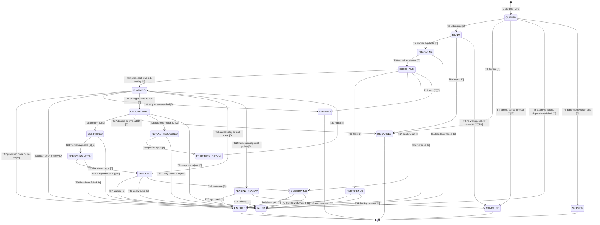

# 08: The run lifecycle

Checked against: docs.spacelift.io read 2026-10-28; introspection `b3255fe38f5e`; spacelift-api-bruno `7cad4574954b`; spacectl `6bf167cb62a6`; terraform-provider-spacelift `c72b9bd2f3c3` (v1.57.0).

Research baseline: **2026-10-28**.

This report records how a Spacelift run is created, how it moves through its
states, what executes in each phase, and which actions people, policies and
timers can take on it. It is the behavioural contract for infraweave's run
scheduler and state machine, so it lists every `RunType` and `RunState`
value from the schema, every transition the sources describe, and every run
action with its preconditions. Stack settings that steer the lifecycle
(autodeploy, autoretry, run promotion) are defined in report 07; policy
inputs and rules are in report 09; workers, the launcher and timeouts are in
report 10; the environment a run sees is in report 13; the state backend is
in report 16. The operation inventory for runs is in report 03, and the REST
mapping rules are in [02](02-graphql-to-rest-mapping.md).

| Label | Means |
|---|---|
| **[D]** | A docs.spacelift.io page, cited by URL, read 2026-10-28 |
| **[G]** | The introspection snapshot `b3255fe38f5e` ([`introspection.json`](../../../api/reference/spacelift/introspection.json)) |
| **[B]** | spacelift-api-bruno at `7cad4574954b` ([`bruno.json`](../../../api/reference/spacelift/bruno.json)) |
| **[S]** | Source code at the cited commit |
| **[RN]** | The Spacelift changelog, <https://docs.spacelift.io/product/changelog> |
| **[I]** | Inferred; the text says from what |
| *(unverified)* | No primary source confirms it; listed in 30-open-questions |

Schema tables in sections 1, 2 and 9 were generated from the snapshot by a
script, then enriched from the docs.

## 1. Run types

`RunType` has 7 values [G].

| Value | Schema meaning [G] | What the docs say | How a run of this type is created | Takes the stack lock |
|---|---|---|---|---|
| `UNKNOWN` | Invalid zero value | Not documented | Never created; a sentinel for an unset field [G] | n/a |
| `PROPOSED` | Change preview or drift detection | A preview of what the code on a branch would change; reports to VCS ([proposed](https://docs.spacelift.io/concepts/run/proposed)) [D] | A push or PR event on a branch other than the tracked branch, under the default or a custom push policy's `propose` rule ([push policy](https://docs.spacelift.io/concepts/policy/push-policy)) [D]; a drift detection schedule ([drift detection](https://docs.spacelift.io/concepts/stack/drift-detection)) [D]; `runTrigger(runType: PROPOSED)` [G]; `runProposeLocalWorkspace` (local preview) [G]; the **Preview** action on a GitHub check ([GitHub](https://docs.spacelift.io/integrations/source-control/github)) [D]; `runResourceCreate(proposed: true)` [G]; the `spacelift_run` resource with `proposed = true`, which calls `runTrigger(runType: PROPOSED)` ([`resource_run.go`](https://github.com/spacelift-io/terraform-provider-spacelift/blob/c72b9bd2f3c3/spacelift/resource_run.go#L109)) [S] | No. Only tracked runs and tasks take the lock ([run](https://docs.spacelift.io/concepts/run)) [D] |
| `TRACKED` | A deployment candidate | A deployment that can apply the plan ([tracked](https://docs.spacelift.io/concepts/run/tracked)) [D] | A push to the tracked branch, or a push policy `track` rule [D]; manual trigger by an admin or stack writer [D]; `runTrigger` (default type) and `runTriggerBatch` [G]; trigger policies ([trigger policy](https://docs.spacelift.io/concepts/policy/trigger-policy)) [D]; stack dependencies ([stack dependencies](https://docs.spacelift.io/concepts/stack/stack-dependencies)) [D]; promotion of a proposed run (`runPromote`) [G]; drift reconciliation [D]; scheduled runs (`stackScheduledRunCreate`) [G]; the **Deploy** action on a GitHub check [D]; a PR comment that a push policy maps to `track` ([PR comments](https://docs.spacelift.io/concepts/run/pull-request-comments)) [D] | Yes [D] |
| `TASK` | One-off run started by the user | A custom command run after initialization, wrapped in `sh -c` ([task](https://docs.spacelift.io/concepts/run/task)) [D] | `taskCreate(command, skipInitialization)` [G]; scheduled tasks (`stackScheduledTaskCreate`) [G]; the `spacelift_task` resource [S] | Yes; tasks never run concurrently with each other or with a tracked run [D]. Tasks need a paid account ([task](https://docs.spacelift.io/concepts/run/task)) [D] |
| `TESTING` | Test case for a module | A module test case: like an autodeployed tracked run followed by a destroy ([test case](https://docs.spacelift.io/concepts/run/test-case)) [D]. A test case marked `negative: true` in the module's `.spacelift/config.yml` is expected to fail ([module registry](https://docs.spacelift.io/vendors/terraform/module-registry)) [D], exposed as `Run.expectFailure` [G]; which final state a negative test that fails reaches is *(unverified)* | Commits to a module's repository; the module runs its test cases on each commit ([module registry](https://docs.spacelift.io/vendors/terraform/module-registry)) [D]; report 15 | *(unverified)* |
| `DESTROY` | Resource destruction job | Runs the vendor's destroy command when a stack is deleted with its resources ([workflow tool](https://docs.spacelift.io/vendors/terraform/workflow-tool)) [D] | `stackDelete(destroyResources: true)` [G]; a scheduled stack deletion that removes resources ([scheduling](https://docs.spacelift.io/concepts/stack/scheduling)) [D]; the `spacelift_stack_destructor` resource on `terraform destroy` [D] [S] | Yes; the scheduling order names destroy runs as blocking [D] |
| `PARSE` | Source code parsing job | Listed only as a possible value of `TF_VAR_spacelift_run_type` ([environment](https://docs.spacelift.io/concepts/configuration/environment)) [D] | Not documented *(unverified)* | *(unverified)* |

The docs group tracked runs, destroy runs and tasks as **blocking** runs, and
proposed and drift detection runs as non-blocking, for scheduling
([run prioritization](https://docs.spacelift.io/concepts/run#run-prioritization)) [D].
A drift detection run is a `PROPOSED` run with `Run.driftDetection = true` [G] [D].

## 2. Run states

`RunState` has 22 values [G]. The terminal and passive flags come from the
docs' state table ([run](https://docs.spacelift.io/concepts/run#full-list-of-potential-run-states)) [D];
a passive state is one in which nothing executes.
`RunStateTransition.terminal` marks the transition that ends a run [G].

| Value | Schema meaning [G] | Terminal [D] | Passive [D] | Where it executes | Run types that reach it |
|---|---|---|---|---|---|
| `UNKNOWN` | Invalid zero value | n/a | n/a | Nowhere | None; it is never assigned [G] |
| `QUEUED` | Waiting for a worker or for the stack lock held by another run | No | Yes | Server | All |
| `CANCELED` | Canceled by the user | Yes | Yes | Server | All |
| `INITIALIZING` | Workspace initializing on the worker | No | Yes (docs flag) | Worker | All that reach a worker |
| `PLANNING` | The worker is planning | No | Yes (docs flag) | Worker | `PROPOSED`, `TRACKED`, `TESTING` |
| `FAILED` | Failed | Yes | Yes | n/a | All |
| `FINISHED` | Finished successfully | Yes | Yes | n/a | All |
| `UNCONFIRMED` | Planned with changes, waiting for review | No | No | Server | `TRACKED` |
| `DISCARDED` | Plan rejected by the user | Yes | Yes | n/a | `TRACKED`; any queued or ready run |
| `CONFIRMED` | Plan confirmed; waiting for a worker | No | No | Server | `TRACKED` |
| `APPLYING` | A worker applies the changes | No | No | Worker | `TRACKED`, `TESTING` |
| `PERFORMING` | A worker runs the task command | No | No | Worker | `TASK` |
| `STOPPED` | Stopped by the user | Yes | Yes | n/a | Runs stopped while initializing or planning |
| `DESTROYING` | A worker destroys managed resources | No | No | Worker | `TESTING` [D]; `DESTROY`, from `StackState.DESTROYING` ("the current destroy job") [G] |
| `PREPARING` | Workspace being prepared for the run | No | Yes | Server and worker handover | All that reach a worker |
| `PREPARING_APPLY` | Workspace being prepared for the change deployment | No | Yes | Server and worker handover | `TRACKED` after confirmation |
| `SKIPPED` | The run was skipped | Yes | Yes | n/a | `TRACKED` runs in a dependency chain [D] |
| `REPLAN_REQUESTED` | Pending a replan; the scheduler picks it up | No | No | Server | `TRACKED` |
| `PENDING` | Deprecated: "no longer used" | No (docs) | Yes (docs) | Nowhere | None [G] |
| `PREPARING_REPLAN` | Being prepared to be replanned | No | Not in the docs table | Server and worker handover [I] | `TRACKED` |
| `READY` | Ready to be started | No | Yes | Server | All |
| `PENDING_REVIEW` | Proposed run waiting for post-planning approval policy sign-off | No | No | Server | `PROPOSED` |

Notes on the table:
- The docs table also lists `NONE`, which is a `StackState` value, not a
  `RunState` value; the page says so itself [D] [G].
- The docs table omits `UNKNOWN` and `PREPARING_REPLAN`, and gives no passive
  flag for `PREPARING_REPLAN` [D].
- The docs mark `INITIALIZING` and `PLANNING` as passive although a worker
  executes in both. infraweave should treat "passive" as "the server does
  nothing in this state" [I], from the descriptions of initializing and
  planning on the same page.
- The docs' state descriptions say "by the user" for `CANCELED`,
  `DISCARDED` and `STOPPED`, but policies and timers also produce these
  states (section 3) [D].

### StackState and RunState

`StackState` (16 values) mirrors the state of the stack's current or last
tracked run [G]. It contains `NONE` (no tracked run yet) and lacks seven
`RunState` values: `UNKNOWN`, `QUEUED`, `CANCELED`, `PERFORMING`, `SKIPPED`,
`PENDING` and `PENDING_REVIEW` [G]. So a queued run, a task, and a canceled
or skipped run do not change the stack's state [I], from the enum
difference and the `StackState` description. `Stack.stateSetBy` names the run
that last changed the stack state, and `Stack.stateIsTerminal` is true when
no run is ongoing [G].

## 3. Transitions

### State diagram

Each edge carries its ID from the transition table below, and the marker of
its strongest evidence. Terminal states lead to the end marker.

`UNKNOWN` and `PENDING` have no edges: the first is the zero value of the
enum and the second is deprecated as no longer used [G] [RN 2026-10-20].
infraweave needs neither as a reachable state.

The six terminal states have no outgoing edge. Each is marked terminal in
the docs' state table; the run page also says in prose that nothing can
follow `DISCARDED`, `FAILED`, `STOPPED` or `FINISHED`
([run](https://docs.spacelift.io/concepts/run#common-run-states)) [D]. For
`CANCELED` and `SKIPPED` the table is the only docs statement, and
`RunStateTransition.terminal` is the schema's per-transition flag [G].

### Transition table

| ID | From | To | Run types | Cause | Evidence |
|---|---|---|---|---|---|
| T1 | (new) | `QUEUED` | All | A run is created by any route in section 1. A queued run waits for the stack lock, approval, upstream stacks or external dependencies | [D] [run](https://docs.spacelift.io/concepts/run#queued); [G] `runTrigger`, `taskCreate`, `runPromote` |
| T2 | `QUEUED` | `READY` | All | Nothing blocks the run any more: no blocking run holds the stack lock, approval policies approved, upstream dependency runs finished, every external dependency is `FINISHED` or `SKIPPED` | [D] [run](https://docs.spacelift.io/concepts/run#queued), [external dependencies](https://docs.spacelift.io/concepts/policy/push-policy/run-external-dependencies), [approval policy](https://docs.spacelift.io/concepts/policy/approval-policy) |
| T3 | `QUEUED` | `DISCARDED` | All | A user discards the queued run | [D] [run](https://docs.spacelift.io/concepts/run#queued) |
| T4 | `QUEUED` | `CANCELED` | All | `runCancel` on a run that has not started [G]; a newer run's push policy `cancel` rule (same run type only, best effort) [D] [push policy](https://docs.spacelift.io/concepts/policy/push-policy#canceling-in-progress-runs); cancellation of a run pending approval [D]; proposed and test runs still queued or ready after two days [D] [RN 2026-09-01]; any run still waiting after 30 days [D] [RN 2026-09-17]; downstream runs when a dependency chain breaks [D] [stack dependencies](https://docs.spacelift.io/concepts/stack/stack-dependencies#dependencies-overview) | [G] [D] [RN] |
| T5 | `QUEUED` | `FAILED` | All | An approval policy `reject` rule fires: the rules section says the run fails at once [D], while the review walkthrough on the same page describes **Reject** as canceling the run [D], so `CANCELED` is possible and the target is *(unverified)*; an external dependency is marked `FAILED` [D] | [D] [approval policy](https://docs.spacelift.io/concepts/policy/approval-policy#rules), [external dependencies](https://docs.spacelift.io/concepts/policy/push-policy/run-external-dependencies) |
| T6 | `QUEUED` | `SKIPPED` | `TRACKED` | A dependent stack's run whose referenced upstream outputs did not change, unless `Trigger always` is set; also the documented example of runs after a failed upstream run | [D] [stack dependencies](https://docs.spacelift.io/concepts/stack/stack-dependencies) |
| T7 | `READY` | `PREPARING` | All | A worker in the stack's pool becomes available | [D] [run](https://docs.spacelift.io/concepts/run#ready) |
| T8 | `READY` | `DISCARDED` | All | A user discards the ready run, including the bulk **Discard** on a worker pool queue | [D] [run](https://docs.spacelift.io/concepts/run#ready), [bulk actions](https://docs.spacelift.io/product/bulk-actions) |
| T9 | `READY` | `CANCELED` | All | No worker picks the run up: two days for proposed and test runs, seven days for tracked runs, tasks and destroy runs; a push policy `cancel`; the 30-day rule | [D] [run](https://docs.spacelift.io/concepts/run#automatic-termination); [RN 2026-09-01] |
| T10 | `PREPARING` | `INITIALIZING` | All | The worker pulls the runner image and starts the container | [D] [run](https://docs.spacelift.io/concepts/run#preparing) |
| T11 | `PREPARING` | `FAILED` | All | The handover between the server and the worker fails | [D] [run](https://docs.spacelift.io/concepts/run#preparing) |
| T12 | `INITIALIZING` | `PLANNING` | `PROPOSED`, `TRACKED`, `TESTING` | Initialization succeeds; the next state depends on the run type | [D] [run](https://docs.spacelift.io/concepts/run#initializing), [proposed](https://docs.spacelift.io/concepts/run/proposed#planning) |
| T13 | `INITIALIZING` | `PERFORMING` | `TASK` | Initialization succeeds. With `skipInitialization` the vendor initialization does not run; whether the run then still passes through `INITIALIZING` or goes from `PREPARING` straight to `PERFORMING` is *(unverified)* | [D] [task](https://docs.spacelift.io/concepts/run/task#skipping-initialization); [G] `taskCreate` |
| T14 | `INITIALIZING` | `DESTROYING` | `DESTROY` | Initialization succeeds and the destroy command runs | [I] from the `DESTROYING` description [G], the `destroy` workflow command used when a stack is deleted [D] [workflow tool](https://docs.spacelift.io/vendors/terraform/workflow-tool), and the `before_destroy` hook being used during stack destruction [D] [stack settings](https://docs.spacelift.io/concepts/stack/stack-settings#customizing-workflow). Whether a destroy run plans and waits for confirmation first is *(unverified)* |
| T15 | `INITIALIZING` | `FAILED` | All | A before-init hook or vendor initialization fails | [D] [run](https://docs.spacelift.io/concepts/run#initializing) |
| T16 | `INITIALIZING` | `STOPPED` | All that reach `INITIALIZING`; a task cannot be stopped once it is `PERFORMING` [D] | A user sends a stop signal (`runStop`), which the worker may honour | [D] [run](https://docs.spacelift.io/concepts/run#stopped); [G] `runStop` |
| T17 | `PLANNING` | `FINISHED` | `PROPOSED`; `TRACKED` | A proposed run plans successfully with no approval policy hold; a tracked run's plan has no changes to resources or outputs (a no-op), unless force apply is set | [D] [proposed](https://docs.spacelift.io/concepts/run/proposed#success-criteria), [tracked](https://docs.spacelift.io/concepts/run/tracked#handling-no-op-changes); [G] `ForceApplyMode` |
| T18 | `PLANNING` | `FAILED` | `PROPOSED`, `TRACKED`, `TESTING` | Invalid code, provider API errors, a plan policy `deny`, or a worker crash | [D] [proposed](https://docs.spacelift.io/concepts/run/proposed#success-criteria) |
| T19 | `PLANNING` | `STOPPED` | `PROPOSED`, `TRACKED` | A user stops the run; Spacelift stops a proposed run when a newer commit is pushed to its branch | [D] [run](https://docs.spacelift.io/concepts/run#stopped), [GitHub](https://docs.spacelift.io/integrations/source-control/github#webhook-integrations) |
| T20 | `PLANNING` | `UNCONFIRMED` | `TRACKED` | The plan has changes and either autodeploy is off, a plan policy warns, or the stack is locked (locking disables autodeploy). The worker encrypts the workspace, uploads it to object storage and leaves the run | [D] [tracked](https://docs.spacelift.io/concepts/run/tracked#unconfirmed), [creating a stack](https://docs.spacelift.io/concepts/stack/creating-a-stack#lock-a-stack-in-spacelift) |
| T21 | `PLANNING` | `APPLYING` | `TRACKED`, `TESTING` | Autodeploy is on and no plan policy warns; a module test case always proceeds as if autodeployed. No second handover happens | [D] [tracked](https://docs.spacelift.io/concepts/run/tracked#approval-flow), [test case](https://docs.spacelift.io/concepts/run/test-case) |
| T22 | `PLANNING` | `PENDING_REVIEW` | `PROPOSED` | A plan policy returns a warning and approval policies are attached | [D] [proposed](https://docs.spacelift.io/concepts/run/proposed#pending-review) |
| T23 | `PENDING_REVIEW` | `FINISHED` | `PROPOSED` | Every attached approval policy approves | [D] [proposed](https://docs.spacelift.io/concepts/run/proposed#pending-review) |
| T24 | `PENDING_REVIEW` | `FAILED` | `PROPOSED` | An approval policy `reject` rule fires; the docs also describe reject as canceling (see T5) | [D] [approval policy](https://docs.spacelift.io/concepts/policy/approval-policy#rules) |
| T25 | `PENDING_REVIEW` | `CANCELED` | `PROPOSED` | 30 days after creation | [D] [proposed](https://docs.spacelift.io/concepts/run/proposed#pending-review), [run](https://docs.spacelift.io/concepts/run#automatic-termination) |
| T26 | `UNCONFIRMED` | `CONFIRMED` | `TRACKED` | A user confirms (`runConfirm`), only after approval policies approve | [D] [tracked](https://docs.spacelift.io/concepts/run/tracked#unconfirmed), [approval policy](https://docs.spacelift.io/concepts/policy/approval-policy#review-a-run); [G] `runConfirm` |
| T27 | `UNCONFIRMED` | `DISCARDED` | `TRACKED` | A user discards (`runDiscard`, `runDiscardAll`); seven days without change; the 30-day rule | [D] [run](https://docs.spacelift.io/concepts/run#automatic-termination); [G] `runDiscard` |
| T28 | `UNCONFIRMED` | `REPLAN_REQUESTED` | `TRACKED` | A user picks resources from the plan and requests a targeted replan (`runTargetedReplan(targets)`) | [D] [tracked](https://docs.spacelift.io/concepts/run/tracked#targeted-replan); [G] `runTargetedReplan`, `REPLAN_REQUESTED` |
| T29 | `UNCONFIRMED` | `FAILED` | `TRACKED` | An approval policy `reject` rule fires; the docs also describe reject as canceling (see T5) | [D] [approval policy](https://docs.spacelift.io/concepts/policy/approval-policy#rules) |
| T30 | `REPLAN_REQUESTED` | `PREPARING_REPLAN` | `TRACKED` | The scheduler picks the run up and a worker restores the saved workspace | [G] state descriptions; order [I] from them |
| T31 | `REPLAN_REQUESTED` | `FAILED` | `TRACKED` | Seven days without change: the saved workspace is kept for seven days only | [D] [run](https://docs.spacelift.io/concepts/run#automatic-termination); [RN 2026-09-01] |
| T32 | `PREPARING_REPLAN` | `PLANNING` | `TRACKED` | The replan executes `plan` with the selected targets | [I] from the `.Targets` plan template parameter, which the workflow tool fills "during targeted replans" [D] [workflow tool](https://docs.spacelift.io/vendors/terraform/workflow-tool#how-does-it-work), and from `RunStateTransition.stateVersion`, which lets a state recur in one run [G] |
| T33 | `CONFIRMED` | `PREPARING_APPLY` | `TRACKED` | A worker picks the confirmed run up; a second handover starts | [D] [tracked](https://docs.spacelift.io/concepts/run/tracked#applying); [G] |
| T34 | `CONFIRMED` | `FAILED` | `TRACKED` | Seven days without change, or the 30-day rule | [D] [run](https://docs.spacelift.io/concepts/run#automatic-termination); [RN 2026-09-01] |
| T35 | `PREPARING_APPLY` | `APPLYING` | `TRACKED` | The handover succeeds | [D] [tracked](https://docs.spacelift.io/concepts/run/tracked#applying) |
| T36 | `PREPARING_APPLY` | `FAILED` | `TRACKED` | The handover fails, for example the worker disappears | [D] [tracked](https://docs.spacelift.io/concepts/run/tracked#applying) |
| T37 | `APPLYING` | `FINISHED` | `TRACKED` | The apply succeeds, or `SPACELIFT_SKIP_APPLYING=true` skips it | [D] [tracked](https://docs.spacelift.io/concepts/run/tracked#success-criteria) |
| T38 | `APPLYING` | `FAILED` | `TRACKED` | The apply fails | [D] [tracked](https://docs.spacelift.io/concepts/run/tracked#success-criteria) |
| T39 | `APPLYING` | `DESTROYING` | `TESTING` | Always, whether the apply succeeded or failed | [D] [test case](https://docs.spacelift.io/concepts/run/test-case) |
| T40 | `DESTROYING` | `FINISHED` | `TESTING`, `DESTROY` | The destroy succeeds and, for a test case, every earlier phase succeeded | [D] [test case](https://docs.spacelift.io/concepts/run/test-case#success-criteria) |
| T41 | `DESTROYING` | `FAILED` | `TESTING`, `DESTROY` | The destroy fails, or a test case's apply had failed | [D] [test case](https://docs.spacelift.io/concepts/run/test-case#success-criteria) |
| T42 | `PERFORMING` | `FINISHED` | `TASK` | The command exits 0 | [D] [task](https://docs.spacelift.io/concepts/run/task#performing-a-task) |
| T43 | `PERFORMING` | `FAILED` | `TASK` | The command exits non-zero | [D] [task](https://docs.spacelift.io/concepts/run/task#performing-a-task) |

Transitions the sources imply but do not pin to a target state:

| Situation | Likely target | Status |
|---|---|---|
| A push policy `cancel` rule names a run that is awaiting confirmation (`in_progress` includes unconfirmed runs) | `CANCELED` or `DISCARDED` | *(unverified)* |
| `runKill` sends SIGKILL to a run in progress | `FAILED` or `STOPPED` | *(unverified)* |
| The launcher kills a job that produced no logs for `SPACELIFT_LAUNCHER_LOGS_TIMEOUT` (default 7 minutes) or ran past `SPACELIFT_LAUNCHER_RUN_TIMEOUT` (default 70 minutes) ([worker pools](https://docs.spacelift.io/concepts/worker-pools)) [D] | `FAILED` | *(unverified)* |
| A worker abandons a run mid-plan; the 30-day rule then fails it ([run](https://docs.spacelift.io/concepts/run#automatic-termination)) [D] | `FAILED` | Documented for the 30-day sweep only |
| A drift detection run on a pool whose drift runs are disabled is created failed, with an explanatory note ([drift detection](https://docs.spacelift.io/concepts/stack/drift-detection#drift-detection-run-limits)) [D] | `FAILED`, possibly without passing `QUEUED` | Whether it is created directly in `FAILED` is *(unverified)* |
| The handover in `PREPARING_REPLAN` fails, as T11 and T36 do for the other preparing states | `FAILED` | *(unverified)*; no source describes it |
| A run in a broken dependency chain | `CANCELED` (prose) or `SKIPPED` (worked example) | The [stack dependencies](https://docs.spacelift.io/concepts/stack/stack-dependencies) page states both [D]; `Run.triggeredRuns` excludes runs "in the Skipped state" [G], so `SKIPPED` is real; which one a failed upstream produces is *(unverified)* |

### Per-type paths

| Run type | Happy path | Notes |
|---|---|---|
| `PROPOSED` | `QUEUED` → `READY` → `PREPARING` → `INITIALIZING` → `PLANNING` → `FINISHED` | `PENDING_REVIEW` sits between `PLANNING` and `FINISHED` when a plan policy warns and approval policies are attached [D] |
| `TRACKED`, manual | `QUEUED` → `READY` → `PREPARING` → `INITIALIZING` → `PLANNING` → `UNCONFIRMED` → `CONFIRMED` → `PREPARING_APPLY` → `APPLYING` → `FINISHED` | A targeted replan loops `UNCONFIRMED` → `REPLAN_REQUESTED` → `PREPARING_REPLAN` → `PLANNING` → `UNCONFIRMED` [D] [G] [I] |
| `TRACKED`, autodeploy | `QUEUED` → `READY` → `PREPARING` → `INITIALIZING` → `PLANNING` → `APPLYING` → `FINISHED` | A no-op plan ends at `FINISHED` straight from `PLANNING` [D] |
| `TASK` | `QUEUED` → `READY` → `PREPARING` → `INITIALIZING` → `PERFORMING` → `FINISHED` | `PERFORMING` cannot be stopped [D] |
| `TESTING` | `QUEUED` → `READY` → `PREPARING` → `INITIALIZING` → `PLANNING` → `APPLYING` → `DESTROYING` → `FINISHED` | `SPACELIFT_SKIP_DESTROYING=true` skips the destroy phase [D] |
| `DESTROY` | `QUEUED` → `READY` → `PREPARING` → `INITIALIZING` → `DESTROYING` → `FINISHED` | [I]; see T14 |
| `PARSE` | Not documented | *(unverified)* |

### Timers

| Rule | Applies to | Outcome | Evidence |
|---|---|---|---|
| Not picked up from `READY` (or `QUEUED`) within 2 days | `PROPOSED`, `TESTING` | `CANCELED` | [D] [run](https://docs.spacelift.io/concepts/run#automatic-termination); [RN 2026-09-01] |
| Not picked up from `READY` within 7 days | `TRACKED`, `TASK`, `DESTROY` | `CANCELED` | Same |
| `UNCONFIRMED` for 7 days with no change | `TRACKED` | `DISCARDED` | Same |
| `CONFIRMED` or `REPLAN_REQUESTED` for 7 days with no change | `TRACKED` | `FAILED`; the saved workspace is kept only 7 days | Same |
| Not terminal 30 days after creation | All, unless a worker is executing it | `CANCELED` if still waiting (queued, ready, approval); `DISCARDED` if awaiting plan review; `FAILED` otherwise | [D]; [RN 2026-09-17] |
| Notifications | Shorter rules notify, except for canceled or failed runs created more than 30 days earlier; the 30-day rule never notifies | n/a | [D] |

`Run.expired` is true when a run waited for approval long enough that its
plan file was garbage-collected [G]. The dashboard's **Runs to be
terminated** widget lists runs due in the next seven days [D] [RN].

The docs say both that an unconfirmed run is discarded 30 days after creation
([tracked](https://docs.spacelift.io/concepts/run/tracked#unconfirmed)) and
that it is discarded after seven unchanged days
([run](https://docs.spacelift.io/concepts/run#automatic-termination)) [D].
Both rules exist; the seven-day rule fires first unless the run keeps
changing [I], from the run page listing them as separate rules.

## 4. Queueing, the stack lock and scheduling

| Mechanism | Behaviour | Evidence |
|---|---|---|
| Stack serialization | Tracked runs and tasks each take an exclusive lock on the stack; a queued run blocked by another shows that run as its blocker | [D] [run](https://docs.spacelift.io/concepts/run#queued); [G] `Stack.blocked`, `Stack.blocker` |
| Order within a stack | Priority orders runs across a worker pool only; inside one stack the lock order stands, so a raised tracked run still queues behind an earlier tracked run | [D] [run](https://docs.spacelift.io/concepts/run#run-prioritization) |
| Human stack lock | `stackLock(id, note)` gives one user exclusive use: only the lock owner can trigger runs and tasks; locks never expire; the owner or an admin releases it; autodeploy is off while locked | [D] [creating a stack](https://docs.spacelift.io/concepts/stack/creating-a-stack#lock-a-stack-in-spacelift); [G] `stackLock`, `stackUnlock`, `Stack.lockedBy` |
| Push policy lock | A push policy `lock` rule returning a non-empty key locks the stack, keeps it if the same key holds it, and rejects runs if a different key holds it; `unlock` releases only a lock with the same key | [D] [push policy](https://docs.spacelift.io/concepts/policy/push-policy#stack-locking) |
| Disabled stack | A disabled stack cannot create runs (`stackDisable`, `stackEnable`, `Stack.isDisabled`) | [G]; detail in report 07 |
| Approval in `QUEUED` | A queued run needing approval is not scheduled; if it is a blocking run it also blocks newer runs | [D] [approval policy](https://docs.spacelift.io/concepts/policy/approval-policy) |
| Stack dependencies | Dependent stacks queue tracked runs that wait for the upstream run; a retry never triggers dependants | [D] [stack dependencies](https://docs.spacelift.io/concepts/stack/stack-dependencies#retries-stack-dependencies); report 18 |
| External dependencies | A push policy `external_dependency` rule attaches named dependencies; the run becomes eligible once all are `FINISHED` or `SKIPPED`, and fails if one is `FAILED` | [D] [external dependencies](https://docs.spacelift.io/concepts/policy/push-policy/run-external-dependencies); [G] `RunExternalDependencyStatus`, `runExternalDependencyMarkAsCompleted` |
| VCS event limit | An account can cap runs created per VCS event, up to 500 | [D] [run](https://docs.spacelift.io/concepts/run#limit-runs); [G] `vcsEventTriggeredRunsLimit` |
| Event deduplication | Runs created by push and PR events for one stack are deduplicated on commit SHA plus run type; a `/spacelift` PR comment yielding `propose` bypasses deduplication | [D] [push policy](https://docs.spacelift.io/concepts/policy/push-policy#deduplicating-events), [PR comments](https://docs.spacelift.io/concepts/run/pull-request-comments) |
| Workflow grouping | `Run.workflowId` is shared by every run in one chain (dependency fan-out, trigger policies, promotion); a standalone run's `workflowId` is its own ID | [G] |
| Drift detection limits | A private pool can cap concurrent drift runs or disable them. Over the cap, further drift runs are skipped until running ones finish; with drift runs disabled, failed runs carrying an explanatory note are created for the record. Whether "skipped" means the `SKIPPED` state or no run at all is *(unverified)* | [D] [drift detection](https://docs.spacelift.io/concepts/stack/drift-detection#drift-detection-run-limits) |

### Priority

`RunPriorityPreset` has 3 values [G]:

| Value | Meaning [G] |
|---|---|
| `high` | Scheduled before every other run |
| `normal` | The default; ordered by run type (blocking, non-blocking, drift) |
| `low` | Behind high and normal runs in the pool, but low tracked and proposed runs still precede drift detection |

Within a private worker pool the scheduler orders waiting runs as follows,
oldest first within each tier ([run](https://docs.spacelift.io/concepts/run#run-prioritization)) [D]:

| Tier | Runs |
|---|---|
| 1 | `high`, any type |
| 2 | `normal` blocking runs (tracked, destroy, task) |
| 3 | `normal` proposed runs |
| 4 | `low` blocking runs |
| 5 | `low` proposed runs |
| 6 | `normal` drift detection runs |
| 7 | `low` drift detection runs |

| Rule | Evidence |
|---|---|
| New runs start at `normal`; a set priority persists through every state until a worker picks the run up | [D] [run](https://docs.spacelift.io/concepts/run#run-prioritization) |
| Priority can be changed on any non-terminal run on a private pool; public pool runs cannot be prioritized | [D] |
| `runPrioritySet(stack, run, preset)` sets it; `runPrioritizeSet(prioritize)` is deprecated (true means `high`, false means `normal`); `Run.isPrioritized` is deprecated and true exactly when `priorityPreset` is `high` | [G]; [D]; [RN 2026-10-20] |
| A push policy `priority` rule sets the starting level; the older boolean `prioritize` equals `high`; a value outside the three, two policies disagreeing, or `priority` together with `prioritize = true` fails the evaluation and creates no run | [D] [push policy](https://docs.spacelift.io/concepts/policy/push-policy#prioritization) |
| A trigger policy `priority` rule sets the level of the runs it triggers; a policy without the rule defers to one with it; disagreeing policies fall back to `normal` with a notification; a value outside the three fails the evaluation, triggers no run and notifies | [D] [trigger policy](https://docs.spacelift.io/concepts/policy/trigger-policy#setting-run-priority) |
| Dependent stacks' runs inherit the level shared by the runs they wait on; mixed levels give `normal` | [D] [run](https://docs.spacelift.io/concepts/run#run-prioritization) |
| `searchSchedulableRuns` filters and sorts the pool queue by `priorityPreset` | [D] |

## 5. Phases and hooks

### Phases

| Phase (state) | What runs | Evidence |
|---|---|---|
| `PREPARING`, `PREPARING_APPLY`, `PREPARING_REPLAN` | The server hands the job to a worker; the worker pulls the runner image and starts a container. Report 10 describes the protocol | [D] [run](https://docs.spacelift.io/concepts/run#preparing) |
| `INITIALIZING` | `before_init` hooks, then the vendor's initialization (for Terraform, `terraform init` in the project root), then `after_init`, in one shell session, so variables exported by a before-init hook reach `init` | [D] [run](https://docs.spacelift.io/concepts/run#initializing) |
| `PLANNING` | The vendor preview (`tofu plan`, `terraform plan`, `pulumi preview`, Ansible check mode), then plan policies, then delta calculation. `SPACELIFT_SKIP_PLANNING=true` skips it on Ansible stacks | [D] [proposed](https://docs.spacelift.io/concepts/run/proposed#planning), [Ansible reference](https://docs.spacelift.io/vendors/ansible/reference) |
| `APPLYING` | The vendor apply of the saved plan; skipped with `SPACELIFT_SKIP_APPLYING=true` | [D] [tracked](https://docs.spacelift.io/concepts/run/tracked#applying) |
| `PERFORMING` | The task command under `sh -c` | [D] [task](https://docs.spacelift.io/concepts/run/task#performing-a-task) |
| `DESTROYING` | The vendor destroy; skipped with `SPACELIFT_SKIP_DESTROYING=true` | [D] [test case](https://docs.spacelift.io/concepts/run/test-case) |

For Terraform-family stacks the workflow tool defines the commands each phase
calls: `init`, `workspaceSelect`, `workspaceNew`, `plan` (with `.Lock`,
`.Refresh`, `.PlanFileName` and `.Targets`), `showState`, `showPlan`,
`getOutputs`, `apply` and `destroy`. Any non-zero exit code is an error
([workflow tool](https://docs.spacelift.io/vendors/terraform/workflow-tool)) [D].
Report 20 covers the vendors.

### Hook kinds

The schema has 11 hook lists, in `Hooks`, `HooksInput`, `RuntimeConfig` and
`RuntimeConfigInput` [G]. There is no `beforeRun` [G].

| Phase | Before | After | Notes |
|---|---|---|---|
| Initialization | `beforeInit` / `before_init` | `afterInit` / `after_init` | Run for every run type that initializes |
| Planning | `beforePlan` / `before_plan` | `afterPlan` / `after_plan` | |
| Applying | `beforeApply` / `before_apply` | `afterApply` / `after_apply` | |
| Destroying | `beforeDestroy` / `before_destroy` | `afterDestroy` / `after_destroy` | Module test cases and stack destruction |
| Performing | `beforePerform` / `before_perform` | `afterPerform` / `after_perform` | Tasks |
| Whole run | none | `afterRun` / `after_run` | Runs after every run a worker actively processed, whatever the outcome; sees `TF_VAR_spacelift_final_run_state` |

Sources: [stack settings](https://docs.spacelift.io/concepts/stack/stack-settings#customizing-workflow) [D]; [G] `HooksInput`.

The flat hook fields on `Stack` (`afterApply`, `beforeInit` and the rest) are
deprecated in favour of `Stack.hooks` [G] [RN].

### Hook execution rules

| Rule | Evidence |
|---|---|
| All hooks run on the worker. A run ended outside the worker (canceled, discarded) or one whose workspace or container setup fails fires no hooks, not even `after_run` | [D] [stack settings](https://docs.spacelift.io/concepts/stack/stack-settings#customizing-workflow) |
| A failing before-hook prevents its phase; a failing phase prevents its after-hooks, unless the hook text uses `;` | [D] |
| Spacelift joins a phase's hooks with `&&` and wraps each in `{}`; a newline inside a hook can hide a non-zero exit | [D] |
| Hooks share the phase's shell session, and environment variables persist across phases | [D] |
| A run that pauses (for confirmation or approval) resumes its remaining phases in a new container, so tools installed earlier are gone | [D] |
| Order in a before-phase: attached contexts by priority, then auto-attached contexts in reverse alphabetical order, then stack hooks. Order in an after-phase: stack hooks, then auto-attached contexts alphabetically, then attached contexts in reverse priority | [D]; report 13 |
| `.spacelift/config.yml` and a custom runtime config on trigger can override hooks | [D]; report 07 |
| Runtime commands: a hook or phase may print `::add-mask <values>` to mask values in later log lines | [D] [stack settings](https://docs.spacelift.io/concepts/stack/stack-settings#runtime-commands) |

Plugins also run at phase boundaries such as `before_init`, `after_plan` and
`after_apply` ([RN]); report 25 covers them.

## 6. Run actions

| Action | Operation [G] | Valid from | Result | RBAC action [D] | Notes |
|---|---|---|---|---|---|
| Trigger | `runTrigger(stack, commitSha, runType, runtimeConfig, forceApply)` | n/a | New run in `QUEUED` | Trigger run; a custom runtime config needs **Trigger run with custom runtime config** (Admin fallback) | Default: a tracked run on the stack's tracked commit, or the branch head if none [G] |
| Trigger batch | `runTriggerBatch(input: {stacks, forceApply})` | n/a | One run per stack; shared dependants get one run | Trigger run | Each stack may name a `commitSha`; for tracked runs it becomes the stack's tracked commit [G] |
| Create task | `taskCreate(stack, command, skipInitialization)` | n/a | New `TASK` run | Create task | [G] [D] |
| Local preview | `runProposeLocalWorkspace(stack, workspace, environmentVarsOverrides)` | n/a | New `PROPOSED` run from an uploaded workspace | Propose run from local workspace; overrides need **Propose run with overrides** | Requires `localPreviewEnabled` on the stack [D] [G] |
| Cancel | `runCancel(stack, run, note)` | A run that has not started [G]; that this means `QUEUED` and `READY` is [I] from the state descriptions | `CANCELED` | Cancel run / Cancel blocking run | [G] [B] |
| Discard | `runDiscard(stack, run?, note)` | `UNCONFIRMED`; also `QUEUED` and `READY` per the docs | `DISCARDED` | Discard run | Without `run`, discards the stack's current blocker [G]; `runDiscardAll(stack, note)` discards every discardable run and returns `discardedRuns` and `failedDiscarding` [G] |
| Confirm | `runConfirm(stack, run?, note)` | `UNCONFIRMED`, once approval policies approve | `CONFIRMED` | Confirm run | Without `run`, confirms the blocker [G]; `Run.canConfirm` and `Run.confirmBlocker` say whether and why not [G] |
| Review | `runReview(stack, run?, decision, note)` | `QUEUED`, `UNCONFIRMED`, `PENDING_REVIEW` when approval policies apply | A `RunReview`; approval policies re-evaluate | Review run | `RunReviewDecision` is `APPROVE` or `REJECT`; only a reviewer's newest review counts [G] [D] |
| Targeted replan | `runTargetedReplan(stack, run, targets)` | `UNCONFIRMED` | `REPLAN_REQUESTED` | Replan targeted run | Business tier and above [D]. The schema and Bruno say it sets the state to `PENDING_PLAN`, a value that does not exist in `RunState` [G] [B] |
| Stop | `runStop(stack, run, note, state)` | In progress: `INITIALIZING`, `PLANNING` | `STOPPED`; the worker may ignore the signal | Stop run / Stop blocking run | `CONFIRMED` and `PERFORMING` cannot be stopped [D]; the purpose of the optional `state` argument is *(unverified)* |
| Kill | `runKill(stack, run, note, state)` | In progress, after a stop that did not end the process | SIGKILL to the process | Kill run / Kill blocking run | [G] [B]; resulting state *(unverified)* |
| Retry | `runRetry(stack, run)` | A finished run (`Run.canRetry`, `Run.retryBlocker`) | Returns a `Run` | Retry run / Retry blocking run | Schema and Bruno say "a PR run"; spacectl calls it "Retry a failed run" [S]; whether it creates a new run or reuses the ID is *(unverified)*; a retry never triggers dependent stacks [D] |
| Promote | `runPromote(stack, run)` | A `PROPOSED` run on a commit newer than the stack's current commit, with promotion allowed (`Run.canPromote`, `Run.promoteBlocker`) [G] [D] | A new `TRACKED` run on the same commit | Promote run | Section 7 |
| Prioritize | `runPrioritySet(stack, run, preset)` | Non-terminal, private pool | `priorityPreset` changes | Prioritize run | Section 4 |
| Comment | `runComment(stack, run, body)` | Any | A `RunComment` (Markdown body, username, timestamp) | Comment on run | Comments on the run in Spacelift, not on the PR [G] |
| Mark external dependency | `runExternalDependencyMarkAsCompleted(dependency, status)` | `QUEUED` runs holding the dependency | Dependency status changes | Write on every affected space | Marked experimental [G]; [D] |
| Delete logs | `runLogsDelete(stack, run)` | Finished runs | Logs removed early | Root space admin | [G] |

RBAC rows come from [RBAC system](https://docs.spacelift.io/concepts/authorization/rbac-system#run-actions) [D];
report 14 covers roles. The docs distinguish "blocking" variants of cancel,
kill, retry and stop, which need Writer, from the plain variants, which fall
back to Reader [D].

spacectl exposes these as `stack deploy`, `preview`, `local-preview`,
`confirm`, `discard`, `cancel`, `stop`, `approve`, `reject`, `retry`,
`replan`, `promote`, `priority` (with the deprecated `prioritize` and
`deprioritize`) and `task` ([`stack.go`](https://github.com/spacelift-io/spacectl/blob/6bf167cb62a6/internal/cmd/stack/stack.go)) [S].
`stack deploy --auto-confirm` triggers and then calls `runConfirm` itself
([`run_trigger.go`](https://github.com/spacelift-io/spacectl/blob/6bf167cb62a6/internal/cmd/stack/run_trigger.go#L148)) [S].

### Force apply

`ForceApplyMode` has 2 values [G]: `SINGLE` forces this run to apply even
with a zero delta, and `CASCADE` also forces the dependants it triggers.
`null` means normal behaviour [G]. The UI calls it **Trigger with force
apply**, and spacectl passes `--force-apply single|cascade`; its purpose is
to upload outputs for dependent stacks when nothing changed
([stack dependencies](https://docs.spacelift.io/concepts/stack/stack-dependencies)) [D].
Policy inputs spell the same setting `force_apply_mode` with the values
`DISABLED`, `SINGLE` and `CASCADE` ([approval policy](https://docs.spacelift.io/concepts/policy/approval-policy#data-input-schema)) [D],
so the policy form has an explicit `DISABLED` where GraphQL uses `null`.

### The Terraform provider

`spacelift_run` (attributes `stack_id`, `commit_sha`, `proposed`, `keepers`,
`wait`) and `spacelift_task` (`stack_id`, `command`, `init`, `keepers`,
`wait`) create runs through `runTrigger` (with `runType` `TRACKED`, or
`PROPOSED` when `proposed` is set) and `taskCreate`
([`resource_run.go`](https://github.com/spacelift-io/terraform-provider-spacelift/blob/c72b9bd2f3c3/spacelift/resource_run.go#L109),
[`resource_task.go`](https://github.com/spacelift-io/terraform-provider-spacelift/blob/c72b9bd2f3c3/spacelift/resource_task.go#L107)) [S].
`runResourceCreate` exists in the schema as a provider stub [G] but the
provider at this commit does not call it [S]. The
`wait` block polls `runResourceState` until the run is finished or
`UNCONFIRMED`, which it treats as an end state because it needs a human;
`continue_on_state` lists the states it accepts, defaulting to `finished`
([`wait.go`](https://github.com/spacelift-io/terraform-provider-spacelift/blob/c72b9bd2f3c3/spacelift/internal/structs/wait.go#L57)) [S].
Report 05 covers the provider.

## 7. Promotion, autodeploy, autoretry and the PR loop

| Feature | Behaviour | Evidence |
|---|---|---|
| Run promotion | Triggers a tracked run for the commit of a proposed run. Requires the proposed commit to be newer than the stack's current commit, **Allow run promotion** enabled on the stack, and the **Promote run** permission | [D] [run promotion](https://docs.spacelift.io/concepts/run/run-promotion) |
| Promotion setting | The UI's **Allow run promotion** is GraphQL `githubActionDeploy` (default `true`); the provider maps both `allow_run_promotion` and the deprecated `github_action_deploy` onto it | [G]; [S] [`resource_stack.go`](https://github.com/spacelift-io/terraform-provider-spacelift/blob/c72b9bd2f3c3/spacelift/resource_stack.go#L425) |
| GitHub **Deploy** and **Preview** | The GitHub check view offers **Preview** (a proposed run) and **Deploy** (a tracked run) on the tested commit; Deploy is promotion from the PR. Its trigger reads `github/<username>`, which plan policies can deny | [D] [GitHub](https://docs.spacelift.io/integrations/source-control/github#commit-status-notifications) |
| Autodeploy | A tracked run whose plan succeeds without plan policy warnings applies without confirmation. Approval policies are then evaluated only in `QUEUED`, so a plan policy `warn` is the way to force a review | [D] [stack settings](https://docs.spacelift.io/concepts/stack/stack-settings#autodeploy), [approval policy](https://docs.spacelift.io/concepts/policy/approval-policy) |
| Autoretry | When an applied change invalidates open PRs against the tracked branch, their proposed runs are re-run against the new state. Private worker pools only | [D] [stack settings](https://docs.spacelift.io/concepts/stack/stack-settings#autoretry); [G] `autoretry` |
| Superseded proposed runs | A push to a branch stops that branch's in-progress proposed runs | [D] [GitHub](https://docs.spacelift.io/integrations/source-control/github#webhook-integrations) |
| Push policy `cancel` | A new run may cancel `in_progress` runs (queued, ready or unconfirmed) of the same type; module test runs cannot be canceled; a run already picked up or approved is not canceled | [D] [push policy](https://docs.spacelift.io/concepts/policy/push-policy#cancelation-restrictions) |

### Ignored runs

When a push to a tracked branch creates no run, Spacelift records an ignored
trigger, shown as a warning on the stack and kept for seven days; the feature
needs the Starter+ tier ([ignored triggers](https://docs.spacelift.io/concepts/run/ignored-triggers)) [D].
`RunIgnoredTriggerReasonType` has 5 values; the schema describes none of them [G].

| Value [G] | Documented reason [D] | Mapping |
|---|---|---|
| `NO_AFFECTED_FILES_IN_PROJECT_ROOT` | The change is outside the project root (and project globs) | [I] from the name |
| `TAGS_IGNORED_BY_DEFAULT` | A tag was pushed | [I] from the name |
| `DISABLED_BY_LABEL` | The default push policy is disabled and no custom push policy is attached | [I]; the label that disables the default policy is not documented *(unverified)* |
| `CUSTOM_POLICY` | Custom push policies evaluated and ignored the commit | [I]; the split between this and the next value is *(unverified)* |
| `CUSTOM_POLICY_NO_TRIGGER` | As above, where the policy produced no trigger at all | [I] |

A `RunIgnoredTrigger` carries `id`, `createdAt`, `reasonType`, `commit` and
`policyAttachments` (`policyName`, `policy`) [G]. `Stack.searchRunIgnoredTriggers`
is admin-only and marked experimental [G].

### PR comments and commit checks

| Feedback | Behaviour | Evidence |
|---|---|---|
| Commit statuses and checks | Proposed runs always report to the VCS as commit statuses and PR feedback; the GitHub check shows progress, success with and without changes, and failure, plus the changed resources and Infracost data | [D] [proposed](https://docs.spacelift.io/concepts/run/proposed#reporting), [GitHub](https://docs.spacelift.io/integrations/source-control/github#commit-status-notifications) |
| Check granularity | `VCSCheck` on each VCS integration: `INDIVIDUAL` (one per stack), `AGGREGATED` (`spacelift/tracked`, `spacelift/proposed`, `spacelift/modules`), or `ALL`. Aggregation is Business tier and above | [G]; [D] |
| Individual check filters | `VCSCheckOptions.individualFailuresOnly` sends individual checks only for non-success terminal states; `individualSkipUnchanged` sends them only for runs that plan changes (failures still go) | [G]; [RN 2026-06-09] |
| Ignored-run checks | An ignored push reports `skipped`; a push policy `fail` rule turns it into a failure and `message` sets its text | [D] [push policy](https://docs.spacelift.io/concepts/policy/push-policy#configuring-ignore-event-behavior) |
| GitHub deployments | A tracked run with changes creates a pending GitHub deployment when it reaches `UNCONFIRMED` or starts applying; discard or a failed apply marks it failed; a successful apply marks it active. The environment name is the stack name, or the `ghenv:` label; `ghenv:-` disables deployments | [D] [GitHub](https://docs.spacelift.io/integrations/source-control/github#deployment-status-notifications) |
| Plan PR comment | The label `feature:add_plan_pr_comment` posts the plan to the PR; the docs prefer a notification policy | [D] [PR comments](https://docs.spacelift.io/concepts/run/pull-request-comments), [stack settings](https://docs.spacelift.io/concepts/stack/stack-settings#labels) |
| Disabling comments | `feature:disable_pr_comments` and `feature:disable_pr_delta_comments` (the default change summary) | [D] [stack settings](https://docs.spacelift.io/concepts/stack/stack-settings#labels) |
| Notification policy comments | A `pull_request` rule, with optional `id`, `commit`, `branch`, `body` and `deduplication_key`, posts or updates a PR comment on `run_updated` events | [D] [notification policy](https://docs.spacelift.io/concepts/policy/notification-policy#pull-request-notifications); report 19 |
| Comment-driven actions | PR comments that start with `/spacelift` reach push policies as `pull_request.action == "commented"`; only new comments count | [D] [PR comments](https://docs.spacelift.io/concepts/run/pull-request-comments) |

Report 11 covers each VCS provider's check behaviour.

## 8. Run summaries and user-provided metadata

| Feature | Behaviour | Evidence |
|---|---|---|
| Run summaries | On a failed or stopped run, **Summarize** explains one phase and **Explain** the whole run. Both open Infra Assistant with a prepared prompt; it reads the run's state, history and policy outcomes. Requires Spacelift Intelligence and Infra Assistant enabled by an admin | [D] [summarization](https://docs.spacelift.io/concepts/run/summarization); [RN] |
| Summary API | The schema has no summary query or mutation; `Run.logs(sanitize: true)` strips ANSI codes, timestamps and noise "for an LLM" | [G]; report 22 |
| User-provided metadata | spacectl `--run-metadata` sends an opaque string with trigger, confirm, task and local-preview calls. Each call appends one entry to the run's `user_provided_metadata` list, which policies read, including the worker-side initialization policy | [D] [user-provided metadata](https://docs.spacelift.io/concepts/run/user-provided-metadata) |
| Metadata transport | The string travels in the HTTP header `Spacelift-User-Provided-Run-Metadata`, not as a GraphQL argument; `Run` exposes no metadata field | [S] [`constants.go`](https://github.com/spacelift-io/spacectl/blob/6bf167cb62a6/internal/constants.go#L5), [`run_confirm.go`](https://github.com/spacelift-io/spacectl/blob/6bf167cb62a6/internal/cmd/stack/run_confirm.go#L35); [G] |
| Run signing | Metadata can carry a signature over run parameters that a binary verifies through `exec` in a worker-side initialization policy | [D]; report 10 covers the reference implementation |

## 9. The run entity

`Run` has 57 fields [G]. The fields that matter to the lifecycle:

| Field | Type [G] | Meaning [G] |
|---|---|---|
| `id` | `ID!` | ULID |
| `stackId` | `ID!` | Owning stack slug |
| `workflowId` | `ID!` | Shared by a run chain |
| `type` | `RunType!` | |
| `state` | `RunState!` | Current state |
| `history` | `[RunStateTransition!]!` | Every transition |
| `branch`, `commit`, `commits` | `String!`, `Commit!`, `[String!]!` | Head commit at trigger time; `commits` holds every SHA bundled by one push |
| `triggeredBy` | `String` | User who triggered it, if manual |
| `title` | `String!` | UI title |
| `command` | `String` | Task command |
| `createdAt`, `updatedAt` | `Int!` | Unix seconds |
| `finished` | `Boolean!` | Convenience flag |
| `driftDetection` | `Boolean!` | Belongs to a drift workflow |
| `forceApplyMode` | `ForceApplyMode` | |
| `priorityPreset` | `RunPriorityPreset!` | `isPrioritized` is deprecated |
| `needsApproval` | `Boolean!` | |
| `reviews` | `[RunReview!]!` | `id`, `author`, `decision`, `note`, `state`, `stateVersion`, `timestamp` |
| `policyReceipts` | `[RunPolicyReceipt!]!` | One per policy evaluation: `policyType`, `outcome`, `flags`, `sampled`, `engineType` |
| `planPoliciesOutcomes` | `[PlanPoliciesOutcome!]!` | `deny` and `warn` messages |
| `canConfirm`, `confirmBlocker`, `canPromote`, `promoteBlocker`, `canRetry`, `retryBlocker` | `Boolean!`, `String` | Action guards |
| `expired` | `Boolean!` | Plan file garbage-collected |
| `isMostRecent` | `Boolean!` | Last run to change the stack state |
| `next`, `previous` | `Run` | Same type and branch neighbours |
| `dependsOn`, `isDependedOnBy`, `triggeredRuns` | `[RunDependency!]!` | Dependency edges; `triggeredRuns` excludes `SKIPPED` runs |
| `externalDependencies` | `[RunExternalDependency!]!` | `PENDING`, `FINISHED`, `FAILED`, `SKIPPED` |
| `runtimeConfig`, `customRuntimeConfig` | `RuntimeConfig` | Effective and caller-supplied runtime configuration; `RuntimeConfig.yaml` holds the YAML form |
| `delta` | `Delta` | Counts of the change |
| `changesV2`, `changesV3` | | Entity changes |
| `logs(state, stateVersion, token, sanitize)` | `LogsResponse` | Logs are stored per state and per state version |
| `workerFindings`, `observabilityStatus`, `workerMetrics` | | Report 10 |

`RunStateTransition` has `state`, `stateVersion`, `terminal`, `timestamp`,
`until`, `note`, `username` and `hasLogs` [G]. `stateVersion` lets one state
recur within a run, and logs are addressed by state plus state version [G].

### Changes and delta

| Type | Values or fields [G] |
|---|---|
| `Delta` | `addCount`, `changeCount`, `deleteCount`, `importCount`, `moveCount`, `forgetCount`, `resources` (state size before), and the Ansible counts `okCount`, `skipCount`, `rescueCount`, `ignoreCount`, `unreachableCount`, `failedCount` |
| `EntityChangePhase` | `DRIFT`, `PLAN`, `APPLY` |
| `EntityChangeType` (16) | `ADD`, `CHANGE`, `DELETE`, `REPLACE_CREATE_BEFORE_DESTROY`, `REPLACE_DESTROY_BEFORE_CREATE`, `NOOP`, `READ`, `IMPORT`, `FORGET`, `CREATE_AFTER_FORGOTTEN`, and the Ansible values `OK`, `SKIPPED`, `RESCUED`, `IGNORED`, `UNREACHABLE`, `FAILED` |
| `EntityChangeResult` | `PLANNED`, `SUCCESSFUL`, `FAILED`, `PARTIAL`, `UNPLANNED`, `UNKNOWN` |
| `EntityChangeV3` | `address`, `previousAddress`, `metadata` (`result`, `type`, `moved`), `attributeChanges` |

`changesV3` and the change search fields serve Terraform, OpenTofu and
Terragrunt stacks only and return an error for other vendors, which use
`changesV2` [G] [RN 2026-09-23]. Without a phase, `changesV3` returns the
latest phase's changes [G]. Report 21 covers the resources view.

### Worker outcome

`RunWorkerOutcomeCategory` orders outcomes from best to worst [G]:

| Value | Meaning [G] |
|---|---|
| `Healthy` | Finished in normal time with no findings |
| `Finished` | Finished in normal time with at least one finding |
| `Slow` | Finished, but much slower than the stack's P95, overall or in one state |
| `Interrupted` | Stopped, canceled, discarded or skipped |
| `Failed` | Ended in `FAILED`, whichever state it failed in |

`RunWorkerOutcome.title` summarises the end ("Finished", "Stopped", "Failed
during planning") and `description` is the note on the final transition [G].
Report 10 covers findings and metrics.

## 10. Log retention

Run logs are kept 60 days by default; an account can choose 90, 180, 365 or
730 days through its customer representative, and a change applies only to
runs created afterwards ([run](https://docs.spacelift.io/concepts/run#log-retention)) [D].
`runLogRetentionDays` reports the value [G]. `LogsResponse` distinguishes
`expired`, `deleted` (on demand, via `runLogsDelete`), `exists`, `ongoing`
and `finished` [G].

## What this means for infraweave

- A run state machine with all 22 `RunState` values on the wire, of which 20
  are reachable, and the 43 transitions above, including the replan loop and
  the second handover after confirmation.
- Run types `PROPOSED`, `TRACKED`, `TASK`, `TESTING` and `DESTROY` with
  their distinct paths, and a decision on `PARSE`, which no source documents.
- A per-stack exclusive lock for blocking runs, a human lock that excludes
  autodeploy, policy-driven lock keys, and a disabled-stack gate.
- Queue gates before `READY`: the stack lock, approval policies, upstream
  dependency runs and external dependencies.
- A per-pool scheduler with three priority presets, seven tiers and FIFO
  within a tier, available on private pools only.
- Timers that cancel, discard or fail runs at 2, 7 and 30 days, with the
  notification rules.
- Hooks for five phases plus `after_run`, ordered across stack, attached and
  auto-attached contexts, and the rule that a paused run resumes in a new
  container with its workspace restored from storage.
- Every run action in section 6 with its guard fields (`canConfirm` and the
  rest), RBAC action and blocking variant.
- Promotion, autodeploy, autoretry, force apply (`SINGLE`, `CASCADE`),
  targeted replan, ignored-trigger records, and VCS feedback: checks,
  aggregation, deployments and PR comments.
- Per-state, per-state-version log storage with configurable retention.
- Opaque user-provided metadata appended on create and confirm and exposed
  to policies.

## Inferred and undocumented

- **[I]** `DESTROY` runs go `INITIALIZING` → `DESTROYING` (T14), from the
  `DESTROYING` description, the workflow tool's `destroy` command and the
  `before_destroy` hook's use during stack destruction. Whether a destroy run
  plans or asks for confirmation first is *(unverified)*.
- **[I]** `REPLAN_REQUESTED` → `PREPARING_REPLAN` → `PLANNING` (T30, T32),
  from the schema descriptions, the `.Targets` plan parameter and
  `stateVersion`.
- **[I]** A queued run, a task and a canceled or skipped run do not change
  `StackState`, from the enum difference.
- **[I]** The mapping of `RunIgnoredTriggerReasonType` values to the four
  documented reasons, from their names.
- **[I]** The seven-day unconfirmed rule fires before the 30-day rule.
- *(unverified)* What `PARSE` runs are and how they move.
- *(unverified)* Whether `TESTING` runs take the module's lock.
- *(unverified)* The state a killed run ends in; what the `state` argument of
  `runStop` and `runKill` does.
- *(unverified)* The state a push policy `cancel` leaves an unconfirmed run in.
- *(unverified)* Whether a failed upstream run cancels or skips downstream
  runs; the dependencies page says both.
- *(unverified)* Whether `runRetry` creates a new run, and which run types it
  accepts beyond "PR runs".
- *(unverified)* The state a launcher timeout (logs or run) produces.
- *(unverified)* Whether an approval policy `reject` fails or cancels the
  run; the approval policy page says both (T5, T24, T29).
- *(unverified)* Whether a task with `skipInitialization` passes through
  `INITIALIZING` (T13).
- *(unverified)* Whether a drift detection run on a pool with drift runs
  disabled is created directly in `FAILED`, and whether runs over the drift
  limit become `SKIPPED` or are not created.
- *(unverified)* `PREPARING_REPLAN` → `FAILED` on a failed handover.
- *(unverified)* The final state of a negative (`expectFailure`) module test
  case that fails as expected.
- *(unverified)* The label behind `DISABLED_BY_LABEL`, and the difference
  between `CUSTOM_POLICY` and `CUSTOM_POLICY_NO_TRIGGER`.
- The schema and Bruno describe `runTargetedReplan` as setting `PENDING_PLAN`,
  which is not a `RunState` value; `REPLAN_REQUESTED` is the state that
  exists [G] [B].
- The docs' state table marks `INITIALIZING` and `PLANNING` passive although
  a worker executes in both [D].

## Versions at the research baseline

| Component | Version |
|---|---|
| Spacelift SaaS GraphQL schema | introspection `b3255fe38f5e`, fetched 2026-10-28 |
| docs.spacelift.io | mirror read 2026-10-28; changelog to 2026-10-22 |
| spacelift-api-bruno | `7cad4574954b` |
| spacectl | `6bf167cb62a6` |
| terraform-provider-spacelift | v1.57.0 (`c72b9bd2f3c3`) |

## Sources

- Schema: [`api/reference/spacelift/introspection.json`](../../../api/reference/spacelift/introspection.json): `RunType`, `RunState`, `StackState`, `Run`, `RunStateTransition`, `RunPriorityPreset`, `RunReview`, `RunReviewDecision`, `RunPolicyReceipt`, `RunIgnoredTriggerReasonType`, `RunExternalDependencyStatus`, `ForceApplyMode`, `Hooks`, `HooksInput`, `RuntimeConfig`, `RuntimeConfigInput`, `Delta`, `EntityChange*`, `RunWorkerOutcomeCategory`, `VCSCheck`, `VCSCheckOptions`, and the `run*`, `task*` and `stack*` mutations.
- Bruno: [`api/reference/spacelift/bruno.json`](../../../api/reference/spacelift/bruno.json), folder `Runs`.
- Docs, read 2026-10-28:
  - <https://docs.spacelift.io/concepts/run>
  - <https://docs.spacelift.io/concepts/run/proposed>
  - <https://docs.spacelift.io/concepts/run/tracked>
  - <https://docs.spacelift.io/concepts/run/task>
  - <https://docs.spacelift.io/concepts/run/test-case>
  - <https://docs.spacelift.io/concepts/run/run-promotion>
  - <https://docs.spacelift.io/concepts/run/ignored-triggers>
  - <https://docs.spacelift.io/concepts/run/pull-request-comments>
  - <https://docs.spacelift.io/concepts/run/summarization>
  - <https://docs.spacelift.io/concepts/run/user-provided-metadata>
  - <https://docs.spacelift.io/concepts/stack/stack-settings>
  - <https://docs.spacelift.io/concepts/stack/creating-a-stack>
  - <https://docs.spacelift.io/concepts/stack/stack-dependencies>
  - <https://docs.spacelift.io/concepts/stack/drift-detection>
  - <https://docs.spacelift.io/concepts/stack/scheduling>
  - <https://docs.spacelift.io/concepts/policy>
  - <https://docs.spacelift.io/concepts/policy/approval-policy>
  - <https://docs.spacelift.io/concepts/policy/push-policy>
  - <https://docs.spacelift.io/concepts/policy/push-policy/run-external-dependencies>
  - <https://docs.spacelift.io/concepts/policy/trigger-policy>
  - <https://docs.spacelift.io/concepts/policy/terraform-plan-policy>
  - <https://docs.spacelift.io/concepts/policy/notification-policy>
  - <https://docs.spacelift.io/concepts/authorization/rbac-system>
  - <https://docs.spacelift.io/concepts/configuration/environment>
  - <https://docs.spacelift.io/concepts/worker-pools>
  - <https://docs.spacelift.io/integrations/source-control/github>
  - <https://docs.spacelift.io/vendors/terraform/workflow-tool>
  - <https://docs.spacelift.io/vendors/ansible/reference>
  - <https://docs.spacelift.io/product/bulk-actions>
  - <https://docs.spacelift.io/product/changelog> (entries 2026-06-09, 2026-09-01, 2026-09-17, 2026-09-23, 2026-10-20)
- Source (MIT):
  - <https://github.com/spacelift-io/spacectl/tree/6bf167cb62a6/internal/cmd/stack>
  - <https://github.com/spacelift-io/spacectl/blob/6bf167cb62a6/internal/constants.go>
  - <https://github.com/spacelift-io/terraform-provider-spacelift/blob/c72b9bd2f3c3/spacelift/resource_run.go>
  - <https://github.com/spacelift-io/terraform-provider-spacelift/blob/c72b9bd2f3c3/spacelift/internal/structs/wait.go>
  - <https://github.com/spacelift-io/terraform-provider-spacelift/blob/c72b9bd2f3c3/spacelift/resource_stack.go>
