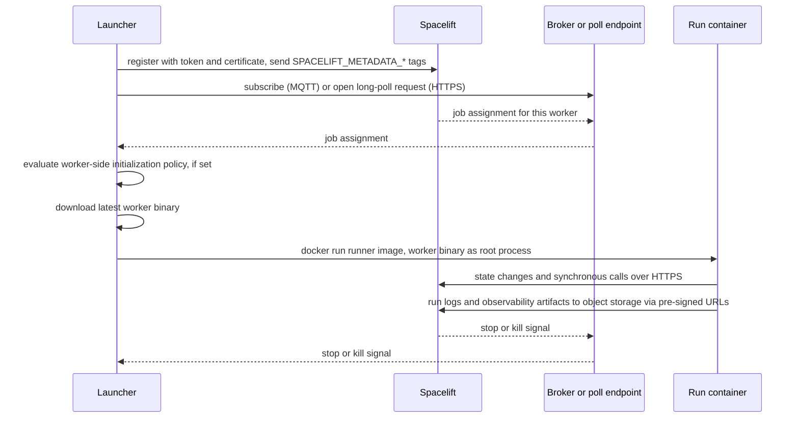

# 10: Workers and execution

Checked against: docs.spacelift.io read 2026-10-28 (SaaS and self-hosted `latest`, which is v7.1.0); introspection `b3255fe38f5e`; terraform-provider-spacelift v1.57.0; repositories at the commits listed in [Versions at the research baseline](#versions-at-the-research-baseline).

Research baseline: **2026-10-28**.

This report records where Spacelift runs execute: the public and private
worker pools, the launcher and worker binaries, the two transports that carry
work to a worker (MQTT and HTTP long-poll), the runner images, Docker-based and
Kubernetes workers, caching, draining and recycling, the worker-pool
autoscaler, signed runs, and the outcome data a worker reports back. It is the
reference for infraweave's execution plane: whoever designs the worker
protocol, the scheduler's pool queue or the Kubernetes operator starts here.
Run states and transitions are report 08; the environment a run computes
(`SPACELIFT_*`, `TF_VAR_*`, contexts) is report 13; the worker-pool API
operations are inventoried in report 03; the Terraform resources are described
in [05](05-terraform-provider.md); self-hosted server components are report 24.

| Label | Means |
|---|---|
| **[D]** | A docs.spacelift.io page, cited by URL, read 2026-10-28 |
| **[G]** | The introspection snapshot `b3255fe38f5e` |
| **[S]** | Source code at the cited commit |
| **[RN]** | The Spacelift changelog, <https://docs.spacelift.io/product/changelog> |
| **[I]** | Inferred; the sentence says from what |
| *(unverified)* | No primary source confirms it; listed in 30-open-questions |

## 1. The execution model

| Term | What it is | Source |
|---|---|---|
| Worker pool | A named set of workers that a stack, module, Intent project or scan is attached to. The account always has the public pool; private pools are created by the customer. | [D] [worker-pools][wp]; [G] `WorkerPool`, `PublicWorkerPool` |
| Worker | A logical executor that processes one run at a time, so the number of workers equals the pool's maximum concurrency. A VM usually hosts one worker; container orchestrators may pack several on one host. | [D] [worker-pools][wp] |
| Launcher | A statically linked Go binary that registers with Spacelift, waits for messages, downloads the worker binary and starts a container per run. On Kubernetes, the controller plays this role and the launcher image runs inside the run pod. | [D] [docker-based-workers][dbw]; [D] [kubernetes-workers][kw] |
| Worker binary | The program that executes the run phases inside the run container. It must be the container's root process. | [D] [docker-based-workers][dbw]; [D] [docker][docker] |
| Runner image | The container image the worker binary runs in, chosen per stack, by runtime configuration, by account default or by launcher default. | [D] [docker][docker]; [D] [stack-settings][ss] |

Every run is processed inside a fresh Docker container on a worker node, and
the worker, not spacelift.io, talks to the customer's infrastructure. Each run
involves a handover from Spacelift to the worker; after it, the worker owns
execution and reports results back [D] [run][run].

The `PREPARING` state covers the handover: Spacelift supplies what the worker
needs, and the phase ends once the worker has pulled the image and started the
container; a failure there fails the run [D] [run][run]. The worker then runs
`INITIALIZING` (hooks and vendor init, such as `terraform init`) and the
later phases [D] [run][run]. The full state machine is report 08.

### 1.1 Public and private pools compared

| Aspect | Public pool | Private pool | Source |
|---|---|---|---|
| Who runs it | Spacelift | The customer, in their infrastructure | [D] [worker-pools][wp] |
| Cloud identity | Needs trust from the customer's cloud to Spacelift's | Assumes the customer's own cloud role | [D] [worker-pools][wp] |
| Runner images | Public images only, from an allowlist of registries | Any registry, including private ones | [D] [docker][docker] |
| Worker list | Not shown, for security and compliance | Shown with ID, metadata and status | [D] [worker-pools][wp] |
| Run priority changes | Not supported | Supported on non-terminal runs | [D] [run][run] |
| Run state encryption | Not stated | Temporary run state is encrypted end to end with the pool's key pair, so only the pool's workers can read it | [D] [worker-pools][wp] |
| Plan | All plans | Starter+ and above | [D] [worker-pools][wp] |
| Concurrency | `PublicWorkerPool.parallelism` per account | Number of connected workers | [G] `PublicWorkerPool`; [D] [worker-pools][wp] |

Public-pool runner images may come only from: `azurecr.io`,
`dkr.ecr.<region>.amazonaws.com`, `docker.io`, `docker.pkg.dev`, `gcr.io`,
`ghcr.io`, `public.ecr.aws`, `quay.io`, `registry.gitlab.com` and
`registry.hub.docker.com` [D] [docker][docker]. The reason given is that the
shared Docker daemon would cache a private image for every customer on the
same worker [D] [docker][docker].

## 2. The worker pool entity

### 2.1 `WorkerPool` fields

All 37 fields of `WorkerPool` [G]. Meanings are restated from the schema
descriptions.

| Field | Type | Meaning |
|---|---|---|
| `id` | `ID!` | Immutable ID (a ULID) |
| `space`, `spaceDetails` | `ID!`, `Space!` | Owning space |
| `name` | `String!` | Mutable; unique per account |
| `description` | `String` | Markdown |
| `config` | `String!` | The worker pool token handed to launchers (base64; see 4.4) |
| `createdAt`, `updatedAt` | `Int!` | Unix seconds |
| `deleted` | `Boolean!` | True on the object a delete returns |
| `pendingRuns` | `Int!` | Runs ready for processing by the pool |
| `activeRuns` | `Int!` | Deprecated: use `busyWorkers` |
| `busyWorkers` | `Int!` | Workers currently busy |
| `notificationCount` | `Int!` | New pool notifications |
| `workers`, `workersCount` | `[Worker!]!`, `Int!` | The workers and their count |
| `searchWorkers`, `searchWorkersSuggestions` | `SearchWorkersOutput`, `SearchSuggestionsOutput` | Search over workers |
| `usersCount`, `users` | `Int!`, `[WorkerPoolUser!]!` | Stacks and modules attached (`users` is empty for the public pool) |
| `searchUsers`, `searchUsersSuggestions` | `SearchWorkerPoolUsersOutput!`, `SearchSuggestionsOutput!` | Search over attached stacks and modules |
| `queuedRunsCount` | `Int!` | Deprecated: use `schedulableRunsCount` |
| `schedulableRunsCount` | `Int!` | Runs the pool can schedule |
| `searchSchedulableRuns`, `searchSchedulableRunsSuggestions` | `SearchSchedulableRunsOutput`, `SearchSuggestionsOutput` | The pool queue view; filters and sorts by `priorityPreset` |
| `intentProjects`, `intentProjectsCount` | `[IntentProjectReference!]!`, `Int!` | Intent projects using the pool |
| `searchIntentProjects`, `searchIntentProjectsSuggestions` | `SearchIntentProjectReferencesOutput!`, `SearchSuggestionsOutput!` | Search over those projects |
| `scans`, `scansCount` | `[WorkerPoolScanReference!]!`, `Int!` | Scans using the pool |
| `allowedActions` | `[Action!]!` | What the caller may do |
| `labels` | `[String!]!` | Labels |
| `workerPool` | `WorkerPool!` | Self-reference kept for compatibility |
| `driftDetectionRunLimit` | `Int` | Maximum concurrently scheduled drift detection runs; null or negative means no limit |
| `preparingTimeoutSeconds` | `Int` | Effective `PREPARING` timeout: the pool override or the platform default |
| `managedByK8sController` | `Boolean!` | The Kubernetes controller owns the pool; other clients cannot update it but can still delete it |

The `preparingTimeoutSeconds` description says that raising it also requires
raising `SPACELIFT_LAUNCHER_WORKSPACE_INIT_TIMEOUT` on the workers, or the
worker stops downloading source before the server deadline [G]. Neither the
platform default nor that variable's default is documented *(unverified)*.

`PublicWorkerPool` has 15 fields [G]: `parallelism` (maximum simultaneous runs
for the account), `activeRuns` (deprecated), `busyWorkers`, `pendingRuns`,
`usersCount`, `searchUsers`, `searchUsersSuggestions`, `intentProjects`,
`intentProjectsCount`, `searchIntentProjects`,
`searchIntentProjectsSuggestions`, `queuedRunsCount` (deprecated),
`schedulableRunsCount`, `searchSchedulableRuns` and
`searchSchedulableRunsSuggestions`. The changelog lists the `activeRuns` and
`queuedRunsCount` deprecations on both types [RN].

### 2.2 Operations

| Operation | Arguments | Returns | Effect | Source |
|---|---|---|---|---|
| `workerPool` | `id: ID!` | `WorkerPool` | Read one pool | [G] |
| `workerPools` | none | `[WorkerPool!]!` | List all pools | [G] |
| `searchWorkerPools`, `searchWorkerPoolsSuggestions` | `SearchInput!`, `SearchSuggestionsInput!` | search outputs | Search pools | [G] |
| `attachableWorkerPoolsInSpace` | `id: ID!` | `[WorkerPool!]!` | Pools a stack or module in that space may use | [G] |
| `publicWorkerPool` | none | `PublicWorkerPool` | Public pool figures for the account | [G] |
| `defaultPublicWorkerPoolRunnerImage`, `defaultPrivateWorkerPoolRunnerImage` | none | `String!` | Account default runner images | [G] |
| `workerPoolCreate` | `name: String!`, `certificateSigningRequest: String!`, `description`, `labels: [String!]`, `space: ID`, `driftDetectionRunLimit: Int`, `preparingTimeoutSeconds: Int` | `WorkerPool!` | Create a pool from a base64 CSR | [G] |
| `workerPoolUpdate` | `id: ID!`, `name: String!`, then the optional create arguments except the CSR | `WorkerPool!` | Update; `name` is always required | [G] |
| `workerPoolReset` | `id: ID!`, `certificateSigningRequest: String!` | `WorkerPool!` | Issue new credentials; workers on the old token can no longer connect | [G]; [D] [worker-pools][wp] |
| `workerPoolCycle` | `id: ID!` | `Boolean!` | Send every worker in the pool a self-destruct signal; takes up to 20 seconds and cannot be undone | [G]; [D] [worker-pools][wp] |
| `workerPoolDelete` | `id: ID!` | `WorkerPool` | Delete | [G] |
| `workerDrainSet` | `workerPool: ID!`, `id: ID!`, `drain: Boolean!` | `Worker!` | Drain or undrain one worker | [G] |
| `accountUpdateDefaultWorkerPoolRunnerImages` | `privateWorkerPoolRunnerImage: String`, `publicWorkerPoolRunnerImage: String` | `AccountUpdateDefaultWorkerPoolRunnerImagesResult` | Set account default runner images | [G]; [D] [docker][docker] |
| `workerUsage` | `input: WorkerUsageInput` | `WorkerUsage!` | Private worker usage for a billing cycle (section 12) | [G] |
| `intentProjectAttachWorkerPool`, `intentProjectDetachWorkerPool` | attach: `intentProject: ID!`, `workerPool: ID!`; detach: `intentProject: ID!` only | `IntentProject!` | Run Intent tasks on a private pool, or return them to the default | [G]; [RN] |

A stack selects its pool with `StackInput.workerPool: ID`; a null
`Stack.workerPool` means the public pool [G]. `Stack.runnerImage` and
`StackInput.runnerImage` carry the stack's image [G]. `Module.workerPool` and
`IntentProject.workerPool` exist too [G].

The Terraform provider maps `spacelift_worker_pool` to `workerPool`,
`workerPoolCreate`, `workerPoolUpdate`, `workerPoolReset` and
`workerPoolDelete`, and `spacelift_worker_pool_recycle` to `workerPoolCycle`
(`terraform-operations.json`). Its attributes are `name` (required),
`description`, `labels`, `space_id`, `drift_detection_run_limit`, `csr`
(sensitive; a change triggers a reset), and the computed sensitive `config` and
`private_key` (`terraform-schema.json`). The provider has no attribute for
`preparingTimeoutSeconds` [I] from the schema. When `csr` is omitted, the
provider generates a 4096-bit RSA key and CSR itself and stores the key in
state as `private_key` [S] [resource_worker_pool.go][tf-wp]. The docs warn that
this puts the private key in state in plain text [D] [worker-pools][wp].
`spacelift_worker_pool_recycle` takes `worker_pool_id` and a `keepers` map
whose change re-triggers the cycle (`terraform-schema.json`).

### 2.3 Credentials

1. The customer generates an RSA private key and a CSR, for example with
   `openssl req -new -newkey rsa:4096 -nodes` [D] [worker-pools][wp].
2. `workerPoolCreate` takes the base64 CSR; Spacelift signs a certificate and
   returns a base64 "worker pool token" (`config`) holding launcher
   configuration and the certificate [D] [worker-pools][wp].
3. Launchers get the token as `SPACELIFT_TOKEN` and the base64 private key as
   `SPACELIFT_POOL_PRIVATE_KEY` [D] [docker-based-workers][dbw].
4. `workerPoolReset` replaces the token; reset is the remedy for a compromised
   certificate [D] [worker-pools][wp].

The token decodes to JSON. The worker-pool modules read `.broker.endpoint`
from it to detect a FedRAMP control plane (`*.fedramp.spacelift.io`) and pick
the FedRAMP launcher build [S] [saas.tftpl][ec2-ud]. No other token field is
documented *(unverified)*.

### 2.4 Pool settings with behaviour

| Setting | Behaviour | Source |
|---|---|---|
| Drift detection run limit | Caps concurrent drift detection runs on the pool, or disables drift detection on it | [D] [worker-pools][wp]; [G] |
| Preparing timeout | Server-side deadline for `PREPARING` | [G] |
| Labels | Sorting and filtering only | [D] [worker-pools][wp] |
| Space | Pools are space-scoped; attachable pools come from the stack's space | [G] `attachableWorkerPoolsInSpace` |

How the API expresses "drift detection disabled" is not documented; the
Kubernetes CRD has a separate `disabled` flag and `maxRuns` (section 7.2),
and `driftDetectionRunLimit: 0` may be the API encoding *(unverified)*.

## 3. Workers, status, drain and recycle

### 3.1 `Worker`

| Field | Type | Meaning | Source |
|---|---|---|---|
| `id` | `ID!` | Immutable ID | [G] |
| `busy` | `Boolean!` | Processing a run or an Intent task | [G] |
| `drained` | `Boolean!` | Not accepting new work | [G] |
| `metadata` | `String` | JSON object of the launcher's `SPACELIFT_METADATA_*` tags | [G]; [S] [worker.go][as-worker] |
| `createdAt` | `Int!` | Unix seconds | [G] |
| `availableAt` | `Int` | Unix seconds when the worker last became idle; meant for autoscalers' idle-time checks | [G] |
| `status` | `WorkerStatus!` | See below | [G] |

`WorkerStatus` has three values [G]:

| Value | Meaning | Source |
|---|---|---|
| `IDLE` | Available for new runs (the schema leaves it undescribed) | [D] [worker-pools][wp] |
| `BUSY` | Processing, or about to process, a run | [G]; [D] [worker-pools][wp] |
| `DRAINED` | Not accepting new work | [G]; [D] [worker-pools][wp] |

Which status a worker that is both drained and busy reports is not
documented *(unverified)*. The autoscaler treats `drained` and `busy` as
independent booleans [S] [worker.go][as-worker].

### 3.2 Worker metadata

Any launcher environment variable named `SPACELIFT_METADATA_<key>` becomes the
tag `<key>` on the worker, used to identify the host when draining or
debugging [D] [worker-pools][wp]. Kubernetes workers send the Worker resource
name and controller version and do not accept custom tags [D]
[worker-pools][wp]. The modules set these tags:

| Platform | Tags | Source |
|---|---|---|
| AWS EC2 | `instance_id`, `ami_id`, `asg_id` | [S] [saas.tftpl][ec2-ud] |
| GCP | `gcp_instance_id`, `gcp_instance_name`, `gcp_zone`, `gcp_machine_type`, `cloud_provider=gcp` | [S] [google main.tf][gcp-main] |
| Azure | `instance_id`, `vm_resource_id`, `vmss_name`, `asg_id` | [S] [azure vmss.tf][az-vmss] |
| DinD Helm chart | `instance_id`, `k8s_namespace` | [S] [statefulset.yaml][dind-sts] |

The autoscaler keys on these: AWS uses `asg_id` and `instance_id` [S]
[aws_controller.go][as-aws], Azure `vmss_name` and `instance_id` [S]
[azure_controller.go][as-az], GCP `gcp_igm_id` and `gcp_instance_id` [S]
[gcp_controller.go][as-gcp]. The GCP module at its pinned commit sets no
`gcp_igm_id` tag [I] from a search of the module.

### 3.3 Drain, cycle and recycle

| Action | Mechanism | Effect | Source |
|---|---|---|---|
| Drain | `workerDrainSet(drain: true)` | Worker stops accepting new work; the mutation returns the worker, including `busy` | [G]; [S] [controller.go][as-ctl] |
| Undrain | `workerDrainSet(drain: false)` | Worker accepts work again | [G]; [S] [controller.go][as-ctl] |
| Cycle | `workerPoolCycle` or `spacelift_worker_pool_recycle` | Self-destruct signal to every worker in the pool, completing within about 20 seconds | [G]; [D] [worker-pools][wp] |
| Reset | `workerPoolReset` | New token; old workers cannot reconnect | [D] [worker-pools][wp] |

Cycling is the recommended way to refresh the launcher, because only the
worker binary is fetched fresh per run [D] [docker-based-workers][dbw]. On
EC2, the launcher runs as a systemd service whose `ExecStopPost` powers the
instance off after `poweroff_delay` seconds (default 15), so a launcher that
exits takes its VM with it and the auto scaling group replaces it [S]
[saas.tftpl][ec2-ud]. Whether a cycle waits for busy workers to finish is not
documented *(unverified)*.

Both scale-in paths start the same way: drain the worker and read `busy` from
the mutation result. They differ when the worker is busy:
- the autoscaler undrains a busy worker, leaves it alone and ends the
  scale-down; an idle worker's instance is terminated [S]
  [controller.go][as-ctl];
- the EC2 module's lifecycle manager, which handles
  `autoscaling:EC2_INSTANCE_TERMINATING` hooks, keeps the worker drained,
  heartbeats the hook and re-checks later, completing the hook with
  `CONTINUE` once the worker is idle [S] [lifecycle main.py][ec2-lcm].

The lifecycle manager's re-check delay starts at 2 seconds and doubles, capped
at 15 minutes and at the hook timeout minus 60 seconds, and it gives up after
30 attempts [S] [lifecycle main.py][ec2-lcm]. The hook's heartbeat timeout is
`lifecycle_hook_timeout`, default 300 seconds, and total wait is about 90
minutes at the default [S] [ec2 variables.tf][ec2-hook].

That a drained busy worker finishes its current run before going idle is
implied by this protocol but not stated *(unverified)*.

## 4. The launcher and the worker protocol

### 4.1 Lifecycle on a Docker host

Edge sources: registration with metadata [D] [worker-pools][wp]; transports
and signals carried [D] [worker-pools][wp]; initialization policy before the
worker starts [S] [signed-run README][sr-readme]; worker binary download per
message [D] [docker-based-workers][dbw]; worker as root process [D]
[docker][docker]; synchronous HTTPS to the server and pre-signed object
storage URLs [D] [sh-networking][sh-net]. The order of registration and
subscription is [I] from the docs' description of the launcher waiting for
messages after connecting.

The launcher writes to the local Docker socket and runs each job in its own
container [D] [docker-based-workers][dbw]. Runs execute as user `spacelift`
with UID 1983 [D] [docker][docker]. Spot interruption notices are watched, and
a run gets the two-minute grace period to finish [D]
[docker-based-workers][dbw].

### 4.2 Transports

| Aspect | MQTT | HTTP long-poll | Source |
|---|---|---|---|
| Selector | default when `SPACELIFT_WORKER_COMMS_PROTOCOL` is unset, or `mqtt` | `SPACELIFT_WORKER_COMMS_PROTOCOL=poll` | [D] [worker-pools][wp] |
| Direction | Server pushes to a broker the worker subscribes to | Worker opens HTTPS requests the server holds until work arrives | [D] [worker-pools][wp] |
| Network | Broker endpoint; on SaaS `worker-iot.spacelift.io` (AWS IoT Core) | Outbound 443 to the server only | [D] [worker-pools][wp] |
| Carries | Job assignments, stop and kill signals | Same | [D] [worker-pools][wp] |
| Server URL | Broker endpoint carried in the token as `broker.endpoint` | `SPACELIFT_WORKER_COMMS_URL`: the shared domain (`https://app.spacelift.io`, US `https://app.us.spacelift.io`), not the account subdomain | [S] [saas.tftpl][ec2-ud]; [D] [worker-pools][wp] |
| Idle hold | n/a | `SPACELIFT_WORKER_POLL_LONG_TIMEOUT`, default `60s`, minimum `5s` | [D] [worker-pools][wp] |
| Status | Retired on 2027-03-30; switch recommended by 2027-01-01 | Replacement; on SaaS since 2026-07-20, on self-hosted since v6.4.0 | [D] [worker-pools][wp]; [RN] 2026-07-20, 2026-10-20; [D] [self-hosted changelog][sh-cl] (v6.4.0 entry) |

Transport choice is purely worker-side: a worker registers its transport when
it connects, and there is no account setting [D] [worker-pools][wp]. The
2026-07-20 and 2026-10-13 changelog entries give the end of 2026 as the
retirement date; the 2026-10-20 entry moves it to 2027-03-30, which the
current docs page also states [RN]; [D] [worker-pools][wp]. The self-hosted
worker pools page gives the same 2027-03-30 date [D] [sh-worker-pools][sh-wp],
while the self-hosted v7.1.0 changelog deprecates MQTT, including the built-in
broker, without naming the release that removes it [D] [self-hosted
changelog][sh-cl].

Defaults differ by deployment path:

| Deployment | Default transport | Source |
|---|---|---|
| Manual launcher | `mqtt` | [D] [worker-pools][wp] |
| EC2 module v9.0.0 and later | `poll` (`worker_comms_protocol`), and `worker_comms_url` is required for poll | [D] [worker-pools][wp]; [S] [ec2 checks.tf][ec2-checks] |
| GCP and Azure modules | `poll` | [S] [google variables.tf][gcp-vars]; [S] [azure variables.tf][az-vars] |
| Kubernetes controller v0.0.46 and later | `poll` (`spec.commsProtocol`) | [D] [kubernetes-workers][kw]; [RN] 2026-10-13 |
| Kubernetes controller v0.0.36 to v0.0.45 | `mqtt`; after an upgrade, a pool keeps a stored `commsProtocol`, and a pool with no stored value switches to `poll` | [D] [kubernetes-workers][kw] |
| Self-hosted CloudFormation worker template | `mqtt` (`WorkerCommsProtocol`, `WorkerCommsURL`) | [D] [sh-docker-based-workers][sh-dbw] |

The modules render the choice as `export SPACELIFT_WORKER_COMMS_PROTOCOL` and,
for poll, `export SPACELIFT_WORKER_COMMS_URL` in user data [S]
[ec2 main.tf][ec2-main]. The poll endpoint paths and payloads are not
published *(unverified)*.

### 4.3 MQTT topics and brokers (self-hosted)

| Item | Value | Source |
|---|---|---|
| Server to worker topic | `<namespace>/readonly/<workerpool-ulid>/<worker-ulid>` | [D] [mqtt-broker][sh-mqtt] |
| Worker to server topic | `<namespace>/writeonly/<workerpool-ulid>/<worker-ulid>` | [D] [mqtt-broker][sh-mqtt] |
| Namespace | `MQTT_BROKER_IOTCORE_NAMESPACE`, default `spacelift` | [D] [mqtt-broker][sh-mqtt] |
| Broker types | `MQTT_BROKER_TYPE`: `iotcore` (default) or `builtin` | [D] [mqtt-broker][sh-mqtt] |
| Endpoint | `MQTT_BROKER_ENDPOINT`: `<id>-ats.iot.<region>.amazonaws.com` for IoT Core, `<host>:<port>` for built-in | [D] [mqtt-broker][sh-mqtt] |
| Built-in broker port | Served by the server process; port 1984 in the reference networking table; 1983 is reserved for HTTP | [D] [sh-networking][sh-net]; [D] [mqtt-broker][sh-mqtt] |
| Built-in broker log level | `MQTT_BROKER_BUILTIN_LOG_LEVEL`, default `error` | [D] [mqtt-broker][sh-mqtt] |
| Inbound bridge | An IoT topic rule selects every message on `<ns>/writeonly/#`, adds a timestamp and copies topic levels 3 and 4 into `worker_pool_ulid` and `worker_ulid`, then sends it base64-encoded to the `iot` SQS queue; the MIT module hard-codes the `spacelift` namespace in its rule | [S] [iot.tf][sh-iot]; [D] [message-queues][sh-mq] |
| `iot` queue | Carries worker messages such as heartbeats and run progress; SQS visibility timeout 45, max receive count 3 | [D] [message-queues][sh-mq] |
| Queue constraint | IoT Core requires SQS message queues; the built-in broker works with the Postgres queue | [D] [mqtt-broker][sh-mqtt] |

Workers need no inbound connectivity under either transport [D]
[sh-networking][sh-net]. The MQTT payload schema is not published
*(unverified)*. The Kubernetes CRD's `mqttReconnectRetryCount` (default 5)
bounds initial-connection retries to the broker [S] [workerpool CRD][crd-wp].
The docs warn that an evicted controller may miss MQTT messages and fail runs
temporarily [D] [kubernetes-workers][kw].

### 4.4 Outbound endpoints a private worker needs (SaaS)

| Endpoint | Why | Source |
|---|---|---|
| `public.ecr.aws` | Default runner image | [D] [worker-pools][wp] |
| `app.spacelift.io`, `registry.spacelift.io`, `<account>.app.spacelift.io` | Server, registry, account API (CloudFront) | [D] [worker-pools][wp] |
| `downloads.spacelift.io` | Launcher and binaries (Cloudflare; `downloads.us.spacelift.io` stays on CloudFront) | [D] [worker-pools][wp] |
| `worker-iot.spacelift.io` | MQTT only | [D] [worker-pools][wp] |
| Amazon S3 in `eu-west-1` and `eu-central-1` | Run logs and observability artifacts; `eu-central-1` is the failover region | [D] [worker-pools][wp] |
| `keys.openpgp.org` | PGP key that signs Spacelift binaries | [D] [worker-pools][wp] |
| VCS, custom registries, managed infrastructure | Source, images, provider APIs | [D] [worker-pools][wp] |

US accounts use the `.us.` variants of each Spacelift host [D]
[worker-pools][wp]. SaaS offers no PrivateLink or VPC peering path [D]
[worker-pools][wp]. On self-hosted, workers reach the server on 443, the MQTT
broker (optional), object storage, VCS and registries [D]
[sh-networking][sh-net].

### 4.5 Launcher distribution

| Build | URL or key | Source |
|---|---|---|
| SaaS standard | `https://downloads.spacelift.io/spacelift-launcher-x86_64`, `-aarch64` | [D] [docker-based-workers][dbw] |
| SaaS FedRAMP | `spacelift-launcher-fedramp-x86_64`, `-aarch64`; less telemetry | [D] [docker-based-workers][dbw] |
| Self-hosted v7.1.0+ | `https://downloads.spacelift.io/deploy/<version>/spacelift-launcher-{x86_64,aarch64,fips-x86_64,fips-aarch64}` with `_SHA256SUMS` and `.sig` | [D] [sh-docker-based-workers][sh-dbw] |
| Container image | `public.ecr.aws/spacelift/launcher:<version>` (Kubernetes `init` and `launcher-grpc`, DinD chart, local compose) | [D] [kubernetes-workers][kw]; [S] [local-worker-pool compose][lwp] |

The EC2 user data downloads the launcher, imports the PGP key with
fingerprint `175FD97AD2358EFE02832978E302FB5AA29D88F7`, verifies the
`SHA256SUMS` signature and then the binary checksum, and powers the instance
off on any failure [S] [saas.tftpl][ec2-ud]. Self-hosted binaries are signed
with key `380BD7699053035B71D027B173EBA0CF3B3F4A46` [D]
[sh-docker-based-workers][sh-dbw].

## 5. Launcher and worker configuration

### 5.1 Launcher environment variables

| Variable | Applies to | Meaning | Default | Source |
|---|---|---|---|---|
| `SPACELIFT_TOKEN` | all | Worker pool token | required | [D] [docker-based-workers][dbw] |
| `SPACELIFT_POOL_PRIVATE_KEY` | all | Base64 private key, one line | required | [D] [docker-based-workers][dbw] |
| `SPACELIFT_WORKER_COMMS_PROTOCOL` | Docker | `mqtt` or `poll` | `mqtt` | [D] [worker-pools][wp] |
| `SPACELIFT_WORKER_COMMS_URL` | Docker, poll | Server base URL | required for poll | [D] [worker-pools][wp] |
| `SPACELIFT_WORKER_POLL_LONG_TIMEOUT` | Docker, poll | Server hold time for an idle poll | `60s`, min `5s` | [D] [worker-pools][wp] |
| `SPACELIFT_MASK_ENVS` | shared | Allowlisted variables passed to workers but masked in logs | none | [D] [worker-pools][wp] |
| `SPACELIFT_SENSITIVE_OUTPUT_UPLOAD_ENABLED` | shared | Upload sensitive outputs, needed for sensitive stack dependency outputs | off | [D] [worker-pools][wp] |
| `SPACELIFT_RUN_LOGS_ON_STANDARD_OUTPUT_ENABLED` | shared | Also write run logs to stdout as structured logs with `run_ulid`, `stack_id`, `ts`, `msg` | off | [D] [worker-pools][wp] |
| `SPACELIFT_LAUNCHER_RUN_INITIALIZATION_POLICY` | shared | Path to a worker-side initialization policy; an invalid policy stops the launcher at startup | none | [D] [worker-pools][wp] |
| `SPACELIFT_LAUNCHER_LOGS_TIMEOUT` | shared | Kill a job that produces no logs for this duration | 7 minutes | [D] [worker-pools][wp] |
| `SPACELIFT_LAUNCHER_RUN_TIMEOUT` | shared | Maximum run time | 70 minutes | [D] [worker-pools][wp] |
| `SPACELIFT_LAUNCHER_WORKSPACE_INIT_TIMEOUT` | shared | Worker-side source download deadline in `PREPARING` | not documented | [G] `WorkerPool.preparingTimeoutSeconds` |
| `SPACELIFT_DEBUG` | shared | Print the exact commands run | off | [D] [worker-pools][wp] |
| `SPACELIFT_METADATA_<key>` | Docker | Worker tags | none | [D] [worker-pools][wp] |
| `SPACELIFT_DOCKER_CONFIG_DIR` | Docker | Docker config directory with private registry credentials | none | [D] [worker-pools][wp] |
| `SPACELIFT_WHITELIST_ENVS` | Docker | Launcher variables passed into runs; `ro_` prefix for read-only runs only, `wo_` for write-only runs only | none | [D] [worker-pools][wp] |
| `SPACELIFT_WORKER_EXTRA_MOUNTS` | Docker | `/host:/container` bind mounts for all runs | none | [D] [worker-pools][wp] |
| `SPACELIFT_WORKER_RO_EXTRA_MOUNTS`, `SPACELIFT_WORKER_WO_EXTRA_MOUNTS` | Docker | Mounts for read-only or write-only runs | none | [D] [worker-pools][wp] |
| `SPACELIFT_WORKER_NETWORK` | Docker | Docker network for run containers | `bridge` | [D] [worker-pools][wp] |
| `SPACELIFT_WORKER_RUNTIME` | Docker | Docker runtime, for example gVisor's `runsc` | Docker default | [D] [worker-pools][wp] |
| `SPACELIFT_DEFAULT_RUNNER_IMAGE` | Docker | Default for non-Ansible runs | `public.ecr.aws/spacelift/runner-terraform:latest` | [D] [worker-pools][wp] |
| `SPACELIFT_DEFAULT_ANSIBLE_RUNNER_IMAGE` | Docker | Default for Ansible runs | `public.ecr.aws/spacelift/runner-ansible:latest` | [D] [worker-pools][wp] |
| `SPACELIFT_PRIVATEVCS_MAPPING_NAME_<n>`, `SPACELIFT_PRIVATEVCS_MAPPING_BASE_ENDPOINT_<n>` | all | Route a VCS endpoint through a VCS agent pool (report 11) | none | [D] [kubernetes-workers][kw] |

The worker pools page speaks of "read-only" and "write-only" runs for the
`ro_` and `wo_` prefixes without defining them. The environment page defines
the same prefixes by stage: `ro_` reaches every read stage (everything except
applying) and `wo_` only the applying stage [D] [environment][env]; report 13
records that rule. That `SPACELIFT_WHITELIST_ENVS` prefixes and the RO and WO
extra mounts follow the same stage split is [I] from the shared prefix names
*(unverified)*. The default runner images in the launcher apply only when
neither the stack nor the account sets one [D] [worker-pools][wp]. The
Spacelift worker AMIs install gVisor (`runsc`), which makes
`SPACELIFT_WORKER_RUNTIME=runsc` available on them [S] [gvisor.sh][wi-gvisor];
[I] from the two sources together.

### 5.2 Timeouts

| Timeout | Default | Where set | Source |
|---|---|---|---|
| Run timeout | 70 minutes | `SPACELIFT_LAUNCHER_RUN_TIMEOUT`; on Kubernetes also `spec.pod.activeDeadlineSeconds` | [D] [worker-pools][wp]; [D] [kubernetes-workers][kw] |
| No-log timeout | 7 minutes | `SPACELIFT_LAUNCHER_LOGS_TIMEOUT` | [D] [worker-pools][wp] |
| Preparing timeout | platform default, not documented | `preparingTimeoutSeconds` on the pool | [G] |
| Kubernetes pod deadline | Docs: 70 minutes; CRD: 81 minutes 20 seconds (run timeout plus 80 seconds plus 10 minutes of startup) | `spec.pod.activeDeadlineSeconds` | [D] [kubernetes-workers][kw]; [S] [workerpool CRD][crd-wp] |
| Ready with no worker | Proposed and test runs canceled after 2 days; tracked, task and destroy runs after 7 days | server | [D] [run][run]; [RN] 2026-09-01 |
| Confirmed or replan requested | Failed 7 days after last change, because the saved workspace is kept 7 days | server | [RN] 2026-09-01 |
| Any non-terminal run | Settled after 30 days; a run still executing on a worker is left alone | server | [D] [run][run] |

The docs and the CRD disagree on the pod deadline default. The CRD
describes the controller at v0.0.47 and explains the extra time as room for a
timed-out run to report failure and run after-run hooks; docs are the higher
source, so the docs' 70 minutes stands as documented behaviour with the CRD
value recorded *(unverified)*.

### 5.3 Scheduling inside a pool

A run that is `READY` waits for a free worker in its pool [D] [run][run].
Within a private pool the queue orders runs by priority preset and then by
type: high (any type), normal blocking (tracked, destroy, task), normal
proposed, low blocking, low proposed, normal drift detection, low drift
detection; ties go oldest first [D] [run][run]. `RunPriorityPreset` has
`high`, `normal` and `low` [G]. Public-pool runs cannot be prioritized [D]
[run][run]. Workers are assigned newest first, which is why the autoscaler
removes the oldest idle workers [S] [autoscaler README][as-readme]. Priority
rules belong to report 08.

## 6. Runner images

### 6.1 Defaults and selection

| Vendor | Default image | Source |
|---|---|---|
| Terraform and other non-Ansible vendors | `public.ecr.aws/spacelift/runner-terraform:latest` | [D] [docker][docker] |
| OpenTofu stacks | `public.ecr.aws/spacelift/runner-opentofu` | [D] [docker][docker] |
| Ansible | `public.ecr.aws/spacelift/runner-ansible:latest` | [D] [worker-pools][wp] |
| Pulumi | Set by the user per language, for example `runner-pulumi-python:latest` | [D] [pulumi-python][pulumi-py] |

Precedence, highest first: runtime configuration `runner_image` in
`.spacelift/config.yml`, the stack's runner image, the account default for
public or private pools, then the vendor default image (which a private
worker's launcher or controller default overrides) [D]
[runtime-configuration][rc]; [D] [docker][docker]; [D] [worker-pools][wp].
The runtime configuration page states this order directly; the launcher
variables apply only when no custom image is set [D] [worker-pools][wp]. The
runtime configuration key is report 07's.

Neither the Terraform nor the OpenTofu image contains the IaC binary: the
worker downloads the requested version and mounts it into the container at
run time [D] [docker][docker]. Runner images are deliberately unversioned
(`latest`, with a `future` tag for previews) [D] [docker][docker].

### 6.2 What each image contains

| Image | Base | Installed | Variants | Source |
|---|---|---|---|---|
| runner-terraform | `alpine:3.24`; the `gcp` target builds on `gcr.io/google.com/cloudsdktool/google-cloud-cli:alpine` and the FIPS targets on `ghcr.io/spacelift-io/alpine-fips` | `bash`, `ca-certificates`, `curl`, `git`, `jq`, `openssh-client`, `openssh-keygen`, `python3`, `py3-pip`, `tzdata`; pip `spaceforge`; `infracost`; `terragrunt` v0.93.3; user `spacelift` UID 1983 | `latest` (aws CLI v2), `gcp-latest` (gcloud and `gke-gcloud-auth-plugin`), `azure-latest` (`az`); each with `-fips`; amd64 and arm64 | [S] [runner-terraform Dockerfile][rt-df]; [S] [docker-bake.hcl][rt-bake] |
| runner-opentofu | As runner-terraform, per target | As runner-terraform without `terragrunt` | Same three clouds and FIPS variants | [S] [runner-opentofu Dockerfile][ro-df]; [S] [runner-opentofu docker-bake.hcl][ro-bake] |
| runner-pulumi | `base-alpine` from runner-terraform; `base-debian` from `debian:latest` with `wget`, `procps` and UID 1983 | Pulumi CLI at the tagged version | `-javascript` (alpine, nodejs, npm), `-golang` (alpine, Go from `golang:1.21-alpine`), `-python` (debian, python3 toolchain), `-dotnet` (debian, .NET STS) | [S] [runner-pulumi][rp] |
| runner-ansible | `python:3.12-alpine` | `ansible` (default 10.7), `ansible-runner` 2.4, `spaceforge`, `openssh-client`; collections at `/usr/share/ansible/collections`; `HOME=/ansible` | `<ver>`, `<ver>-aws` (`boto3`, `amazon.aws`, SSM plugin), `<ver>-gcp` (`google-auth`, `google.cloud`), `<ver>-azure` (`azure-cli`, azure collection); tags per minor, latest 5 minors from Ansible 7 | [S] [runner-ansible Dockerfile][ra-df]; [S] [build-matrix][ra-bm] |

The FIPS variants use a FIPS-validated OpenSSL build; the host and endpoints
must also be FIPS compliant [S] [runner-terraform README][rt-readme]. Images
are pushed to `public.ecr.aws/spacelift/*` with `ghcr.io/spacelift-io/*` as a
backup, and rebuilt weekly [S] [runner-terraform README][rt-readme]; [S]
[runner-ansible README][ra-readme].

### 6.3 Requirements on a custom image

| Requirement | Why | Source |
|---|---|---|
| A user `spacelift` with UID 1983 | Runs execute as that user; files must be accessible to it | [D] [docker][docker] |
| A `ps` command | The worker polls the container's process status with it | [D] [docker][docker] |
| No reliance on `ENTRYPOINT` or `CMD` | Both are ignored; the worker binary is the root process | [D] [docker][docker] |
| An architecture matching the worker | amd64 or arm64; all Spacelift images are multi-arch | [D] [docker-based-workers][dbw] |
| Vendor tools present | Ansible, kubectl, helm, gcloud and similar are expected in the image or installed by hooks | [D] [ansible getting started][ans-gs]; [D] [kubernetes getting started][k8s-gs] |
| Custom Terraform 0.13+ providers under `/plugins/<host>/<ns>/<name>/<ver>/<os_arch>/` | Terraform finds in-house providers there when the configuration requires the matching source address | [D] [docker][docker] |

### 6.4 Private images

Private workers pull private images after `docker login` when
`SPACELIFT_DOCKER_CONFIG_DIR` points at the Docker config [D] [docker][docker].
ECR is special-cased: the launcher detects an ECR image and generates a
registry token from the host's credentials on every job, with no login needed
[D] [docker][docker]. Kubernetes pools use `spec.pod.imagePullSecrets` [S]
[workerpool CRD][crd-wp]; `spec.allowedRunnerImageHosts` fails any run whose
image host is not in the list [S] [workerpool CRD][crd-wp].

## 7. Docker-based and Kubernetes workers

### 7.1 Docker-based workers

| Path | What it provides | Source |
|---|---|---|
| spacelift-worker-image | Packer images for AWS (Amazon Linux 2023 minimal, `/opt/spacelift`, `/var/log/spacelift`, Docker, gVisor, CloudWatch and SSM agents), GCP and Azure (Ubuntu, Docker, gVisor, `jq`, `tar`, `zstd`; Azure also `az`) | [S] [aws.pkr.hcl][wi-aws]; [S] [gcp.pkr.hcl][wi-gcp]; [S] [azure.pkr.hcl][wi-az] |
| AMI lifecycle | Weekly builds; AMIs deprecated after 364 days and removed after 420 | [D] [docker-based-workers][dbw]; [S] [aws.pkr.hcl][wi-aws] |
| terraform-aws-spacelift-workerpool-on-ec2 | ASG with launch template; 53 variables including `worker_pool_id`, `security_groups`, `vpc_subnets` (required), `min_size` 0, `max_size` 10, `ec2_instance_type` `t3.micro`, `volume_size` 40, `poweroff_delay` 15, `worker_comms_protocol` `poll`, `worker_comms_url` (no default), `env_vars` (entries marked `sensitive = true` go to Secrets Manager), `secret_env_var_arns`, `configuration`, `instance_market_options` (spot), `autoscaling_configuration`, `lifecycle_hook_timeout` 300 | [S] [ec2 variables.tf][ec2-vars] |
| terraform-google-spacelift-workerpool, terraform-azure-spacelift-workerpool | Managed instance group or VM scale set with the same user data pattern; Azure bundles the autoscaler as an Azure Function | [S] [google main.tf][gcp-main]; [S] [azure vmss.tf][az-vmss] |
| Self-hosted CloudFormation template | `workerpool.yaml` with `WorkerCommsProtocol`, `WorkerCommsURL`, proxy parameters, `RunLauncherAsSpaceliftUser`, `PowerOffOnError` | [D] [sh-docker-based-workers][sh-dbw] |
| local-worker-pool | Docker Compose: `launcher` (`public.ecr.aws/spacelift/launcher:latest`) plus a privileged `docker:dind` sidecar sharing `/opt/spacelift` | [S] [local-worker-pool compose][lwp] |
| spacelift-worker-pool Helm chart | Deprecated DinD StatefulSet: `launcher` plus privileged `dind` (`docker:23.0.6-dind`) | [S] [spacelift-worker-pool README][dind-readme] |

The `configuration` variable is shell placed in user data before the launcher
starts, so anything it exports (extra mounts, proxies, whitelisted variables)
reaches the launcher [D] [docker-based-provider-cache][dpc]; [S]
[saas.tftpl][ec2-ud]. A `configuration` that exports `SPACELIFT_TOKEN` or
`SPACELIFT_POOL_PRIVATE_KEY` raises a plan-time warning, not an error, that
points to `env_vars` for secrets [S] [secure_strings.tf][ec2-ss].

### 7.2 Kubernetes workers

The workerpool controller (operator) watches `WorkerPool` resources and keeps
`poolSize` `Worker` resources registered with Spacelift. Idle workers are only
API objects; a pod is created when Spacelift schedules a run on a worker [D]
[kubernetes-workers][kw]. It supports Kubernetes v1.26+ and OpenShift with the
`anyuid` SCC [D] [kubernetes-workers][kw]. The Helm chart pins controller image
`public.ecr.aws/spacelift/kube-workerpool-controller:v0.0.47` [S]
[controller values.yaml][ctl-values].

Run pod containers [D] [kubernetes-workers][kw]:

| Container | Image | Role |
|---|---|---|
| `init` | `public.ecr.aws/spacelift/launcher:<version>`, version sent by the backend per run | Populates the workspace: source, role assumption, tools |
| `launcher-grpc` | Same | gRPC sidecar the worker uses to upload the workspace between stages and to learn of stop requests |
| `worker` | The stack's runner image | Executes the run |

Volumes: the workspace at `/opt/spacelift/workspace` and the binaries cache at
`/opt/spacelift/binaries_cache`, both `emptyDir` by default [D]
[kubernetes-workers][kw]. Containers run as UID/GID 1983 [D]
[kubernetes-workers][kw].

Registration modes [D] [kubernetes-workers][kw]:
- **Manual**: `spec.token` and `spec.privateKey` reference a Secret created
  from a UI-created pool.
- **Auto-registration** (controller v0.0.27+): omit both; the controller
  creates the pool through the API with credentials from a
  `spacelift-api-credentials` Secret or `spec.spaceliftAPICredentials`,
  generates and stores the key pair, and the pool shows
  `managedByK8sController`, so the UI cannot update or reset it.

`WorkerPool` CRD (`workers.spacelift.io/v1beta1`, namespaced, scale
subresource on `spec.poolSize`/`status.actualPoolSize`), enumerated from the
CRD by script [S] [workerpool CRD][crd-wp]:

| Field | Type | Default and constraints | Meaning |
|---|---|---|---|
| `spec.poolSize` | integer | min 0; docs give default 1 | Desired worker count |
| `spec.token.secretKeyRef`, `spec.privateKey.secretKeyRef` | object | both set or both unset (CEL rule) | Manual credentials |
| `spec.commsProtocol` | string | `poll` (default) or `mqtt` | Transport for all workers in the pool |
| `spec.pollCommsURL` | string | default `https://app.spacelift.io`; required when `poll` (CEL rule) | Poll server |
| `spec.mqttReconnectRetryCount` | integer | default 5 | Initial MQTT connection retries |
| `spec.space`, `spec.description` | string | | Auto-registered pool's space and description |
| `spec.driftDetectionRunLimits.disabled` | boolean | default false; CEL rules forbid `maxRuns` when true and require it when false | Disable drift detection runs |
| `spec.driftDetectionRunLimits.maxRuns` | integer | min 0; required unless `disabled` | Drift detection cap |
| `spec.allowedRunnerImageHosts` | [string] | unset allows any | Image host allowlist |
| `spec.spaceliftAPICredentials` | object | `secretName` required; `keyIdField` `keyId`, `keySecretField` `keySecret`, `keyEndpointField` `endpoint` | Per-pool API credentials; override the controller's |
| `spec.successfulPodsHistoryLimit` | integer | min 0; effective 0 when both limit and TTL unset | Successful pods kept per worker |
| `spec.failedPodsHistoryLimit` | integer | min 0; effective 5 when both unset | Failed pods kept per worker |
| `spec.successfulPodsHistoryTTL`, `spec.failedPodsHistoryTTL` | string (duration) | unset disables TTL | Age-based pod cleanup, from pod creation |
| `spec.pod` | object | | Run pod template, below |
| `status.desiredPoolSize`, `status.actualPoolSize`, `status.autoRegistered`, `status.selector` | | | Observed state; `selector` exists for KEDA and HPA scaling |

`spec.pod` keys [S] [workerpool CRD][crd-wp]: `activeDeadlineSeconds`,
`terminationGracePeriodSeconds`, `volumes`, `binariesCacheVolume`,
`workspaceVolume`, `defaultRunnerImage`, `defaultAnsibleRunnerImage`,
`defaultIntentImage`, `launcherImage`, `customBinariesPath` (prepended to the
worker's `PATH`), `customInitContainers` (run before the built-in `init`),
`additionalSidecarContainers` (terminated when the run succeeds),
`initContainer`, `grpcServerContainer`, `workerContainer` (each with `env`,
`envFrom`, `volumeMounts`, `resources`, `securityContext`, `imagePullPolicy`,
`lifecycle`), `serviceAccountName`, `automountServiceAccountToken`,
`securityContext`, `imagePullSecrets`, `nodeSelector`, `nodeName`, `affinity`,
`schedulerName`, `tolerations`, `hostAliases`, `dnsConfig`, `dnsPolicy`,
`runtimeClassName`, `topologySpreadConstraints`, `priorityClassName`,
`shareProcessNamespace`, `labels` and `annotations`. `keepSuccessfulPods` was
removed in favour of the history fields (deprecated since controller v0.0.25)
[D] [kubernetes-workers][kw]. Some fields are immutable, so changing pod
volumes means deleting and recreating the `WorkerPool` [D]
[kubernetes-workers][kw].

`Worker` CRD fields: `spec.replicas` (fixed at 1, for PodDisruptionBudgets),
`status.currentRunID`, `status.registered`, `status.state`, `status.replicas`
(1 while busy, else 0) and `status.selector`; printer columns show the pool
annotation `workers.spacelift.io/workerpool-name` [S] [worker CRD][crd-w]. Run
pods carry `workers.spacelift.io/space-id` and `workers.spacelift.io/stack-id`
labels, so admission controllers can give each run a space- or stack-scoped
identity; this needs Helm chart v0.71.0 [D] [self-hosted changelog][sh-cl]
(v6.3.0 entry).

Scaling: `kubectl scale workerpools <name> --replicas=N` or KEDA on the
`spacelift_worker_pool_runs_pending` metric from the prometheus-exporter
subchart [D] [kubernetes-workers][kw]. Scaling down never kills in-progress
runs [D] [kubernetes-workers][kw]. Billing counts `poolSize` workers even when
idle [D] [kubernetes-workers][kw].

Controller metrics (opt-in with `--metrics-bind-address=:8443`):
`spacelift_workerpool_controller_worker_creation_duration_seconds`,
`..._worker_creation_errors_total`, `..._worker_idle_total` and
`..._worker_total`, labelled by `pool_ulid` [D] [kubernetes-workers][kw]. The
Helm chart exposes `crds.install`, `crds.keepOnUninstall`,
`controllerManager.namespaces`, `controllerManager.enforceFips140` and
`metricsService.*`; from chart v0.58.0 the CRDs live in a subchart [S]
[controller values.yaml][ctl-values]; [D] [kubernetes-workers][kw].

## 8. Caching

| Cache | Docker-based workers | Kubernetes workers | Source |
|---|---|---|---|
| Tool binaries (`terraform`, `tofu`, `kubectl`, worker binary) | `/opt/spacelift/binaries` on the host, reused automatically on that host | `/opt/spacelift/binaries_cache` in the pod; `emptyDir` unless `spec.pod.binariesCacheVolume` is a shared `ReadWriteMany` claim | [D] [caching][cache]; [D] [kubernetes-provider-cache][kpc] |
| Providers | Bind-mount shared storage with `SPACELIFT_WORKER_EXTRA_MOUNTS` and set `TF_PLUGIN_CACHE_DIR` (pool-wide via `SPACELIFT_WHITELIST_ENVS`, or per stack) | Mount a claim into `workerContainer` and set `TF_PLUGIN_CACHE_DIR` | [D] [docker-based-provider-cache][dpc]; [D] [kubernetes-provider-cache][kpc] |

Shared storage must allow concurrent read and write from every worker, show
writes immediately, and be writable by UID 1983; EFS works but is too slow for
the many small files, and block devices with multi-attach are not shared
filesystems [D] [caching][cache]. Terraform 1.4+ and OpenTofu reuse a cached
provider only when `.terraform.lock.hcl` has a matching hash, unless
`TF_PLUGIN_CACHE_MAY_BREAK_DEPENDENCY_LOCK_FILE=true` [D] [caching][cache].
OpenTofu locks per provider version with `flock`; Terraform does not, so a
cold cache under concurrent runs can corrupt a download once [D]
[caching][cache]. Provider binaries are executable, so a cache should only be
shared inside one trust boundary [D] [caching][cache]. A non-shared cache can
make apply fail after plan on a different node; a `before_apply` init hook is
the documented mitigation [D] [worker-pools][wp].

## 9. The worker-pool autoscaler

`ec2-workerpool-autoscaler` runs periodically for one pool and one cloud group
(AWS ASG, Azure VMSS or GCP MIG) as a Lambda, Azure Function, Cloud Run job or
local binary; it must not run concurrently with itself [S]
[autoscaler README][as-readme].

### 9.1 Configuration

| Variable | Platforms | Default | Meaning | Source |
|---|---|---|---|---|
| `SPACELIFT_API_KEY_ID` | all | required | API key ID | [S] [runtime_config.go][as-rc] |
| `SPACELIFT_API_KEY_SECRET_NAME` | all | required | Secret store name holding the key secret | [S] [runtime_config.go][as-rc] |
| `SPACELIFT_API_KEY_ENDPOINT` | all | required | Account API URL | [S] [runtime_config.go][as-rc] |
| `SPACELIFT_WORKER_POOL_ID` | all | required | Pool to scale | [S] [runtime_config.go][as-rc] |
| `SPACELIFT_CA_BUNDLE` | all | none | Custom CA | [S] [runtime_config.go][as-rc] |
| `AUTOSCALING_SCALE_DOWN_DELAY` | all | 0 | Minutes before an idle worker may be removed, counted from `availableAt` when it is read, else from `createdAt` | [S] [state.go][as-state] |
| `AUTOSCALING_SCALE_DOWN_DELAY_USE_IDLE_TIME` | all | false | When true, the pool query reads `availableAt`; when false, a query without it is used, so the delay counts from worker registration (`createdAt`) | [S] [runtime_config.go][as-rc]; [S] [controller.go][as-ctl-get] |
| `AUTOSCALING_MAX_KILL` | all | 1 | Maximum terminations per execution | [S] [runtime_config.go][as-rc] |
| `AUTOSCALING_MAX_CREATE` | all | 1 | Maximum creations per execution | [S] [runtime_config.go][as-rc] |
| `AUTOSCALING_CAPACITY_SANITY_CHECK` | all | 10 | Excess desired capacity that triggers a reset | [S] [auto_scaler.go][as-as] |
| `AUTOSCALING_TARGET_UTILIZATION_PERCENT` | all | 100 (values outside 1 to 100 become 100) | Headroom target | [S] [state.go][as-state] |
| `AUTOSCALING_GROUP_ARN`, `AUTOSCALING_REGION` | AWS | required | Target ASG | [S] [runtime_config.go][as-rc] |
| `SPACELIFT_CA_BUNDLE_SECRET_ARN` | AWS | none | CA bundle too large for a Lambda variable | [S] [runtime_config.go][as-rc] |
| `AUTOSCALING_MIN_SIZE`, `AUTOSCALING_MAX_SIZE` | Azure, GCP | 0, required | Bounds the cloud group lacks natively | [S] [runtime_config.go][as-rc] |
| `AZURE_VMSS_RESOURCE_ID`, `AZURE_KEY_VAULT_NAME` | Azure | required | Target and secret store | [S] [runtime_config.go][as-rc] |
| `GCP_IGM_ID` | GCP | required | Target MIG | [S] [runtime_config.go][as-rc] |

The API key needs `Space:Read` on the pool's space and `Worker Pool:Drain
Worker` [S] [autoscaler README][as-readme]. In the EC2 module the
`autoscaling_configuration` object maps `max_create`, `max_terminate` and
`scale_down_delay` to these variables, defaults `schedule_expression` to
`rate(1 minute)`, and pins the `stable` autoscaler to v3.0.0 [S]
[ec2 autoscaler.tf][ec2-as]; [S] [ec2 variables.tf][ec2-asvar].

### 9.2 Algorithm (code at the pinned commit)

1. Read the pool (`pendingRuns`, and each worker's `id`, `busy`, `createdAt`,
   `drained`, `metadata`, plus `availableAt` when
   `AUTOSCALING_SCALE_DOWN_DELAY_USE_IDLE_TIME` is true) and the cloud group
   [S] [worker_pool_details.go][as-wpd]; [S] [controller.go][as-ctl-get].
2. Map workers to instances through metadata; a worker whose metadata names
   another group aborts the execution, and invalid metadata is treated as
   stray [S] [state.go][as-state].
3. Sanity check: when desired capacity exceeds
   `ceil((valid workers + pendingRuns) * 100 / target) + MAX_CREATE` by at
   least `CAPACITY_SANITY_CHECK` and desired capacity is above the group
   minimum, reset desired capacity to the target value, clamped to the group's
   bounds [S] [auto_scaler.go][as-as].
4. Terminate in-service instances older than 10 minutes that have no worker
   [S] [auto_scaler.go][as-as].
5. If valid workers differ from desired capacity, make no decision this time
   [S] [state.go][as-state].
6. Demand is busy workers plus `pendingRuns`; desired total is
   `ceil(demand * 100 / target)`; raise to the group minimum if below it [S]
   [state.go][as-state].
7. Scale up by the shortfall, capped by `MAX_CREATE` and the group maximum
   [S] [state.go][as-state].
8. Scale down by the surplus, capped by idle workers past the delay,
   `MAX_KILL` and the group minimum; for each, drain, skip if busy (undrain),
   else terminate the instance and decrement capacity [S] [state.go][as-state];
   [S] [controller.go][as-ctl].

The README describes an older rule (idle workers against schedulable runs);
the code is what is recorded here [S] [autoscaler README][as-readme].

## 10. Signed runs and worker-side policy

A worker-side initialization policy is a Rego file the launcher evaluates
before it starts the worker; a `deny` fails the run and the reason appears in
the initialization phase logs [S] [signed-run README][sr-readme]. It is
configured with `SPACELIFT_LAUNCHER_RUN_INITIALIZATION_POLICY`; on Kubernetes
the file is mounted into the `init` container [D] [worker-pools][wp]; [D]
[kubernetes-workers][kw]. The server-side run initialization policy is
deprecated in favour of approval policies, and the worker-side variant remains
(report 09) [D] [run-initialization-policy][rip].

The signed-run reference implementation [S] [signed-run README][sr-readme]:
1. A push policy with `ignore { true }` stops Spacelift from starting runs on
   pushes [S] [push-policy.rego][sr-push].
2. A GitHub Action builds a JWT (`iss`, `iat`, `exp` one hour later, `sub` the
   commit SHA, `spacelift_stack`), signs it with a shared secret, and calls
   `spacectl stack deploy` (tracked branch) or `spacectl stack preview` with
   `--run-metadata <jwt>` [S] [trigger workflow][sr-gha].
3. The worker policy denies the run when
   `input.run.user_provided_metadata[0]` fails `io.jwt.decode_verify`, when
   `payload.spacelift_stack != input.static_run_environment.stack_slug`, or
   when `payload.sub != input.run.commit.hash` [S]
   [initialization-policy.rego][sr-init].

The docs describe the same idea more generally: metadata appended at run
creation or confirmation forms a list on the run, visible to policies,
including the worker-side initialization policy, which can call a verifier
binary inside the image [D] [run][run]. The worker-side policy input therefore
carries at least `run.user_provided_metadata`, `run.commit.hash` and
`static_run_environment.stack_slug` [S] [initialization-policy.rego][sr-init];
its full schema is not documented *(unverified)*.

## 11. Worker outcomes and observability

`Run.workerFindings` (null until the run ends) holds `outcome` and `findings`
[G]. `Run.workerMetrics(input: { comparisonWindowDays })` (1 to 90, default
30) compares a run with finished tracked runs of the same stack that measured
an apply [G]. `Run.observabilityStatus` reports `traces` and `metrics`
pipeline status, and `Run.otelTraceForJaegerDownloadURL` returns the run's
OTEL trace as Jaeger JSON [G].

| Enum | Values | Meaning | Source |
|---|---|---|---|
| `RunWorkerOutcomeCategory` | `Healthy`, `Finished`, `Slow`, `Interrupted`, `Failed` | Best to worst: normal duration and no findings; normal duration with at least one finding; much longer than the stack's P95 overall or in a state (the `MAJOR` duration rule); stopped, canceled, discarded or skipped; ended `FAILED` | [G] |
| `RunWorkerFindingType` | `ProviderVersionChange`, `ProviderVersionConflict`, `SlowProviderInstallCacheDisabled`, `ProviderRegistryDuplicate` | Finding kinds; the schema leaves them undescribed | [G] |
| `RunObservabilitySeverity` | `NONE`, `MINOR`, `MAJOR` | Nothing to act on; worth knowing; worth acting on | [G] |
| `ObservabilityProcessingStatus` | `NOT_ELIGIBLE`, `NOT_ELIGIBLE_TERRAFORM_VENDOR`, `PARTIAL_DATA_AVAILABLE`, `PROCESSING`, `AVAILABLE`, `UNAVAILABLE` | Never produced; Terraform vendor captures nothing; partial data from a running run; expected but not landed; stored; missing after the processing window | [G] |

| Type | Fields | Source |
|---|---|---|
| `RunWorkerOutcome` | `title` (for example "Failed during planning"), `description` (note on the final transition), `category` (null until metrics are `AVAILABLE`) | [G] |
| `RunWorkerFinding` | `type`, `title`, `description`, `recommendation`, `severity` | [G] |
| `RunWorkerMetrics` | `duration`, `states`, `failedResources`, `slowestProviders`, `comparison` | [G] |
| `RunWorkerMetricsDuration` | `seconds`, `p95Seconds` (null below `requiredRunCount`), `p95Ratio`, `p95Severity` | [G] |
| `RunWorkerMetricsState` | `runState` (one of `INITIALIZING`, `PLANNING`, `APPLYING`, `DESTROYING`, `PERFORMING`), `duration`, `failed`, `errors`, `slowestResources`, `slowestHooks` | [G] |
| `RunWorkerMetricsHook` | `command`, `phase` (`before` or `after`), `durationSeconds` | [G] |
| `RunWorkerMetricsProvider` | `address`, `installDurationSeconds` | [G] |
| `RunWorkerMetricsResource` | `address`, `resourceType`, `durationSeconds`, `failed` | [G] |
| `RunWorkerMetricsStateError` | `message` (redacted by the worker), `resourceAddress` | [G] |
| `RunWorkerMetricsFailedResources` | `count`, `breakdown` | [G] |
| `RunWorkerMetricsComparison` | `windowDays`, `runCount`, `requiredRunCount` | [G] |

The worker traces only the five run states listed, so `PREPARING` and the
queue states have no worker metrics [G]. Workers upload these artifacts to a
separate run observability bucket [RN] 2026-09-01. Which vendors besides
Terraform produce data is not stated; OpenTofu is the likely producer given the
Terraform-only exclusion *(unverified)*.

## 12. Environment and usage

**What a run receives from the worker side.** The launcher passes variables
named in `SPACELIFT_WHITELIST_ENVS` into run containers and masks those in
`SPACELIFT_MASK_ENVS` [D] [worker-pools][wp]; Kubernetes pools set
`workerContainer.env` instead [D] [kubernetes-provider-cache][kpc]. Users may
set `SPACELIFT_STATE_ANALYTICS_UPLOAD_TIMEOUT`,
`SPACELIFT_STATE_OUTPUTS_UPLOAD_TIMEOUT` and
`SPACELIFT_MODULE_METADATA_UPLOAD_TIMEOUT` (durations, at most 10 minutes) on
a stack to tune worker uploads [D] [environment][env]. Interpolation of
`${VAR}` in environment values is evaluated on the worker [D]
[environment][env]. The computed run environment (`SPACELIFT_API_TOKEN`, the
Spacelift environment variables, `TF_VAR_*`, contexts and precedence) is
report 13.

**Usage.** Spacelift counts distinct connected private workers every minute;
idle minutes count as zero; the billed figure is the contracted percentile
(for example P95) over the cycle, and the remaining minutes form a burst
budget [D] [worker-usage][wu]. `workerUsage` exposes `cycle`,
`selectableCycles`, `daily`, `concurrencyPercentiles`,
`concurrencyAtContractedPercentile`, `contractedLimit`,
`multiAccountContract`, `contractedPercentile` and `burst` [G].

## What this means for infraweave

- The execution plane needs a worker registry with the `Worker` fields and the
  three `WorkerStatus` values, drain and undrain that return `busy`, cycle,
  reset, and per-pool settings (drift detection limit, preparing timeout).
- A worker protocol must carry job assignment and stop and kill signals to
  workers with no inbound connectivity; Spacelift's surviving transport is
  worker-initiated HTTP long-poll, with MQTT topics per pool and worker as the
  retiring alternative.
- Pool credentials are a CSR-signed certificate plus a private key held only
  by the customer; run state for private pools is encrypted to that key.
- Workers need the launcher variables in section 5.1, including image
  defaults, extra mounts, environment passthrough with `ro_`/`wo_` prefixes,
  log masking, run and no-log timeouts, and the worker-side initialization
  policy.
- Runner images need a contract: UID 1983, `ps`, no entrypoint, IaC binary
  supplied by the worker, multi-arch, and a public-pool registry allowlist.
- A Kubernetes operator with `WorkerPool` and `Worker` resources, pods per run
  with `init`, `launcher-grpc` and `worker` containers, auto-registration and
  pod history is part of the surface.
- Scheduling must honour priority presets and type order within a pool, stale
  run cleanup windows, and drain-safe scale-in for external autoscalers that
  use `pendingRuns`, `busy` and `availableAt`.
- Run outcome categories, findings and per-state metrics are API surface tied
  to worker-reported traces.

## Inferred and undocumented

- The poll transport's endpoints and payloads, and the MQTT payload schema,
  are not public (sections 4.2 and 4.3).
- The token's JSON fields other than `broker.endpoint` (section 2.3).
- Whether a drained busy worker finishes its run, and what a cycle does to a
  busy worker (section 3.3).
- `WorkerStatus` when a worker is both drained and busy (section 3.1).
- The platform default preparing timeout and the
  `SPACELIFT_LAUNCHER_WORKSPACE_INIT_TIMEOUT` default (section 2.1).
- How the API encodes "drift detection disabled" (section 2.4).
- Whether the `SPACELIFT_WHITELIST_ENVS` prefixes and the RO/WO extra mounts
  follow the environment page's read-stage and applying-stage split
  (section 5.1).
- The Kubernetes pod deadline default: docs and CRD differ (section 5.2).
- The full worker-side initialization policy input (section 10).
- Which vendors produce worker metrics besides the excluded Terraform vendor
  (section 11).
- The GCP module sets no `gcp_igm_id` tag although the autoscaler reads one
  (section 3.2), inferred from searching the module.

## Versions at the research baseline

| Component | Version or commit |
|---|---|
| Introspection | `b3255fe38f5e` |
| terraform-provider-spacelift | v1.57.0 (`c72b9bd2f3c3`) |
| Self-hosted docs | `latest`, v7.1.0 per its changelog |
| kube-workerpool-controller | v0.0.47 (Helm `appVersion`) |
| spacelift-helm-charts | `4e02e1d22e73` |
| spacelift-worker-image | `be56096a703d` |
| terraform-aws-spacelift-workerpool-on-ec2 | `b83474a27024` (stable autoscaler v3.0.0) |
| terraform-google-spacelift-workerpool | `a658df01a860` |
| terraform-azure-spacelift-workerpool | `956e03e85480` |
| ec2-workerpool-autoscaler | `ffbe8fbdc110` |
| signed-run-reference-implementation | `379a7b30516e` |
| local-worker-pool | `cb4ce86b0a77` |
| runner-terraform | `6c75296f90e3` (Terragrunt v0.93.3, Alpine 3.24) |
| runner-opentofu | `41c9f80cb86b` |
| runner-pulumi | `6120ea0266dd` |
| runner-ansible | `d222259098b3` (Ansible 10.7 default) |
| terraform-aws-spacelift-selfhosted | `18c59d122853` |

## Sources

Docs, read 2026-10-28 [D]:
- <https://docs.spacelift.io/concepts/worker-pools>
- <https://docs.spacelift.io/concepts/worker-pools/docker-based-workers>
- <https://docs.spacelift.io/concepts/worker-pools/kubernetes-workers>
- <https://docs.spacelift.io/concepts/worker-pools/caching>
- <https://docs.spacelift.io/concepts/worker-pools/docker-based-provider-and-binaries-cache>
- <https://docs.spacelift.io/concepts/worker-pools/kubernetes-provider-and-binaries-cache>
- <https://docs.spacelift.io/integrations/docker>
- <https://docs.spacelift.io/concepts/run>
- <https://docs.spacelift.io/concepts/stack/stack-settings>
- <https://docs.spacelift.io/concepts/configuration/environment>
- <https://docs.spacelift.io/concepts/configuration/runtime-configuration>
- <https://docs.spacelift.io/self-hosted/latest/concepts/worker-pools>
- <https://docs.spacelift.io/concepts/policy/deprecated/run-initialization-policy>
- <https://docs.spacelift.io/product/billing/worker-usage>
- <https://docs.spacelift.io/vendors/ansible/getting-started>
- <https://docs.spacelift.io/vendors/kubernetes/getting-started>
- <https://docs.spacelift.io/vendors/pulumi/python>
- <https://docs.spacelift.io/self-hosted/latest/concepts/worker-pools/docker-based-workers>
- <https://docs.spacelift.io/self-hosted/latest/installing-spacelift/reference-architecture/reference/mqtt-broker>
- <https://docs.spacelift.io/self-hosted/latest/installing-spacelift/reference-architecture/reference/message-queues>
- <https://docs.spacelift.io/self-hosted/latest/installing-spacelift/reference-architecture/reference/networking>
- <https://docs.spacelift.io/self-hosted/latest/installing-spacelift/changelog>
- <https://docs.spacelift.io/product/changelog> [RN]

Schema and provider snapshots:
- `api/reference/spacelift/introspection.json` [G]: `WorkerPool`, `PublicWorkerPool`, `Worker`, `WorkerStatus`, `RunWorkerOutcomeCategory`, `RunWorkerFindingType`, `RunObservabilitySeverity`, `ObservabilityProcessingStatus`, `RunWorkerMetrics*`, `RunPriorityPreset`, `WorkerUsage`, and the root fields in section 2.2.
- `api/reference/spacelift/terraform-schema.json` and `terraform-operations.json`, pinned in [`sources.lock.yaml`](../../../api/reference/spacelift/sources.lock.yaml).

Repositories (MIT) [S]:
- <https://github.com/spacelift-io/ec2-workerpool-autoscaler/tree/ffbe8fbdc110>
- <https://github.com/spacelift-io/spacelift-helm-charts/tree/4e02e1d22e73>
- <https://github.com/spacelift-io/spacelift-worker-image/tree/be56096a703d>
- <https://github.com/spacelift-io/terraform-aws-spacelift-workerpool-on-ec2/tree/b83474a27024>
- <https://github.com/spacelift-io/terraform-google-spacelift-workerpool/tree/a658df01a860>
- <https://github.com/spacelift-io/terraform-azure-spacelift-workerpool/tree/956e03e85480>
- <https://github.com/spacelift-io/signed-run-reference-implementation/tree/379a7b30516e>
- <https://github.com/spacelift-io/local-worker-pool/tree/cb4ce86b0a77>
- <https://github.com/spacelift-io/runner-terraform/tree/6c75296f90e3>
- <https://github.com/spacelift-io/runner-opentofu/tree/41c9f80cb86b>
- <https://github.com/spacelift-io/runner-pulumi/tree/6120ea0266dd>
- <https://github.com/spacelift-io/runner-ansible/tree/d222259098b3>
- <https://github.com/spacelift-io/terraform-aws-spacelift-selfhosted/tree/18c59d122853>
- <https://github.com/spacelift-io/terraform-provider-spacelift/tree/c72b9bd2f3c3>

[wp]: https://docs.spacelift.io/concepts/worker-pools
[dbw]: https://docs.spacelift.io/concepts/worker-pools/docker-based-workers
[kw]: https://docs.spacelift.io/concepts/worker-pools/kubernetes-workers
[cache]: https://docs.spacelift.io/concepts/worker-pools/caching
[dpc]: https://docs.spacelift.io/concepts/worker-pools/docker-based-provider-and-binaries-cache
[kpc]: https://docs.spacelift.io/concepts/worker-pools/kubernetes-provider-and-binaries-cache
[docker]: https://docs.spacelift.io/integrations/docker
[run]: https://docs.spacelift.io/concepts/run
[ss]: https://docs.spacelift.io/concepts/stack/stack-settings
[env]: https://docs.spacelift.io/concepts/configuration/environment
[rip]: https://docs.spacelift.io/concepts/policy/deprecated/run-initialization-policy
[wu]: https://docs.spacelift.io/product/billing/worker-usage
[ans-gs]: https://docs.spacelift.io/vendors/ansible/getting-started
[k8s-gs]: https://docs.spacelift.io/vendors/kubernetes/getting-started
[pulumi-py]: https://docs.spacelift.io/vendors/pulumi/python
[sh-dbw]: https://docs.spacelift.io/self-hosted/latest/concepts/worker-pools/docker-based-workers
[sh-mqtt]: https://docs.spacelift.io/self-hosted/latest/installing-spacelift/reference-architecture/reference/mqtt-broker
[sh-mq]: https://docs.spacelift.io/self-hosted/latest/installing-spacelift/reference-architecture/reference/message-queues
[sh-net]: https://docs.spacelift.io/self-hosted/latest/installing-spacelift/reference-architecture/reference/networking
[sh-cl]: https://docs.spacelift.io/self-hosted/latest/installing-spacelift/changelog
[sh-wp]: https://docs.spacelift.io/self-hosted/latest/concepts/worker-pools
[rc]: https://docs.spacelift.io/concepts/configuration/runtime-configuration
[tf-wp]: https://github.com/spacelift-io/terraform-provider-spacelift/blob/c72b9bd2f3c3/spacelift/resource_worker_pool.go#L130-L170
[ec2-ud]: https://github.com/spacelift-io/terraform-aws-spacelift-workerpool-on-ec2/blob/b83474a27024/user_data/saas.tftpl#L24-L123
[ec2-vars]: https://github.com/spacelift-io/terraform-aws-spacelift-workerpool-on-ec2/blob/b83474a27024/variables.tf
[ec2-hook]: https://github.com/spacelift-io/terraform-aws-spacelift-workerpool-on-ec2/blob/b83474a27024/variables.tf#L211-L215
[ec2-asvar]: https://github.com/spacelift-io/terraform-aws-spacelift-workerpool-on-ec2/blob/b83474a27024/variables.tf#L380-L421
[ec2-main]: https://github.com/spacelift-io/terraform-aws-spacelift-workerpool-on-ec2/blob/b83474a27024/main.tf#L8-L11
[ec2-checks]: https://github.com/spacelift-io/terraform-aws-spacelift-workerpool-on-ec2/blob/b83474a27024/checks.tf#L40-L44
[ec2-ss]: https://github.com/spacelift-io/terraform-aws-spacelift-workerpool-on-ec2/blob/b83474a27024/secure_strings.tf#L41-L44
[ec2-lcm]: https://github.com/spacelift-io/terraform-aws-spacelift-workerpool-on-ec2/blob/b83474a27024/lifecycle_manager/main.py
[ec2-as]: https://github.com/spacelift-io/terraform-aws-spacelift-workerpool-on-ec2/blob/b83474a27024/autoscaler/autoscaler.tf#L62-L176
[gcp-main]: https://github.com/spacelift-io/terraform-google-spacelift-workerpool/blob/a658df01a860/main.tf#L81-L92
[gcp-vars]: https://github.com/spacelift-io/terraform-google-spacelift-workerpool/blob/a658df01a860/variables.tf#L23-L37
[az-vmss]: https://github.com/spacelift-io/terraform-azure-spacelift-workerpool/blob/956e03e85480/vmss.tf#L96-L99
[az-vars]: https://github.com/spacelift-io/terraform-azure-spacelift-workerpool/blob/956e03e85480/variables.tf#L36-L50
[as-readme]: https://github.com/spacelift-io/ec2-workerpool-autoscaler/blob/ffbe8fbdc110/README.md
[as-rc]: https://github.com/spacelift-io/ec2-workerpool-autoscaler/blob/ffbe8fbdc110/internal/runtime_config.go#L14-L50
[as-state]: https://github.com/spacelift-io/ec2-workerpool-autoscaler/blob/ffbe8fbdc110/internal/state.go#L54-L273
[as-as]: https://github.com/spacelift-io/ec2-workerpool-autoscaler/blob/ffbe8fbdc110/internal/auto_scaler.go#L76-L160
[as-ctl]: https://github.com/spacelift-io/ec2-workerpool-autoscaler/blob/ffbe8fbdc110/internal/controller.go#L166-L196
[as-worker]: https://github.com/spacelift-io/ec2-workerpool-autoscaler/blob/ffbe8fbdc110/internal/worker.go#L11-L18
[as-wpd]: https://github.com/spacelift-io/ec2-workerpool-autoscaler/blob/ffbe8fbdc110/internal/worker_pool_details.go
[as-aws]: https://github.com/spacelift-io/ec2-workerpool-autoscaler/blob/ffbe8fbdc110/internal/aws_controller.go#L238-L241
[as-az]: https://github.com/spacelift-io/ec2-workerpool-autoscaler/blob/ffbe8fbdc110/internal/azure_controller.go#L441-L442
[as-gcp]: https://github.com/spacelift-io/ec2-workerpool-autoscaler/blob/ffbe8fbdc110/internal/gcp_controller.go#L349-L350
[as-ctl-get]: https://github.com/spacelift-io/ec2-workerpool-autoscaler/blob/ffbe8fbdc110/internal/controller.go#L77-L98
[crd-wp]: https://github.com/spacelift-io/spacelift-helm-charts/blob/4e02e1d22e73/spacelift-workerpool-controller/config/crd/bases/workers.spacelift.io_workerpools.yaml
[crd-w]: https://github.com/spacelift-io/spacelift-helm-charts/blob/4e02e1d22e73/spacelift-workerpool-controller/config/crd/bases/workers.spacelift.io_workers.yaml
[ctl-values]: https://github.com/spacelift-io/spacelift-helm-charts/blob/4e02e1d22e73/spacelift-workerpool-controller/values.yaml
[dind-readme]: https://github.com/spacelift-io/spacelift-helm-charts/blob/4e02e1d22e73/spacelift-worker-pool/README.md
[dind-sts]: https://github.com/spacelift-io/spacelift-helm-charts/blob/4e02e1d22e73/spacelift-worker-pool/templates/statefulset.yaml#L69-L87
[wi-aws]: https://github.com/spacelift-io/spacelift-worker-image/blob/be56096a703d/aws.pkr.hcl#L101-L183
[wi-gcp]: https://github.com/spacelift-io/spacelift-worker-image/blob/be56096a703d/gcp.pkr.hcl#L94-L101
[wi-az]: https://github.com/spacelift-io/spacelift-worker-image/blob/be56096a703d/azure.pkr.hcl#L159-L167
[wi-gvisor]: https://github.com/spacelift-io/spacelift-worker-image/blob/be56096a703d/shared/scripts/gvisor.sh
[sh-iot]: https://github.com/spacelift-io/terraform-aws-spacelift-selfhosted/blob/18c59d122853/modules/sqs/iot.tf#L49-L64
[lwp]: https://github.com/spacelift-io/local-worker-pool/blob/cb4ce86b0a77/docker-compose.yml
[sr-readme]: https://github.com/spacelift-io/signed-run-reference-implementation/blob/379a7b30516e/README.md
[sr-init]: https://github.com/spacelift-io/signed-run-reference-implementation/blob/379a7b30516e/initialization-policy.rego#L3-L29
[sr-push]: https://github.com/spacelift-io/signed-run-reference-implementation/blob/379a7b30516e/push-policy.rego
[sr-gha]: https://github.com/spacelift-io/signed-run-reference-implementation/blob/379a7b30516e/trigger-spacelift-signed-run.yml
[rt-df]: https://github.com/spacelift-io/runner-terraform/blob/6c75296f90e3/Dockerfile
[rt-bake]: https://github.com/spacelift-io/runner-terraform/blob/6c75296f90e3/docker-bake.hcl
[rt-readme]: https://github.com/spacelift-io/runner-terraform/blob/6c75296f90e3/README.md
[ro-df]: https://github.com/spacelift-io/runner-opentofu/blob/41c9f80cb86b/Dockerfile
[ro-bake]: https://github.com/spacelift-io/runner-opentofu/blob/41c9f80cb86b/docker-bake.hcl
[rp]: https://github.com/spacelift-io/runner-pulumi/tree/6120ea0266dd
[ra-df]: https://github.com/spacelift-io/runner-ansible/blob/d222259098b3/Dockerfile
[ra-bm]: https://github.com/spacelift-io/runner-ansible/blob/d222259098b3/build-matrix/main.go
[ra-readme]: https://github.com/spacelift-io/runner-ansible/blob/d222259098b3/README.md
