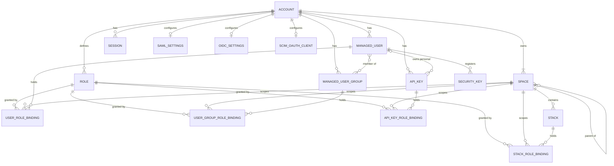
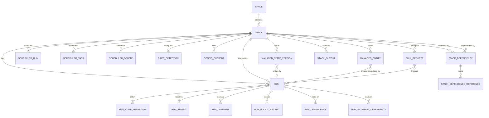
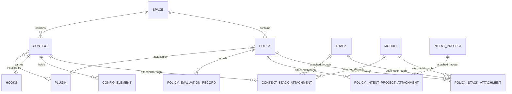
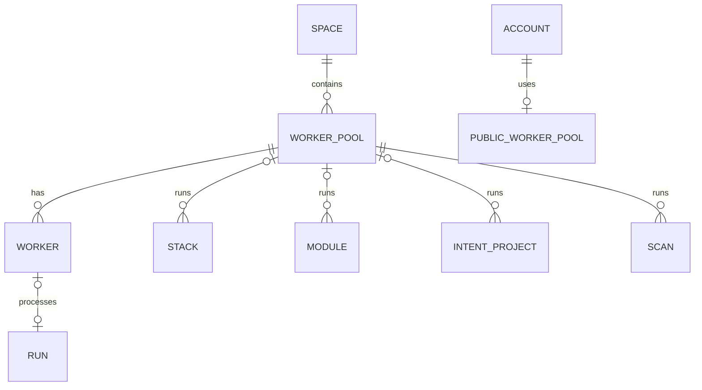
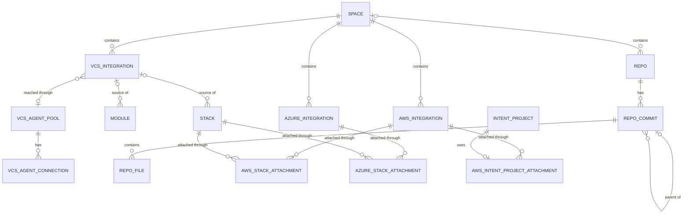
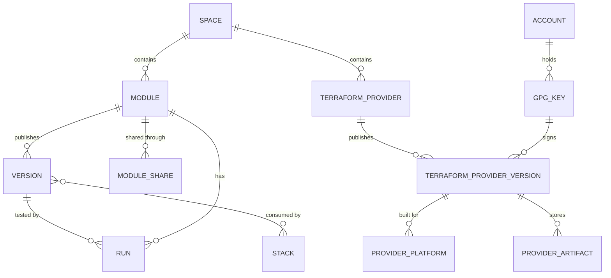
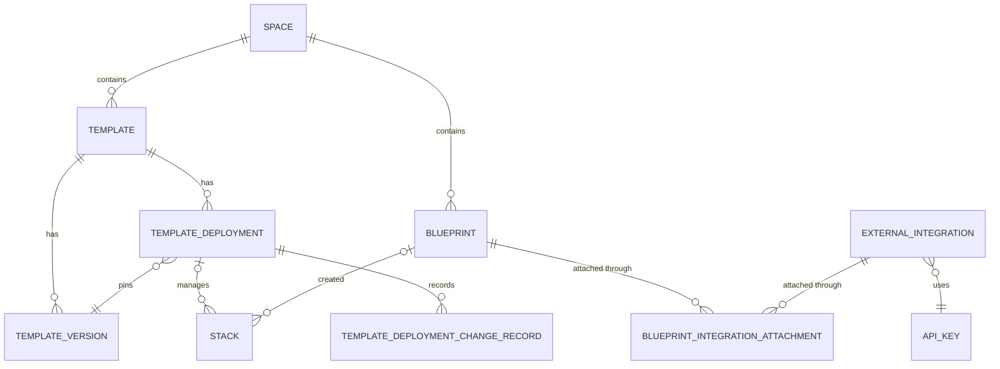
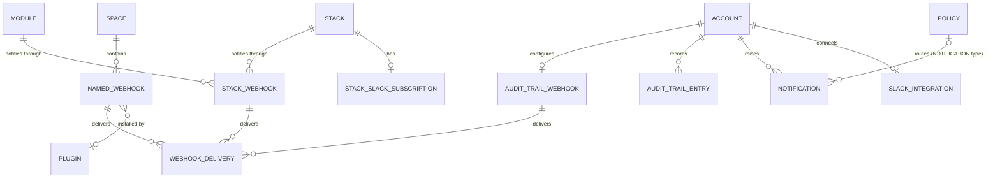
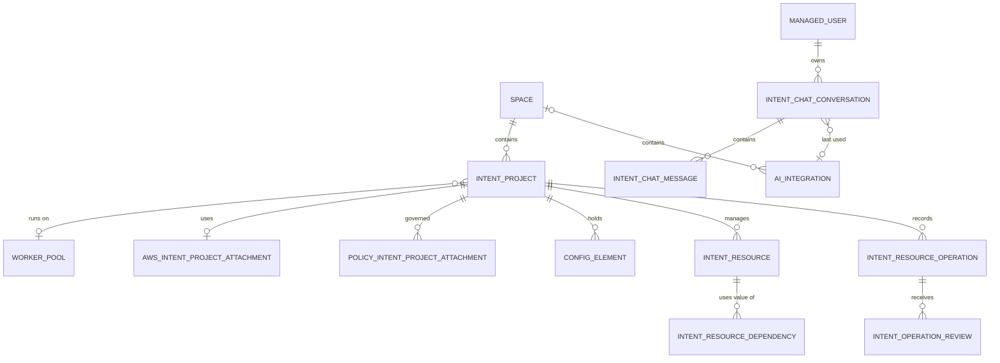
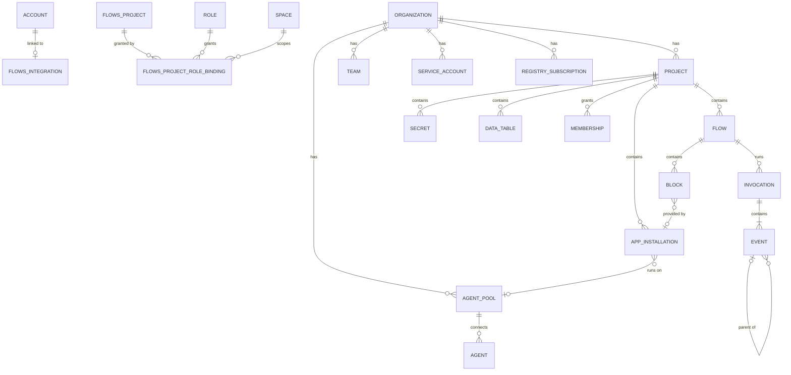

# 28: Data model

Checked against: docs read 2026-10-28; schema `b3255fe38f5e`; terraform-provider-spacelift v1.57.0 (`c72b9bd2f3c3`); reports 07 to 25 as written at the baseline.

Research baseline: **2026-10-28**.

This report records the entities Spacelift exposes on the wire and how they
relate, so that infraweave's storage can be derived from facts rather than
guessed. Sections 2 to 11 draw one entity-relationship diagram per area,
each followed by the cardinality of every relationship and the field or page
that shows it. Section 12 derives the relational tables those entities and
their access patterns imply. It is derived structure, not a design:
choosing PostgreSQL and the schema design belong to decision 0005 (planned in
[#29](https://github.com/weaveplatform/infraweave/issues/29)). Report 29 is
the generated inventory of every type, field and enum in the schema; this
report names only the fields that carry a relationship or drive a key or an
index. The behaviour behind each entity is in reports
[07](07-stack-model.md) to [25](25-other-integrations.md), and report
[26](26-scope-and-tiers.md) says which of them are in scope.

| Label | Means |
|---|---|
| **[D]** | A docs.spacelift.io page, read 2026-10-28, usually through the report that cites it |
| **[G]** | The introspection snapshot `b3255fe38f5e` ([`introspection.json`](../../../api/reference/spacelift/introspection.json)) |
| **[S]** | Source code at the cited commit |
| **[I]** | Inferred; the row says from what |
| *(unverified)* | No primary source confirms it; listed in 30-open-questions |

## 1. How to read the diagrams

### 1.1 Cardinality from the schema

The schema says little about cardinality directly; it is read from field
types [G]:

| Field shape | Reads as | Example |
|---|---|---|
| `T!` or `ID!` naming a parent | exactly one | `Run.stackId: ID!`: a run belongs to exactly one stack |
| `T` or `ID`, nullable | zero or one | `Stack.workerPool: WorkerPool`: null means the public pool |
| `[T!]!` | zero or more | `Stack.runs: [Run!]!` |
| `field(id)` returning `T` | lookup within a parent, so the child is unique per parent and ID | `Stack.run(id): Run` |
| an attachment type with its own `id` | a many-to-many relationship that carries data | `StackContextAttachment.priority` |

Where a constraint is stricter than the type, such as "at most one read
attachment per stack", the evidence column cites the rule. Mermaid's
`||` means exactly one, `|o` zero or one, `}o` zero or more and `}|` one or
more.

### 1.2 Identity and tenancy

- **Account.** Every GraphQL request is scoped to one account: the endpoint
  is the account's host, and `id`, `name` and `type` are root fields, not
  fields of an `Account` object [G]. The diagrams draw `ACCOUNT` as the
  owner of account-wide entities [I] from those root fields.
- **Slugs and ULIDs.** Stacks, modules, spaces, contexts, policies,
  templates and blueprints are addressed by a slug `id` that is unique in
  the account [G] (reports [07](07-stack-model.md),
  [14](14-spaces-rbac-and-identity.md), [17](17-blueprints-and-templates.md)).
  Templates, template versions and blueprints also expose a `ulid` [G]. Runs
  and worker pools are identified by ULIDs (`Run.id` is described as a
  "Globally unique ID (ULID)") [G] (report [10](10-workers-and-execution.md)
  section 2.1). Stacks have a ULID the schema does not expose: the usage CSV
  carries `stack_ulid` beside `stack_slug`, and `run_ulid` and
  `worker_pool_ulid` likewise [D] <https://docs.spacelift.io/product/billing/usage>.
  `stackReslug` regenerates a stack's slug from its name [G] (report 07
  section 1).
- **Spaces.** Most entities carry `space` (an ID) and `spaceDetails` (the
  object), or `space: Space!` directly [G]. A few account-wide entities have
  no space: roles, GPG keys, VCS agent pools, the audit trail webhook, the
  SSO settings [G].

## 2. Account and spaces

| Relationship | Cardinality | Evidence |
|---|---|---|
| Account to space | one to one or more | Every account starts with `root` and `legacy`, which cannot be deleted [D] (report 14 section 2.1) |
| Space to parent space | zero or one parent | `Space.parentSpace: ID` is nullable; `root` is the top of the tree [G] [D] (report 14 section 2.1) |
| Space to stack | one to zero or more; a stack in exactly one space | `Stack.space: ID!`, `Stack.spaceDetails: Space!` [G] |
| Role | account-wide, no space | `Role` has no space field; `isSystem` marks the fixed roles [G] (report 14 section 3) |
| Role binding to role, space and actor | each binding exactly one of each | `UserRoleBinding.role: Role!`, `.space: Space!`, `.user: ManagedUser!`; API key and stack bindings have the same shape; `UserGroupRoleBinding` carries only `roleID: ID!` for the role, with `space: Space!` and `userGroup: ManagedUserGroup!` [G] |
| Role to bindings | one to zero or more | `Role.roleBindings: [RoleBinding!]!` [G] |
| Actor to bindings | one to zero or more | `ManagedUser.userRoleBindings`, `ManagedUserGroup.userRoleBindings`, `ApiKey.apiKeyRoleBindings`, `Stack.roleBindings`, all `[...!]!` [G] |
| User to group | many to many | `ManagedUserGroup.managedUsers: [ManagedUser!]!` and `ManagedUser.latestGroups: [String!]!` [G]; group membership comes from the IdP at login (report 14 section 4.3) |
| User to personal API keys | one to zero or more; a key has zero or one owner | `ManagedUser.personalApiKeys: [ApiKey!]!`; `ApiKey.isPersonal`; `ApiKey.owner: String` is the owner's login, null for organization-level keys [G] |
| User to security keys | one to zero or more | `SecurityKey.owner: String!` [G]; how a key is registered is *(unverified)* (report 14) |
| Session to user | many to one, by login | `Session.login: String!`; no object reference [G] |
| SSO and SCIM settings | zero or one per account | `samlSettings`, `oidcSettings` and `scimSettings` are nullable root queries "if the account is using" them [G] |

Flows project role bindings, the fifth binding kind, are in section 11.

## 3. Stacks and runs

| Relationship | Cardinality | Evidence |
|---|---|---|
| Stack to runs | one to zero or more; a run in exactly one stack | `Run.stackId: ID!`; `Stack.runs(before)`, `Stack.run(id)` [G]; tasks are runs of type `TASK` (`Stack.tasks: [Run!]!`) [G] (report [08](08-run-lifecycle.md) section 1) |
| Run to state transitions | one to one or more | `Run.history: [RunStateTransition!]!`; every run starts in a state [G] (report 08 sections 2 and 3) |
| Run to reviews, comments, policy receipts | one to zero or more each | `Run.reviews`, `Run.comments`, `Run.policyReceipts`, all `[...!]!` [G] |
| Run to run (dependencies) | many to many through `RunDependency` | `Run.dependsOn`, `Run.isDependedOnBy`: `[RunDependency!]!`, each naming `runId` and `stackId` [G] (report [18](18-scheduling-drift-dependencies.md) section 4.4) |
| Run to external dependencies | one to zero or more | `Run.externalDependencies: [RunExternalDependency!]!` [G] (report 08 section 4) |
| Run to workflow | many runs share one `workflowId` | `Run.workflowId: ID!`; a standalone run's workflow ID is its own [G] (report 08 section 4) |
| Run to commit | exactly one commit, as a value | `Run.commit: Commit!`; `Commit` has no ID, only `hash` [G] |
| Stack to blocking run | zero or one | `Stack.blocker: Run` [G]; tracked runs and tasks take an exclusive stack lock (report 08 section 4) |
| Stack to stack (dependencies) | many to many through `StackDependency` | `Stack.dependsOn`, `Stack.isDependedOnBy: [StackDependency!]!`; `StackDependency.stack` and `.dependsOnStack` are both non-null [G]; `Stack.dependency(id, dependsOnStackId)` looks one up by the pair [G] (report 18 section 4.1) |
| Dependency to references | one to zero or more | `StackDependency.references: [StackDependencyReference!]!`; `reference(id, inputName)` [G] (report 18 section 4.5) |
| Stack to scheduled runs, tasks, deletes | one to zero or more each | `Stack.scheduledRuns`, `.scheduledTasks`, `.scheduledDeletes` [G]; `ScheduledTask.stack: ID!`, `ScheduledDelete.stack: ID!` [G] (report 18 section 2.1) |
| Stack to drift detection | zero or one | `StackIntegrations.driftDetection: DriftDetectionIntegration` is nullable [G] (report 18 section 3) |
| Stack to configuration elements | one to zero or more | `Stack.config: [ConfigElement!]!`; `configElement(id)` [G] (report [13](13-configuration.md) section 1) |
| Stack to state versions | one to zero or more | `Stack.searchManagedStateVersions` [G] (report [16](16-state-management.md) section 6) |
| State version to run | zero or one | `ManagedStateVersion.run: Run` is nullable; imported versions have none [G] (report 16 section 6.1) |
| Stack to managed entities | one to zero or more | `Stack.entities: [ManagedEntity!]!`; `ManagedEntity.stackId: ID!` [G] (report [21](21-resources-scans-search.md) section 2.2) |
| Managed entity to run | zero or one creator, zero or one updater | `ManagedEntity.creator: Run`, `.updater: Run` [G] |
| Stack to outputs | one to zero or more | `Stack.outputs: [StackOutput!]!` [G] |
| Pull request to runs | zero or more runs per pull request; no `Run` field names a pull request, so whether a run can sit under several is not shown *(unverified)* | `PullRequest.runs: [Run!]!`; `PullRequest.run` is deprecated [G] (report [11](11-vcs-integrations.md) section 12.5) |

## 4. Policies and contexts

| Relationship | Cardinality | Evidence |
|---|---|---|
| Space to policies and contexts | one to zero or more; each in exactly one space | `Policy.space: ID!`, `Context.space: ID!` [G] |
| Policy to stack or module | many to many through an attachment | `Policy.attachedStacks: [PolicyStackAttachment!]!` with `stackId` and `isModule`; `Stack.attachedPolicies: [StackPolicyAttachment!]!` with `policyId` [G] (report [09](09-policies.md) section 7) |
| One attachment per policy and stack | at most one | `Policy.attachedStack(id)` returns a single attachment per stack [G] [I] from the lookup shape |
| Login and other unattachable types | no attachments | Login policies live in `root` and apply account-wide; they cannot be attached [D] (report 14 section 5.2) |
| Auto-attachment | derived, flagged | `isAutoattached` on both attachment views; `autoattach:<label>` labels [G] [D] (report 09 section 7) |
| Policy to Intent projects | many to many | `Policy.attachedIntentProjects: [PolicyIntentProjectAttachment!]!`; `IntentProject.attachedPolicies` [G] |
| Policy to evaluation records | one to zero or more | `Policy.evaluationRecords: [PolicyEvaluationRecord!]!`, keyed by `key` [G] (report 09 section 6) |
| Context to stack or module | many to many through an attachment with `priority` | `Context.attachedStacks: [ContextStackAttachment!]!` with `stackId`, `isModule`, `priority: Int!`; `Stack.attachedContexts` [G] (report 13 section 5.3) |
| Context to configuration elements | one to zero or more | `Context.config: [ConfigElement!]!` [G] |
| Context to hooks | exactly one hooks object | `Context.hooks: Hooks!` [G] (report 13 section 5.5) |
| Policy or context to plugin | zero or one | `Policy.plugin: Plugin`, `Context.plugin: Plugin` [G] (report [25](25-other-integrations.md) section 2) |

A configuration element belongs to exactly one owner: a stack, a module, a
context or an Intent project (`Stack.config`, `Module.config`,
`Context.config`, `IntentProject.configElements`) [G]. `ConfigElement` itself
carries no owner field, so the owner is known only from the path it was read
through [G].

## 5. Workers

| Relationship | Cardinality | Evidence |
|---|---|---|
| Space to private pools | one to zero or more; a pool in exactly one space | `WorkerPool.space: ID!` [G] (report [10](10-workers-and-execution.md) section 2) |
| Pool to workers | one to zero or more | `WorkerPool.workers: [Worker!]!`, `workersCount` [G] |
| Account to public pool | zero or one, shared | The `publicWorkerPool` root query returns a nullable `PublicWorkerPool` with `parallelism` per account [G] (report 10 section 1.1); self-hosted and FedRAMP have no public pool [D] (report 26 sections 2.3 and 2.4) |
| Stack or module to pool | zero or one private pool; null means the public pool | `Stack.workerPool: WorkerPool`, `Module.workerPool: WorkerPool` [G] |
| Pool to its users | one to zero or more | `WorkerPool.users: [WorkerPoolUser!]!` with `stackId` and `isModule` [G] |
| Pool to Intent projects and scans | one to zero or more | `WorkerPool.intentProjects`, `WorkerPool.scans`; `Scan.workerPool: ID!` [G] |
| Worker to run | zero or one at a time | A worker processes one run at a time [D]; `Worker.busy` [G] (report 10 section 1). No schema field names the worker of a run [G]; how Spacelift records it is *(unverified)* |

## 6. VCS and cloud integrations

| Relationship | Cardinality | Evidence |
|---|---|---|
| Space to VCS integrations | one to zero or more; an integration in exactly one space | `VCSIntegration.space: Space!` [G]; the provider-specific types declare `space` nullable, the common view does not [G] |
| Default integration | at most one per provider per account | One default and any number of space-level integrations per provider [D] (report 11 section 2.3) |
| Stack or module to VCS integration | zero or one; null means the provider default or a detached stack | `Stack.vcsIntegration: VCSIntegration` [G]; `vcsIntegrationId` empty means the default; deleting an integration in use sets `vcsDetached` [D] [G] (report 11 section 2.3) |
| Stack to repository | exactly one provider, repository and branch | `Stack.provider: VCSProvider!`, `.repository: String!`, `.branch: String!` [G] (report 11 section 2.4) |
| VCS integration to agent pool | zero or one, by address | `private://<pool>` in the integration's host [D] (report 11 section 14.2); no schema field links them [G]; which host field the service routes by is *(unverified)* |
| Agent pool to connections | one to zero or more | `VCSAgentPool.agentConnections: [VCSAgentConnection!]!` [G] |
| Spacelift Repos | repo to commits one to many; commit to parent zero or one, and a commit may be the parent of zero or more; commit to files one to many; repo to space zero or one (`Repo.space: Space` is nullable) | `Repo.commits`, `RepoCommit.parentCommit: RepoCommit`, `RepoCommit.files: [RepoFile!]!`, `RepoFile.commit: RepoCommit!` [G] |
| Repo to stacks and modules | one to zero or more | `Repo.stacks: [ID!]!`, `Repo.modules: [ID!]!` [G] |
| Space to cloud integrations | one to zero or more | `AwsIntegration.space: ID!`, `AzureIntegration.space: ID!` [G] (report [12](12-cloud-integrations-and-oidc.md)) |
| AWS integration to stack | many to many, with `read` and `write` | `AwsIntegration.attachedStacks`, `Stack.attachedAwsIntegrations` [G]; a stack has at most one read and one write AWS attachment, and one integration may serve both [G] (report 12 section 2.6) |
| Azure integration to stack | many to many, with `read`, `write` and `subscriptionId` | `AzureIntegration.attachedStacks`, `Stack.attachedAzureIntegrations` [G] (report 12 section 3) |
| AWS integration to Intent project | zero or one per project | `IntentProject.awsIntegrationIntentProjectAttachment` is a single nullable field with `awsRegion` [G] (report 12 section 2.6) |
| Legacy per-stack AWS role | zero or one per stack, superseded | `StackIntegrations.aws: StackIntegrationAws!`; `AwsIntegration.legacy` [G]; report 26 section 7.7 |

Blob storage and Origin integrations are further `VCSProvider` sources with
the same envelope (`space`, `isDefault`, `labels`, `vcsChecks`) [G] (report
11 section 10). The GitHub built-in app has its own singleton query
(`githubIntegration`) [G].

## 7. Modules and providers

| Relationship | Cardinality | Evidence |
|---|---|---|
| Space to modules | one to zero or more | `Module.space: ID!` [G] (report [15](15-module-and-provider-registry.md) section 2) |
| Module to versions | one to zero or more; version numbers unique per module | `Module.versions(before, includeFailed): [Version!]!`, `Module.version(id)`, `versionFind(term)` [G]; numbering rules [D] (report 15 sections 6.1 and 6.4) |
| Version to test runs | one to zero or more | `Version.runs: [Run!]!`, `Version.metadataParsingRun: Run` [G] (report 15 section 5) |
| Version to consuming stacks | many to many | `Version.consumers: [Stack!]!`, `Stack.moduleVersionsUsed: [Version!]!` [G] (report 15 section 6.7) |
| Module to shares | one to zero or more | `Module.moduleShares: [ModuleShare!]!` with `from` and `to` scopes [G] (report 15 section 7) |
| Module to runs | one to zero or more | `Module.run(id)`, `Module.runsInRange` [G] |
| Module attachments | as a stack | Modules share the stack attachment types for policies, contexts and cloud integrations, flagged `isModule` [G] (section 4) |
| Space to providers | one to zero or more; `type` unique in the account | `TerraformProvider.space: ID!`; the type is the provider's ID [G] [D] (report 15 section 10.1) |
| Provider to versions | one to zero or more | `TerraformProvider.versions`, `version(number)` [G] |
| Version to platforms and artifacts | one to zero or more each | `TerraformProviderVersion.platforms`, `.artifacts` [G] (report 15 section 10.2) |
| Version to signing key | exactly one | `TerraformProviderVersion.signingKeyId: ID!` [G] (report 15 section 10.4) |
| GPG keys | account-wide | `GPGKey` has no space field [G] |

## 8. Templates

| Relationship | Cardinality | Evidence |
|---|---|---|
| Space to templates | one to zero or more | `Template.space: Space!` [G] (report [17](17-blueprints-and-templates.md) section 3) |
| Template to versions | one to zero or more | `Template.templateVersion(id)`, `templateVersionByNumber`, `searchTemplateVersions`; `TemplateVersion.templateDetails: Template!` [G] |
| Template to deployments | one to zero or more | Deployments are addressed with `templateID` [G] (report 17 section 3) |
| Deployment to version | exactly one | `TemplateDeployment.templateVersion: TemplateDeploymentVersion!` [G]; each deployment pins one version [D] (report 17 section 1) |
| Deployment to stacks | one to zero or more; a stack in at most one deployment | `TemplateDeployment.stacks: [TemplateDeploymentStack!]!`; `Stack.templateDeployment: TemplateDeployment` is nullable [G] |
| Deployment to change records | one to zero or more | `searchChangeHistory` returns `TemplateDeploymentChangeRecord` [G] |
| Blueprint to stacks | one to zero or more; a stack created from at most one blueprint | `Stack.blueprint: Blueprint` is nullable; the blueprint has no effect after creation [G] [D] (report 17 section 1) |
| Blueprint to external integrations | many to many | `Blueprint.externalIntegrations`, `ExternalIntegration.attachedBlueprints`: `[BlueprintIntegrationAttachment!]!` [G] (report 25 section 3) |
| External integration to API key | exactly one; an API key serves zero or more | `ExternalIntegration.apiKey: ApiKey!` [G]; no `ApiKey` field names an integration [G] |

The versioned-blueprint family (`BlueprintVersionedGroup`,
`BlueprintDeployment`) mirrors templates under older names and is
superseded (report 26 section 7.2); it is not drawn.

## 9. Events

| Relationship | Cardinality | Evidence |
|---|---|---|
| Space to named webhooks | one to zero or more | `NamedWebhooksIntegration.space: Space!` [G] (report [19](19-events-notifications-audit.md) section 6) |
| Stack or module to webhooks | one to zero or more | `StackIntegrations.webhooks: [WebhooksIntegration!]!`, `webhook(id)` [G] (report 19 section 7) |
| Webhook to deliveries | one to zero or more, paged | `deliveries(token): WebhookDeliveries` on named, stack and audit webhooks [G] (report 19 section 6) |
| Account to audit trail webhook | zero or one | `auditTrailWebhook` is a nullable root query [G] (report 19 section 8) |
| Account to audit entries | one to zero or more | `searchAuditTrailEntries` [G]; each entry has exactly one affected resource and zero or one related resource (`affectedResource: AuditTrailResource!`, `relatedResource: AuditTrailResource`) [G] |
| Notification to target | exactly one target entity | `Notification.target: ID!`, `type: NotificationType!`; repeats collapse under `groupingKey` [G] [I] (report 19 section 2) |
| Notification policy to outputs | one policy to zero or more inbox entries, Slack messages, webhook calls | Rules `inbox`, `slack`, `webhook`, `pull_request` [D] (report 19 section 3); no `Notification` field names a policy, so an inbox entry has zero or one routing policy [G] |
| Account to Slack | zero or one workspace | `slackIntegration` root query; `SlackIntegration.teamID` [G] (report 19 section 4) |
| Stack to Slack subscription | zero or one, possibly inactive | `Stack.integrations: StackIntegrations` is nullable; when present, `StackIntegrations.slack: StackIntegrationSlack!` with `activated` and `channelNames` is always set [G] |
| Run state changes | the source of most events | Stack webhooks fire on every run state change; the audit webhook optionally includes runs (`includeRuns`) [G] [D] (report 19 sections 7 and 8) |

## 10. Intent

| Relationship | Cardinality | Evidence |
|---|---|---|
| Space to Intent projects | one to zero or more | `IntentProject.space: Space!` [G] (report [22](22-intelligence.md) section 5.2) |
| Project to worker pool | zero or one; null means the public pool | `IntentProject.workerPool: WorkerPool` [G] |
| Project to AWS integration | zero or one | A single nullable attachment field [G] (section 6) |
| Project to policies | many to many | `IntentProject.attachedPolicies: [IntentProjectPolicyAttachment!]!` [G] (report 22 section 6) |
| Project to configuration | one to zero or more | `IntentProject.configElements: [ConfigElement!]!` [G] |
| Project to resources | one to zero or more; a resource in exactly one project | `IntentResource.intentProjectID: String!`, `resourceID: String!` [G] |
| Resource to resource | many to many through dependencies | `IntentResourceDependency.fromResourceID`, `.toResourceID`, both non-null [G]; the open-source store keys them as a composite primary key [S] (report 22 section 8.4) |
| Project to operations | one to zero or more; each names one resource | `IntentResourceOperation.resourceID: String!` [G] (report 22 section 5.5) |
| Operation to reviews | one to zero or more | `IntentResourceOperation.reviews: [IntentResourceOperationReview!]!` [G] |
| Project lock | zero or one holder at a time | `isLocked`, `lockedBy`, `lockedUntil` [G] (report 22 section 5.4) |
| Conversation owner | one user | History is kept per user [D] (report 22 section 4.2); no schema field names the owner [G], so how it is stored is *(unverified)* |
| Conversation to messages | one to zero or more | `IntentChatConversation.messages: [IntentChatMessage!]!` [G] |
| Conversation to AI integration | zero or one, the last used | `lastUsedAIIntegration: AIIntegration` [G] |
| Space to AI integrations | zero or one space per integration | `AIIntegration.space: Space` is nullable; Spacelift-provided integrations have `isSpaceliftProvided` [G] (report 22 section 3.1) |

## 11. Flows

Flows is a separate product with its own API (report [23](23-flows.md)
section 10). The Deploy schema holds only its edges: `FlowsIntegration`,
`FlowsProject` and `FlowsProjectRoleBinding` [G]. The Flows side comes from
the docs and the Flows Terraform provider (report 23 section 2).

| Relationship | Cardinality | Evidence |
|---|---|---|
| Deploy account to Flows organization | zero or one | `flowsIntegration` returns `FlowsIntegration { organizationID, organizationName, baseURL }` [G] (report 23 section 15) |
| Flows project to role bindings | one to zero or more; each binding names one role and one space | `FlowsProject.roleBindings: [FlowsProjectRoleBinding!]!`; `FlowsProjectRoleBinding.role: Role!`, `.space: Space!`, `.flowsProjectID: ID!` [G] |
| Organization to projects, teams, service accounts, agent pools, registry subscriptions | one to zero or more each | [D] (report 23 section 2) |
| Personal sandbox | one project per user | [D] (report 23 section 2) |
| Project to flows, app installations, secrets, data tables | one to zero or more each | [D] [S] (report 23 section 2) |
| Flow to blocks | one to zero or more; block names unique in a flow | Blocks are identified by name inside a flow; the provider keys block IDs by name [D] [S] (report 23 section 3.2) |
| App to installations | one app to many installations per project | [D] (report 23 section 6.1) |
| Installation or HTTP block to agent pool | zero or one; the default is the public agent pool | [D] (report 23 section 8) |
| Agent pool to projects | a private pool is exposed to listed projects | [D] (report 23 section 8) |
| Event to parent event | zero or one predecessor; an event with none starts an invocation | [D] (report 23 section 4.1) |
| Invocation to events | one to one or more | Every descendant of the root event belongs to its invocation [D] (report 23 section 4.1) |

## 12. Storage tables [I]

Everything in this section is derived **[I]**. It is derived from:
- the entities and cardinalities of sections 2 to 11;
- the access patterns the cited reports describe, such as the run queue
  order, event routing by repository and branch, and paging by time;
- the identity rules of section 1.2.

It is not a schema. The database engine, key types, naming, partitioning and
migrations are decision 0005. "Account" in every key is the tenant scope
of section 1.2; whether infraweave stores more than one account per
installation is a plan decision.

### 12.1 Shapes that recur

| Shape | Derivation | Driven by |
|---|---|---|
| Slug plus ULID | Entities addressed by slug keep a stable internal key (the ULID) and a unique `(account, slug)`; renaming (`stackReslug`) updates only the slug | Report 07; [G] `Stack.id`, `Template.ulid`; [D] the usage CSV's `stack_ulid` |
| Space column | Most tables carry `space_id` with an index, because every read is filtered by the caller's reachable spaces | Report 14 section 2.3 |
| Labels | A label array with an inverted index, because auto-attachment and search match on labels | Report 13 section 5.4; report 09 section 7; report 21 section 6 |
| Attachment table | A row per pair with its own ID, a unique `(left, right)` constraint and `is_autoattached` | Section 4; report 12 section 2.6 |
| Polymorphic owner | Configuration elements, webhooks and role bindings attach to several owner kinds; an `owner_kind` column with `owner_id` | Sections 2, 4 and 9 |
| Write-only secrets | Secret values stored encrypted and never returned; a checksum is readable | Report 13 section 4 |
| Blobs outside the database | Logs, state files, plan artifacts, module and provider archives live in object storage; tables keep keys and metadata | Reports 08, 16, 15; self-hosted buckets in report 24 section 3.2 |
| Soft delete | Entities with `deleted: Boolean!` keep a tombstone while references remain | [G] `Stack.deleted`, `WorkerPool.deleted`, `Template` versions |

### 12.2 Account and spaces

| Table | Key | Main columns | Foreign keys | Indexes | Driven by |
|---|---|---|---|---|---|
| `accounts` | `id` | name, type, authorization scheme, account settings, tier features | none | unique name | Report 04 sections 3.1 and 3.2; report 26 section 3 |
| `spaces` | `(account, slug)` | name, description, labels, `inherit_entities`, `parent_space` | `parent_space` to `spaces` | `(account, parent_space)` for subtree walks | Report 14 sections 2.1 and 2.3 |
| `roles` | `(account, ulid)` | slug, name, `is_system`, description | none | unique `(account, slug)` | Report 14 section 3 |
| `role_actions` | `(role, action)` | action from the `Action` enum | `role` | none beyond the key | Report 14 section 3.3 |
| `users` | `(account, ulid)` | username, invitation email, login method, status, role, last login, Slack member ID | none | unique `(account, username)` | Report 14 section 9 |
| `user_groups` | `(account, ulid)` | group name, identity provider, status | none | unique `(account, identity provider, group name)` | Report 14 section 9 |
| `user_group_members` | `(group, user)` | source (login or SCIM) | `group`, `user` | `(user)` | Report 14 sections 4.3 and 7.1 |
| `api_keys` | `(account, ulid)` | name, type, hashed secret, OIDC settings, owner (personal), teams, expiry, disabled reason, last used | `owner` to `users` | `(account, owner)`; `(expires_at)` | Report 14 section 8 |
| `role_bindings` | `(account, ulid)` | actor kind (user, group, API key, stack, Flows project), actor ID, role, space | `role`, `space` | `(space)`; `(actor kind, actor ID)` | Report 14 section 4 |
| `sessions` | `(account, id)` | login, channel, admin, teams, IP, expiry, access snapshot | none | `(account, login)`; `(expires_at)` for expiry | Report 14 section 10 |
| `security_keys` | `(account, id)` | owner, name, credential | none | `(account, owner)` | Report 14 section 7.2 |
| `sso_settings` | `(account, kind)` | SAML or OIDC settings and claim mapping | none | none beyond the key | Report 14 section 6 |
| `scim_clients` | `account` | client ID, hashed secret | none | none beyond the key | Report 14 section 7.1 |

### 12.3 Stacks and runs

| Table | Key | Main columns | Foreign keys | Indexes | Driven by |
|---|---|---|---|---|---|
| `stacks` | `(account, ulid)` | slug, name, space, vendor configuration, provider, repository, branch, project root, labels, flags (`autodeploy`, `autoretry`, `protectFromDeletion`, `isDisabled`), state, lock (`lockedBy`, `lockNote`, `lockedAt`), tracked commit, runner image, worker pool, VCS integration | `space`, `worker_pool`, `vcs_integration`, `template_deployment`, `blueprint` | unique `(account, slug)`; `(space)`; `(vcs_integration, repository, branch)` for push routing; labels | Report 07 sections 2, 5 and 6; report 11 section 11.2 |
| `stack_hooks` | `(stack, phase)` | before and after command lists | `stack` | none beyond the key | Report 07 section 2.4; report 08 section 5 |
| `runs` | `(account, ulid)` | stack, type, state, state version, commit hash, branch, triggered by, workflow ID, priority preset, drift flag, force-apply mode, expected failure, title, created and updated times | `stack` | `(stack, created_at)` for `runs(before)` paging; `(worker_pool, state, priority, type, created_at)` for the pool queue; `(stack, commit, type)` for event deduplication; `(workflow_id)` | Report 08 sections 1, 4 and 9; report 10 section 5.3 |
| `run_state_transitions` | `(run, sequence)` | state, state version, timestamp, until, username, note, terminal, has logs | `run` | none beyond the key | Report 08 section 3 |
| `run_reviews` | `(run, id)` | author, decision, note, state and state version reviewed | `run` | none beyond the key | Report 08 section 6; report 09 section 3.3 |
| `run_comments` | `(run, id)` | username, body | `run` | none beyond the key | [G] `RunComment` |
| `run_policy_receipts` | `(run, id)` | policy, type, outcome, flags, sampled, engine type | `run`, `policy` (nullable once deleted) | none beyond the key | Report 09 sections 5 and 6 |
| `run_dependencies` | `(run, depends_on_run)` | state | both to `runs` | `(depends_on_run)` for the reverse edge | Report 18 section 4.4 |
| `run_external_dependencies` | `(run, name)` | status, completed at | `run` | `(account, name)` for `runExternalDependencyMarkAsCompleted` | Report 08 section 4 |
| `stack_dependencies` | `(account, ulid)` | stack, depends-on stack, `triggerAlways` | both to `stacks` | unique `(stack, depends_on)`; `(depends_on)` for `isDependedOnBy` | Report 18 section 4 |
| `stack_dependency_references` | `(dependency, id)` | output name, input name, type, `triggerAlways` | `dependency` | unique `(dependency, input_name)` | Report 18 section 4.5 |
| `scheduled_jobs` | `(stack, id)` | kind (run, task, delete), cron list or timestamp, timezone, next fire time, command, runtime config, delete resources | `stack` | `(next_fire_at)` for the scheduler | Report 18 section 2 |
| `drift_detection` | `stack` | schedule, timezone, reconcile, ignore state, next fire time | `stack` | `(next_fire_at)` | Report 18 section 3 |
| `config_elements` | `(owner kind, owner, id)` | type (environment variable or file), value or encrypted value, write-only, runtime, file mode, checksum | owner by kind | none beyond the key | Report 13 section 1 |
| `managed_state_versions` | `(stack, id)` | object key, size, run, rollback, imported by and when | `stack`, `run` | `(stack, last_modified)` | Report 16 section 6 |
| `managed_entities` | `(stack, address)` | type, name, parent, vendor, creator run, updater run, drifted, metadata | `stack`, runs | `(account, type)` and search fields | Report 21 section 2 |
| `stack_outputs` | `(stack, name)` | value or encrypted value, sensitive | `stack` | none beyond the key | Report 18 section 4.5 |
| `pull_requests` | `(stack, id)` | head branch, head SHA, author, title, URL, draft | `stack` | `(stack, head_sha)` | Report 11 section 12.5 |

### 12.4 Policies and contexts

| Table | Key | Main columns | Foreign keys | Indexes | Driven by |
|---|---|---|---|---|---|
| `policies` | `(account, ulid)` | slug, name, space, type, engine type, body, labels, description | `space` | unique `(account, slug)`; `(space, type)`; labels for auto-attach | Report 09 sections 1 and 9 |
| `policy_attachments` | `(account, id)` | policy, target kind (stack, module, Intent project), target, `is_autoattached` | `policy`, target | unique `(policy, target kind, target)`; `(target kind, target)` | Report 09 section 7 |
| `policy_evaluations` | `(policy, key)` | outcome, timestamp, sampled input reference | `policy` | `(policy, timestamp)` | Report 09 section 6 |
| `contexts` | `(account, ulid)` | slug, name, space, description, labels, hooks | `space` | unique `(account, slug)`; `(space)`; labels | Report 13 section 5 |
| `context_attachments` | `(account, id)` | context, target kind (stack, module), target, priority, `is_autoattached` | `context`, target | unique `(context, target)`; `(target, priority)` for precedence | Report 13 sections 5.3 and 7 |

### 12.5 Workers

| Table | Key | Main columns | Foreign keys | Indexes | Driven by |
|---|---|---|---|---|---|
| `worker_pools` | `(account, ulid)` | name, space, description, labels, credentials, drift run limit, preparing timeout, managed by the Kubernetes controller | `space` | `(space)` | Report 10 section 2 |
| `workers` | `(pool, ulid)` | status, busy, drained, metadata, available since, current run | `pool`, `run` | `(pool, status)`; newest first within a pool | Report 10 section 3 and section 5.3 |
| `public_pool` | `account` | parallelism | none | none beyond the key | Report 10 section 1.1 |

### 12.6 VCS and cloud integrations

| Table | Key | Main columns | Foreign keys | Indexes | Driven by |
|---|---|---|---|---|---|
| `vcs_integrations` | `(account, id)` | provider, name, space, `is_default`, labels, check mode, check options, provider settings and encrypted credentials, webhook secret | `space` | partial unique `(account, provider)` where default; `(space)` | Report 11 sections 2 to 8 |
| `vcs_agent_pools` | `(account, ulid)` | name, description, encrypted config | none | unique `(account, name)` for `private://<pool>` | Report 11 section 14 |
| `repos` | `(account, slug)` | name, space, labels, `is_default`, check mode | `space` | `(space)` | Report 11 section 10 |
| `repo_commits` | `(repo, sha)` | message, author, parent | `repo`, parent | `(repo, created_at)` | [G] `RepoCommit` |
| `repo_files` | `(commit, path)` | object key, size, mode, deleted | `commit` | `(repo, path)` for file history | [G] `RepoFile`, `repoFileHistory` |
| `cloud_integrations` | `(account, ulid)` | kind (AWS or Azure), name, space, labels, auto-attach, kind settings (role ARN, external ID, duration, tenant, application) | `space` | `(space)`; labels | Report 12 sections 2 and 3 |
| `cloud_integration_attachments` | `(account, id)` | integration, target kind (stack, module, Intent project, scan), target, `read`, `write`, subscription or region, `is_autoattached` | integration, target | unique `(integration, target)`; at most one read and one write AWS attachment per target | Report 12 section 2.6 |

### 12.7 Modules and providers

| Table | Key | Main columns | Foreign keys | Indexes | Driven by |
|---|---|---|---|---|---|
| `modules` | `(account, ulid)` | slug, name, provider name, space, repository, branch, project root, labels, workflow tool, public, worker pool, VCS integration | `space`, `worker_pool`, `vcs_integration` | unique `(account, slug)`; `(account, name, provider)` for registry addressing | Report 15 sections 2 and 9 |
| `module_versions` | `(module, ulid)` | number, state, commit, notes, metadata, yanked and by whom, download object key | `module` | unique `(module, number)` | Report 15 section 6 |
| `module_version_consumers` | `(version, stack)` | none | both | `(stack)` | Report 15 section 6.7 |
| `module_shares` | `(module, id)` | from and to scopes | `module` | `(to scope)` | Report 15 section 7 |
| `terraform_providers` | `(account, type)` | space, labels, public | `space` | none beyond the key | Report 15 section 10.1 |
| `provider_versions` | `(provider, ulid)` | number, status, protocol versions, signing key, verified at, docs | `provider`, `gpg_key` | unique `(provider, number)` | Report 15 section 10.2 |
| `provider_version_platforms` | `(version, os, arch)` | artifact object keys and checksums | `version` | none beyond the key | Report 15 sections 9.4 and 10.2 |
| `gpg_keys` | `(account, ulid)` | name, public key, description, revoked at and by | none | none beyond the key | Report 15 section 10.4 |

### 12.8 Templates and blueprints

| Table | Key | Main columns | Foreign keys | Indexes | Driven by |
|---|---|---|---|---|---|
| `templates` | `(account, ulid)` | slug, name, space, labels | `space` | unique `(account, slug)` | Report 17 section 3 |
| `template_versions` | `(template, ulid)` | version number, state, raw body, inputs, stack keys, published at, deprecated at and note | `template` | `(template, version)`; whether it is unique is *(unverified)* (report 17 section 7.3) | Report 17 sections 7.2 to 7.4 |
| `template_deployments` | `(template, slug)` | name, space, pinned version, type (`TEST` or not), state, inputs, scheduled delete | `template`, `template_version` | `(space)` | Report 17 section 9 |
| `template_deployment_changes` | `(deployment, ulid)` | version and inputs, previous version and inputs | `deployment` | `(deployment, created_at)` | Report 17 section 9 |
| `blueprints` | `(account, ulid)` | slug, name, space, state, raw body, inputs, labels | `space` | unique `(account, slug)` | Report 17 section 4 |
| `external_integrations` | `(account, id)` | name, type, space, custom config, API key | `space`, `api_key` | none beyond the key | Report 25 section 3 |
| `blueprint_integration_attachments` | `(blueprint, integration)` | none | both | `(integration)` | Report 25 section 3 |

A stack created by a template deployment or a blueprint carries the
deployment or blueprint as a nullable column on `stacks` (section 12.3).

### 12.9 Events

| Table | Key | Main columns | Foreign keys | Indexes | Driven by |
|---|---|---|---|---|---|
| `webhooks` | `(account, ulid)` | kind (named, stack, audit), owner (space, stack or module, account), name, endpoint, enabled, retry on failure, labels, include runs | owner by kind | `(owner kind, owner)` | Report 19 sections 6 to 8 |
| `webhook_secret_headers` | `(webhook, name)` | encrypted value | `webhook` | none beyond the key | Report 19 section 6 |
| `webhook_deliveries` | `(webhook, id)` | status, timestamp, request and response object keys | `webhook` | `(webhook, timestamp)` for paging and retention | Report 19 section 6, "Delivery records" |
| `audit_trail_entries` | `(account, ulid)` | actor, action, event type, affected resource, related resource, body, remote IP, created at | none | `(account, created_at)`; search fields | Report 19 section 8 |
| `notifications` | `(account, id)` | type, target, severity, title, body, grouping key, occurrences, last occurrence, dismissed | none | unique `(account, grouping_key)` while open; `(account, dismissed, timestamp)` | Report 19 section 2 |
| `slack_integrations` | `account` | team ID and name, environment, tokens | none | none beyond the key | Report 19 section 4 |
| `stack_slack_subscriptions` | `stack` | activated, channel names | `stack` | none beyond the key | Report 19 section 4 |

### 12.10 Intent

| Table | Key | Main columns | Foreign keys | Indexes | Driven by |
|---|---|---|---|---|---|
| `intent_projects` | `(account, ulid)` | name, space, labels, state, created by, lock holder and expiry, worker pool, runner image | `space`, `worker_pool` | `(space)` | Report 22 sections 5.2 and 5.4 |
| `intent_resources` | `(project, resource_id)` | type, address, name, provider and version, state (JSON), HCL, last operation, changed by | `project` | `(project, provider, type)` | Report 22 sections 5.5 and 8.4 |
| `intent_resource_dependencies` | `(from_resource, to_resource)` | dependency type, explanation, field mappings | both to `intent_resources` | `(to_resource)` | Report 22 section 5.7; [S] storage schema |
| `intent_operations` | `(project, id)` | resource, operation, allow and deny results, state, failure, current and proposed state, author | `project` | `(project, created_at)`; `(resource)` | Report 22 section 5.5 |
| `intent_operation_reviews` | `(operation, id)` | author, decision, note, timestamp | `operation` | none beyond the key | Report 22 section 5.5 |
| `ai_integrations` | `(account, ulid)` | name, space, provider, provider integration, base URL, models, enabled, Spacelift-provided, encrypted credentials | `space` | `(space)` | Report 22 section 3 |
| `chat_conversations` | `(account, id)` | owner, description, version, last AI integration and model | `owner` to `users` | `(owner, updated_at)` | Report 22 section 4.2 |
| `chat_messages` | `(conversation, id)` | role, content (JSON) | `conversation` | none beyond the key | Report 22 section 4.2 |

### 12.11 Flows

| Table | Key | Main columns | Foreign keys | Indexes | Driven by |
|---|---|---|---|---|---|
| `flows_organizations` | `id` | name, domain, OIDC providers, two-factor enforcement | none | none beyond the key | Report 23 sections 2 and 9 |
| `flows_projects` | `id` | organization, name, personal sandbox owner | `organization` | `(organization)` | Report 23 section 2 |
| `flows_memberships` | `(project, member kind, member)` | role (Consumer, Viewer, Editor, Admin) | `project` | `(member kind, member)` | Report 23 section 9.1 |
| `flows` | `id` (UUID) | project, name, active, event limit, definition | `project` | `(project)` | Report 23 section 3.1 |
| `flow_blocks` | `id` (UUID) | flow, name, type, configuration, error handler, lifecycle state, app installation | `flow`, installation | unique `(flow, name)` | Report 23 section 3.2 |
| `app_installations` | `id` | project, app and version, name, configuration, state, agent pool | `project`, `agent_pool` | `(project)` | Report 23 section 6.1 |
| `agent_pools` | `id` | organization, name, hashed token, exposed projects | `organization` | none beyond the key | Report 23 section 8 |
| `flow_events` | `id` (UUIDv7) | flow, block, output, parent event, invocation, body, echo, pending status | `flow`, parent | `(invocation)`; `(flow, created_at)` for limits | Report 23 sections 4.1 and 4.3 |
| `flow_invocations` | `id` | flow, root event, state | `flow` | `(flow, created_at)` | Report 23 section 4.2 |
| `flows_secrets`, `flows_data_tables` | `(project, name)` | encrypted value; typed columns and rows | `project` | none beyond the key | Report 23 section 2 |

Deploy-side Flows project role bindings are rows of `role_bindings` with
actor kind Flows project (section 12.2).

## 13. The generated inventory

Report 29 is generated from the introspection snapshot and lists every object
type with every field (type, nullability, deprecation) and every enum value.
This report draws on it for relationships only. When a table here and report
29 disagree about a field, report 29 is the higher source, because it is
regenerated from the snapshot and fails verification on drift.

## What this means for infraweave

- The model is space-scoped almost everywhere; every table needs a space
  column and every query a reachable-space filter.
- Attachments are first-class rows with their own IDs, flags and
  constraints, not plain join tables.
- Runs need three access paths at once: by stack in time order, by pool in
  scheduling order, and by workflow.
- Several relationships exist only by convention, with no schema field: the
  worker processing a run, the owner of a configuration element, the owner of
  a chat conversation, the agent pool behind a VCS integration. The plan has
  to decide how infraweave records them.
- Large payloads (logs, state, artifacts, deliveries) belong in object
  storage with metadata in tables, as self-hosted Spacelift does.
- Flows is a separate model with its own tenancy (organizations) and
  identifiers (UUIDs); the plan decides whether it shares a database with
  Deploy.

## Inferred and undocumented

- Cardinalities read from field types are facts about the schema; where a
  lookup shape implies uniqueness (`attachedStack(id)`), the uniqueness is
  inferred [I].
- The `ACCOUNT` entity is inferred from the root fields `id`, `name` and
  `type` [I].
- All of section 12 is derived [I]; the derivation sources are named per
  table.
- Open, marked *(unverified)* above or in the cited reports:
  - which worker processed a run, since no schema field records it;
  - who owns a chat conversation in the data, beyond "history is kept per
    user";
  - which host field routes a VCS integration through an agent pool (report
    11 section 14.2);
  - whether `TemplateVersion.version` is unique per template;
  - whether one run can be listed under several pull requests.

## Versions at the research baseline

| Input | Version |
|---|---|
| Introspection | `b3255fe38f5e`, fetched 2026-10-28 |
| terraform-provider-spacelift | v1.57.0 (`c72b9bd2f3c3`) |
| Docs mirror | read 2026-10-28 |
| Reports 07 to 25 | as written at the baseline |

## Sources

- [`api/reference/spacelift/introspection.json`](../../../api/reference/spacelift/introspection.json): every type and field named in the evidence columns **[G]**.
- Reports [07](07-stack-model.md), [08](08-run-lifecycle.md), [09](09-policies.md), [10](10-workers-and-execution.md), [11](11-vcs-integrations.md), [12](12-cloud-integrations-and-oidc.md), [13](13-configuration.md), [14](14-spaces-rbac-and-identity.md), [15](15-module-and-provider-registry.md), [16](16-state-management.md), [17](17-blueprints-and-templates.md), [18](18-scheduling-drift-dependencies.md), [19](19-events-notifications-audit.md), [21](21-resources-scans-search.md), [22](22-intelligence.md), [23](23-flows.md), [24](24-self-hosted-reference.md) and [25](25-other-integrations.md): behaviour, access patterns and the docs pages they cite **[D]** **[S]**.
- Report [26](26-scope-and-tiers.md): which entities are in scope and which are superseded.
